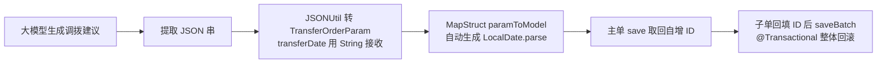

# 5-16 状态机 JSON 数据解析与入库节点开发

## 【学习目标】

- 复现并定位 MapStruct 的 LocalDate 转换异常：会读 convert 层异常栈，知道去 `target/generated-sources` 对照生成代码。
- 掌握修复方案：`param` 用 `String` 接收日期，MapStruct 自动生成 `LocalDate.parse`。
- 理解「JSON 提取 → 转换 → 入库」全链路的验证方法：日志、SQL、脏数据清理、预期字段核对。
- 建立测试卫生习惯：验证前清理脏数据，验证后逐项对照设计意图（包括「应有的空值」）。

## 【正文】

### 1. 还原坑：param 用 LocalDate 接收

接下来启动项目做测试。不过在测试之前先说明一点：之前埋设的坑不小心被提前填上了，现在把它还原回去，`param` 里的调拨日期改回用 `LocalDate` 来接收。

之所以这么改，是因为这里引入了 MapStruct，希望直接从 `param` 层实体转成 model 层实体，而 model 层里的调拨日期定义的就是 `LocalDate`，所以顺手把 `param` 层也定义成了 `LocalDate`：

```java
public class TransferOrderParam {
    private Integer sourceWarehouseId;
    private Integer targetWarehouseId;
    private Integer status;
    private Integer transferType;
    private LocalDate transferDate;  // 关键字段，可能为null
    private String comment;
    private String createdBy;
    private List<TransferOrderItemParam> items;
}
```

图省事、让 `param` 实体上的字段类型直接和 model 层完全匹配，会出什么问题？启动之后跑一遍就知道了。

### 2. 启动调用，异常出现

项目启动完成，开始调用。工作流依次执行：大模型生成结果、提取 JSON 串……提取完成之后马上就报错了。

看异常信息，这是一个 convert 层的报错：

```
java.lang.String com.carl.ai.transfer.domain.param.TransferOrderParam
...
at com.carl.ai.transfer.domain.convert.TransferOrderConvertImpl.transferOrderParamToModel(TransferOrderConvertImpl.java:37)
...
```

定位一下，报错就出在 `TransferOrderConvert` 转换层，具体是 MapStruct 生成的实现类 `TransferOrderConvertImpl`：

```java
public class TransferOrderConvertImpl implements TransferOrderConvert {
    public BbTransferOrder transferOrderParamToModel(TransferOrderParam param) {
        BbTransferOrder bbTransferOrder = new BbTransferOrder();
        bbTransferOrder.setStatus(param.getStatus());
        bbTransferOrder.setTransferType(param.getTransferType());
        bbTransferOrder.setTransferDate(LocalDate.parse(param.getTransferDate())); // 异常发生点
        bbTransferOrder.setComment(param.getComment());
        bbTransferOrder.setCreatedBy(param.getCreatedBy());
        return bbTransferOrder;
    }
}
```

具体原因日志里写得很清楚：把日期转成 `LocalDate` 的时候出了问题，MapStruct 生成的代码会调用 `LocalDate.parse`，而 `parse` 接收的其实是一个字符串：

```java
public static LocalDate parse(@NonNull CharSequence text) {
    return parse(text, DateTimeFormatter.ISO_LOCAL_DATE);
}

public static LocalDate parse(@NonNull CharSequence text, @NonNull DateTimeFormatter formatter) {
    Objects.requireNonNull(formatter, "formatter");
    return formatter.parse(text, LocalDate::from);
}
```

但这里传过来的不是字符串，而是一个 `LocalDate` 对象，于是转换失败。

**读栈的三个要点。** 第一，栈顶落在 `TransferOrderConvertImpl` 而不是业务代码，MapStruct 的实现在编译期生成，问题出在「生成的转换实现」，手写的 `TransferOrderConvert` 接口只是声明；第二，行号 `TransferOrderConvertImpl.java:37` 直接指向生成代码中的日期转换行，顺藤就能看到 `LocalDate.parse(param.getTransferDate())`；第三，`parse` 的签名只接受 `CharSequence`，运行期传入的却是对象，根因是 `param` 侧把日期声明成了对象而非字符串。生成代码位于 `target/generated-sources` 目录，排查时打开对照，比盯着异常栈猜要快得多。

类型错位的传播链可以这样理解：`param` 声明 `LocalDate` → 生成的实现对日期字段按「待解析的日期串」处理、调用 `LocalDate.parse` → 运行期传入的是 `LocalDate` 对象 → `parse(CharSequence)` 收到对象 → 抛异常。同一处 `parse` 调用，入参是字符串就成功、是对象就失败，差别全在 `param` 的字段声明上。

### 3. 修复：param 用字符串接收日期

正常来讲，这里应该传一个字符串才对：大模型返回的 JSON 里，日期就是一个字符串，所以应该用字符串来接收；然后 MapStruct 把字符串转成 `LocalDate` 时是没问题的，它会调用 `LocalDate.parse`，`parse` 接收字符串，转换就能成功。只要 `param` 里用字符串接收，MapStruct 生成的 `TransferOrderConvertImpl` 里 `LocalDate.parse(param.getTransferDate())` 就能正常工作。

将该类型改回字符串之后重启项目。调用之前先把数据库里的脏数据清一下：主表里有一条之前测试保存的业务单据，删掉；子表里最后面的几条记录也一并删除，确认清理干净之后再发起调用。

清理脏数据不是洁癖：入库验证的判据是「新产生的记录条数与内容」，旧数据会干扰判断，尤其是按时间倒序查看「最新一条」的时候。测试卫生等于可复现的验证，同样的输入，必须能看出「这次调用到底写进去了什么」。

### 4. 验证结果

经过一段等待，整个工作流终于执行完毕。日志里可以看到两条 `insert` 语句：第一条插入主表成功，第二条插入子表成功。到数据库里刷新，主表数据已经进来了，审核人为空也是符合预期的，这里确实没有生成审核人；再刷新子表，最新的这条调拨单明细也在，就是华北仓那条记录。

「符合预期的空」同样是验证点：审核人字段按设计留空，这里如果非空反而是异常。验证时逐项对照设计意图，而不是只看「没报错、有数据」就收工。

到这里算是补了一个小坑：使用 MapStruct 做 POJO 之间转换时，如果两边都用 `LocalDate`、想让两个 `LocalDate` 直接做转换，是会报错的，必须用字符串来接收，再转成 `LocalDate`。

到此，「自动生成调拨单」节点的全链路闭环：



链路上每一步的失败模式都不同：提取步失败是模型输出不合规；转换步失败是类型声明错位（本节修复的坑）；入库步失败靠事务回滚保证主子表一致。分层之后，排查时先看日志停在哪一步，再决定往哪查。

至此，自动生成调拨单节点也开发完毕了。从下一小节开始，进入面试官经常会问到的点以及项目的亮点部分，人类反馈和条件边的开发与讲解。

## 【易错点 / 面试题】

1. **面试题：MapStruct 转换日期字段的规则是什么？** 依据两侧声明类型生成代码：`param` 侧 `String`、model 侧 `LocalDate`，生成 `LocalDate.parse`；两侧都声明 `LocalDate` 时，生成的实现与运行期类型错位，`parse` 收到对象即失败。结论：模型输出侧（`param`）一律用 `String` 接日期，转换交给 MapStruct。
2. **面试题：convert 层报错怎么定位？** 看栈顶落在 `XxxConvertImpl` 而不是接口：MapStruct 的实现在编译期生成，问题多在「字段声明」而非接口签名。打开 `target/generated-sources` 下的生成类，对照报错行号，根因通常一眼可见，这也是「会用编译期生成工具」和「只会用」的分水岭。
3. **易错点：不清理脏数据就验证入库。** 旧记录会干扰「最新一条」判断，导致误判修复是否生效；验证前先清理，验证后逐项对照预期（条数、关键字段、应有的空值），三者齐了才算通过。

## 【小结】

本节复现并修复了 MapStruct 的 LocalDate 坑：`param` 日期改回 `String` 后，`LocalDate.parse(param.getTransferDate())` 正常工作，两条 `insert` 验证主子表入库成功，审核人按设计留空。「提取 JSON → 转 `param` → MapStruct 转 model → 事务入库」的链路至此闭环。

工程侧该链路的可运行复刻见 `980-demo/src/main/java/com/carl/ai/transfer/extract/TransferOrderExtractor.java`（用 `ChatClient` 的 `call().entity(TransferOrderParam.class)` 完成「模型输出 → POJO」，底层即 `BeanOutputConverter` 的结构化输出能力）、`980-demo/src/main/java/com/carl/ai/transfer/convert/TransferOrderConvert.java` 与 `980-demo/src/main/java/com/carl/ai/transfer/service/TransferOrderServiceImpl.java`；转换层的 LocalDate 边界有单测 `TransferOrderConvertTest` 兜底，日期类型声明被改错会在构建期暴露。

下一篇进入人类反馈与条件边，面试官常问的工程亮点。
