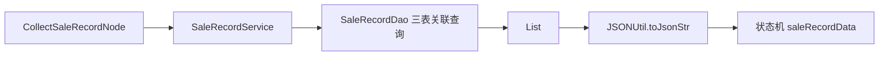

# 5-2 构建商品实时数据流

## 【学习目标】

- 明确「喂给大模型的数据」如何决定 VO 设计：商品维度、仓库维度、时间维度、汇总指标。
- 掌握手写 DAO 层：`@Mapper` + `@Select` + `@Param` 完成多表关联聚合查询，以及 `@Param` 不能省的原因。
- 理解查询结果为什么必须 JSON 化之后再进状态机。
- 能对照 VO 字段与 SQL 别名，保证 MyBatis 自动映射不丢字段。

## 【正文】

### 1. 定义 SaleRecordVo

按照前面的分析，先明确要把哪些数据告诉大模型，然后据此定义实体。

商品维度肯定需要商品 ID、商品代码、商品名称；仓库维度需要仓库 ID、仓库代码、仓库名字；此外还要有总计的销售数量。于是先定义 `Integer` 类型的 `productId`、`String` 类型的 `productCode` 与 `productName`。

同时，既然 SQL 里是按年份分组的，最好把年和季度也一并返回，让大模型知道具体是哪一年、哪一个季度的销售情况。季度是 `Integer`，因为季度是通过 MySQL 的 `QUARTER` 函数返回的，函数返回值就是 `Integer` 类型，字段名取 `quarter`。

再往下是仓库的基本信息：`warehouseId`、`warehouseCode`、`warehouseName`。最后一个字段是总计销售数量，用 `Long` 类型来存，字段名 `saleQty`。

对应的 VO 定义如下：

```java
package com.carl.ai.transfer.domain.vo;
import lombok.Data;

@Data
public class SaleRecordVo {
    private Integer productId;
    private String productCode;
    private String productName;
    private Integer year;
    private Integer quarter;
    private String warehouseCode;
    private Long totalSaleQty;
}
```

字段设计的依据是「模型要做预测，需要哪些事实」：什么商品（`productId`/`productCode`/`productName`）、在哪个仓（`warehouseId`/`warehouseCode`/`warehouseName`）、什么时间段（`year`/`quarter`）、卖了多少（`saleQty`）。代码与名称并存（id 与 code/name）不是冗余：code 与 name 让模型输出可读，id 供系统侧关联。

需要说明：本代码块与正文描述存在两处未同步，正文要求仓库维度包含 `warehouseId` 与 `warehouseName`，块内只有 `warehouseCode`；正文说总计字段名为 `saleQty`，块内为 `totalSaleQty`（与下文 SQL 别名一致的是 `saleQty`）。以文字描述与 SQL 别名为准补齐，是使用讲稿代码时的必要自查。

VO 字段与 SQL 列的对应关系：

| VO 字段 | SQL 来源 | 是否起别名 | 原因 |
|---|---|---|---|
| `productId` | `p.id` | `as productId` | 列名下划线转驼峰，需显式别名 |
| `productCode` | `p.product_code` | 不需要 | 列名与字段一致 |
| `productName` | `p.product_name` | 不需要 | 列名与字段一致 |
| `year` | `YEAR(s.sale_date)` | `as year` | 函数结果无列名，必须起别名 |
| `quarter` | `QUARTER(s.sale_date)` | `as quarter` | 同上 |
| `warehouseId` | `w.id` | `as warehouseId` | 同上 |
| `warehouseCode` | `w.code` | 不需要 | 列名与字段一致 |
| `warehouseName` | `w.name` | 不需要 | 列名与字段一致 |
| `saleQty` | `SUM(...)` | `as saleQty` | 聚合列无列名，必须起别名 |

VO 定义好之后，接口的返回值就要换成 `SaleRecordVo` 了。接下来去实现类里做修改。

### 2. 手写 DAO 层与复杂 SQL

因为这里涉及比较复杂的查询，不再使用 MyBatis Plus 提供的内置方法，而是自己再写一个 DAO 层：通过 MyBatis Plus 的注解扫描，手动编写这条比较复杂的 SQL。先建一个 `dao` 包，在里面创建接口 `SaleRecordDao`，同样需要加上 `@Mapper` 注解让它能被扫描到。

接口里定义方法，返回值就是刚才定义的 VO，方法名 `collectSaleRecordDataByProductId`，接收 `Integer` 类型的商品 ID。这里之前已经安装过 MyBatisX 插件，直接点中参数按 `Alt + Enter`，插件会自动补上参数注解 `@Param`。

`@Param` 不能省：SQL 里用 `#{productId}` 占位，MyBatis 靠 `@Param` 把方法参数名与占位名绑定；Java 编译后不保留参数名，没有 `@Param` 会抛「Parameter 'productId' not found」。MyBatisX 的自动补全省的是手敲，补出来的注解本身不可省略。

接着手动写 SQL，使用 `@Select` 注解，注意选的一定是 MyBatis 的包（`org.apache.ibatis.annotations.Select`）。SQL 语句在文档中其实已经提供了，但还是带着一步一步写一遍，印象会更深刻。

先确定查哪些表。结合数据库表结构，这里肯定不是单表查询，而是多表关联：先查销售记录表 `bb_sales_record`（别名 `s`），再关联商品表 `bb_product`（别名 `p`），关联条件是销售记录里的 `product_id` 等于商品表的 `id`；然后继续关联仓库表 `bb_warehouse`（别名 `w`），通过销售记录表里的 `warehouse_id` 等于仓库表的 `id`。关联这三张表就足够实现需求了。

然后写具体查哪些字段。商品 ID 在表里的列名是 `product_id`，和 VO 字段名不一致，所以要起别名 `productId`；`product_code`、`product_name` 这两个列名和 VO 一致，不需要起别名。

年份借助 MySQL 的 `YEAR` 函数，取销售记录表里的 `sale_date`（销售日期），别名为 `year`；季度同理使用 `QUARTER` 函数，同样基于 `sale_date` 查询，别名为 `quarter`。

再往下是仓库相关字段：`w.id` 取别名 `warehouseId`，`w.code`、`w.name` 与 VO 字段名一致，不需要别名，最后补上仓库名称。

到这一步基础信息都齐了，唯一缺的是总计销售数量，用 `SUM` 函数对销售记录表里的销售数量做累加即可，别名为 `saleQty`。

SQL 的主体写完了，还差 `WHERE` 条件和 `GROUP BY`，这一步差点漏掉。查询是按商品维度来的，所以 `WHERE` 条件是商品表的 `id` 等于传进来的商品 ID；`GROUP BY` 则按前面说的四个维度分组：商品 ID、年份、季度以及仓库 ID。至此这条 SQL 就完整了：

```java
package com.carl.ai.transfer.dao;
import org.apache.ibatis.annotations.Mapper;
import org.apache.ibatis.annotations.Param;
import org.apache.ibatis.annotations.Select;
import java.util.List;

@Mapper
public interface SaleRecordDao {
    @Select("""
        SELECT
            p.id as productId,
            p.product_code,
            p.product_name,
            YEAR(s.sale_date) as year,
            QUARTER(s.sale_date) as quarter
        FROM bb_sales_record s
        JOIN bb_product p ON s.product_id = p.id
        JOIN bb_warehouse w ON s.warehouse_id = w.id
        WHERE s.product_id = #{productId}
        """)
    List<SaleRecordVo> collectSaleRecordDataByProductId(@Param("productId") Integer productId);
}
```

对照正文描述，这段 SQL 草稿还缺三部分：仓库字段（`w.id as warehouseId`、`w.code`、`w.name`）、合计列 `SUM(...) as saleQty`、`GROUP BY` 子句。写完多表聚合 SQL 的自查口诀：列齐否、函数结果起别名否、出现聚合必有 `GROUP BY` 否、`WHERE` 与分组维度一致否。

为什么这类查询不用 MyBatis Plus 内置方法：`lambdaQuery` 面向单表条件构造，三表关联加函数加聚合超出其表达范围，手写 SQL 反而更直观，也便于 DBA review。MyBatis Plus 的 `@Select` 与 XML 二选一即可，简单语句用注解，复杂动态语句再考虑 XML，不必一刀切。

### 3. 节点里调用并转成 JSON

回到节点里，注入 `SaleRecordService`（声明为 `final`，通过构造方法注入）之后就可以调用它的方法了：通过 `Integer.parseInt` 把状态机里的商品 ID 转成 `Integer` 传进去，就拿到了销售数据集合：

```java
public class CollectSaleRecordNode implements NodeAction {
    private final SaleRecordService saleRecordService;
    private final BbInventoryService bbInventoryService;

    @Override
    public Map<String, Object> apply(OverallState state) throws Exception {
        String productId = state.value(key: "productId", defaultValue: "");
        if (StringUtils.isBlank(productId)) {
            return Map.of();
        }
        List<SaleRecordVo> saleRecordVos = saleRecordService.collectSaleRecordDataByProductId(Integer.parseInt(productId));
        return Map.of("saleRecordData", saleRecordVos);
    }
}
```

这段草稿里 `state.value(key: "productId", defaultValue: "")` 是 Kotlin 风格的命名参数写法，Java 里应为 `state.value("productId", "")`（下一节的正式代码即标准写法）；节点字段 `bbInventoryService` 已声明但本节尚未使用，属于为第三步预留。使用讲稿代码时，「能讲清意图」与「能直接编译」是两回事，后者需要自己按语言规范补齐。

拿到集合之后要想一个问题：能直接把 `List` 集合丢给大模型吗？这样不太好，数据结构对大模型来说不够清晰。所以这里选择用 JSON 做一次转换，把数据集合转成一个 JSON 格式的字符串，借助 Hutool 工具包的 `JSONUtil.toJsonStr`，把集合传进去即可。

JSON 化的理由有三层：模型侧只认文本，JSON 是它最熟悉的紧凑结构化格式，字段名自带语义；提示词里拼装 JSON 比拼装对象序列化结果更可控，能避开框架噪声；日志排查基于同一份 JSON 文本，「模型看到了什么」与「日志里记了什么」完全一致，出问题可逐字比对。

转换出来的字符串要放进状态机，起的 key 名就用「查询历史销售数据」的语义来命名（图的 key 定义中为 `saleRecordData`，与 5-3 保持一致）。这是节点要返回的第一个 key。为了方便排查，这里照例加上日志注解，用 `log.info` 把最终生成的内容打印出来。到这里第二步就完成了。



### 4. 第三步：查询当前库存数据

接下来编写第三步，库存数据。这一步不需要自己单独写 DAO 层，直接使用 MyBatis Plus 自动生成的、位于 `base` 包下的 Service 就能实现，但前提是要先把它注入进来。查的是库存信息，所以注入的是 `BbInventoryService`，同样通过构造方法注入。

使用方式上，此处要查的是一个集合，而不是单条，因为需要知道该商品在所有仓库中的库存情况，它可能不只存在于一个仓库，所以用 `list` 方法查询集合。构造查询条件时写一个 lambda：`wrapper.lambdaQuery()`，只需要一个 `where` 条件即可。

「什么时候手写 SQL、什么时候用 ORM」在这两步之间划出了界线：多表聚合手写，单表条件查询用 MyBatis Plus。判断标准是表达成本，不是技术高低，用 `lambdaQuery` 硬写三表关联，可读性反而更差。

## 【易错点 / 面试题】

1. **面试题：为什么把查询结果 JSON 化再传给大模型？** 模型侧只认文本；JSON 保留结构与字段语义，比拼接自然语言更省 token、歧义更少。日志排查也基于同一份 JSON 文本，模型输入可复现。
2. **易错点：SQL 别名与 VO 字段不一致，映射静默丢字段。** 下划线列名、函数结果、聚合列都必须起与 VO 同名的别名（驼峰），否则 MyBatis 映射不到，字段为 `null` 且不报错，直到模型拿到缺字段的数据，输出质量下降，才会被发现。
3. **面试题：多表聚合为什么不用 MyBatis Plus 的 `lambdaQuery`？** 三表关联加 `YEAR`/`QUARTER` 函数加 `SUM` 聚合超出条件构造器的表达范围；`@Select` 手写 SQL 更直观，也便于 review 执行计划。

## 【小结】

本节完成商品实时数据流的采集：按「告诉模型什么」定义 `SaleRecordVo`，手写 `SaleRecordDao` 完成三表关联与聚合，节点内 `Integer.parseInt` 转换商品 ID、查询结果经 `JSONUtil.toJsonStr` 放入状态机，并用 MyBatis Plus 完成当前库存查询。

VO 字段、SQL 别名、状态机 key 三者的命名一致性，是这类采集节点的生命线。模型调用侧「文本进、POJO 出」的写法可对照 `980-demo/src/main/java/com/carl/ai/transfer/extract/TransferOrderExtractor.java`（`ChatClient` + `call().entity()`，底层即 `BeanOutputConverter`）。

下一篇把两个查询注入图、接入 `saleRecordDataNode` 并实测。
