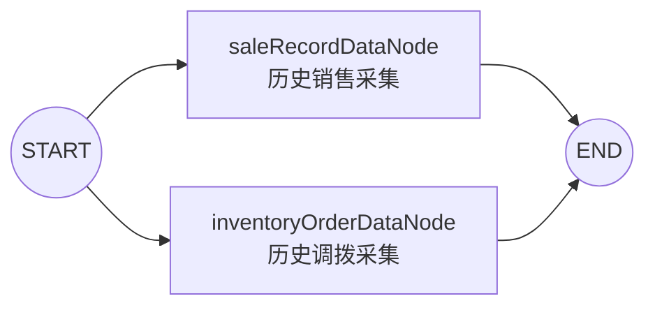

# 5-4 构建库存实时数据流，为AI决策引擎提供精准弹药

## 【学习目标】

- 动手前先定义「交给大模型的数据口径」：历史调拨数据的字段由分析目标反推，而非边写边猜
- 掌握在 Spring AI Alibaba Graph 中定义状态机 key（`ReplaceStrategy`）与采集节点（`NodeAction`）的标准姿势
- 独立完成 `CollectInventoryOrderNode` + Service + DAO 的分层搭建，写出主子表关联、仓库表两次自关联的聚合 SQL

## 【正文】

### 一、先想清楚：要把什么数据交给大模型

调拨建议的质量上限，在写下第一行代码之前就已经决定了，它取决于投喂给模型的前置上下文。这一节的任务是构建库存调拨实时数据流：系统收到商品 ID 后，查询该商品在历史当中的库存调拨情况，把这部分数据交给预测节点，让大模型做分析。动手之前先把产出物定义清楚：一条按「年份 × 季度 × 商品 × 仓库」聚合的历史调拨数据集。

为什么反复强调先定口径？大模型不是查询引擎，它不会主动补全缺失维度：字段漏一个，分析结论可能跑偏；字段多十个，token 成本线性上涨。数据采集节点的职责，就是把业务分析真正需要的「弹药」精准备齐，多一枪浪费，少一枪误事。

### 二、定义状态机 key 与节点

与上一节销售数据采集节点的开发流程一致：先确定往状态机里放什么 key。既然要查询商品对应的历史调拨情况，就一定会生成一份历史调拨的数据，所以提前把 key 命名为 `inventoryOrderData`，届时直接写入即可，继续使用替换策略 `ReplaceStrategy`。

选替换策略而非追加策略的理由：采集节点每次执行产出的都是该商品的完整数据集，语义上是「全量覆盖」；两条并行分支写入的是不同 key，替换策略下互不干扰。

节点类命名为 `CollectInventoryOrderNode`，实现 `NodeAction` 并重写 `apply` 方法，在方法里编写业务逻辑：

```java
public class CollectInventoryOrderNode implements NodeAction {
    @Override
    public Map<String, Object> apply(OverallState state) throws Exception {
        return Map.of();
    }
}
```

`NodeAction` 是 Spring AI Alibaba Graph 中节点的最小契约：入参 `OverallState` 是全局状态，可按 key 读取上游节点写入的数据；返回值是要合并进状态机的增量 `Map`。返回空 `Map` 表示当前节点不产生新状态，属于合法出口。

业务逻辑分两步：第一步从状态机里取出商品 ID；第二步写 SQL 查询该商品对应的历史调拨情况。两步都要经过 Service 层，所以先把 Service 与 DAO 建起来。

### 三、创建 Service 与 DAO

写 SQL 肯定要调用 Service 层来实现，但目前尚不存在对应 Service，所以先创建：在 `service` 包下定义接口 `InventoryOrderService`，再创建实现类 `InventoryOrderServiceImpl`，加上 `@Service` 注解和 slf4j 的日志注解：

```java
public interface InventoryOrderService {
    List<InventoryOrderVo> collectInventoryOrderData(@Param("productId") Integer productId);
}
```

历史调拨查询同样涉及比较复杂的 SQL，需要手动编写，所以在 `dao` 包下再创建一个对应的 DAO 接口 `InventoryOrderDao`，务必加上 `@Mapper` 注解，MyBatis 的 Mapper 扫描依赖该注解识别接口，漏掉它，Bean 注册阶段直接报找不到 Mapper。

### 四、确定返回给大模型的字段

接口里定义方法，返回结果是什么？这就要结合表结构来思考：库存调拨有主表和子表两张表，肯定是基于这两张主子表的数据来查询。最终要返回给大模型的内容包括商品信息，商品名称、商品代码；主表里有调拨日期，所以还要返回年份和季度；子表里有调拨数量，所以还要返回实际的调拨数量。

换言之，按商品查询历史调拨情况，和按商品查询历史销售情况非常相像，都是通过对应的维度来聚合：年份、季度、商品三个维度。这里要不要加仓库？还是要加上仓库，不加就无法知道商品从哪个仓库调出、又调拨到哪里。所以加上仓库维度是没问题的，这样一来它和之前写的查询历史销售记录就非常相似了。

思路明确了就可以定义对应的 VO。创建 `InventoryOrderVo`，加上 `@Data` 注解，定义它需要具备的属性：首先肯定要存商品的基本数据，`productId`、`productCode`、`productName`；其次是年份和季度；再往下是总的库存调拨数量，字段叫 `totalTransferQty`；然后是仓库的基本信息，记录 `sourceWarehouseId`，也就是从哪个仓库调出，以及对应的 `sourceWarehouseCode`、`sourceWarehouseName`；还有调往哪个仓库，也就是 `targetWarehouseId` 以及对应的 `targetWarehouseCode`、`targetWarehouseName`，这几个编码和名称字段都用 `String` 类型。

VO 字段与后续用途强相关：编码、名称用 `String` 是给大模型看的，模型对 `WH001` 这串字符的理解，远好过对一个裸 ID 数字的猜测；数量字段单独聚合，是因为子表一行一个商品明细，主从之间是一对多，不聚合就无法回答「这批调拨总共搬了多少」。

VO 定义好之后，Service 里就可以写方法了：返回 `List<InventoryOrderVo>`，方法名 `collectInventoryOrderDataByProductId`，接收 `Integer` 类型的 `productId`。然后到实现类里做实现。

### 五、编写多表关联 SQL

实现的时候，这条 SQL 比较复杂，希望放到 DAO 层手动编写，所以在 DAO 里也创建同名方法，同样接收 `Integer` 类型的 `productId`。点中参数按 `Alt + Enter`，让插件自动生成参数注解，然后通过 `@Select` 编写 SQL：

```java
@Select("SELECT " +
        "t1.id, t1.order_no, t1.source_warehouse, t1.target_warehouse, t1.status, t1.transfer_type, t1.transfer_date, t1.comment " +
        "FROM bb_transfer.transfer_order t1 " +
        "JOIN bb_transfer.transfer_order_item t2 ON t1.id = t2.transfer_order_id " +
        "JOIN bb_product p ON t2.product_id = p.id " +
        "WHERE p.product_id = #{productId}")
List<InventoryOrderVo> collectInventoryOrderDataByProductId(@Param("productId") Integer productId);
```

先明确要查哪些表：第一张是调拨单主表 `bb_transfer_order`；然后要连查它对应的子表 `bb_transfer_order_item`，两者通过主表的 `id` 与子表的 `transfer_order_id` 关联；接下来还要关联商品表，关联条件是子表的 `product_id` 等于商品表的 `id`。

还要继续关联仓库表，而且需要关联两次：第一次关联出库的源仓库，用主表里的 `source_warehouse_id` 对应仓库表的 `id`；第二次再关联一次仓库表，用子表里的 `target_warehouse_id` 连接目标仓库的 `id`。

仓库表为什么必须关联两次？调拨单同时携带源仓库与目标仓库两个外键，且都指向同一张仓库表，只能起两个别名分别 JOIN。这也解释了「一调多」场景下的模型局限：一条主单配多个目标时，子表结构要能表达多组源目标对，当前主子表设计只覆盖「一调一」。

这一版 SQL 是迭代起点：字段清单、`SUM` 聚合、`GROUP BY`、状态过滤都还没写进去；图定义的草图同样处于半成品，下一节继续补全。

图的定义在这时大致是这样：

```java
public class GraphConfig {
    @Resource
    private IBInventoryService bbInventoryService;

    public CompiledGraph graph() throws GraphStateException {
        KeyStrategyFactory keyStrategyFactory = new KeyStrategyFactory();
        return Map<String, KeyStrategy> keyStrategyFactory.new ReplaceStrategy();
    }

    @Override
    public Map<String, KeyStrategy> apply() {
        return Map.of(
            "productCode", new ReplaceStrategy(),
            "saleRecordData", new ReplaceStrategy()
        );
    }

    StateGraph stateGraph = new StateGraph(name: "inventoryTransferGraph", keyStrategyFactory);
    stateGraph.addMode("saleRecordDataMode", AsyncNodeAction.async_node(new CollectSaleRecordNode(saleRecordService)));
    stateGraph.addEdge(StateGraph.START, "saleRecordDataMode");
    stateGraph.addEdge("saleRecordDataMode", StateGraph.END);
    return stateGraph.compile();
}
```

如实说明：这段是课程录像中的中间态草稿，存在明显残缺，`graph()` 方法声明的返回类型是 `CompiledGraph`，却返回了一个 `Map`；`new StateGraph(name: ...)` 是伪语法；`addMode` 应为 `addNode`；新定义的 `inventoryOrderData` key 还没有加入 `apply()` 的策略表。它如实记录「图定义正从上一章的销售数据流扩建成库存调拨流」的演进痕迹，作为讲稿快照保留，不代表可编译的成品，补全后的版本见下一节。

值得注意的是 `apply()` 里这张策略表：`KeyStrategyFactory` 为每个状态机 key 声明合并策略，`productCode`、`saleRecordData` 用 `ReplaceStrategy`（新值覆盖旧值）。`inventoryOrderData` 补进来时同样遵循替换语义，采集节点的产出是完整快照，不是增量碎片。

表都关联完了，接下来该确定具体查哪些字段，这节课内容已经比较长了，下一节接着写。

### 六、采集节点在图中的位置



演示阶段两条分支并行采集、各自直达结束；后续章节预测节点接入后，两个分支将汇合到预测节点，Fan-in 结构在 5-6 展开。

## 【易错点 / 面试题】

1. **面试题：`ReplaceStrategy` 和 `AppendStrategy` 怎么选？** 看节点产出的语义：全量快照用替换，增量事件用追加。采集节点每次执行都重算该商品的完整历史调拨集，若用追加策略，重跑或多次触发会把多份 JSON 拼接在一起，下游反序列化直接失败。这类错误代码能跑、结果静默损坏，是最难在联调中暴露的一类。
2. **面试题：仓库表为什么要 JOIN 两次？** 调拨单同时存在源仓库与目标仓库两个外键，都指向同一张仓库表，必须起不同别名分别关联。可延伸讨论：若要支持「一个仓库调到两个仓库」，主子表模型该如何调整（子表按「源-目标对」建模）。
3. **采集哪些字段由谁决定？** 这是开发与业务的协同问题：口径来自业务部门的分析思路，而不是技术侧的臆测。面试聊到需求驱动型节点时，「先问业务平时怎么分析，再反推 SQL 维度」是显著加分的回答。

工程侧参考：`980-demo/src/main/java/com/carl/ai/transfer/repository/BbTransferOrderRepository.java` 演示了同构的调拨单主从表存取（H2 内存库 + MyBatis-Plus），`service/TransferOrderServiceImpl.java` 演示采集结果如何编排进后续转换链路，可与本节的 Service/DAO 分层对照阅读。

## 【小结】

本节搭好了库存调拨实时数据流的骨架：`inventoryOrderData` key、`CollectInventoryOrderNode` 空壳、Service/DAO 分层，以及主子表加仓库双关联的 SQL 雏形。下一节把这条 SQL 补全为带聚合、分组与状态过滤的最终版本，完成采集节点的返回值与图注册，并跑通节点测试。再往后，采集到的数据将汇入预测节点，第一次真正与大模型对话。
