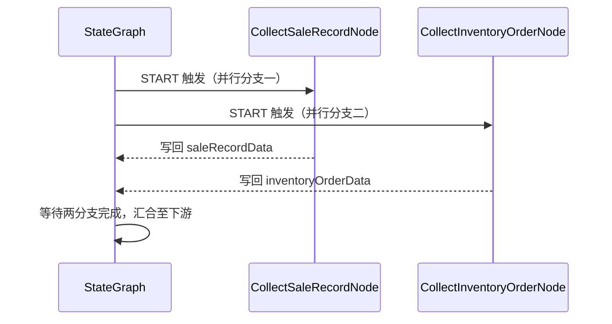

# 5-5 完善库存实时数据流并执行节点测试

## 【学习目标】

- 补全采集 SQL：字段别名对齐 VO、`YEAR`/`QUARTER` 取数、`SUM` 聚合、`GROUP BY` 分组、状态过滤
- 完成 `CollectInventoryOrderNode` 的数据回填：从 `OverallState` 取参、判空、`JSONUtil` 序列化、写回状态机
- 在图定义中注册节点与边，复现并修复「边指向不存在的节点」的典型错误，用日志与数据库双通道核对数据

## 【正文】

### 一、补全采集 SQL

继续把这条 SQL 写完。首先肯定要查询商品的基本信息，但要注意和 VO 实体对应，需要加上别名：`product_code`、`product_name` 这些商品基础数据都要查出来。

接着查询年份和季度：使用 `YEAR` 函数，从调拨单主单的调拨日期上取年份；季度同理，用 `QUARTER` 函数基于同一个调拨日期取，别名为 `quarter`。

然后是仓库的基本数据：先查调拨主单里的 `source_warehouse_id`，即调拨出库的仓库，再查它的 `warehouse_code` 和名称，分别起别名为源仓库的编码和名称；目标侧同理，还有 `target_warehouse_id` 以及对应的 `target_warehouse_code`、`target_warehouse_name`。

字段写完之后加 `WHERE` 条件：商品表的 `id` 等于传过来的商品 ID。最后需要 `GROUP BY` 分组：首先是商品 ID，其次是年份和季度，再加上源仓库 ID 和目标仓库 ID。这样这条 SQL 查询就完整了：

```java
@Mapper
public interface InventoryOrderDao {
    @Select("SELECT p.id as productId, p.product_name, YEAR(o.transfer_date) as year, QUARTER(o.transfer_date) as quarter, o.source_warehouse_id, o.target_warehouse_id, o.quantity FROM bb_transfer_order o JOIN bb_transfer_order_item i on o.id = i.transfer_order_id JOIN bb_product p on i.product_id = p.id JOIN bb_warehouse w on o.target_warehouse_id = w.id")
    List<InventoryOrderDto> collectInventoryOrderDataByProductId(@Param("productId") Integer productId);
}
```

如实说明：这份落盘 SQL 处于「描述齐全、代码滞后」的中间态，文字里讲到的 `product_code` 别名、仓库编码与名称、`SUM(transfer_quantity)` 聚合、`GROUP BY` 与状态过滤，此刻尚未全部进入 SQL 文本：选的是 `o.quantity` 而非聚合值，`JOIN bb_warehouse w` 关联了目标仓库却没有任何 `w` 的字段入选。随后两轮测试会逐个暴露缺口：先是 `totalTransferQty` 为空，再补状态条件。「先跑通链路、再逐步对齐口径」的节奏，与真实开发中联调数据流的过程一致。

`GROUP BY` 为什么锁定这四个维度？年份、季度决定时间切片；商品 ID 固定单商品分析；源、目标仓库 ID 决定调拨方向。少任何一个维度，聚合总量都会失去业务含义，例如不按仓库分组，「华北调华东」与「华东调华北」的数量会被加总到一起，方向信息丢失，模型还怎么判断该往哪调？

然后到 Service 的实现类里把 DAO 注入进来，直接调用它的方法并把结果返回，格式化一下代码。

### 二、编写采集节点

回到库存调拨数据采集节点，按上面的结果继续编写：

```java
public class CollectInventoryOrderNode implements NodeAction {
    private final InventoryOrderService inventoryOrderService;
    // ...
    @Override
    public Map<String, Object> apply(OverallState state) throws Exception {
        return Map.of();
    }
}
```

节点需要一个属性，也就是我们自己定义的 `InventoryOrderService`，通过构造方法注入。

第一步从状态机里拿到用户触发时传过来的商品 ID，没有的话给空字符串；依然要做判空：如果商品 ID 为空，直接返回一个空的 `Map`；不为空才调用 Service 的查询方法，并把商品 ID 转成 `Integer` 后传入。

查询结果要给大模型，还是通过规范的 JSON 格式投喂，所以依然使用工具包的 `JSONUtil` 转成 JSON 字符串，变量名参考定义的 key 来取。最终把序列化结果更新进状态机，key 同样用前面定义好的。照例再加一个 slf4j 日志注解，在里面打印一份日志。

为什么投喂格式选 JSON 字符串，而不是直接把 List 塞进状态机？三个原因：其一，大模型只认文本，序列化是必经一步，提前做可以避免每个下游节点重复转换；其二，JSON 字符串可直接打进日志，节点测试时人眼可核对；其三，后续节点从状态机取到的就是纯文本，与预测节点的提示词拼装天然衔接。日志打印则是数据流节点的标配，出了问题，第一现场是日志里的 JSON，而不是断点。

### 三、改造图并开始测试

节点写完，到图的定义里将该节点注册：新增节点 `inventoryOrderDataNode`，还是通过 `NodeAction` 的静态方法把实现的节点注册进去。节点需要接收一个 Service，所以在配置里注入 `inventoryOrderService` 并传给它：

```java
public class GraphConfig {
    public CompiledGraph graph() throws KeyStrategyFactory {
        // ...
        StateGraph stateGraph = new StateGraph(name, keyStrategyFactory);
        stateGraph.addNode("saleRecordDataNode", new CollectSaleRecordNode(saleRecordService, bbInventoryOrderService));
        stateGraph.addNode("inventoryOrderDataNode", new CollectInventoryOrderNode(inventoryOrderService));
        stateGraph.addEdge(StateGraph.START, "saleRecordDataNode", StateGraph.END);
        stateGraph.addEdge("saleRecordDataNode", "inventoryOrderDataNode", StateGraph.END);
        return stateGraph.compile();
    }
}
```

如实说明：这段图定义同为中间态草稿，`addEdge` 一次传入三个参数、`graph()` 方法抛出的却是 `KeyStrategyFactory`，都不是最终编译通过的写法；它呈现的是「从单分支销售流扩建为双分支并行采集」的构图思路，最终版本以 5-6 接入预测节点后的图为准。

下面还要改边。按照图的设计，开始节点之后希望并行执行两个分支：一个分支查询销售数据，另一个分支查询历史库存调拨数据。所以直接用开始边连接库存数据采集节点；演示场景下让两个分支都直接连到结束即可，也就是再加一条边，让新建的历史库存调拨数据采集节点连到结束。这样图不用再改动，可以直接测试。

并行分支在 Spring AI Alibaba Graph 中由 `AsyncNodeAction` 承载：两个采集节点互不依赖，各查各的表，分别写回状态机的不同 key。并行相对串行的意义在于总耗时约等于慢的那一支，而不是两支相加，两个查询都在毫秒级时收益不明显，一旦某个查询涉历史大表，差距立刻显形。

启动项目看返回结果，结果报了个错：某条边未被关联到已定义的节点。检查一下发现是加边的时候写错了，应该是让 `START` 连接该节点，而当时写成了 key 的名字，因此定位不到对应节点。改回节点名之后重启，启动成功。

该错误值得记住：`addEdge` 的两个参数都必须是「节点名」，而采集节点的 key（`inventoryOrderData`）与节点名（`inventoryOrderDataNode`）只差一个后缀，手滑就会写错。Graph 在编译期做边校验，报错即暴露拼写问题，属于框架给的早期保护，假如边校验拖到运行期，一个不执行的分支可能静默地让大模型少一份上下文，而表面上看系统一切正常。

### 四、验证数据

再次调用，依然使用商品 1，看有没有数据。已经生成了，返回的数据里第一个 key 是触发时传过来的商品 ID；第二个 key 是历史销售数据采集节点采集到的历史销售情况；还有当前商品对应的库存信息；以及商品对应的历史库存调拨情况，也都拿到了。

回到代码看日志里该节点打印的内容，把 JSON 拷到 `json.cn` 里格式化看：

```json
{
  "inventoryOrderData": [
    {
      "productId": 1,
      "productCode": "P001",
      "productName": "智能手机",
      "year": 2024,
      "quarter": 2,
      "sourceWarehouseId": 1,
      "targetWarehouseId": 2,
      "totalTransferQty": 24,
      "sourceWarehouseName": "华东仓",
      "targetWarehouseName": "华南仓"
    }
  ]
}
```

可以看到是 2 号华东仓调到了华南仓，在 24 年第二季度，但是调拨数量怎么没有？

检查一下代码，发现 SQL 确实遗漏了总计调拨数量。看一下 VO 里该字段叫什么，是 `totalTransferQty`，那就用 `SUM` 函数，对子表里的 `transfer_quantity` 求和，别名取该名称。刚才确实漏掉了，补上之后重启。

重新执行，从日志里取到这次的结果：`totalTransferQty` 有值了，24 年第二季度从华东仓调到华南仓，总计调拨数量 76；25 年第四季度从华北仓调到华东仓，调拨了 11 个，数据都正常。

### 五、核对数据准确性

怎么核查这些数据是否正确？把这条 SQL 拿到数据库里执行一下看看实际结果。执行出来是 4 条记录，而 JSON 里返回的也是 4 条，数量对得上。数值上可以看到 29、24、11、76，通过 SQL 插入脚本生成的数据里会带小数，这里统一转成 `Long` 类型处理，只取整数部分，小数直接丢弃。真实的数据设计中商品数量绝大部分是整数，也可能出现小数，但当前演示只处理整数这种情况，小数不管。最终取到的就是 29、24、11、76 这几个整数，说明结果没问题。

「条数对得上」只是第一层校验：条数一致只证明行没有丢，不能证明每行的值对。严谨做法是逐行比对聚合口径，SQL 里的 `SUM` 与 JSON 里的 `totalTransferQty` 是否同一含义，过滤条件是否一致。这正是要把 SQL 拿到数据库里单独执行的原因。

另外，状态条件也可以补进来：调拨单主单里有一个 `status` 字段，看表结构定义，`status` 为 3 表示已完成，查询时只需要查已完成的调拨单即可，所以可以直接在 SQL 里写死 `order_status = 3`。

加上之后再重启、重新调用，看代码会不会报错。启动成功，执行也没有报错，说明没什么问题。

写死状态值在演示项目里够用，生产环境要斟酌：状态字典一旦调整（例如新增「已撤销」状态），散落各处的魔法值就是隐患。更稳妥的做法是把 `status = 3` 收敛为枚举或常量，并在 SQL 注释里写明字典来源。

最后补充一点：在数据采集节点里，为什么要这么采集、以及怎样采集才更好，这其实是开发部门需要去询问业务部门的。如何更好地做调拨分析、如何更好地采集数据，肯定要问业务部门他们平时是怎么分析的，然后按照他们的思路，把他们需要的前置数据通过 SQL 查出来，再喂给大模型。

### 六、并行采集的执行时序



## 【易错点 / 面试题】

1. **面试题：`GROUP BY` 漏了仓库维度会怎样？** 不同仓库方向的调拨量被加总，大模型拿到一条没有方向感的记录，「从华北调到华东」这类结论无从谈起。这类错误 SQL 能跑、结果静默错误，code review 中最容易漏。
2. **面试题：节点返回空 `Map` 与返回 `null` 有什么区别？** `NodeAction.apply` 的约定是返回要合并进状态机的增量：空 `Map` 表示「无增量」，是合法出口（如商品 ID 判空时提前返回）；返回 `null` 则把合并逻辑推向歧义，属于应当避免的写法。
3. **面试题：如何验证采集节点取数正确？** 三层：日志 JSON 人眼核对；SQL 单独执行比对条数与数值；对聚合字段核对口径（`SUM` 的列、过滤条件）。只做第一层的候选人，往往在生产上第一次数据倾斜就翻车。

工程侧参考：`980-demo/src/main/java/com/carl/ai/transfer/repository/BbTransferOrderRepository.java` 用 MyBatis-Plus 加 H2 内存库演示同构的主从表存取；`service/TransferOrderServiceImpl.java` 演示采集结果如何编排进后续转换链路。

## 【小结】

本节把库存调拨采集链路走通：SQL 补齐字段、聚合、分组与状态过滤；节点完成取参、判空、序列化与回填；图定义注册双分支并行采集；并用日志与数据库双通道核对数据。遗留一个明确缺口，SQL 的文字描述与落盘代码之间仍有字段未对齐，将在接入预测节点后继续收敛。预测引擎如何接入、`call()` 为何超时，见下一节。
