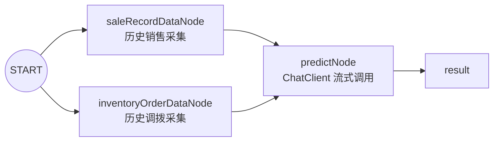

# 5-6 预测引擎开发：接入AI大模型实现调拨建议生成

## 【学习目标】

- 在项目中引入 Ollama `ChatModel` 依赖并完成 `application.yml` 的 AI 参数配置
- 理解 `call()` 与 `stream()` 的语义差异，定位大模型场景下 IO 超时的根因
- 把预测节点接入双分支汇合的状态机，并用流式订阅加 `StringBuilder` 收集完整输出

## 【正文】

### 一、引入大模型依赖

前两小节把库存调拨数据采集写完了，从这里开始终于要和大模型交互了：把采集出来的前置上下文内容喂给大模型，让它做预测分析并生成调拨建议。

开发预测节点之前先想一个问题：当前项目的 POM 文件里没有引入任何大模型的依赖，所以第一步要先加上。之前讲解简单案例时用的是 OpenAI 的 `ChatModel`，这里换一种思路，使用 Ollama 作为 `ChatModel`，模型跑在本机，数据不出内网，适合企业数据敏感的场景。

需要添加两个依赖：一个是 `spring-ai-autoconfigure-model-ollama`，另一个是自动装配 `ChatClient` 的依赖 `spring-ai-autoconfigure-model-chat-client`。这两个依赖在之前的案例里已经讲过为什么要引入，这里就不再重复，区别只是把案例中 OpenAI 的大模型换成了 Ollama 的模型：

```xml
<dependency>
    <groupId>org.springframework.boot</groupId>
    <artifactId>spring-boot-starter-web</artifactId>
</dependency>
<dependency>
    <groupId>com.baomidou</groupId>
    <artifactId>mybatis-plus-spring-boot-starter</artifactId>
    <version>${mybatis-plus.version}</version>
</dependency>
```

如实说明：录屏中 POM 的特写只截取了这两个既有依赖（web starter 与 mybatis-plus），讲解中提到的两个 Spring AI 依赖未在特写里完整呈现。POM 的完整写法以课程源码工程为准，本节不对未截取部分臆造补全。

两个依赖的分工值得说清：前者提供 `OllamaChatModel`，即对话模型的实现；后者提供 `ChatClient` 的自动装配。`ChatClient` 是 Spring AI 对外的统一入口，底层 `ChatModel` 可换（Ollama、OpenAI、通义、DeepSeek），上层调用代码一行不改。「模型可替换」不是口号，而是这两个依赖划出的边界。

### 二、配置 AI 相关参数

依赖加完之后，还要在配置文件里添加 AI 的相关配置：

```yaml
spring:
  application:
    name: ai-transfer
  ai:
    ollama:
      base-url: http://localhost:11434
      chat:
        model: qwen2:0.5b
datasource:
  driver-class-name: com.mysql.cj.jdbc.Driver
  url: jdbc:mysql://localhost:3306/ai-transfer?useUnicode=true&characterEncoding=utf-8&useSSL=false&serverTimezone=Asia/Shanghai
  username: root
  password: 123456
server:
  port: 8074
mybatis-plus:
  configuration:
    log-impl: org.apache.ibatis.logging.stdout.StdOutImpl
logging:
  level:
    root: info
    com.carl.ai.transfer: info
```

配置里要注意模型的选型：之前演示用的是 0.5B 的模型，它只有 300 多兆，是量化版本的小模型。真正的企业项目里不可能用这么小的量化模型，肯定要用比较大的模型，比如 4.9B 的 Ollama 模型，或者 DeepSeek R1 的 7B 模型。这里把模型改成 DeepSeek R1 7B 之后再发起调用，就能看到埋下的坑是什么了。

模型选型的现实约束是三角平衡：效果、时延、资源。0.5B 量化模型几百兆、秒回，但指令遵循差；7B 模型效果明显更好，单次推理耗时按秒甚至十几秒计；云端满血模型效果最好且不受本机性能限制，但涉及数据出境与按量计费。选型没有标准答案，只有与场景的匹配度，这也是面试中被问「你们为什么选 Ollama」时，先讲场景再讲模型的回答顺序。

### 三、IO 超时：call() 的坑

项目启动后调用接口，果然出现了问题：报错信息是 IO 错误、POST 请求超时。

为什么会出现这类错误？因为现在用的是 DeepSeek R1 的 7B 模型，这是一个 4.7GB 的大模型。而调用的时候，采集节点里用的是 `call()`，不是流式输出，也就是串行执行，不需要它边生成边返回，而是让它把最终结果一次性返回。这种情况下大模型一次性返回耗时会很长，就会触发 IO 超时。

从 `ChatClient` 的请求规格上也能看到 `call()` 与 `stream()` 这两种返回方式：

```java
public interface ChatClientRequestSpec {
    ChatClientRequestSpec system(Consumer<PromptSystemSpec> consumer);
    ChatClientRequestSpec user(String text);
    ChatClientRequestSpec user(Resource text);
    ChatClientRequestSpec user(Consumer<PromptUserSpec> consumer);
    CallResponse call();
    StreamResponse stream();
}
```

这段签名把 `ChatClient` 的请求构建过程讲得很清楚：`system(...)` 与 `user(...)` 负责组装提示词，且支持字符串、资源文件、Lambda 三种入参形式；终端操作二选一，`call()` 返回 `CallResponse`，一次性拿全量内容；`stream()` 返回 `StreamResponse`，逐段流式接收。提示词组装与响应获取被清晰分层，这是流畅式 API 的典型特征。

超时的根因不在网络，而在「大模型生成是渐进过程，而 `call()` 要求等待生成彻底结束」。7B 模型生成一段结构化调拨建议，耗时轻松超过 HTTP 客户端默认的 IO 超时；连接早已建立成功，卡住的是响应体的到达。这类超时和网络抖动长得像，排查方向却完全不同，错误栈显示 read timeout 而非 connect timeout，就能把矛头指向生成耗时。

正常应该怎么做？调用这种比较大的模型时，一次性返回的时间肯定比较长，会触发超时，所以要改成流式输出：结果像水一样不断流出来，出来一点就接住一点，等它全部输出完之后，再把接到的完整内容放进状态机，这样就不会超时了。

生产环境还有一层纵深：流式之外，应为 LLM 调用配置显式超时与熔断降级（如 resilience4j 的 `@TimeLimiter` 加 `@CircuitBreaker`），并用 Java 21 虚拟线程承载并发请求。`980-demo` 的 `config/ChatModelConfig` 负责模型 Bean 的多 profile 装配（default 离线、prod 真实端点），`config/OfflineChatModel` 提供不联网的 mock 实现，保证链路在无 Key 环境下可开发、可测试，工程层的超时治理，从这里落地。

### 四、节点与图的接入

预测节点需要先注册到图里：

```java
public class GraphConfig {
    public CompiledGraph graph(ChatClient.Builder chatClientBuilder) throws GraphStateException {
        StateGraph stateGraph = new StateGraph(name: "InventoryTransferGraph", keyStrategyFactory);
        stateGraph.addNode("saleRecordDataNode", new CollectSaleRecordNode(saleRecordService, bbInventoryService));
        stateGraph.addNode("inventoryOrderDataNode", new CollectInventoryOrderNode(inventoryOrderService));
        stateGraph.addNode("predictNode", new PredictNode());
        stateGraph.addEdge(StateGraph.START, "saleRecordDataNode");
        stateGraph.addEdge(StateGraph.START, "inventoryOrderDataNode");
        stateGraph.addEdge("saleRecordDataNode", "predictNode");
        stateGraph.addEdge("inventoryOrderDataNode", "predictNode");
        return stateGraph.compile();
    }
}
```

图的拓扑在这一步发生关键变化：从上一节「两个采集分支各自直达 END」，变为「双分支汇合到预测节点」。两个采集节点都从 `START` 出发并行执行，随后都连向 `predictNode`，Graph 的汇合语义保证预测节点在两个上游都完成后才执行，且能通过 `OverallState` 同时读到 `saleRecordData` 与 `inventoryOrderData` 两份上下文。这就是「先并行采集、后汇合推理」的经典 Fan-in 结构。

注意 `graph()` 方法开始接收 `ChatClient.Builder` 参数：预测节点自身不创建客户端，而是从图配置层注入，与采集节点注入 Service 保持同一套路，节点保持纯粹的业务逻辑，依赖由外层组装。这也是可测试性的来源：测试时换一个 mock 的 Builder，节点逻辑原样跑。

### 五、改成流式输出

具体实现上，把调用从 `call()` 改成 `stream()`，拿到内容之后就要去接：用 `StringBuilder` 来接，配合 `doOnNext` 回调，一旦有内容流出，就追加到 `StringBuilder` 当中；然后一直阻塞等待，直到把所有流出的内容都接收完，最后再把 `sb` 输出出去：

```java
public class PredictNode implements NodeAction {
    @Override
    public Map<String, Object> apply(OverallState state) throws Exception {
        String productData = state.value("productData", defaultValue);
        String saleRecordData = state.value("saleRecordData", defaultValue);
        String inventoryOrderData = state.value("inventoryOrderData", defaultValue);
        Flux<String> content = chatClient.prompt(...);
        StringBuilder sb = new StringBuilder();
        content.subscribe(t -> sb.append(t.text()));
        return Map.of("result", sb.toString());
    }
}
```

如实说明：这段是中间态草稿，`chatClient.prompt(...)` 被省略号占位；`subscribe` 回调里对每个元素调用 `t.text()`，而真实签名里 `stream().content()` 产生的是 `Flux<String>`，元素本身就是文本片段，直接 append 即可；`defaultValue` 也未定义。它如实记录「阻塞等待流式完成再统一返回」的思路，可编译的完整版见下一节改造后的预测节点。

流式收集的要点是「边收边等、收完再走」：`doOnNext` 回调负责累积，等待流关闭的阻塞负责让当前线程停留到生成结束。若不等待就返回，状态机里拿到的只是一句开场白，这类「拿到了、但没拿全」的 Bug 在流式改造中最常见，且极难在自测中发现：调用链全通、日志有输出，只是内容被截断。

改完再来调用一次。因为大模型比较大，加上机器开了很多软件、性能比较差，耗时可能比较久。经过一段时间的等待，它终于生成了，不再报 IO 超时的问题。

不过这段代码里依然存在一个遗留问题，会在下一小节中说明。

遗留问题先埋个伏笔：7B 模型不再超时，输出却开始「听不懂要求」，这正是下一节系统提示词登场的入口。超时是工程问题，提示词是效果问题，两层问题按顺序浮出水面，恰好对应生产调优的两个阶段。

### 六、汇合后的图拓扑



## 【易错点 / 面试题】

1. **面试题：`call()` 和 `stream()` 怎么选？** 看消费者能否渐进处理。要整体 JSON、下游立刻解析，且模型足够快，`call()` 更简单；模型较大或生成内容较长，`stream()` 把一次长等待拆成多次短接收，规避 IO 超时。关键认知：超时的是「读完整个响应」的时间，不是建连时间，错误栈里 read timeout 与 connect timeout 是两个世界。
2. **面试题：`chatClient.prompt(...)` 的省略号里应该有什么？** `system(...)` 与 `user(...)` 的组装，前者是角色与约束，后者是四部分数据（商品 ID、历史销售、历史调拨、当前库存与日期）。提示词组装是下一节的主题，此处留白正是问题伏笔。
3. **本地 Ollama 与云端 API 的差异只是快慢吗？** 不止。还有数据出境合规、并发上限（本机受 CPU 与内存约束）、模型可换性（Ollama 换模型要重新拉取，云端改个配置即可）。企业选型通常是混合架构：敏感数据本地推理，通用能力走云端。

## 【小结】

本节让项目第一次真正调用大模型：补齐 Ollama 依赖与配置，把预测节点接入双分支汇合的图，并把阻塞式 `call()` 改造为流式收集，消掉 7B 模型的 IO 超时。链路已通，输出质量却暴露新问题，模型「听不懂」调拨需求。下一节从系统提示词入手，讲清如何让大模型准确理解意图。
