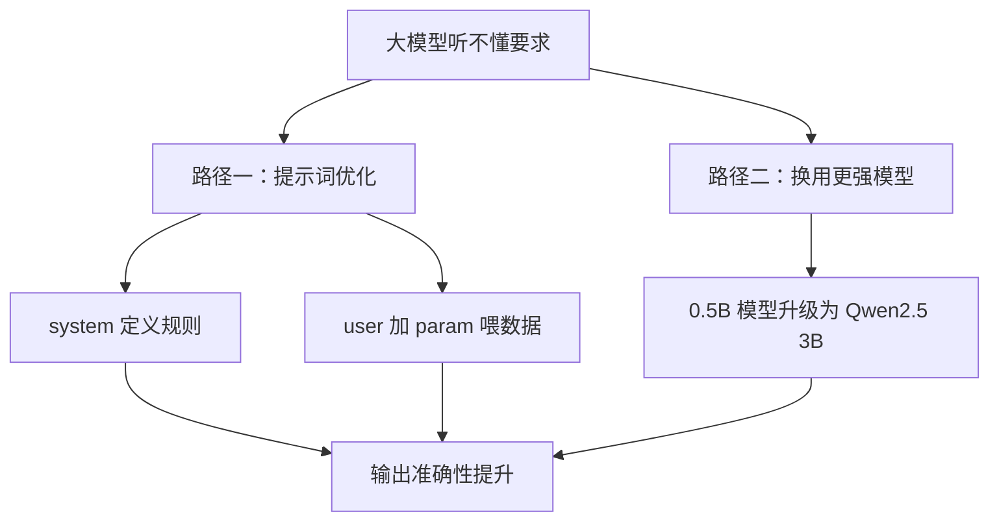

# 5-8 面试加分项：使用多种提示词优化技术实现LLM输出准确性提升

## 【学习目标】

- 把系统提示词与用户提示词组装进 `ChatClient`：`system(...)` 定义规则，`user(...)` 加 `param(...)` 喂数据
- 理解「提示词优化」与「换用更强模型」是提升输出准确率的两条并行路径，以及二者的乘算关系
- 认识 LLM 输出不确定性的来源，建立「多次生成结果不一致」的正确预期与工程应对

## 【正文】

### 一、两条路径的总览

在做代码演示之前，先对 PPT 里的方案做一个扩展。解决「大模型听不懂」涉及两条路：一条是通过提示词优化技术把提示词写好；另一条是使用更加聪明的大模型。刚才用的模型只有 300 多兆，是个量化版本，在原版功能上做了阉割，训练得比较差，智能程度有限。

两条路径不是二选一，而是乘算关系：提示词决定「要求是否讲清楚」，模型决定「要求能否被理解并执行」。0.5B 量化模型即便拿到完美提示词，指令遵循也会打折扣；顶级模型配一句笼统指令，同样产出垃圾。工程上的正确姿势是两边同时投入，这也是面试中展示「系统性优化」叙事结构的骨架：先提示词，后模型，再工程兜底，层层递进而非单点抱怨。



### 二、组装系统提示词与用户提示词

回到代码里，先把系统提示词粘进去。粘贴完成之后，用户输入提示词最好也做相应修改，按照 System 提示词里定义的，让它严格基于商品的历史销售数据、商品的历史库存调拨数据、当前库存状况和日期信息来分析，即通过 `user` 提示词把这四部分数据提供出来。先把多余的转义符号删掉，再格式化一下，代码会好看很多。

之前讲过可以通过 `param` 来传参数，所以这里写成「输入数据」，然后依次给出四部分：商品历史销售数据、商品历史库存调拨数据、当前库存状况，以及销售日期（`sellDate`）。销售日期这里就用今天来模拟。

前三个数据在前面已经采集好了，销售日期则通过 Hutool 工具包的 `DateUtil` 来获取今天日期。这样四部分数据都有了。不过还少传一个东西，商品 ID：不把商品 ID 给大模型，它不知道要分析哪个商品，所以再加一个参数 `productId`。一共五个数据。

有了这五个参数之后，用户提示词里那些要求性的描述就可以不写了，因为前面的 System 提示词已经定义好了我们想要什么，这里只需要把前面生成的这些数据喂给它即可：依次是 `productId`、历史销售数据、历史库存调拨数据、当前库存数据、当前销售日期：

```java
public class PredictNode implements NodeAction {
    public Map<String, Object> apply(OverallState state) throws Exception {
        // 用户输入内容
        .user(t -> t.text(""));

        // 生成参数
        .param(Map.of(
            "productid", productid,
            "saleRecordData", saleRecordData,
            "newProductInventoryData", inventoryOrderData
        )).stream().content();
    }
}
```

如实说明：这段草稿存在手滑与占位，`productid` 大小写与模板占位符不一致，`newProductInventoryData` 与实际采集 key 的语义有出入，`apply` 方法体外孤立的 `.user(...)` 链式调用也只是思路速记。它如实记录「用户提示词退化为纯数据投喂、规则全部上移至 System 提示词」这一关键设计决策，可运行版本以课程源码为准。

「System 定规则、User 喂数据」的分工，是提示词工程里的标准结构：

| 层 | 职责 | 内容 | 变化频率 |
|---|---|---|---|
| `system(...)` | 规则与约束 | 角色、任务、分析步骤、输出格式、边界 | 静态，可复用、可单测 |
| `user(...)` + `param(...)` | 数据与请求 | 五部分采集数据按占位符注入 | 动态，随请求变化 |

分离的收益是双重的：改规则只动 System 一处，不碰数据流；换商品只换参数，不动提示词结构。相比之下，把规则和数据混写在一条 user 提示词里，每次调成都像在雷区排雷，改一个措辞可能顺手改掉数据格式，且毫无测试手段。反过来说，判断一个项目的提示词是否「工程化」，看这两层分得清不清就够了。

写的时候报了个错，看一下 `param` 的参数定义，改成传入一个 `Map` 就可以了。

`param(Map)` 对应 Spring AI 的 `PromptTemplate` 参数绑定：模板里的占位符由 Map 的 key 匹配注入。编译报错正是在提醒参数形状，它接收的是 Map，而非零散的键值对。这类「框架 API 形状不符」的编译错误跟着 IDE 提示改成正确签名即可，但值得记住 `PromptTemplate` 的存在：提示词模板化是后续做提示词版本管理、A/B 对比与离线评测的基础设施。

### 三、换一个更聪明的模型

改完之后本想直接重启验证，但还忘了一步：大模型也要换成一个比较聪明的才行。打开命令行执行 `ollama list` 看一下本地有哪些模型，里面有一个 1.9GB 的 Qwen2.5 3B 模型，就用它，再大的话本机性能可能撑不住，毕竟开了很多软件。1.9GB 已经比较大了，应该够用：

```yaml
spring:
  application:
    name: ai-transfer
  ai:
    ollama:
      base-url: http://localhost:1144
    chat:
      model: qwen:2.5b
datasource:
  # 数据库配置
```

如实说明：这份配置是随手改的中间态，`base-url` 端口 `1144` 应为 `11434`（Ollama 默认端口），`chat.model` 的缩进被提到与 `ollama` 同级，模型名写作 `qwen:2.5b`。以课程实录为准如实保留，实际配置以本机 `ollama list` 列出的模型名为准。

把模型改成 Qwen2.5 的 3B 之后重启，端口 `8876` 启动成功。回到页面再发起调用，把文档里之前的内容先清掉，把改动之后多次生成的结果粘进去做对比。模型变大之后耗时会明显拉长，取决于各自机器的性能，Ollama 是部署在本机的，看的是你自己电脑的性能。

### 四、结果对比

生成完之后复制出来，再调用一次，两次结果就够了。看这次生成的内容：创建人是「AI智能助手」，这正是我们在 System 提示词的示例结构里定义好的，它照着样本生成了出来。而且它严格按我们给的 JSON 格式输出，解释说明放在 `comment` 里：「观察 23 年和 24 年的一个一季度销售数据，可以看出商品在第 2 季度呈现了显著的增长趋势，预测到 25 年的第 3 季度需求会有所增长」。

再看调拨建议：它希望我们从 1 号仓库调到 2 号仓库。推理过程是「根据当前仓库的库存情况，华北仓有剩余 147 台，基于此建议将该部分库存转移到华东仓，以补充库存」。

回到数据库核对一下它分析得是否正确，数据库里查出来的记录大致是这样：

```
Row: 1, P001, 智能手机, 2025, 3, 24.59, 3, WH001, 华南仓, 2, WH002, 华东仓
Row: 1, P001, 智能手机, 2025, 4, 11.05, 3, WH001, 华南仓, 2, WH002, 华东仓
Row: 1, P001, 智能手机, 2025, 2, 24.59, 3, WH001, 华南仓, 2, WH002, 华东仓
Row: 1, P001, 智能手机, 2025, 2, 29.57, 3, WH001, 华南仓, 2, WH002, 华东仓
Total: 4
```

可以直接把页面返回的内容粘到在线 JSON 工具里看：它说的是把 1 号仓库调到 2 号仓库，而 1 号仓库是华北仓、2 号是华东仓，也就是从华北调到华东。依据是 24 年第二季度的销售情况和当前库存状况，预测 25 年第三季度需求；目前华北仓剩余 147 台，可以转移到华东仓。即它预测下一个季度（第三季度）华东仓销量可能比较多，而华北仓库存量比较多，所以推荐从华北调到华东。

看一下实际的库存数据：华北仓现在有 245 个。而它说的是「华北仓有剩余库存 147，建议将这一部分库存补到华东仓」，这 147 是它预测销售之后认为可以调拨的数量，它不可能把华北仓的 245 全部调走，而是推荐把其中 147 台可能积压的库存调到华东仓。

这里有一个值得训练的细节：模型口中的「剩余 147」不是库存读数，而是「预测消耗后仍可调出」的推导值，245 是当前库存，147 是扣除预测销量后的可调拨余量。判断模型输出是否正确，先分清哪个是事实、哪个是推导：事实可以回库核对，推导只能检查逻辑是否自洽。把两者混为一谈，要么误信模型，要么错怪模型。这也是「不可凭空虚构数据」这条边界在提示词里存在的意义。

再看另一次生成的需求说明：「华北仓当前有 245 个库存单位的智能手机，华东仓有 285，华东仓就向华北仓调拨，以实现库存的平衡」。

可以发现，它每一次生成的调拨建议都是不一样的、不确定的，这本身也是一种存在的问题，后续讲解中会说明针对这种问题怎么做优化，当然这也是面试时可以展开讲的内容。

不确定性的来源要讲清楚：大模型的生成是「基于概率逐 token 采样」，同样的输入不保证同样的输出；采样参数不为零时，波动天然存在。工程上压低波动的常规手段包括：降低 temperature、固定随机种子、用结构化输出约束格式、对关键决策加「生成-校验-重试」闭环。这些手段能压缩波动，不能根除，对「每次必须一致」的需求，正确做法是把决策逻辑放进规则代码，而不是指望模型稳定。该认知差，正是面试官区分「玩过 demo」与「做过生产」的切口。

## 【易错点 / 面试题】

1. **面试题：模型每次生成结果都不一样，怎么保证系统稳定性？** 分层回答：① 格式稳定性，结构化输出（`entity()` 或 JSON Schema）保证机器可解析；② 内容稳定性，调低 temperature、few-shot、清晰约束压缩波动空间；③ 决策稳定性，关键字段加校验节点，不达标触发重试或降级到规则引擎。承认「采样天然不确定」比承诺「我让它稳定输出」更显专业。
2. **面试题：「华北仓剩余 147」这类数字怎么核验？** 先分类：库存现值（245）回库核对；推导值（147）检查推导链是否基于给定数据、算术是否正确。提示词里已禁止模型做运算，运算应在代码侧完成，模型输出的每个数字都必须能在输入数据里找到出处。
3. **面试题：System 与 User 提示词为什么要分工？** 规则静态、数据动态。分离后规则可单测、可版本化，数据流与提示词结构解耦。混写是后期维护灾难的起点。

工程侧参考：`980-demo/src/main/java/com/carl/ai/transfer/config/ChatModelConfig.java` 集中管理 `ChatClient` 与模型配置，`config/OfflineChatModel` 提供离线 mock 模型，换模型只改配置、不动调用代码，正是本节「模型可替换」主张的工程落地。

## 【小结】

本节完成提示词的代码落地：System 提示词承载全部规则，User 提示词通过 `param` 注入五部分数据；随后换用 Qwen2.5 3B 模型，输出质量明显改善，并核对了生成建议与数据库实际库存的对应关系。遗留问题是输出的不确定性，每次生成的结论不同。下一节换用满血版云端模型，并开发 JSON 提取节点，把「夹带私货」的模型输出收敛为纯净 JSON。
