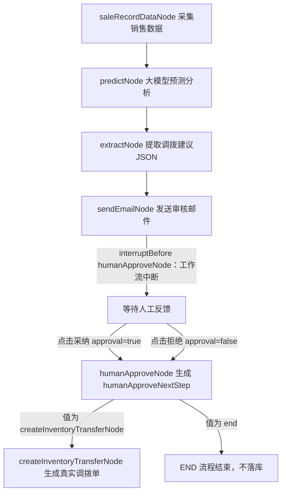

# 6-1 什么是人机协同？为什么要进行人机协同？

## 【学习目标】

- 说清大模型幻觉为什么无法靠「换一个更先进的模型」根治，以及人机协同在风控链路中的位置。
- 掌握 Spring AI Alibaba Graph 提供的两种人类反馈实现方式：`InterruptionMetadata` 模式与 `interruptBefore` 模式，并能给出选型理由。
- 独立开发人类审核节点：从 `OverallState` 中取人类反馈数据，产出供条件边消费的路由 key。

## 【正文】

### 一、问题起点：调拨建议「胡编乱造」怎么办

库存调拨优化系统的主链路是：采集销售数据 → 大模型预测分析 → 生成调拨建议 JSON → 提取结构化数据 → 入库。前面所有章节都在解决「让模型生成得更准」，但有一类风险无法通过模型侧优化消除：**大模型会幻觉**。

通俗讲，大模型可能胡编乱造；术语讲，这叫幻觉（hallucination）。落到本业务中，具体表现是：模型给出的调拨数量、仓库组合在业务上根本不成立，A 仓库明明没有 500 件库存，模型却建议从 A 仓库调出 500 件；或者把「北京仓调上海仓」写成「北京仓调北京仓」，数量单位混淆、日期错位更是常态。这类调拨单一旦直接插入业务数据库，会造成三重后果：

1. **脏数据污染**：数据库中出现大量没有业务意义的调拨单，后续基于此表的统计、对账、报表全部失真。数据是链路的起点，起点脏了，下游全脏。
2. **错误流入审批流**：这些单据会继续流向领导审批环节。领导看到明显不合理的调拨单，追问「这是谁做的」，一查是 AI 生成的，责任会沿着链路找到开发部门，做系统的人最终为模型的幻觉背书。
3. **信任崩塌**：一次明显的胡编乱造，足以让业务方否定整个系统的价值，后续推广阻力极大。技术问题由此演变成组织问题。

所以本课反复强调的问题点，换一种问法就是：**如何防止大模型发生幻觉、产生的调拨数据污染真实的业务数据？** 这是 Agent 类项目面试的高频问题，也是生产落地的一票否决项，答不上来，前面讲的预测、提取、入库讲得再细也会被面试官判定为「没上过生产」。

### 二、为什么必须靠人机协同

需要先建立一个基本认知：**无论使用国内还是国外的、最先进还是什么版本的文本交互自然语言处理大模型，都无可避免地会出现幻觉。**

机理层面不难理解：大模型的本质是「基于概率的下一个词预测」，它优化的是「生成看起来合理的文本」，而不是「生成事实正确的结论」。训练数据有截止时间、有覆盖盲区；提示词工程、少样本、RAG、微调等手段，都只是在降低幻觉概率，没有任何一种能做到百分百消除。指望通过「换个更强的模型」根治幻觉，等于把工程问题寄托于不可控因素。

因此工程上的策略不是「根治幻觉」，而是「风险控制」：**用流程把模型的不确定性圈在可控范围内，让风险最小化。** 落到本系统，设计思路是**人类反馈 + 条件分支**：

- 在真实插入业务数据库之前，增加一步人工审核；
- 把调拨建议通过邮件发送给管理员，邮件中提供「采纳」「拒绝」两个按钮；
- 审核通过，工作流继续往下走，生成真实业务调拨单；
- 审核不通过，本次工作流直接结束，不生成任何真实业务数据。

这样，模型输出的可疑数据永远停在人工把关这道闸口之前，数据库里落下的每一条调拨单都经过人类确认。这就是人机协同（Human-in-the-Loop，HITL）在本项目中的含义：不是让 AI 替代人，而是让 AI 承担生成、让人承担裁决，各自做自己擅长的事。

两种风险控制思路的差别，一张表就能看清：

| 维度 | 纯自动化（无人工审核） | 人机协同（人工审核把关） |
|---|---|---|
| 幻觉数据落库 | 会，直接污染业务库 | 不会，审核不过即终止 |
| 出错后的追责 | 直接指向开发方 | 人工已确认，责任边界清晰 |
| 业务方信任 | 一次事故即崩塌 | 有闸口，可逐步建立信任 |
| 系统吞吐 | 全自动，最高 | 增加一次人工往返，略降 |
| 适用数据 | 容错高的辅助数据 | 写库的核心业务数据 |

结论很明确：**面向核心业务库的写入，必须有人工闸口**；吞吐上的损失，换的是数据质量与责任边界，这笔账在生产环境是划算的。

还有一个落地层面的选择值得说明：为什么用邮件做审核载体，而不是站内信或企业微信？课程选择邮件，理由在于邮件是异步、留痕、且不依赖公司内网系统的通道，管理员不在工位、不登录内部系统，也能在手机上看清调拨建议并完成审批；同时邮件本身就是天然的操作记录，出了问题有据可查。按钮点击 → 调用接口 → 激活工作流，整条唤醒链路的「信号」由邮件承载，「身份」由 `threadId` 承载，二者缺一不可。

### 三、前置知识：两种人类反馈实现方式

Spring AI Alibaba Graph 提供了两种实现人类反馈的方式，动手写代码之前必须理解二者的差异。它们的核心分野是：**中断时机由运行时决定，还是由编译期决定。**

**第一种是 `InterruptionMetadata` 模式**：节点实现 `InterruptibleAction` 接口，可以在任何节点、任何时刻动态决定是否中断，运行时根据当前状态返回 `InterruptionMetadata` 即可挂起执行。用大白话说，这种模式可以随意、动态地在任何一个节点上中断，灵活性比较高。

| 维度 | `InterruptionMetadata` 模式 |
|---|---|
| 中断时机 | 任意节点、运行时动态决定 |
| 控制方式 | 节点自身根据运行状态判断，无需提前配置 |
| 状态感知 | 可根据当前状态决定是否等待用户输入 |
| 节点改造 | 需实现 `InterruptibleAction` 接口 |
| 代码复杂度 | 高，中断逻辑要写代码动态判断 |
| 典型场景 | 中断条件依赖运行时状态的复杂流程 |

**第二种是 `interruptBefore` 模式**：与第一种正好相反，需要提前设计好「在哪个节点之前、或者在哪个边之前中断」，在编译 Graph 时通过 `CompileConfig` 声明中断点，执行到指定节点前自动挂起。注意是编译 Graph 的时候指定，写死即可，不需要根据状态动态决定。

| 维度 | `interruptBefore` 模式 |
|---|---|
| 中断时机 | 编译时固定，指定节点执行前自动中断 |
| 控制方式 | 编译配置中声明，自动生效 |
| 节点改造 | 普通 `NodeAction` 即可，无需实现特殊接口 |
| 代码复杂度 | 低，配置简单直接 |
| 可维护性 | 中断位置集中声明，易于理解和维护 |
| 典型场景 | 中断点可提前设计的常规人机协同 |

对比结论：第一种虽然灵活，但代码复杂度比较高，需要通过写代码动态判断是否要中断；在真实的工作流业务场景中，中断时机通常在设计阶段就能确定（「审核环节必须过一道人工」是需求写死的，不是运行时算出来的），因此这种方式用得不是特别多。**反而是 `InterruptBefore` 模式用得更多**：简单清晰、代码复杂度低。本系统提前就能确定「在人类审核节点之前中断」，因此选用第二种，在编译 Graph 时通过 `interruptBefore` 指定。

最后补一个两种模式的共同前提：无论哪种方式，中断都意味着「执行挂起、状态等待」，工作流此刻的状态必须被完整保存为检查点，否则恢复时无从谈起。课程后续章节会专门落地检查点持久化（Redis），人机协同的完整生产形态 = 中断机制 + 检查点存储，二者配套才能支撑「邮件发出去几小时后才有人点」这类真实时间跨度。

### 四、开发人类审核节点

#### 4.1 业务逻辑拆解

先分析该节点要做的事，一共四步：

1. **等待人工反馈触发后才执行**：节点执行前工作流已中断，被审批接口唤醒后才会进入 `apply`；
2. **拿到唤醒时传入的参数**：人类反馈接口调用时传入的参数，通过 `OverallState` 的 `humanFeedback().data()` 取出，结果是一个 `Map`；
3. **判定审批结果**：约定 key 为 `approve`、值为 `Boolean`，点击「采纳」传 `true`，点击「拒绝」传 `false`，读取时给默认值 `false` 并做强转；
4. **产出路由 key**：审批通过时，把下一个节点名 `createInventoryTransferNode` 写入 `nextStep`；审批不通过时，`nextStep` 保持默认值 `end`。该 key 在状态机中定义为 `humanApproveNextStep`，使用替换策略，供后面的条件边做分支判断。

其中「替换策略」值得多说一句：状态机中同一个 key 被多次写入时，后一次覆盖前一次。路由 key 用替换策略，保证条件边读到的永远是最近一次审核结论，不会出现新旧值并存导致的分支漂移。

#### 4.2 代码实现

```java
public class HumanApprovalNode implements NodeAction {
    @Override
    public Map<String, Object> apply(OverallState state) throws Exception {
        Map<String, Object> data = state.humanFeedback().data();
        Boolean approval = (Boolean) data.getDefault("approval", false);
        String nextStep = Stategraph.END;
        if (approval) {
            nextStep = "createInventoryTransferNode";
        }
        return Map.of("nextStep", nextStep);
    }
}
```

逐行解读：

- `state.humanFeedback().data()`：Spring AI Alibaba Graph 把「唤醒工作流时传入的数据」封装为 `HumanFeedback`，`data()` 返回其中的 `Map`。后续章节会看到，审批接口正是把一个包含 `approve` 键的 `Map` 塞进这里。
- `data.getDefault("approval", false)`：从反馈数据中取审批结果，默认值取 `false`。**默认值必须落在安全侧**：没有任何显式反馈时按「不通过」处理，宁可漏放，不可错放。
- `nextStep` 默认 `Stategraph.END`：同样先落到安全侧（直接结束流程），只有审批通过才改写为 `createInventoryTransferNode`。
- `return Map.of("nextStep", nextStep)`：节点返回值会合并进 `OverallState`。该 key 需在 `KeyStrategyFactory` 中按替换策略定义，课程中命名为 `humanApproveNextStep`，供后续条件边读取。

如实说明：以上代码按课程讲稿原样保留，其中 `Stategraph.END`、`getDefault` 的写法以及返回值 key（`nextStep`）与状态机定义的 `humanApproveNextStep` 之间的命名差异，属于讲稿转写痕迹。实际编码时应以 `StateGraph.END`、`OverallState` 的真实取值方法为准，并保证「节点写入的 key」与「图中定义的 key」严格一致。本节重点掌握的主线是：**取人类反馈 → 判定 → 产出路由 key**。

#### 4.3 中断与激活全流程



### 五、整体梳理

这套逻辑稍显绕，整体过一遍：

1. 工作流到达人类反馈节点之前会直接中断，不再往下执行；
2. 中断后等待具体的人类反馈：管理员收到邮件，点击「采纳」或「拒绝」，触发审批接口；
3. 审批接口把人类反馈的值放入状态机，并激活整个工作流，让它从中断处继续执行；
4. 继续执行时，人类反馈节点拿到唤醒时放入的键值对：key 是 `approve`，value 是 `true`（采纳）或 `false`（拒绝）；
5. 节点根据该值生成 `nextStep`，交给后面的条件边判断走哪个分支：自动生成调拨单，还是结束。

贯穿全篇的设计思想：**「中断-等待-唤醒」三段式把人的决策嵌进了机器的工作流**。工作流本身不懂业务对错，它只提供两个出口；人只负责在两个按钮之间做选择，不需要懂代码。这种低耦合的分工，是人机协同系统能落地的核心原因，机器跑速度，人掌方向盘。

最后补一个度量视角：审核跑起来之后，要持续统计三个指标，审核通过率、审核平均耗时、拦截率（拒绝数占总触发数）。通过率长期接近 100%，说明审核在「走形式」，要么把审核点移到更低风险的环节，要么加抽样复核；拦截率突然抬升，说明模型侧在某类场景上退化，是提示词或样本要调整的信号。人机协同不只是「一道闸口」，它同时是模型质量的观测窗口，人每一次点击，都是一次带标注的反馈数据。

## 【易错点 / 面试题】

**面试题 1：大模型产生幻觉，导致生成的业务数据污染数据库，你怎么解决？**

参考回答：幻觉无法靠模型根治，只能做风险控制。我们的方案是人类反馈 + 条件分支：在数据落库前插入人工审核节点，模型生成的调拨建议先发邮件给管理员，点击「采纳」才继续生成真实单据，点击「拒绝」则直接结束工作流。技术上通过 Spring AI Alibaba Graph 的 `interruptBefore` 在编译期声明中断点，用 `HumanFeedback` 传递审批结果，用条件边做分支路由。这样数据库里的每条业务数据都经过人类确认，风险被圈在可控范围内。追答一层：即便加了审核，模型侧仍在持续优化（提示词、少样本、评估节点），人机协同是兜底而非主力。

**易错点 2：两种人类反馈模式选错，把简单问题复杂化。**

`InterruptionMetadata` 适合「是否中断取决于运行时状态」的场景；如果中断点在设计期就能确定（绝大多数业务流程都是如此），应选 `interruptBefore`：节点零改造、配置一行搞定。面试中如果被追问，重点答「编译期声明 vs 运行时动态」这一本质差异。

**易错点 3：默认值方向选错。**

`approve` 的默认值必须取 `false`、`nextStep` 的默认值必须是 `END`。一旦图省事把默认值设为「通过」，唤醒链路出现任何异常（参数缺失、类型转换失败）时，工作流会默认放行，人工审核形同虚设。安全侧的默认值，是人机协同的最后一道防线。

**面试题 2：如果管理员每次都直接点「采纳」，人机协同是形式主义吗？**

参考思路：分两层看。技术层，审核的价值在「兜底」，大多数建议是合理的，审核平时看似无用，恰恰是为了拦住那小概率的幻觉；没有这道闸口，幻觉数据会 100% 落库。组织层，「无脑采纳」确实是真实风险，治理手段包括抽样复核、审核记录留痕（谁在何时批了哪条）、把审核质量纳入考核。技术上还可以加超时升级（多久未审转上级或自动关闭），避免邮件沉没导致流程堆积。面试中这样答，既承认了机制边界，又给出了治理方案，比单纯辩解「不是形式主义」成熟得多。

## 【小结】

本节建立了人机协同的整体认知：幻觉不可根治，只能靠「人类反馈 + 条件分支」做风险控制；两种人类反馈实现方式中，`interruptBefore` 因其声明式、低复杂度的特点成为首选；人类审核节点的主线是「从 `OverallState.humanFeedback().data()` 取审批结果 → 生成 `humanApproveNextStep` 路由 key」，默认值一律落在安全侧。下一篇把视线移到图定义：如何把该节点挂进 `StateGraph`、如何调整边、如何用 `CompileConfig` 声明中断点。配套可部署工程见 `980-demo/src/main/java/com/carl/ai/transfer/agent/TransferAgent.java`：其串联的「自然语言 → 抽取 → 入库」节点序列，对应课程的「预测 → 提取 → 自动生成调拨单」链路，人工审核节点把关的正是入库动作之前的那道闸口；`extract/TransferOrderExtractor` 复刻课程的 JSON 提取节点，`service/TransferOrderServiceImpl` 复刻落库环节。
