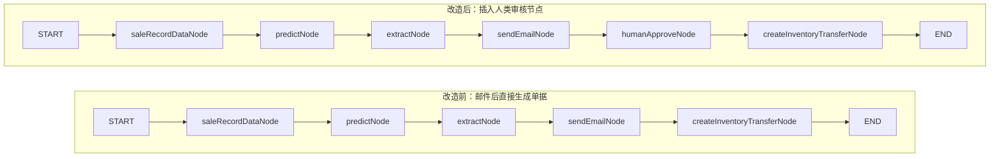

# 6-2 Graph 配置适配人机协同节点

## 【学习目标】

- 在 `StateGraph` 中完成三件改造：定义 `humanApproveNextStep` 状态 key、挂载 `humanApproveNode`、重排邮件节点之后的边。
- 会用 `CompileConfig.builder().interruptBefore(...)` 在编译期声明中断点，并理解它为何优于在节点里写中断逻辑。
- 能用 Debug 验证「中断是否真的生效」，理解审批接口为何必须拿到 `RunnableConfig` 才能恢复工作流。

## 【正文】

### 一、定义 key 并添加人类审核节点

人类审核节点会生成一个新 key：拿到人类反馈传来的键值对，判断审核是否通过，通过则把下一个节点名放进该 key。所以图里面要先做该 key 的定义：把 `humanApproveNextStep` 补进 `KeyStrategyFactory`，依然使用替换策略（注意补上逗号）。

替换策略的含义：同一 key 被多次写入时，后值覆盖先值。路由 key 用它，是为了保证工作流恢复后条件边读到的必然是最近一次审核结论，不会被历史值干扰。

`KeyStrategyFactory` 值得多看一眼：它是整张图的「状态契约」集中声明处，哪些 key 存在、用什么策略更新，全部在这一处定义。生产节点只管 `return Map.of(...)`，消费方（后续节点、条件边）只管按 key 名读取，双方靠这份契约对齐，而不是靠口头约定。工程上建议把 key 名提为常量类集中管理，避免「写入方写 `humanApproveNextStep`、读取方读 `humanApprovalNextStep`」这类一字之差引发的静默故障。

key 定义好之后增加节点。在图中添加 `humanApproveNode`，仍通过 `AsyncNodeAction` 的静态方法把人类审核节点实例传进去：

```java
public class GraphConfig {
    public CompiledGraph graph(ChatClient.Builder chatClientBuild) throws GraphStateException {
        KeyStrategyFactory keyStrategyFactory = new KeyStrategyFactory();
        public Map<String, String> apply() {
            // ...
        }
    }

    StateGraph stateGraph = new StateGraph(name "inventoryTransferGraph", keyStrategyFactory);
    stateGraph.addNode("saleRecordDataNode", AsyncNodeAction.node_async(new CollectSaleRecordNode(saleService)));
    stateGraph.addNode("predictNode", AsyncNodeAction.node_async(new PredictNode(chatClientBuild.build())));
    stateGraph.addNode("extractNode", AsyncNodeAction.node_async(new ExtractNode()));
    stateGraph.addNode("sendEmailNode", AsyncNodeAction.node_async(new SendEmailNode(emailService)));
    stateGraph.addNode("createInventoryTransferNode", AsyncNodeAction.node_async(new CreateInventoryTransferNode()));

    // 定义状态转移
    stateGraph.addEdge(StateGraph.START, targetid: "saleRecordDataNode");
    stateGraph.addEdge("saleRecordDataNode", targetid: "predictNode");
    stateGraph.addEdge("predictNode", targetid: "extractNode");
    stateGraph.addEdge("extractNode", targetid: "sendEmailNode");
    stateGraph.addEdge("sendEmailNode", targetid: "createInventoryTransferNode");
    stateGraph.addEdge("createInventoryTransferNode", targetid: StateGraph.END);

    return stateGraph.compile();
}
```

如实说明：以上代码按课程讲稿原样保留，是图定义的转写稿。其中 `new StateGraph(name "inventoryTransferGraph", ...)` 缺等号、`targetid:` 前缀、方法体内直接写语句等，均为讲稿转写痕迹，不是可编译代码。阅读时按语义理解即可：**用 `KeyStrategyFactory` 声明状态 key 的策略 → 用 `addNode` 挂载各节点 → 用 `addEdge` 串起主链路 → `compile()` 得到 `CompiledGraph`。** 本小节改造完成后，图中新增的是 `humanApproveNode`，链路重排见下文。

三个知识点值得展开：

- **节点名是契约**：`addNode` 的第一个参数（如 `"humanApproveNode"`）既是图的内部标识，也是后续 `addEdge`、`interruptBefore`、审批接口引用的目标。节点名一旦改动，边定义、中断点配置、条件边映射三处都要同步，改名前先全局搜索。
- **`AsyncNodeAction.node_async(...)` 是标准挂载方式**：把实现 `NodeAction` 接口的业务节点包装成异步节点动作。课程中的所有业务节点（采集、预测、提取、发邮件、生成单据、人类审核）都是同一种挂载方式，区别只在 `apply(OverallState)` 内部写什么。
- **`ChatClient.Builder` 传进图配置**：预测节点需要与大模型对话，图定义时把 `ChatClient.Builder` 传进来、由 `PredictNode` 自行 `build()`。这样图配置不依赖具体模型实例，换模型只改 Bean 定义，图结构不动，配置与编排分离的典型写法。

### 二、重排边：把人类审核节点插进链路

边定义按新编排调整。原链路中邮件发送节点直接连自动生成调拨单节点；改造后：

- `sendEmailNode` → `humanApproveNode`：邮件发出去，工作流走到审核节点之前；
- `humanApproveNode` → `createInventoryTransferNode`：审核通过后生成真实单据（先用单边连通，条件边下一篇开发）；
- `createInventoryTransferNode` → `END`：生成单据后结束。



这里有一个工程节奏问题：为什么先用单边把审核节点连到生成单据节点，而不是直接上条件边？因为**编译配置、中断激活、审批接口都还没就绪**，一步到位会让「图配置错误」和「中断链路错误」混在一起，排查时分不清问题出在哪。先保证「结构对」（边连对了、能编译），再保证「行为对」（中断生效、分支正确），是工作流开发的稳妥顺序。

此时邮件节点到审核节点之间还差一个中断点，否则工作流会径直穿过审核节点，人工审核毫无意义。这正是下一节 `CompileConfig` 的职责。

还要留意这次边改造的范围：只动 `sendEmailNode` 之后的连线，之前的「START → 采集 → 预测 → 提取」原封不动。这是工作流改造的基本纪律，**把改动面收敛到新增环节，不触碰已验证的存量链路**。存量链路每少动一行，回归风险就小一分；这也是评审时最能体现工程意识的一点。

### 三、用 CompileConfig 指定中断点

`interruptBefore` 模式要求提前在编译配置中定义中断点。此前直接调用状态图的 `compile()` 编译；`compile()` 还有一个接收 `CompileConfig` 参数的重载（在 IDE 中按 `Ctrl + P` 可见）。含义很直观：编译图时想附加配置，就把配置传进去。

`CompileConfig` 采用建造者模式：`CompileConfig.builder().interruptBefore("humanApproveNode").build()` 即声明「在人类审核节点之前中断」，再把实例传给 `compile()`。这样编译出的 `CompiledGraph` 自带中断点信息，运行到审核节点前自动挂起。

注意 `compile()` 与 `compile(compileConfig)` 是两个重载：前者产出无中断的普通图，后者产出带中断点的图。同一份 `StateGraph` 定义，编译时传入不同配置，得到运行形态不同的 `CompiledGraph`，这是「图定义」与「运行策略」分离的直接体现。测试环境可以编译无中断版本快速跑通主链路，生产环境编译带中断版本走完整人机协同，一份定义两处受益。

中断的精确语义：**停在进入该节点的 `apply` 方法之前**，此前的节点产出、状态机数据全部就绪并落盘为检查点，但审核节点的业务逻辑一行都没执行。恢复时从检查点续跑，审核节点第一次真正执行。理解这一点很重要：它意味着「中断」丢的只是待执行的节点逻辑，不是整个状态机。

为什么中断点要放在编译期而不是写进节点？三个理由：

1. **关注点分离**：节点只写业务（取反馈、判审批、产 key），中断是编排层的事，混在一起节点难复用、难测试。
2. **中断点集中可视**：所有中断点在一处声明，读图的人一眼能看出「哪些位置需要人介入」。
3. **与条件边职责等价**：中断恢复后走哪条分支由条件边决定，中断点只负责「停」，不负责「走哪」，职责边界清晰。

反过来想：如果把中断逻辑写进节点（比如进节点后轮询等待审批结果），会同时踩三个坑，轮询空转烧 CPU、线程被长时间占用、最致命的是「等待中」这一状态对框架不可见，既无法在快照里体现，也无法在服务重启后恢复。声明式中断把「等待」变成框架原生能力，节点代码反而更干净。

### 四、Debug 验证中断

在人类审核节点内打一个断点，以 Debug 模式启动项目（端口 `8876`），调用销售触发接口并传入商品 ID。日志依次为：查询销售数据、与大模型对话（`PredictNode` 内部通过 `ChatClient` 完成）、JSON 提取、邮件发送，邮箱也确实收到邮件。

关键观察：边定义中邮件发送节点的目标就是 `humanApproveNode`，但审核节点里的断点根本没有进入。这说明工作流在到达该节点之前已经中断，不会往下执行，中断配置生效。只有管理员点击邮件中的「采纳」或「拒绝」、触发审批接口，工作流才会被重新激活。

该 Debug 手法值得记住：**验证中断是否生效，不是看日志里有什么，而是看断点进不进得来。** 日志只能证明「执行过」，断点的沉默才能证明「被拦住」。

完整的验证清单建议核对四项：断点未进入审核节点、日志停在邮件发送节点、邮箱收到带链接的邮件、链接中带有 `threadId` 参数。四项全中，中断与邮件两个环节才算同时过关；只验其中一两项，容易在后续联调时反复回头排查。

### 五、编写审批接口

接下来要写激活工作流的接口：唤醒被中断的流程，同时把人类审核节点需要的键值对放进状态机。邮件中的「采纳」「拒绝」两个按钮对应 Controller 层的方法，需要一个参数区分二者：

```java
@RestController
public class SaleProductController {
    @Resource
    private CompiledGraph graph;

    @GetMapping("/sale")
    public Map<String, Object> sale(@RequestParam String productId) {
        OverallState overallState = graph.call(Map.of("productId", productId)).get();
        return overallState.data();
    }

    @GetMapping("/approval")
    public R approval(Boolean approval) {
        // 通过 graph.getState() 获取当前状态
        return R.ok().data(graph.getState());
    }
}
```

接口要怎么恢复工作流？两个前提：

1. **知道工作流停在哪**：恢复之前必须拿到当前的状态快照，才能基于快照继续执行；
2. **把审批结果塞进状态机**：审核节点要从 `HumanFeedback` 里取审批值。

Spring AI Alibaba Graph 为此提供了 `graph.getState(...)`，但它需要一个 `RunnableConfig` 参数。`RunnableConfig` 里可传的信息包括：

| 配置项 | 作用 |
|---|---|
| `threadId` | 对话唯一标识，用于定位并隔离某一次工作流执行 |
| `checkpointId` | 检查点标识，精确到某一次快照 |
| `nextNode` | 指定接下来执行的节点 |
| `streamMode` | 流式输出模式 |
| `metadata` | 附带的元数据 |
| `interruptNodes` | 中断节点相关配置 |

其中 `threadId` 与 `checkpointId` 的分工要分清：`threadId` 回答「是哪一次执行」（哪个人），`checkpointId` 回答「是这次执行里的哪个快照」（哪个时刻）。日常恢复场景传 `threadId` 即可，框架会定位到该执行的最新检查点。

`R` 是项目统一的返回体包装（`R.ok().data(...)` 形式），Controller 层统一返回它，前端拿到的结构稳定。注意上面代码里 `graph.getState()` 是不传参数的写法，仅用于占位，`getState` 要定位到具体一次执行，就必须传入携带 `threadId` 的 `RunnableConfig`，无参调用拿不到任何有效快照。这也解释了为什么审批接口比触发接口「多一个配置对象」：触发是发起，审批是找回，找回必须先验明身份。

还有一个执行模型的细节：`graph.call(...)` 返回的是 `CompletableFuture`，代码里习惯接 `.get()` 同步等待结果。中断发生时，这次调用不会无限期挂起，工作流在审核节点前挂起后，触发调用即告一段落，控制权交还给触发线程；后续恢复由审批请求驱动，两个请求各管一段。这意味着触发接口的响应时间不包含「等管理员审批」的时间，接口吞吐不受人工时长影响。若采用完全同步的阻塞等待（审批不通过就不返回），触发线程会被长时间占用，高并发下线程池很快打满，这也是课程选择「中断 + 异步唤醒」而非「同步等待」的工程理由。

课程在开发过程中先给出审核节点的另一种写法，随后在梳理时收敛：

```java
public class HumanApprovalNode implements NodeAction {
    @Override
    public Map<String, Object> apply(OverallState state) throws Exception {
        Map<String, Object> data = state.humanFeedback().data();
        Boolean approval = (Boolean) data.getOrDefault("approval", defaultValue: false);
        if (approval) {
            return Map.of("nextStep", StateGraph.END);
        } else {
            // 处理未通过审批的情况
            return Map.of("nextStep", "sendEmailNode"); // 示例，实际应根据业务逻辑调整
        }
    }
}
```

如实说明：以上代码按课程讲稿原样保留，其分支是开发过程中的占位写法（注释中自述「示例，实际应根据业务逻辑调整」）：此处把「通过」映射到 `END`、「不通过」映射到 `sendEmailNode`，与 6-1 篇的版本相反，最终以 6-6 篇条件边落定的逻辑为准，采纳走向 `createInventoryTransferNode`，拒绝走向 `END`。另外注意此段读取的 key 是 `approval`，与邮件链接参数对齐时需保持命名一致。这种「开发期草稿与终版不一致」的现象在讲稿里很常见，读代码时以最终跑通的链路为准，不必为中间版本困惑。

### 六、为什么需要 threadId

恢复工作流为什么要传 `RunnableConfig`？本质是**对话隔离**：一个商品触发一次工作流执行，就是一次独立的对话；如果多个商品的触发不做隔离，它们会混在同一个对话里，恢复时根本不知道该恢复哪一次执行。这与使用 Spring AI 开发大模型应用时的会话隔离是同一道理，每一次有状态的执行都需要唯一标识。多个商品同时待审时，没有 `threadId` 的审批接口就像没有取号机的银行窗口，谁喊得大声谁先办。

所以需要 `threadId`：触发端生成它、随初始状态进入工作流，审批端携带它找回对应的那次执行。但目前触发端还没有生成 `threadId` 的地方，思路是：触发工作流时用 Hutool 的 `IdUtil` 随机生成一个字符串作为 `threadId`，定义 key 放进状态机；执行到邮件发送节点时，把它拼进「采纳」「拒绝」两个按钮的 URL。具体落地见下一篇。

最后点破一个依赖关系：Controller 里 `@Resource` 注入的是 `CompiledGraph`，即图编译后的产物（注册为 Bean）。触发接口与审批接口注入的是同一个实例，同一张图、同一份中断点配置、同一套状态管理。若两边注入的不是同一个 `CompiledGraph`（比如重复编译出两个实例），触发端建的检查点，审批端根本看不到，`missing checkpoint` 会以另一种更隐蔽的方式复现。**「一份定义、一次编译、一个 Bean、多处注入」是图配置的基本纪律。**

## 【易错点 / 面试题】

**面试题 1：`interruptBefore` 和 `InterruptibleAction` 两种人类反馈方式有什么区别？怎么选？**

参考回答：前者是编译期声明式中断，在 `CompileConfig` 中指定「在哪个节点前停」，节点零改造，简单清晰；后者靠节点实现 `InterruptibleAction` 接口，运行时根据状态动态返回 `InterruptionMetadata`，灵活但复杂。工作中断点若能提前设计（通常是），就用 `interruptBefore`。可再补一层：`interruptBefore` 的中断点是图的元数据，和边、节点一样集中在一处，评审时看得见、测得到。

**易错点 2：只改边、不改编译配置，中断不生效。**

`sendEmailNode` 指向 `humanApproveNode` 只保证「会走到审核节点」，不保证「会停在审核节点之前」。忘记 `CompileConfig.builder().interruptBefore("humanApproveNode").build()` 时，Debug 会发现断点直接进审核节点，人工审核被跳过，而日志看起来一切正常，这类故障最隐蔽。

**易错点 3：节点名不一致埋雷。**

讲稿中类名有 `HumanApproveNode` / `HumanApprovalNode`、节点 ID 有 `humanApproveNode` / `humanApprovalNode` 两种写法。工程惯例是**类名、节点 ID、中断点名、条件边映射四处保持同一命名**，最好把节点 ID 提为常量。否则 `interruptBefore` 指向一个不存在的节点，编译或运行期才报错，排查成本高。

**面试题 2：工作流中断等待审批期间，服务重启了，恢复时会发生什么？**

参考回答：此时检查点默认在内存中，重启即丢失，凭 `threadId` 恢复会报 `missing checkpoint`，与管理员迟迟不审批是两种不同的失败，但现象相同。生产解法是把检查点持久化（课程后续章节用 Redis Stack 落地：状态快照以 JSON 形式入库，重启后凭 `threadId` 仍可找回）。该问题面试命中率很高，因为它同时考了「中断机制」与「状态持久化」两块，回答时主动带出 Redis 方案会明显加分。

## 【小结】

本节完成了图定义层的改造：新增 `humanApproveNextStep` 状态 key（替换策略）、挂载 `humanApproveNode`、把邮件节点之后的边重排为「邮件 → 审核 → 生成单据 → 结束」，并通过 `CompileConfig.builder().interruptBefore(...)` 在编译期声明中断点，Debug 验证了中断真实生效。审批接口要恢复工作流，必须先拿到 `RunnableConfig`，其核心是 `threadId`，对话隔离的标识；`checkpointId` 则进一步定位快照。下一篇落地 `threadId` 的生成、传递与邮件链接拼接。配套工程见 `980-demo/src/main/java/com/carl/ai/transfer/agent/TransferAgent.java` 与 `controller/TransferController.java`：前者复刻「预测 → 提取 → 入库」的节点串联，后者对应课程的触发与审批入口，人机协同节点把关的正是入库前的最后一道工序。
