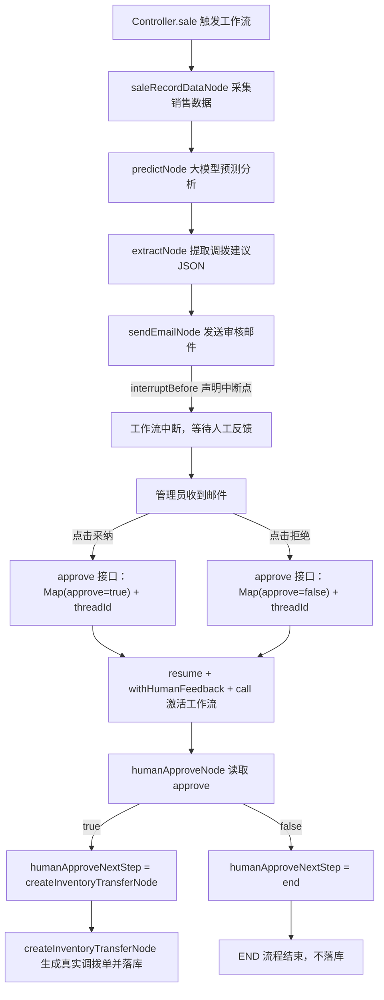

# 6-5 人机协同流程总结与梳理

## 【学习目标】

- 用一张图讲清「触发 → 中断 → 唤醒 → 分支 → 落库」全过程中每个组件的职责与数据流向。
- 理解 `HumanFeedback` 的概念本质：它不是新机制，而是对「激活时传入的 Map」的框架命名。
- 说清审核节点为什么必须产出路由 key，以及条件边在整条链路中承担的角色。

## 【正文】

### 一、为什么需要一篇梳理

人机协同这部分逻辑稍绕，原因在于它横跨了三个通常独立运行的环节：**触发时执行一段、中断时挂起等待、唤醒后续跑一段**。三段之间靠 `threadId` 与检查点粘合，任何一段单独看都不复杂，连起来看就容易迷路。把三次执行放进同一张图里看，结构就清晰了。

先建立「三段式执行模型」的心智模型，后面所有细节都能挂在这上面：

| 段 | 触发者 | 入口 API | 关键配置 | 结束条件 |
|---|---|---|---|---|
| 第一段：触发与预执行 | 销售触发接口 | `call(初始Map, RunnableConfig)` | `threadId` 初始值 | 到达审核节点前，自动中断 |
| 第二段：中断与等待 | 无（挂起） | - | `interruptBefore` 声明 | 管理员点击邮件按钮 |
| 第三段：唤醒与分支 | 审批接口 | `getState` + `resume` + `call(state, config)` | `threadId` + `HumanFeedback` | 生成单据落库，或走向 `END` |

三段各自独立：第一段失败（模型超时）不会影响第三段的存在；第三段没写对，前两段照常运行。排查故障时先问「哪一段出的问题」，能把搜索空间从整条链路缩到一段。

### 二、链路总览

图中邮箱与审核两段，正是与普通工作流节点最大的差异所在：**它们之间隔着一道人工闸口**。普通工作流是「一条直线跑到底」，人机协同工作流是「跑一段、停住、等人、再跑一段」，形态上多了一次中断与唤醒，本质上只是把「人的决策」建模成了状态机里的一个布尔值。

`threadId` 在全链路中有三个落点，复盘时按落点检查最省时间：**触发端生成**（`IdUtil.simpleUUID()`，随初始 Map 进入工作流）、**邮件链接携带**（`adoptLink` / `rejectLink` 各带一份）、**审批接口消费**（`@RequestParam` 接收，构造 `RunnableConfig`）。三个落点任何一处断裂，症状都是「恢复失败」，但断裂位置不同、修法不同。把这条链路的三个落点记牢，`missing checkpoint` 类故障基本都能在五分钟内定位。

两种形态的对照能帮读者快速建立体感：

| 维度 | 普通工作流 | 人机协同工作流 |
|---|---|---|
| 执行次数 | 一次跑完 | 至少两次（触发 + 恢复） |
| 会话标识 | 不需要 | 必须（`threadId`） |
| 状态依赖 | 执行内自洽 | 跨请求延续（检查点） |
| 失败模式 | 当场报错 | 可能静默挂起，需主动验证 |
| 验收标准 | 接口返回 | 业务数据终态 |

### 三、逐段拆解

**第一段：触发与预执行。** 入口是 Controller 中的 `sale` 方法，传入商品 ID（以及初始的 `threadId`）。工作流依次执行采集、预测、提取，到达发送邮件节点。这一段与普通工作流无异，全部由机器自动完成；需要特别注意的是 `threadId` 的生成时机，必须在触发瞬间，而不是用到时才补，否则后续节点无值可取。

**第二段：中断与等待。** 关键点：工作流在进入人类反馈审核节点**之前**中断，不是进入之后判断，而是根本没进去。中断点由编译期的 `interruptBefore` 声明。中断后审核节点一直阻塞，直到另一个接口来激活它，它才会真正执行。中断期间，此前所有节点的产出以检查点形式保存，管理员即使半小时后才点开邮件，数据也不会丢。

**第三段：唤醒与分支。** 邮件中「采纳」「拒绝」两个按钮，调用的是同一个审批方法，区别只在传入的 `Map`：key 都是 `approve`，点「采纳」时 value 是 `true`，点「拒绝」时 value 是 `false`。审批接口做三件事：凭 `threadId` 找到对应执行、把 `approve` 键值对经 `HumanFeedback` 塞入状态、驱动工作流恢复。审核节点醒来后读取该值，生成 `humanApproveNextStep`：通过则指向创建调拨单节点，拒绝则指向结束。

还有一个常被忽略的设计问题：审核点加在哪个节点后面？本课程放在「邮件发送」之后，该位置有三重考虑，其一，审核的材料（调拨建议 JSON）此时已完整生成，人看的是最终产物而不是中间量；其二，审核不通过时，前面节点的算力已经消耗，但没有任何脏数据落库，代价可控；其三，邮件本身就是触达管理员的最佳载体，节点顺序上「先发信、再等人」天然成立。若把审核放在提取节点之前，管理员看到的将是原始模型输出，可读性差、误判率高，**审核点的位置，本质是「让人以最低认知成本做最关键的决策」**。

三段的失败模式各不相同，记牢这张对照，排查时能少走弯路：

| 段 | 典型故障 | 直接原因 | 归属章节 |
|---|---|---|---|
| 第一段 | 模型超时、采集无数据 | 外部依赖问题 | 前几章节点开发 |
| 第二段 | `missing checkpoint` | 检查点未登记或已丢失 | 本节及检查点章节 |
| 第三段 | 500 无日志、200 不落库 | 异常未捕获、未调用恢复 | 本节 |

### 四、数据是怎么流动的

把审批结果的流转路径单独拉出来看，一条直线，没有任何魔法：

| 环节 | 载体 | 动作 |
|---|---|---|
| 邮件按钮 | 链接 URL | 携带 `approve=true/false` 与 `threadId` |
| 审批接口 | `@RequestParam` | 接收两个参数 |
| 状态挂载 | `HumanFeedback` | `withHumanFeedback` 把 `Map` 挂到快照 |
| 审核节点 | `state.humanFeedback().data()` | 取出 `Map`，读 `approve` |
| 路由产出 | `humanApproveNextStep` | 按布尔值写节点名或 `end` |
| 分支决策 | 条件边 `mappings` | 返回值翻译成目标节点 |

六个环节，每个都只是普通的参数传递与 Map 读写。理解了这条线，「人机协同」就不再神秘：**它没有引入任何新机制，只是把人的一次点击，翻译成了状态机里的一个布尔值。**

### 五、HumanFeedback：被名字吓住的概念

Spring AI Alibaba Graph 给「中断之后重新激活所需要的数据」起了一个专门名字：人类反馈数据，即 `HumanFeedback`。很多初学者在这里卡住，以为它是什么复杂机制。**它实质就是你重新激活时传过来的 `Map`**，key 是 `approve`，value 是 `true` / `false`，仅此而已。框架只是封装了一个专有名词，理解时直接把它当成「唤醒工作流时捎带的那张纸条」即可。

三个容易混淆的点，一次说清：

| 混淆点 | 正解 |
|---|---|
| `HumanFeedback` 是新类型的状态？ | 不是，它包装的是一个 `Map`，经 `withHumanFeedback` 挂到状态快照上 |
| 采纳和拒绝是两个接口？ | 是同一个接口，仅 `approve` 的 value 不同 |
| 中断发生在审核节点内部？ | 不，中断发生在进入审核节点之前，节点被唤醒后才第一次执行 |

命名对应关系也值得固化，四个名字指的是四层不同的东西，别混：

| 名字 | 层级 | 是什么 |
|---|---|---|
| `HumanFeedback` | 类型 | 框架封装的人类反馈载体 |
| `humanFeedback()` | `OverallState` 的方法 | 从状态里取出该载体 |
| `approve` | `Map` 的 key | 本次审批的结果值 |
| `humanApproveNextStep` | 状态 key | 审核节点产出的路由值 |

链路读法：审批接口构造 `HumanFeedback`（内含 `approve` 键值对）→ 挂到快照 → 审核节点经 `state.humanFeedback().data()` 拿到 `Map` → 读 `approve` → 写 `humanApproveNextStep` → 条件边消费。四个名字各就各位，一条线读下来，没有任何黑盒。

再补一个设计层面的追问：为什么采纳、拒绝要共用同一个接口？因为激活链路（找快照、挂反馈、恢复执行）对两者完全一样，差异只有布尔值。拆成两个接口，等于把同一套逻辑复制两份，日后改激活机制要改两处，行为还容易漂移。**单一激活入口 + 参数区分语义**，是该设计里最值得借鉴的部分。

邮件本身的内容设计也有讲究，直接影响审核质量：邮件需要让人在十秒内做出负责任的判断，因此至少包含三样东西，调拨建议的核心摘要（源仓、目标仓、数量、依据），「采纳」「拒绝」两个界限分明的按钮，以及这条建议的生成时间与有效期（防止管理员批一份早已过期的旧建议）。课程实现里邮件携带了调拨 JSON 中的 `comment` 字段作为说明文本，正是这一思路的最小落地。审核体验差，人就会敷衍点「采纳」，人机协同随之退化成人肉橡皮章，**技术链路之外，审核材料的可读性同样是机制有效性的组成部分。**

### 六、为什么需要条件边

梳理到这里，条件边的位置就自然浮现了：审核节点产出 `humanApproveNextStep` 之后，需要有人根据该值决定工作流走向，值为 `createInventoryTransferNode` 时去生成真实单据，值为 `end` 时直接结束。承担该决策的就是条件边。

这也是状态机编程的通用范式：**节点负责产出状态，边负责消费状态做路由。** 人机协同场景把「人的决策」转成「状态里的一个布尔值」，后续路由与普通业务分支完全同构，人机协同由此从「特殊机制」退化为「一个普通分支」，系统复杂度被控制在最低。下一篇正式开发这条条件边。

条件边与审核节点之间有一份明确契约，写代码时按契约对表即可：审核节点保证「无论审批结果如何，都会写入 `humanApproveNextStep`，且取值必为约定集合之一」；条件边保证「读取该 key，返回值必在映射表中有对应项」。契约两端都不做多余的事，节点不关心值被怎么用，边不关心值怎么来的。这份契约也是单测的边界：验节点用各种审批输入、验边用各种路由值，两边各自覆盖，不必起全流程。

顺着契约想一个边界情况：万一审核节点因异常没写路由 key，条件边读到空串会怎样？按既定逻辑，空串不命中 `createInventoryTransferNode`，于是返回结束，流程安全地停住，不会误生成单据。这与 6-1 篇「默认值落在安全侧」是同一设计原则在两个部件上的各自落地：**任何一个环节拿不到明确指令时，系统的默认动作必须是「不做有副作用的事」**。人机协同的安全感，正是由这一连串安全侧默认值堆出来的。

### 七、与后续章节的衔接

还有一个遗留问题值得预告：目前工作流状态（检查点）默认放在内存里，服务重启即丢失。这意味着管理员半小时后点「采纳」，若期间服务重启过，同样会报 `missing checkpoint`。解决办法是把检查点持久化（课程后续章节用 Redis Stack 落地），这是人机协同从「演示可用」到「生产可用」的必经一步，邮件审批的时间跨度以小时计，内存态检查点撑不住该场景。

再往后的工程化章节还会做两件事：把审批接口的逻辑从 Controller 下沉到 Service（Controller 只做参数接收，编排逻辑归业务层），以及引入消息队列做触发削峰。这两步都不改变本节的链路结构，只是让同样的链路更耐压、更可维护，读后续章节时，可以不断回到这张流程图，核对「新组件是挂在哪个环节上的」。

## 【易错点 / 面试题】

**面试题 1：口述人机协同的完整流程，从触发到落库。**

参考回答：触发接口生成 `threadId` 启动工作流；采集、预测、提取、发邮件依次执行；在审核节点前中断；管理员点击邮件按钮，审批接口凭 `threadId` 找回状态快照，把 `approve` 值经 `HumanFeedback` 塞入并激活工作流；审核节点读取该值生成路由 key；条件边据此决定生成调拨单还是结束；采纳分支最终落库。讲这条链时主动带出 `missing checkpoint` 的踩坑经历，加分明显。

**易错点 2：认为「采纳 / 拒绝」需要两个接口或两套激活逻辑。**

二者共用接口、共用激活链路，只是 `Map` 里 `approve` 的 value 不同。设计成两个接口会让 `threadId` 的传递、快照的获取、激活的逻辑全部重复一遍，且两处行为容易漂移不一致。

**易错点 3：把 `HumanFeedback` 当成独立于 `OverallState` 的存储。**

它经 `withHumanFeedback` 挂到快照之上，最终仍通过 `state.humanFeedback().data()` 从状态里读取，是状态机制的一部分，不是另一套存储。面试中若被追问「人的输入存在哪」，答案是：存在状态机里，和其他节点产出同一个容器。

**面试题 2：`HumanFeedback` 里只能放 `approve` 一个 key 吗？业务上想同时传审批意见、审批人呢？**

参考回答：完全可以，它本质是 `Map`，放几个 key、放什么类型都不受限，审核节点按需读取即可。课程只放一个布尔值，是因为当前分支决策只需要「过 / 不过」。若业务要记录审批意见，就加一个 `comment` 键；要支持多级审批，可以把 `Map` 里的值换成结构更丰富的对象。机制不变，变的是 key 的约定，这也是「把人类反馈建模成普通 Map」这一设计的扩展性所在。

## 【小结】

本节把前四篇的开发成果收拢成一条完整链路：`sale` 触发 → 四个自动节点 → `interruptBefore` 中断 → 邮件双按钮 → `approve` 接口凭 `threadId` 唤醒 → 审核节点读 `HumanFeedback` 产出 `humanApproveNextStep` → 条件边分支 → 落库或结束。核心认知有三个：中断发生在进入审核节点之前；`HumanFeedback` 本质是激活时传入的 `Map`；人的决策被建模为状态机里的布尔值，后续路由与普通分支同构。条件边作为下一个待开发的环节，承担消费路由 key 的职责；检查点持久化则是后续章节对生产可用性的补强。配套工程见 `980-demo/src/main/java/com/carl/ai/transfer/agent/TransferAgent.java`：它把课程的节点编排思想抽象为「自然语言 → 抽取 → 入库」的单一动作链，配合 `controller/TransferController.java` 的 REST 入口，即是本节流程图在可部署工程中的最小闭环。
