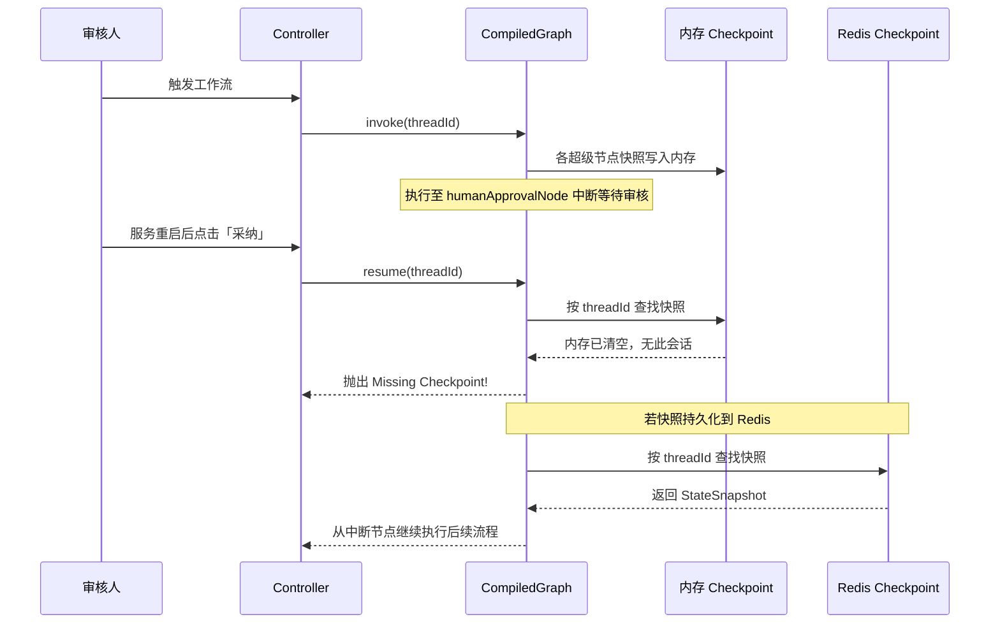

# 7-1 什么是检查点？

【学习目标】

- 理解 Spring AI Alibaba Graph 中检查点（Checkpoint）的定位，以及 `StateSnapshot` 快照对象的五个关键属性；
- 完整复现「人审节点中断 → 服务重启 → `Missing Checkpoint!` 报错」的事故现场，并定位到根因：状态默认驻留内存；
- 建立「用 Redis 对工作流状态做持久化」的改造思路，为 7-2 的配置落地与 7-3 的全链路验证建立认知框架。

## 【正文】

## 一、先看事故现场：重启之后，审核点不动了

进入持久化主题之前，先回顾当前进度：条件边已经开发完毕，库存调拨工作流的全链路节点均已就位。本节演示一个线上极易踩中的场景，工作流执行到人类审核节点时，服务恰好宕机或重启，审核人再次操作时会发生什么。

演示前需要先把图定义按条件边的逻辑重新编排。看当前这张图：人类审核节点还直连着创建库存调拨单节点，而人审与创单之间已经改由条件边连接，这条直连边应当删除，避免出现两条并存的路径造成歧义。另外，「创建库存调拨单节点 → 结束」这条边在声明顺序上可以后移，放在上方不会报错，但顺序调整后图的阅读逻辑会更清晰。

这里对两条 API 的差别做一次拆解，理解它们对后续读持久化代码很关键：

| API | 语义 | 在调拨工作流中的体现 |
|---|---|---|
| `addEdge(source, target)` | 无条件边，上一节点执行完毕必然流向目标节点 | 数据流节点 → 预测节点 → 提取节点 的固定主干 |
| `addConditionalEdges(source, condition)` | 条件边，由 `AsyncEdgeAction` 的结果动态决定去向 | 人审节点根据「采纳 / 拒绝」分流到创单节点或结束 |

人审节点之后必须用条件边，因为「采纳」与「拒绝」是两种互斥的运行时结果；而条件边的路由结果同样要进入快照的 `next`，恢复时才知道该走哪一条分支。这也是图定义改造与 checkpoint 机制之间的隐性关联：**边定义得越准确，恢复时 `next` 的指向才越可靠。**

改造之后的图定义：

```java
public class GraphConfig {
    public class GraphConfig graph(ChetClient.Builder chatClientBuild) throws GraphStateException {
        stateGraph.addConditionalEdges(sourceId: "humanApprovalNode", AsyncEdgeAction.edge_async(new ApprovalEd...);
        Map.of(k1: "createInventoryTransferNode", v1: "createInventoryTransferNode", StateGraph.END, StateGraph.END);
        stateGraph.addEdges(sourceId: "createInventoryTransferNode", StateGraph.END, StateGraph.END);
        // 定义配置
        CompileConfig compileConfig = CompileConfig.builder();
    }
}
```

需要如实说明：上述代码为讲稿节选，存在转写残缺，`addConditionalEdges` 一行的 `new ApprovalEd...` 参数不完整，`Map.of` 的 `k1:` / `v1:` 是具名参数写法，`CompileConfig.builder()` 之后没有接链式调用。这些残缺不影响理解改造意图，完整可运行的写法见 7-2 与 7-5 两篇的代码块。

启动项目验证：没有报错，服务正常启动。

## 二、复现事故：点击「采纳」，抛出 Missing Checkpoint

发起一次调用，工作流开始运行：预测节点完成，JSON 提取节点完成，邮件正常推送，邮箱里也收到了调拨单通知。

演示仍以 1 号商品为例，相关查询如下：

```sql
SELECT p.id, p.product_id, p.product_name, p.product_code, p.product_type, p.product_status, p.create_time, p.update_time
FROM product p
WHERE p.product_name LIKE '%手机%'
```

现在模拟事故：管理员正准备点击「采纳」或「拒绝」进行审核时，程序宕机，随后服务重启。重启完成后再次点击「采纳」，控制台立刻出现错误打印：

```
2025-11-27 22:24:09.802 ERROR c.a.i.transfer.controller.SaleProductController - error msg[Missing Checkpoint!]
```

报错信息是 `missing checkpoint`，也就是找不到检查点了。后果是业务调拨单无法实际生成，工作流卡死在中途，等待审核的状态凭空消失。

顺着报错链路再往深走一层，可以把「身份证」的比喻落到实处：6-3 篇落地人机协同时，前端每次发起调用都会携带 `RunnableConfig` 的 threadId，审核接口同样凭 threadId 找回自己的会话。恢复动作的本质，就是框架拿着 threadId 去 checkpoint 存储里查快照，查内存 Map 时命中，查 Redis 时也命中，唯一的差别是这份存储是否活得比进程更长。事故现场中进程刚重启，内存 Map 已空，查询落空，异常便顺着 controller 往上抛，最终打出 `error msg[Missing Checkpoint!]`。

这正是面试官会抛出的问题点：**代码执行过程中宕机或重启，审核人再次审核时发现报错，无法生成真实的业务单据，这种问题你是怎么解决的？**

## 三、根因分析：状态默认驻留内存，重启即蒸发

事故的根因在于：当前没有把整个工作流状态机里的状态信息做持久化，它默认被放到内存当中。

可以这样理解：工作流启动时，框架为本次会话分配一个会话 ID（threadId），后续每个节点的执行快照都以「会话 ID → 快照」的形式挂在一张内存 Map 里。服务正常运行时，审核接口拿着会话 ID 一查即中；机器一旦重启，进程内存被清空，这张 Map 随之蒸发。此时再拿着同一张「身份证」去内存里查找，自然一无所获，于是报 `missing checkpoint`。

用一张时序图把两种结局画出来：



结论很直接：**内存 checkpoint 的生命周期与进程绑定，进程没了，状态就没了。** 只要工作流存在「中断-等待-恢复」的人机协同语义，状态就必须有一份不随进程消亡的副本。

把视野从单机放大到生产部署，问题会更尖锐：一旦服务做多副本部署，用户的触发请求和恢复请求很可能被负载均衡分发到不同的实例上。实例 A 的内存里存着中断现场，实例 B 的内存里却空空如也，即使两台机器都没重启，`missing checkpoint` 照样会发生。这意味着内存 checkpoint 不只输在「怕重启」，还输在「不共享」，而外部持久化存储（Redis）恰好能同时解决这两个问题：状态不随进程消亡，也能被所有副本共同访问。

## 四、前置知识：检查点与 StateSnapshot

实现持久化之前，先补齐框架侧的前置知识。Spring AI Alibaba Graph 具有内置的持久化层，通过检查点来实现：会话在特定时间点的状态叫做检查点（Checkpoint）。检查点是在每个超级步骤保存的图状态快照，由 `StateSnapshot` 快照对象表示，包含以下关键属性：

| 属性 | 含义 | 生产视角的补充 |
|---|---|---|
| `config` | 与此检查点关联的配置 | 携带 `RunnableConfig`，其中包含 threadId，是恢复时定位会话的钥匙 |
| `metadata` | 与此检查点关联的元数据 | 如来源节点、写入时间等，排障时用来还原现场 |
| `values` | 此时状态通道的值 | 工作流上下文的全量数据，比如预测结果、提取出的 JSON |
| `next` | 图中下一个要执行的节点名称元组 | 决定了恢复后从哪个节点继续跑 |
| `tasks` | 包含有关下一个要执行的任务信息的对象元组 | 描述待执行任务的输入与状态 |

检查点是持久化的，可以用于在稍后的时间恢复会话的状态。

这里有一个容易混淆的概念需要拆开：**超级步骤（super-step）**。Graph 的执行不是逐节点线性推进，而是以超级步骤为节拍：一个超级步骤内，所有入边就绪的节点并行执行（比如销售数据节点与库存数据节点同时启动），本拍全部落定后才进入下一拍。checkpoint 正是在每个超级步骤的边界保存，所以恢复的粒度是「拍」而不是「节点」。这也解释了 6-2 篇里 `interruptBefore("humanApprovalNode")` 的语义：编译时声明在该节点执行前暂停，上一个超级步骤的快照此时已经生成，暂停点之后的所有逻辑都在等待一份可恢复的现场。

还有一个面试高频的辨析题：**checkpoint 与 `ChatMemory`（`MessageChatMemoryAdvisor` + `ChatMemory`）是否是一回事？** 不是。`ChatMemory` 存的是「对话历史消息」，服务于多轮聊天的上下文拼接；checkpoint 存的是「工作流状态快照」（`values` + `next` + `tasks`），服务于流程级的中断与恢复。前者回答「模型之前说过什么」，后者回答「流程走到哪了、下一步该干什么」。库存调拨这类带人审的工作流，两者可以并存，但职责不能互相替代。

官方文档的描述可能每个字都认识、连在一起却不太好理解。换成通俗版本：工作流执行过程中，每个节点其实都会留下一份快照，只不过默认存到内存当中。机器重启后，内存中整个工作流的信息就缺失了，无法把工作流恢复；只有做了持久化，才能在机器重启之后依然恢复整个工作流的状态。持久化本质上就是把整个工作流当中的状态信息（`values` + `next` + `tasks` 的组合）落到了进程外。

## 五、解决方案总览：Redis 持久化，中断后续跑

解决方案是做可靠性的保证：**使用 Redis 持久化，实现让工作流中断后智能续期**。

落地时需要一个配置类来提供图与 Redis 客户端：

```java
@Configuration
public class TransferConfig {
    @Bean
    public StateGraph stateGraph() {
        return StateGraph.builder().build();
    }
    @Resource
    private RedissonClient redissonClient;
}
```

需要如实说明：该配置类为讲稿节选，`StateGraph.builder().build()` 并未挂载任何节点与边，`RedissonClient` 字段的注入来源也尚未给出；其用意是指出「图的 Bean 与 Redis 客户端需要被同一个配置类组织起来」，`RedissonClient` 的构建细节在 7-3 展开，图编译时挂载 `SaverConfig` 的写法在 7-2 展开。

为什么持久化介质选 Redis，而不是直接写业务库（MySQL）？三个理由：

1. **读写模型匹配。** checkpoint 是高频小 JSON 的读写，每个超级步骤都要写一次快照，恢复时按 key 点查一次。Redis 的点查延迟在微秒级，MySQL 即使命中主键索引也要付出连接与事务开销，高频写下会把状态读写变成工作流的额外瓶颈。
2. **TTL 原生可控。** 中断中的会话快照需要保留，已终态的会话快照属于可回收数据。Redis 的过期机制让「自动清理结束会话」变成一个配置项，而 MySQL 需要额外开发清理任务。
3. **数据结构简单。** 快照整体是一个 JSON 文档，key-value 模型足够承载，引入关系库反而要设计表结构、处理大字段拆合。

介质形态上，课程选用的是 Redis Stack 而非纯 Redis，原因在 7-2 展开：Redis Stack 是 Redis 的超集，纯 Redis 的能力它全都有，同时还为后续智能 BI 项目预备了全文搜索等能力。

在动手写代码之前，先把生产环境必须回答的四个问题想清楚，这些也是本节章之后的深化方向：

| 问题 | 结论 | 详细展开位置 |
|---|---|---|
| 为什么不用内存 checkpoint？ | 状态生命周期与进程绑定，重启即丢，且多实例部署时各节点内存互不可见 | 7-2 |
| 序列化边界在哪里？ | 整个 `StateSnapshot` 需要被序列化写入 Redis，自定义节点 Action 里携带进状态通道的对象必须可序列化 | 7-2、7-3 |
| 需要 TTL 吗？ | 进行中的会话快照不能过期；已终态的会话快照应定期清理，避免 Redis 内存无限膨胀 | 7-2、7-3 |
| 并发如何隔离？ | 以 threadId 为键的维度天然隔离不同用户的会话，但同一会话的恢复动作需要避免并发双写 | 7-2 |

把上述四个问题的答案与课程后续安排对应起来，落地路线图是清晰的：7-2 解决「存到哪、怎么连」，用 Docker 起 Redis Stack，改 `CompileConfig` 挂 `SaverConfig`，在 POM 引入 `spring-boot-starter-data-redis`；7-3 解决「存什么、怎么验」，自定义 `RedissonConfig` 接管序列化器，跑通「中断 → 重启 → 采纳 → 单据落库」的全链路，并演示自定义 `BaseCheckpointSaver` 把快照落到 MySQL 的扩展路径。

用一个生产经验类比收尾本节：checkpoint 机制相当于给工作流上了「保险丝 + 存档」。没有持久化时，任何一次发布重启、OOM  kill、机器故障，都会让所有进行中的人审流程蒸发，运营侧看到的是「点了采纳但单据没生成」的隐性数据事故；有了 Redis 持久化，故障的影响面被压缩到「重启窗口内的请求重试」，审核人刷新页面重新点击即可恢复。对企业级项目而言，这类「故障可恢复」的能力，往往比功能本身更能体现工程成熟度，也是面试中把「高可用」从口号变成证据的关键素材。

## 【易错点 / 面试题】

1. **面试官问：工作流执行到一半服务重启，如何保证状态不丢、流程能续跑？**
   答题要点：先说根因，Graph 默认把 checkpoint 存内存，重启即丢；再说方案，通过 `CompileConfig` 挂载 `SaverConfig`，`register(SaverEnum.REDIS.getValue(), new RedisSaver(redisConnectionFactory))` 把 `StateSnapshot` 持久化到 Redis，重启后按 threadId 即可恢复；最后补生产细节，Redis Stack 的选型、序列化器选择、快照清理策略。

2. **面试官问：checkpoint 里到底存了什么？**
   答题要点：`StateSnapshot` 五属性，`config`（含 threadId 的配置）、`metadata`（元数据）、`values`（状态通道全量值）、`next`（下一个待执行节点元组）、`tasks`（待执行任务信息）。恢复的本质就是按 threadId 取出快照，从 `next` 指示的位置继续。

3. **易错点：以为 threadId 只是「对话隔离」用的，与持久化无关。** 实际上 6-3 篇里用于人机协同对话隔离的 threadId，正是 checkpoint 的主键维度；中断续跑与对话隔离复用同一套会话标识，改动一侧往往影响另一侧。

4. **易错点：中断点选错。** `interruptBefore` 声明在哪个节点，快照的恢复起点就在哪个节点之前。若把中断声明放在人审节点之后，审核动作就会在工作流已经越过人审之后才被处理，流程语义直接错乱。排障时先核对 `CompileConfig.interruptBefore` 的节点名与 `next` 指向是否一致。

## 【小结】

本节把「宕机重启后人审失效」的事故现场、根因（状态默认驻留内存）与检查点机制（`StateSnapshot` 五属性）讲透，并给出方向：用 Redis 持久化实现工作流中断后智能续跑。下一篇（7-2）落地 Redis Stack 环境搭建与 `SaverConfig` 的代码改造，7-3 做全链路验证与自定义 `BaseCheckpointSaver` 的扩展。

完整的「大模型生成 → 提取 → 转换 → 入库」最小可部署闭环见工程模块 `980-demo/src/main/java/com/carl/ai/transfer/agent/TransferAgent.java`，其中 `extract/TransferOrderExtractor` 复刻 JSON 提取节点、`service/TransferOrderServiceImpl` 与 `repository/BbTransferOrderRepository` 复刻入库节点，可作为理解工作流节点与状态通道的参照。
