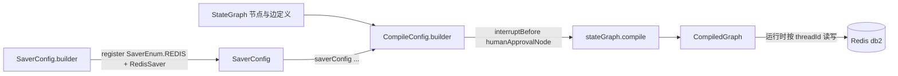

# 7-2 集成Redis Stack+Graph 配置改造实现工作流状态 Redis 持久化

【学习目标】

- 说清 Redis 与 Redis Stack 的能力差异，以及本课程选型 Redis Stack 的真实动机；
- 掌握持久化改造的三个落点：`SaverConfig` 的组装、`CompileConfig` 的挂载、Redis 依赖与配置的补齐；
- 理解 `SaverEnum` 五种存储类型的语义与 `BaseCheckpointSaver` 的扩展点，能向面试官讲明「为什么不直接用内存 checkpoint」。

## 【正文】

## 一、准备工作：用 Docker 起一个 Redis Stack Server

真正开发之前需要先做环境准备：工作流状态要放到 Redis 当中存储，首先得把 Redis 装上。课程通过 Docker 启动一个 Redis Stack Server 服务，Windows 电脑需要先装好 Docker 相关软件并把 Docker 环境配置好。

直接使用纯 Redis 当然也可以。之所以选 Redis Stack，是为接下来的第二个项目，智能 BI Agent，做准备，因为该项目里也会往 Redis 里放一些数据（9-6 篇会用到 Redis 的向量检索能力）。为了不让读者对 Redis Stack Server 感到陌生，先用一张表把两者的差异摆出来：

| 维度 | Redis | Redis Stack |
|---|---|---|
| 数据结构 | 一个项目，支持多种基本数据结构 | 除基本数据结构外还支持复杂结构，Redis 支持的它全支持 |
| 全文搜索 | 不支持 | 支持高效的全文搜索 |
| 图形功能 | 不支持 | 支持图形的存储与查询 |
| 时间序列支持 | 基本支持 | 专门优化过的时间序列处理 |
| 安装复杂度 | 较简单 | 相对复杂，涉及多个组件；但单机版启动仍是一条 Docker 命令的事 |

从这五个维度可以得出结论：Redis 有的功能 Redis Stack 全都有，Redis Stack 是对 Redis 的一种扩展。对当前项目而言，即便只把它当成一个普通 Redis 来用也完全没问题，Redis 怎么用，它就可以怎么用。

介绍完之后运行 Docker 命令把服务拉起来：

```bash
        docker run --name redis-stack redis-stack:latest
```

需要补充说明：该命令为讲稿节选，未显式指定 `-p 6379:6379` 端口映射与持久化卷参数；若本机之前已经运行过一个同名的 Redis Stack 容器，再执行同一命令会报命名重复错误，直接在 Docker 桌面端把已有容器运行起来即可，端口仍是 `6379`。

## 二、持久化写在哪里：图编译的那一刻

环境就绪，进入代码编写。编码之前先想清楚一个问题：持久化的存储应该写在什么地方？答案是，写在图编译的时候。

回到图的定义类看编译这一块的演进：最开始用的只是无参的 `compile()` 方法，状态默认进内存；后来涉及人类反馈、需要工作流中断时，改用了它的第二个重载方法，即传入 `CompileConfig` 的有参方法。`CompileConfig` 里除了指定在哪里中断（`interruptBefore`）之外，还有没有别的能力？点进去可以看到有一个 `SaverConfig`，也就是保存的配置类，这就是挂载持久化的入口。把 `SaverConfig` 组装好后塞进 `CompileConfig`，工作流的状态就会被写入外部存储。

先加一个注释「创建持久化配置类」。`SaverConfig` 是构造器模式，通过 `builder()` 来构造。看它内部的 `register` 方法，需要传两个参数：第一个参数是一个类型字符串，表达「我想将工作流的状态用什么样的方式去做持久化」，Spring AI Alibaba 对该类型提供了枚举，叫做 `SaverEnum`；第二个参数是一个 `BaseCheckpointSaver` 实例，即真正干活儿的持久化实现。

改造后的图定义如下：

```java
        public class GraphConfig {
            public class GraphConfig graph(ChattClient.Builder chattclientBuild) throws GraphStateException {
                stateGraph.addEdge(StateGraph.START, targetd="saleRecordDataNode");
                stateGraph.addEdge(StateGraph.START, targetd="inventoryOrderDataNode");
                stateGraph.addEdge(StateGraph.START, targetd="predictNode");
                stateGraph.addEdge(StateGraph.START, targetd="extractNode");
                stateGraph.addConditionalEdges("sendEmailNode", "humanApprovalNode", AsyncEdgeAction.edge_async(new ApprovalNode()));
                stateGraph.addEdge("createInventoryTransferNode", StateGraph.END);
                // 配置检查点
                SaverConfig saverConfig = SaverConfig.builder()
                    .register(SaverEnum.REDIS.getValue(), ...)
                    .build();
                CompileConfig compileConfig = CompileConfig.builder()
                    .interruptBefore("humanApprovalNode")
                    .build();
                return stateGraph.compile(compileConfig);
            }
        }
```

需要如实说明：该代码块为讲稿节选，存在若干转写问题，外层 `public class GraphConfig` 与内层类名重复；`graph(...)` 方法参数写作 `ChattClient.Builder chattclientBuild`（拼写与命名均与 7-1 篇的 `ChetClient.Builder chatClientBuild` 不一致）；`targetd=` 是具名参数写法；`register(...)` 的第二个参数以省略号占位；最关键的是 `saverConfig` 组装完成后并没有通过 `.saverConfig(saverConfig)` 挂进 `CompileConfig`，`compile(compileConfig)` 因此仍不会走 Redis 持久化。完整的正确写法在 7-3 与 7-5 篇的代码块中给出。

## 三、SaverEnum 的五种存储类型

点进 `SaverEnum`，看它提供了哪些存储类型：

| 枚举值 | 语义 | 适用场景 |
|---|---|---|
| `DB` | 存到数据库当中 | 官方默认沿 MongoDB 实现，适合快照量大、要求强一致的团队 |
| `REDIS` | 把工作流的状态存到 Redis 当中 | 高频小 JSON 读写、需要 TTL 自动清理，本课程选择 |
| `MEMORY` | 存到内存当中 | 默认方案，仅适合本地开发与单机演示 |
| `FILE` | 存到文件当中 | 本地调试、单机持久化的轻量替代 |
| `NONE` | 不存储 | 无中断语义的一次性流程，或状态由外部系统全权托管的场景 |

现在要存到 Redis，所以调用 `SaverEnum.REDIS.getValue()`。第二个参数需要传一个 `BaseCheckpointSaver`，点进去它是一个接口，接口下有一些实现类；Spring AI Alibaba 已经帮我们把 Redis 存储做了集成，其中有一个 Redis 存储的实现类，即框架预置好的实现。看它的构造方法，需要传入一个 Redis 连接工厂即可，所以直接使用该实现类 `new RedisSaver(...)`，并传入对应的 `RedisConnectionFactory`。

用一张图把编译期的组装关系画出来，便于建立整体印象：



## 四、Redis 客户端怎么拿：先补依赖，再补配置

`RedisSaver` 需要一个 Redis 连接工厂。可能有开发者想着直接用 `@Resource` 注入一个现成的 `RedisConnectionFactory`，但会发现项目里并没有，因为 Redis 的依赖还没有引入。所以第一步是先把依赖加进 POM。

按老规矩，加依赖之前先在 POM 里定义版本号：定义 `redis.version`，课程使用的版本是 `3.2.4`。然后引入依赖，直接引入它的 starter 即可，也就是 `spring-boot-starter-data-redis`（Redis Spring Boot Starter），版本通过 `${redis.version}` 来取。

刷新 POM 文件，可以看到依赖在正常加载，没有报错也没有爆红。按住 Ctrl 点进去能进到 Redis 的 POM，说明依赖已经引入成功。

引入成功之后还需要到 YAML 配置文件里对 Redis 做配置，总要指定 Redis 服务器的地址等信息。做过实际项目开发的读者对 Redis 配置肯定不陌生，这里不逐行展开，直接给出课程的配置口径：

Redis 的配置放在 `spring.data` 下面的 `redis` 节点里。先指定 `database`，默认是 0，课程放到 2，因为 0 号库里可能有其他数据，演示时会造成数据混乱，所以先用可视化工具确认哪个库是空的。这里强烈推荐装一个 Redis 可视化工具 Another Redis Desktop Manager，挺好用；连接本地 `localhost:6379` 后可以看到 db2 是空的，就用它。

接着填写 `host`：本地启动就写 `localhost`；`port` 也是 `6379`，即 Docker 暴露的端口。再配置超时时间 `timeout`，课程定义为 5 秒；连接超时时间同样设为 5 秒。

原稿此处给出的配置代码如下：

```yaml
        spring:
          thymeleaf:
            suffix: .html
        datasource:
          driver-class-name: com.mysql.cj.jdbc.Driver
          url: jdbc:mysql://localhost:3306/ai-transfer?useUnicode=true&characterEncoding=utf-8&useSSL=false&serverTimezone=Asia/Shanghai
          username: root
          password: # (此处省略)
```

需要如实说明：该代码块为讲稿转写时的错位节选，块中内容是 thymeleaf 与 MySQL 数据源的配置，且 `datasource` 节点缩进与 `spring` 不一致，与正文所述的 Redis 配置并非同一段配置。按正文描述，Redis 配置的正确位置是 `spring.data.redis` 节点，包含 `database`、`host`、`port`、`timeout` 与连接超时项；`RedissonConfig` 读取的也正是 `spring.data.redis.host`、`spring.data.redis.port`、`spring.data.redis.database` 这三个配置项（详见 7-3）。

## 五、生产级考量：序列化边界、TTL 与并发隔离

代码通路打通之后，还有三个生产问题必须回答，它们也是面试深挖的高发区：

**1. 序列化边界在哪里？** checkpoint 持久化的对象是 `StateSnapshot`，其中 `values` 承载状态通道的全量数据。这意味着：凡是被写进状态通道、随节点流转的对象，都必须可被 checkpoint 序列化。课程链路里流经状态通道的既有框架侧的结构化数据，也有业务侧从 MySQL 查出的商品、库存快照。自定义节点 Action 里若持有不可序列化的依赖（如数据库连接、线程池），必须用 `transient` 或构建期注入排除，否则 Redis 写入阶段会直接抛序列化异常。这是「内存 checkpoint 时代不会暴露、上了 Redis 才爆」的典型问题。

**2. 需要 TTL 吗？** 分两种会话看：进行中的人审会话，快照是恢复的唯一依据，不能过期；已终态（走到 END）的会话，快照属于可回收数据，应设置 TTL 或由定时任务清理。Redis 的过期机制让清理策略成为一个配置项，这是选 Redis 而非裸写 MySQL 的便利之一。7-3 会看到 db2 中实际落库的快照结构。

**3. 并发如何隔离？** 不同用户的会话以 threadId 区分，键空间天然隔离，互不覆盖；需要防范的是同一会话的并发恢复，比如审核人重复点击「采纳」，两次恢复请求可能同时读到同一份快照并各自向后执行，造成单据重复创建。生产上应在恢复入口按 threadId 加分布式锁（Redisson 的 `RLock` 正好合适），保证同一会话的恢复动作串行化。

## 【易错点 / 面试题】

1. **面试官问：为什么不用内存 checkpoint，非要上 Redis？**
   答题要点：内存 checkpoint 与进程同生命周期，重启即丢；多副本部署时内存互不共享，恢复请求落到其他实例同样报 `missing checkpoint`。Redis 同时解决「不随进程消亡」与「多实例共享」两个问题，且点查延迟低、TTL 可控，与 checkpoint「高频小 JSON 读写」的模型匹配。

2. **面试官问：`SaverConfig` 和 `CompileConfig` 是什么关系？**
   答题要点：`SaverConfig` 通过 `builder().register(SaverEnum.REDIS.getValue(), new RedisSaver(connectionFactory))` 描述「状态存到哪、用什么实现」；`CompileConfig` 是编译配置的总入口，用 `.saverConfig(...)` 把前者装配进去，同时承载 `.interruptBefore(...)` 的中断声明，最终 `stateGraph.compile(compileConfig)` 产出 `CompiledGraph`。只组装 `SaverConfig` 而不挂进 `CompileConfig`，持久化不会生效，这是本节讲稿代码残缺处特别标注的坑。

3. **易错点：数据库编号随手用默认的 0。** 0 号库往往已有其他业务数据，checkpoint 快照与业务数据混在一起，排查时互相干扰。课程显式选用空的 db2，生产上同样建议为 checkpoint 独立分配 db 或 key 前缀。

## 【小结】

本节完成 Redis Stack 环境搭建与持久化的配置层改造：讲透 Redis 与 Redis Stack 的选型动机、`SaverConfig` / `SaverEnum` / `BaseCheckpointSaver` 的机制，以及依赖、YAML 配置的补齐路径，并补上序列化边界、TTL、并发隔离三个生产视角。下一篇（7-3）落地 `RedissonConfig` 的序列化器接管，跑通「中断 → 重启 → 续跑 → 单据落库」的全链路验证，并演示自定义 `BaseCheckpointSaver` 把快照落到关系库的扩展写法。

完整的「大模型生成 → 提取 → 转换 → 入库」最小可部署闭环见工程模块 `980-demo/src/main/java/com/carl/ai/transfer/agent/TransferAgent.java`，其中 `extract/TransferOrderExtractor` 复刻 JSON 提取节点、`service/TransferOrderServiceImpl` 与 `repository/BbTransferOrderRepository` 复刻入库节点、`config/ChatModelConfig` 负责模型装配，可作为对照工作流节点实现的参照。
