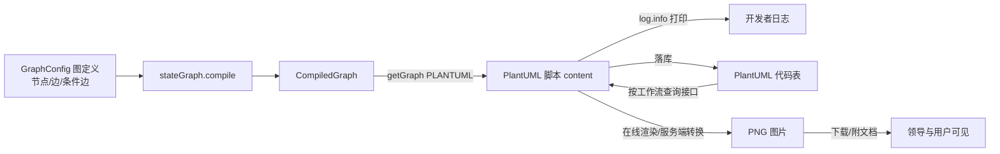

# 7-5 集成PlantUML，一键生成专业架构图，让设计清晰可见

【学习目标】

- 理解 PlantUML 作为「脚本驱动出图」语言的核心形态，以及 Spring AI Alibaba Graph 内置 PlantUML 集成的能力边界；
- 掌握 `CompiledGraph.getGraph(type, title, printConditionalEdges)` 三个参数的语义，完成图定义类的可视化改造；
- 走通「日志打印 → 在线渲染 → 落库 → 转 PNG」的完整链路，让流程设计对领导与用户可见。

## 【正文】

## 一、背景：PlantUML 是一门用脚本画图的语言

先补一个背景：PlantUML 本质上是一门用脚本代码来画图的语言。平时画图是在页面上可视化地拖拽，而 PlantUML 把这些图形抽象成了一段文本 script，由脚本驱动出图。

Spring AI Alibaba 已经内置了对 PlantUML 的集成，可以直接把图定义里的代码结构，添加了哪些节点、节点之间怎么连、哪里用了条件边，全部自动识别出来，生成对应的脚本代码，再由这份脚本渲染出整张工作流流程图。

回顾 7-4 的结论：静态截图必然与代码漂移，维护成本高；而 PlantUML 方案让图跟着代码走，改动即同步。本节把这套思路落到库存调拨工作流上。

## 二、改造点：编译之后先接住 CompiledGraph

改动点依旧落在图的定义类里。之前编译完成后是直接 `return` 拿到的 `CompiledGraph`，现在不能这么做了：需要先把返回结果接住，加工之后再返回。最终肯定还是要返回 `CompiledGraph`，因为不返回的话，触发层也就是 controller 这一层就没法正常使用。

在 `CompiledGraph` 上有一个 `getGraph` 方法，顾名思义就是拿到这张图。它接收若干参数：

| 参数 | 类型 | 语义 | 本课程的取值 |
|---|---|---|---|
| 第一个参数 `type` | `GraphRepresentation.Type` 枚举 | 指定用哪种方案来呈现这张图 | `PLANTUML` |
| 第二个参数 `title` | 字符串 | 给图起个名字 | `transferGraph`（库存调拨图，见名知意） |
| 第三个参数 `printConditionalEdges` | 布尔 | 控制是否把条件边打印出来 | `true`（开启，开不开其实都可以） |

框架提供的枚举 `GraphRepresentation.Type` 目前实现了两套方案：一套是 PLANTUML，另一套是 MERMAID。MERMAID 这条课程没有实际使用，了解不多，感兴趣的可以自行跟进；本课程走的是 PLANTUML。

图对象拿到之后就可以打印。日志加上 Slf4j 注解，用 `log.info` 输出，形如 `plantUML code =`，具体的值通过 `content()` 方法取出。到这里基本就实现完了。

改造后的图定义类如下：

```java
    public class GraphConfig {
        public CompiledGraph graph(ChatClient.Builder chatclientBuild) throws GraphStateException {
            stateGraph.addConditionalEdges(
                sourceId: "humanApprovalNode",
                targetId: "createInventoryTransferNode",
                edge: async(new ApproveAction)
            );
            stateGraph.addEdge(sourceId: "createInventoryTransferNode", targetId: StateGraph.END);

            // 创建保存配置
            SaverConfig saverConfig = SaverConfig.builder()
                .register(SaverEnum.REDIS.getValue(), new RedisSaver(redissonClient))
                .build();

            // 定义编译配置
            CompileConfig compileConfig = CompileConfig.builder()
                .interruptBefore("humanApprovalNode")
                .saverConfig(saverConfig)
                .build();

            // 编译状态图
            CompiledGraph compiledGraph = stateGraph.compile(compileConfig);

            // 实现 PlantUML 可视化
            GraphRepresentation transferGraph = compiledGraph.getGraph(GraphRepresentation.Type.PLANTUML,
                title = "transferGraph", printConditionalEdges = true);

            return compiledGraph;
        }
    }
```

需要如实说明：该代码块为讲稿节选，存在转写痕迹，`addConditionalEdges` 与 `addEdge` 调用中的 `sourceId:` / `targetId:` / `edge:`、以及 `getGraph` 调用中的 `title =` / `printConditionalEdges =` 均为具名参数写法，Java 方法调用并不支持这种语法；`async(new ApproveAction)` 缺少类名结尾的点号；`redissonClient` 字段未在本类中声明（应来自 `RedissonConfig` 的 Bean，见 7-3）；`GraphRepresentation transferGraph` 赋值后未使用，打印时应通过 `transferGraph.content()` 取值。理解改造意图即可：**先接住 `compiledGraph` → 调 `getGraph` 拿 PlantUML 脚本 → 打印/落库 → 返回 `compiledGraph` 供 controller 使用。**

注意这段代码同时承载了 7-2、7-3 两篇的成果：`SaverConfig` + `saverConfig(...)` 是 Redis 持久化装配，`interruptBefore("humanApprovalNode")` 是人审中断声明，新增的只有 `getGraph` 可视化这一段，这正是「图是代码的投影」的直观体现，改一行代码，图的内容就变。

## 三、验证：一次「不按剧本走」的日志

先验证一下这段代码能不能正常打印。启动服务，发起调用，把日志复制出来搜索。此时还没有输出；稍等一会儿，日志显示已经走到提取 JSON 的节点，邮件也发送了，但仍然没有打印。接着去邮件里点一次采纳，执行完再回来看，还是没有输出。于是重新再发起一次调用，发现连 debug 日志都没打出来。

重启一次服务，启动完成再查，这次输出出来了。该现象确实有点奇怪：一开始没进来，重启之后就进来了。放行之后，从日志里一路往下找到那段内容并复制出来，它就是整张工作流图转换出来的 PlantUML 脚本代码。

对这一现象不必过度解读，但值得记录一个排障经验：图定义类的 Bean 初始化时机与日志输出存在耦合时，首个调用周期内 `getGraph` 可能尚未随 Bean 初始化完成而执行；重启后 Bean 完整初始化，日志即正常输出。实践中若遇到「第一次不打印」，先重启验证，再回头核对 Bean 的初始化顺序，而不是反复发起业务调用。

怎么把这段脚本变成图？用在线工具即可。找一个 PlantUML 在线渲染网站，把代码粘进去，它会自动生成对应的图。全屏看一眼，图里呈现的正是这条工作流设计的结构：

- 起始是开始节点；
- 往下并行分出两条，一条查询销售数据，一条查询调拨数据；
- 两个节点汇总到大模型预测调拨情况；
- 再往下是提取 JSON；
- 接着是发送邮件；
- 再往下是人类反馈节点，并在那里设置一个中断；
- 中断结束之后会走条件边：如果是结束，直接 stop；如果是接受，则去创建实际业务调拨单，业务调拨单执行完再走到结束节点。

整张图就这样被自动还原出来了。注意图里还有虚线一类的元素，同样被正确渲染，虚线对应的正是条件边，这也说明第三个参数 `printConditionalEdges` 的开启确实生效了。仅凭 PlantUML 的这份代码，就能实现流程图的自动生成。

再点破一个读图要点：人审节点处的「中断」与条件边的「分流」是两件事，图上分别体现为节点上的中断标记和两条去向不同的虚线路径。向领导讲解时，把「中断」翻译成「到这里会停下来等人批」，把「条件边」翻译成「批了就创单、拒了就结束」，一张图即可完成业务语义的完整传递，这正是 7-4 所说「让非技术角色看清流程设计」的落地效果。

用一张图概括这条「代码 → 脚本 → 图片」的投影链路：



## 四、扩展：落库、查询接口与转 PNG

前面埋的伏笔在这里接上：编译的时候把这段内容保存到表里，再通过相应的方法把 PlantUML code 转成 PNG。推荐优先保存到表中，再额外提供一个接口，按工作流查询它的 PlantUML 代码；查到之后把代码转成图片输出。

课程笔记中贴过来的这部分代码是阿里巴巴官方提供的，作用就是把 PlantUML 的 code 生成对应的图片。拿到的是 response，同样可以做扩展，例如不落图片，直接通过 response 让用户下载。

这段代码需要传入的 code，就是上面打印出来的 `content()` 内容。把它传进去就能生成图片，最终可以在对应的工具类里直接看到效果。

把落库与查询的形态再展开一层，它与 7-4 讲的三步落地完全对应：**日志打印**解决「开发者自己能看到」，**落库 + 按工作流查询的接口**解决「别人能按需拿到」，**转 PNG / 下载接口**解决「非技术角色能直接看」。其中「落库优先于直接产图」的顺序值得强调，代码是文本，存储成本低、可重复渲染；图片是二进制，按需生成即可，没必要每次编译都产出一份。

## 【易错点 / 面试题】

1. **面试官问：你们的流程图是手工维护的吗？**
   答题要点：不是。调用 `CompiledGraph.getGraph(GraphRepresentation.Type.PLANTUML, title, true)` 从图定义自动生成脚本，打印后可落库、可转 PNG；图跟着代码走，改动即同步。能讲出「静态截图必然漂移、代码化生成才是唯一事实源」的对比，就是完整的加分回答。

2. **面试官问：`getGraph` 支持哪些呈现格式？**
   答题要点：`GraphRepresentation.Type` 目前有 PLANTUML 与 MERMAID 两套实现；课程走 PLANTUML，`title` 为图命名（如 `transferGraph`），`printConditionalEdges` 控制条件边（虚线）是否渲染，开启后能让评审者看清人审节点的分流逻辑。

3. **易错点：改完图定义后忘记确认输出形态。** `getGraph` 返回的 `GraphRepresentation` 只是脚本载体，值要通过 `content()` 取；只把返回值接住而不使用，日志里什么都不会打印。另外「首次调用不打印、重启后正常」的现象，先排查 Bean 初始化时机，别急着改业务代码。

## 【小结】

本节完成 PlantUML 可视化落地：讲清 PlantUML 的脚本画图形态与框架内置集成，完成「接住 `CompiledGraph` → `getGraph` → 打印脚本」的改造，验证了在线渲染还原整张工作流图（含条件边虚线），并给出「落库 → 查询接口 → 转 PNG」的生产链路。至此，7-4 提出的「让用户与领导看到流程设计」形成了从理念到工具的完整闭环。

工作流节点编排与对外入口的最小可部署参照见工程模块 `980-demo/src/main/java/com/carl/ai/transfer/agent/TransferAgent.java` 与同包 `controller/TransferController.java`；模型侧装配见 `config/ChatModelConfig.java`。下一篇（8-1）进入新主题：高并发场景下，这套调拨系统如何承接双 11 级别的瞬时流量。
