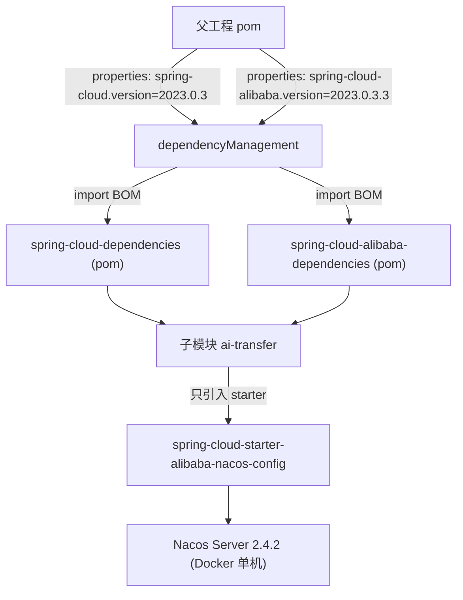

# 8-2 项目改造：单体项目改造为微服务项目

## 【学习目标】

- 理解本项目引入 Nacos 的动机：动态阈值更新，从根上缓解高并发下的预测触发压力。
- 掌握「先查版本对应关系、再动 pom」的依赖引入方法论。
- 学会在父工程用 `dependencyManagement` 统一管理 Spring Cloud / Spring Cloud Alibaba 版本。
- 掌握从 starter 依赖反查 `nacos-client` 版本、反推服务端版本的方法。

## 【正文】

### 一、改造动机：高并发方案的第一块基石

解决高并发问题的第一种方案，是通过引入 Nacos 作为配置中心，实现动态阈值的更新：只有当商品销售达到阈值设定时，才会触发库存调拨的预测。

回顾 8-1 提出的问题：商品销售是高频写操作，如果每次都同步触发大模型预测，推理耗时会直接压垮销售主链路。阈值动态化是一道闸门，阈值放在配置中心，运营调整数字不需要发版；后续还可以按仓库、按商品粒度分别配置，把预测触发频率控制在合理区间。要让「配置改完立即生效」，就需要一个独立于应用的配置中心，这正是引入 Nacos 的理由。

### 二、现状与目标：从单体到微服务子模块

先看现状。当前项目本质上仍是单体项目，是 Spring Boot 的单体结构，并没有做成微服务。但在实际的公司项目里，智能库存调拨系统一定是微服务体系中的一个子 module、一个子模块，集成进公司现有的微服务体系。所以第一步要把整个项目改造成微服务项目。

这里要对齐一个认知：课程里的「改造为微服务」并不是把应用拆成多个服务，而是**把单体工程改造成「可嵌入现有微服务体系的模块」**，父工程 + 子模块的 Maven 多模块结构、版本统一管理、配置外部化，这些都是接入公司微服务体系的入场券。

改造从引入 Spring Cloud 和 Spring Cloud Alibaba 开始，依赖统一在父项目的 pom 文件里引入。

### 三、版本对应关系：先查表，再动手

引入之前有个前提：必须先到 Spring 官网确认 Spring Boot 版本与对应的 Spring Cloud 版本，两者只有当版本对应关系兼容时才能整合。打开 Spring 官网，在 Spring Cloud 的 overview 页面可以看到版本对应关系表，左边是 Spring Boot 版本，右边是对应的 Spring Cloud 版本。

本项目的 Spring Boot 版本是 3.3.4，对应表里的 3.3.x / 3.2.x 这一档，因此 Spring Cloud 必须是 2023 系列的版本。

为什么版本对应关系是硬约束？Spring Cloud 是对 Spring Boot 自动配置体系的深度封装，`spring-cloud-context`、配置属性绑定等机制与 Boot 版本强耦合。跨大版本混搭的典型症状是：Bean 加载顺序变化导致 `@RefreshScope` 失效、配置属性绑定静默失败、启动阶段抛 `NoSuchMethodError`。官方 release train 表就是用来对齐该耦合关系的，选型第一步永远是查表，而不是凭记忆写版本号。

版本确定后再回到父工程的 pom 做改造。注意一定要进到父工程的 pom 文件里，在 properties 中定义版本信息：`spring-cloud.version`，取值必须是 2023 系列，这里用 `2023.0.3`，它属于 2023.0.x，与本地 3.3 的版本适配更好。

定义好版本之后要放进 dependencyManagement 做版本管理。在父工程统一管理之后，各子项目就不需要再写对应的版本号了。添加 `spring-cloud-dependencies`，groupId 是 `org.springframework.cloud`，版本从上面定义的属性里取，同时要加上 `type` 为 `pom`、`scope` 为 `import`。

`dependencyManagement` + `import` 这套组合的含义是：把 Spring Cloud 的 BOM（物料清单）整体导入父工程的依赖管理，BOM 里声明的所有 cloud 组件版本随之生效；子模块引用这些组件时只写 groupId + artifactId，版本由父工程裁决。这样做的直接收益是版本单一来源（single source of truth），升级 Spring Cloud 只需要改父工程一处属性，不会出现模块 A 用 2023.0.2、模块 B 用 2023.0.3 的撕裂局面。

刷新之后没有报错，按住 Ctrl 点进去也能正常跳转，说明引入成功。

### 四、Spring Cloud Alibaba 适配

引入 Spring Cloud 之后还要引入 Spring Cloud Alibaba 与它适配，这就要再确认两者的版本对应关系。到 Spring Cloud Alibaba 官网看开始部分的版本发布声明：文档列出了 Spring Cloud 2023.0.0 对应某个版本、0.1 对应某个版本，但并没有给出 0.3 对应的版本。这部分我自己试过，没有问题，可以直接使用下面给出的版本来进行适配，与 3.3.4 是兼容的。

Spring Cloud Alibaba 的版本定为 `2023.0.3.3`，用它来和当前的 Spring Cloud、Spring Boot 版本做适配，实测没有发现问题，可以直接沿用。

Spring Cloud Alibaba 的版本号是三位结构（如 2023.0.3.3），前两段对齐 Spring Cloud 的 release train，第三段是 Alibaba 侧的补苗版本。文档未覆盖的组合，按「实测可用 + 版本号对齐原则」处理：先取与 Spring Cloud 2023.0.3 同前缀的 2023.0.3.x，再跑通启动验证。

定义完版本号之后，同样回到 dependencyManagement 里添加 `spring-cloud-alibaba-dependencies`，groupId 为 `com.alibaba.cloud`，版本取自定义的属性，`type` 依然是 `pom`、`scope` 依然是 `import`。刷新并按住 Ctrl 点进去验证，依赖没有问题。

至此依赖管理层就绪，整体结构如下：



### 五、引入 nacos-config starter

依赖就绪之后，下一步是引用 Spring Cloud Alibaba 里的 Nacos。继续看官网，在「注册配置中心」章节，官方文档给出了需要引入的依赖，直接照搬到项目里即可。文档给出的基础配置形如：

```yaml
        spring:
          cloud:
            nacos:
              server-addr: 127.0.0.1:8848
              config:
                file-extension: yaml
                prefix: nacos-config-example
```

回到 `ai-transfer` 模块的 pom（注意不要引错模块），添加 `spring-cloud-starter-alibaba-nacos-config`，然后刷新。这里只引入 Nacos 作为配置中心，没有引入 Nacos 作为注册中心。如果实际项目中公司确实使用 Nacos 做注册中心，也可以自行引入，这里不做演示，用例只用配置中心。

```xml
        <dependency>
            <groupId>com.alibaba.cloud</groupId>
            <artifactId>spring-cloud-starter-alibaba-nacos-config</artifactId>
            <version>2023.0.3.3</version>
        </dependency>
```

「只引 config、不引 discovery」是一个有意识的取舍：配置中心的诉求是把阈值这类动态配置外移，服务注册发现则是另一套基础设施（涉及心跳、健康检查、实例列表订阅），公司已有注册中心时重复引入只会带来双写与一致性问题。按需引入、用哪个引哪个，是接入公司既有体系时的基本纪律。

### 六、从依赖反查服务端版本

引入 `nacos-config` 之后，还需要真正启动一个 Nacos 实例作为配置中心。用哪个版本的 Nacos 才能更好地与这套依赖适配？官网并没有给出最新的对应关系，这种情况下可以直接查源码。

回到 pom，按住 Ctrl 点进刚才引入的 nacos 依赖，进到它的 pom 里往下翻，能找到 `nacos-client` 的版本，是 2.4.2。所以接下来启动 2.4.2 版本的 Nacos 作为配置中心即可，版本就是这样确定下来的。

该「反查」手法值得记住：客户端与服务端的协议、API 是耦合的，客户端大版本跨越往往意味着服务端也要跟上。当文档没有给出对应关系时，starter → client 的依赖传递链就是最权威的答案，启动与服务端同版本的客户端所声明的版本，是最稳的选择。

Nacos 的启动方式这里采用 Docker，跑一个单机版的 Nacos，并且把 Nacos 的持久化配置到 MySQL 中。下一篇逐步演示具体实现。

### 七、多模块结构：父工程到底管什么

引入版本管理之前，先对齐多模块结构里父工程的角色。父工程的 pom 不写业务代码，只做三件事：

- **聚合**：以 `modules` 声明子模块列表（如 `ai-transfer`），一条命令构建全部模块；
- **版本裁决**：`dependencyManagement` 统一管理跨模块共享依赖的版本，子模块引用时免写版本号；
- **构建配置**：统一的编译参数、插件与仓库地址。

这次改造把依赖全部落在父工程，正是因为「版本对齐」是多模块工程的生命线：Spring Cloud 与 Boot 的版本耦合关系一旦在某一个子模块被破坏，症状往往是启动期诡异的 Bean 缺失，而不是直观的版本冲突报错。收敛到父工程后，这类问题从源头消失。

`import` 方式引入 BOM 还有一个常被忽略的性质：它只导入 `dependencyManagement`，不会给项目凭空添加传递依赖，BOM 里声明的组件，只有子模块显式引用后才会进入依赖树。这保证了「统一版本」与「按需引入」两不误：版本表是全量的，实际依赖树是最小集。

### 八、升级视角：单一版本来源的价值

从维护视角看，单一版本来源的价值在升级时才兑现：Spring Cloud 某个组件曝出安全漏洞，修复只需改父工程的一行属性，全模块自动对齐；反之，如果版本散落在各子模块，升级必然漏改，漏掉的模块就是下一次故障的源头。这也是「依赖收敛」成为企业级 Maven 工程基本纪律的原因，它的收益不在引入时，而在每一次升级与排障时。

### 九、配置中心与注册中心的分工

Nacos 有两大能力，本节只用其一，值得把分工说清：

| 能力 | 解决的问题 | 关键机制 | 本节是否引入 |
|---|---|---|---|
| 配置中心 | 配置外移、动态刷新、多环境隔离 | 长轮询推送、命名空间/Group/Data ID | 引入 |
| 注册中心 | 服务实例注册与发现、健康检查 | 心跳保活、实例列表订阅 | 未引入 |

公司已有微服务体系时，注册中心通常已存在（Nacos、Eureka、Consul 等），新模块按既有规范接入即可；配置中心同理，若公司已有一套，动态阈值就并进去，而不是新起一套。判断标准是「公司用什么就跟什么对齐」，自建只会带来双写与一致性问题，这也是本节只引 `nacos-config` 的务实之处。

### 【易错点 / 面试题】

1. **面试：Spring Cloud 和 Spring Boot 的版本怎么选？**
   参考答法：以 Spring 官方 release train 对应表为准，Boot 3.3.x 对应 Cloud 2023.x；不跨大版本混搭，避免自动配置与上下文机制不兼容。

2. **面试：`dependencyManagement` 的 `import` scope 解决什么问题？**
   参考答法：把 BOM 导入父工程统一裁决版本，子模块免写版本号，保证多模块版本一致、升级只改一处。没有它，每个模块各自声明版本，升级必然漏改。

3. **易错：在子模块 pom 里写 cloud 依赖版本。** 版本一旦散落到子模块，父工程的统一管理就失效了；另外 starter 要引在 `ai-transfer` 模块，引到父工程或无关模块都不会生效。

### 【小结】

本节完成了微服务改造的第一步：按官方对应表确定 Spring Cloud 2023.0.3 + Spring Cloud Alibaba 2023.0.3.3，在父工程用 `dependencyManagement` 统一管理，给 `ai-transfer` 引入 `nacos-config` starter，并通过依赖反查锁定 Nacos 服务端 2.4.2。下一篇用 Docker 启动该单机版 Nacos（MySQL 持久化）跑起来。

配套工程参考：`980-demo/src/main/resources/application.yml` 与 `application-prod.yml` 用「多 profile + 环境变量占位」实现同一目标，配置与代码分离、密钥不落库；default profile 完全离线可跑，prod profile 填真实端点即可上线，与「配置外移到 Nacos」在生产上是互补的两条路径。
