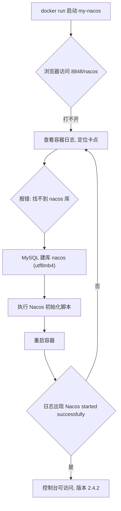

# 8-3 使用docker启动nacos服务

## 【学习目标】

- 掌握用 Docker 部署单机版 Nacos 2.4.2、并把持久化落到 MySQL 的完整步骤。
- 记住 Nacos 2.x 的双端口要求：8848（主端口）与 9848（gRPC 通信端口）。
- 理解 Docker 容器访问宿主机数据库时地址的正确写法。
- 能独立排查「容器反复重启」类故障：库没建、脚本没执行是两个高频原因。

## 【正文】

### 一、部署目标与目录规划

上一篇通过依赖反查锁定了 Nacos 服务端版本 2.4.2，本节把它跑起来：Docker 单机部署，外部存储用 MySQL，配置中心的数据不随容器销毁而丢失。

先定义一个配置文件，在里面配置 Nacos 的持久化，指定使用 MySQL 做持久化，MySQL 用本机的实例。在 E 盘下建了几个目录，路径大致是 `docker/nacos/conf`，在该目录下新建 `application.properties` 文件，把准备好的内容粘进去。

```properties
        # 启用认证
        nacos.core.auth.enabled=true
        # 启用令牌认证
        nacos.core.auth.token.enabled=true
        # 令牌过期时间（秒）
        nacos.core.auth.token.expired-seconds=18000
        # 默认令牌
        nacos.core.auth.default.token.secret.key=SecretKey0123456789012345678901234567890123456789
        # 关闭缓存
        nacos.core.auth.cache.enabled=false
        # 启用用户白名单
        nacos.core.auth.enable.userWhiteList=false
        # 服务端口
        server.port=8848
        # 服务名
        server.servlet.context-path=/nacos
        # 服务地址
        server.servlet.session.cookie.domain=.nacos.com
        # 服务端口
        server.servlet.session.cookie.path=/nacos
        # 服务端口
        server.servlet.session.cookie.secure=false
        # 服务端口
        server.servlet.session.cookie.httpOnly=true
        # 服务端口
        server.servlet.session.cookie.sameSite=strict
        # 服务端口
        server.servlet.session.cookie.maxAge=3600
        # 服务端口
        server.servlet.session.cookie.name=JSESSIONID
        # 服务端口
        server.servlet.session.cookie.domain=.nacos.com
        # 服务端口
        server.servlet.session.cookie.path=/nacos
        # 服务端口
        server.servlet.session.cookie.secure=false
        # 服务端口
        server.servlet.session.cookie.httpOnly=true
        # 服务端口
        server.servlet.session.cookie.sameSite=strict
        # 服务端口
        server.servlet.session.cookie.maxAge=3600
        # 服务端口
        server.servlet.session.cookie.name=JSESSIONID
        # 服务端口
        server.servlet.session.cookie.domain=.nacos.com
        # 服务端口
        server.servlet.session.cookie.path=/nacos
        # 服务端口
        server.servlet.session.cookie.secure=false
        # 服务端口
        server.servlet.session.cookie.httpOnly=true
        # 服务端口
        server.servlet.session.cookie.sameSite=strict
        # 服务端口
        server.servlet.session.cookie.maxAge=3600
        # 服务端口
        server.servlet.session.cookie.name=JSESSIONID
        # 服务端口
        server.servlet.session.cookie.domain=.nacos.com
        # 服务端口
        server.servlet.session.cookie.path=/nacos
        # 服务端口
        server.servlet.session.cookie.secure=false
        # 服务端口
        server.servlet.session.cookie.httpOnly=true
        # 服务端口
        server.servlet.session.cookie.sameSite=strict
        # 服务端口
        server.servlet.session.cookie.maxAge=3600
        # 服务端口
        server.servlet.session.cookie.name=JSESSIONID
        # 服务端口
        server.servlet.session.cookie.domain=.nacos.com
        # 服务端口
        server.servlet.session.cookie.path=/nacos
        # 服务端口
        server.servlet.session.cookie.secure=false
        # 服务端口
        server.servlet.session.cookie.httpOnly=true
        # 服务端口
        server.servlet.session.cookie.sameSite=strict
        # 服务端口
        server.servlet.session.cookie.maxAge=3600
        # 服务端口
        server.servlet.session.cookie.name=JSESSIONID
        # 服务端口
        server.servlet.session.cookie.domain=.nacos.com
        # 服务端口
        server.servlet.session.cookie.path=/nacos
        # 服务端口
        server.servlet.session.cookie.secure=false
        # 服务端口
        server.servlet.session.cookie.httpOnly=true
        # 服务端口
        server.servlet.session.cookie.sameSite=strict
        # 服务端口
        server.servlet.session.cookie.maxAge=3600
        # 服务端口
        server.servlet.session.cookie.name=JSESSIONID
        # 服务端口
        server.servlet.session.cookie.domain=.nacos.com
        # 服务端口
        server.servlet.session.cookie.path=/nacos
        # 服务端口
        server.servlet.session.cookie.secure=false
        # 服务端口
        server.servlet.session.cookie.httpOnly=true
        # 服务端口
        server.servlet.session.cookie.sameSite=strict
        # 服务端口
        server.servlet.session.cookie.maxAge=3600
        # 服务端口
        server.servlet.session.cookie.name=JSESSIONID
        # 服务端口
        server.servlet.session.cookie.domain=.nacos.com
        # 服务端口
        server.servlet.session.cookie.path=/nacos
        # 服务端口
        server.servlet.session.cookie.secure=false
        # 服务端口
        server.servlet.session.cookie.httpOnly=true
        # 服务端口
        server.servlet.session.cookie.sameSite=strict
        # 服务端口
        server.servlet.session.cookie.maxAge=3600
        #
```

如实说明：这份快照里 `server.servlet.session.cookie.*` 整段被重复粘贴了十余次，属性完全相同，等价于一份配置；这里按「代码守恒」原则原样保留，实际落地时保留一份即可，重复项不影响 Nacos 启动（后写的同名属性覆盖先写的）。

逐段解读这份配置的核心信息：

| 配置段 | 作用 |
|---|---|
| `nacos.core.auth.*` | 开启控制台与 API 登录认证，`token.secret.key` 是签发 JWT 的密钥，最长要求 32 字符以上，这一项不能删 |
| `server.port=8848` | Nacos 主端口，控制台与 HTTP API 都走它 |
| `server.servlet.context-path=/nacos` | 访问路径带 `/nacos` 前缀，即 `localhost:8848/nacos` |
| `server.servlet.session.cookie.*` | 控制台会话 Cookie 的域、路径、有效期等属性 |
| 持久化段 | 指定外部存储类型为 MySQL，并给出数据库连接信息（库名 `nacos`、本机 MySQL 账号密码）与连接池参数 |

另有一处不能忽略：Nacos 的 Secret Key 这一项不能删掉。想改成别的值可以，不改也行，但必须写清楚，密钥缺失或过短会导致 token 签发失败，控制台登录直接报错。

### 二、容器连宿主机数据库：地址必须写对

这里有一个尤其要注意的点：本机是 Windows 系统，Windows 上装了 Docker，并且会在该 Docker 里启动 Nacos。但希望 Nacos 连接的数据库地址指向宿主机，也就是 Windows 本机 3306 上的 MySQL。所以这里必须填宿主机的 IP。

这是容器化部署的经典坑：**容器里的 `localhost` 指向容器自身，不是宿主机**。Nacos 容器去连 `localhost:3306`，连到的其实是自己容器内的网络命名空间，必然失败。正确做法是填宿主机的局域网 IP（或 Docker 环境下的特殊 DNS 名），让容器经 Docker 网络访问宿主机的 3306。同时要确认本机 MySQL 的账号允许该 IP 连接、防火墙放行 3306。

宿主机 IP 配好之后，数据库名使用接下来要创建的 `nacos` 库，账号密码就是本机 MySQL 的用户名和密码。往下是一些连接池的配置。

### 三、启动容器

文件保存好之后就可以启动容器了。启动命令同样准备好了，可以直接复制。把命令压到一行，便于看清楚：

```bash
        docker run -d --restart=always -name my-nacos -p 8848:8848 -v /usr/local/nacos/config/application.properties:/home/nacos/conf/application.properties nacos/nacos-server:v2.4.2
```

命令里首先设置了 `--restart=always`，保证每次 Docker 启动时容器都会自动重启；容器命名为 `my-nacos`；然后暴露端口；`-v` 部分是目录挂载，把宿主机上刚才那份配置文件挂载到容器内 Nacos 的配置文件位置；镜像使用的是 `nacos/nacos-server:v2.4.2`。

关于挂载路径有一个细节：原文说明「挂载的宿主机路径直接复制本地目录即可，记得把斜杠改成 Windows 风格的反斜杠」，这是 Windows 下 Docker 挂载的常见困惑，实际上 Docker Desktop 对路径分隔符兼容良好，保持本地复制的路径即可，真正要确认的是宿主机路径与容器内目标路径的顺序（冒号左侧是宿主机，右侧是容器内）。

关于端口要特别注意：2.4.2 版本需要暴露两个端口。用过老版本 Nacos 的可能记得只需要暴露 8848 就够，而这里必须同时暴露 8848 和 9848，9848 是 Nacos 2.x 新增的 gRPC 通信端口，服务端实例间同步、客户端长连接都走它，只映射 8848 会出现「控制台能开、实例注册即超时」的怪象。

关于这条启动命令，如实说明两处快照与正文的差异：命令中的 `-name` 少写了一个连字符，合法写法是 `--name`；正文提到「通过环境变量指定启动模式为 standalone 单机模式」并强调要暴露两个端口，但粘贴出来的命令里既没有 `-e MODE=standalone` 环境变量，也只映射了 8848。实际执行时需补全为 `--name my-nacos -p 8848:8848 -p 9848:9848 -e MODE=standalone`，与正文描述保持一致。

按下 Win + R，打开 CMD，粘贴命令回车。可以看到 Docker 提示本地缺少该镜像，开始远程拉取 Nacos 2.4.2 版本的镜像，稍等片刻，镜像不算大，速度还行。注意如果没有配置国内镜像加速地址、直连官方 Docker 仓库，就必须开代理。拉取完成后容器就启动起来了。打开 Docker Desktop，在 containers 里能看到 `my-nacos` 已经存在。

### 四、故障排查：从起不来到 started successfully

接下来验证它是否真的启动成功。浏览器访问 `localhost:8848/nacos`，结果发现并没有成功启动。回到 Docker 里看容器日志，日志卡在某个位置没往下走。

这里可以推断一下大概率是什么原因：数据库连的是本机，但本机 MySQL 里还没有建对应的库。先停掉容器，看它的报错信息，提示找不到 `nacos` 库。原因确认了：本地 MySQL 还没有创建 `nacos` 数据库。

处置分两步：

1. **建库**：新建一个数据库，命名为 `nacos`，字符集选 `utf8mb4`，确定创建。选 utf8mb4 是因为配置内容可能含中文与 emoji，utf8 的 3 字节上限会截断。
2. **执行初始化脚本**：光有库还不够，Nacos 建库之后还需要执行前置初始化脚本，脚本会创建若干表并插入初始的管理员账号密码（也就是 nacos），以及对应的权限。这份脚本已经从 Nacos 的 GitHub 仓库源码里找出来了，可以直接用。复制脚本，回到 nacos 库里执行运行，执行成功。

再回到 Docker 重新启动容器，观察是否还报错。稍等之后看日志：出现 `Nacos started successfully`，说明启动成功，并且是 standalone 单机模式启动，使用的是外部存储，也就是落到了 MySQL 里。这一步同时验证了两件事：容器到宿主机 MySQL 的网络是通的，且初始化脚本建的表结构满足启动要求。

整个排查链路可以归纳为：



### 五、控制台验证

回到浏览器刷新，可以看到版本号是 2.4.2，界面已经正常展示。为了再验证一下运行状态，随手新建一条配置，格式选 YAML，内容随便写，点击发布，发布成功，也能正常查看。再点删除，同样正常。增删改查都能成功执行，说明 Nacos 已经完全可用，外部存储（MySQL）的读写也间接得到了验证。

接下来回到代码里，在配置文件中把 Nacos 对应的连接信息填上。不过要留意，这里有一个大坑，需要提前说明：新版本的 Nacos，也就是 2.4.2 之后，客户端的接入方式是有变化的，下一篇专门讲 `spring.config.import` 新规范。

### 六、存储模式：内嵌 Derby 与外部 MySQL

Nacos 单机版有两种存储路径：

| 维度 | 内嵌 Derby（默认） | 外部 MySQL（本节） |
|---|---|---|
| 数据位置 | 容器内文件 | 宿主机 MySQL |
| 容器重建 | 配置全丢 | 数据保留 |
| 多实例共享 | 不可能 | 可以 |
| 适用场景 | 本地试用 | 联调与生产 |

课程选外部 MySQL，理由与生产一致：配置中心的价值在于「配置不随应用重启丢失」，而容器是一次性的。把配置放在宿主机 MySQL，容器随时可重建、可回滚，数据与生命周期解耦。这也解释了为什么值得为它多走一遍「建库 + 初始化脚本」的流程。

### 七、容器侧常用排查手段

这次「起不来」的排查用到了三板斧，值得固化为习惯：

1. **看日志**：`docker logs -f my-nacos` 实时观察启动进度，定位卡住的位置；
2. **停容器看报错**：容器反复重启时，先 stop 再看完整错误栈，比在滚动日志里翻更高效；
3. **验证端口与连通性**：确认 8848、9848 已映射，再验证 MySQL 账号可从容器网络访问。

这三步分别对应「看现象、拿全量信息、验证前置条件」，是容器化服务排查的通用套路，本次故障正是停在第三步的前置条件上：库不存在。

### 【易错点 / 面试题】

1. **面试：Nacos 2.x 为什么要暴露两个端口？**
   参考答法：8848 是主端口，承担控制台与 HTTP API；9848 是 2.x 新增的 gRPC 端口，承担实例间同步与客户端长连接。只开 8848 会出现控制台正常、注册通信超时的半瘫状态。

2. **面试：Docker 容器连不上宿主机 MySQL，怎么排查？**
   参考答法：先看连接地址，容器内 `localhost` 指向自身，必须换宿主机 IP；再确认 MySQL 账号权限与防火墙；最后看容器日志区分「网络不通」与「库不存在」两种报错。

3. **易错：只建库、不执行初始化脚本。** Nacos 启动需要表结构与初始权限数据，缺一样都会在启动阶段报错，表现为容器反复重启。

### 【小结】

本节把 Nacos 2.4.2 以「Docker 单机 + MySQL 外部存储」的形态跑了起来：准备好挂载的 `application.properties`，用 `docker run` 起容器，补上建库与初始化脚本两块前置条件，最终在控制台完成配置的增删改查验证。服务端就绪，下一篇把应用接上来，使用 `spring.config.import` 新规范把 Nacos 配置导入 Spring 环境。

配套工程参考：单容器 `docker run` 适合本节的单点演示，多组件协作场景更推荐 compose 编排，可对照 `980-demo/docker-compose.yml`，其中用健康检查（`wget` 探活 `/actuator/health`）、环境变量注入 profile 与密钥，与本节 `--restart=always`、`-v` 挂载、`-e` 传参的思路一致。
