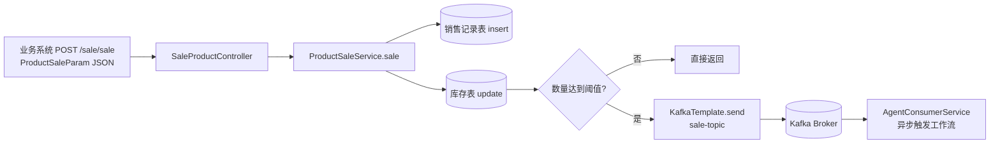

# 8-5 消息中间件Kafka引入及接口改造

## 【学习目标】

- 说清 Kafka 在本项目中的定位：为什么 Agent 触发链路要从「同步直连」改为「异步削峰」。
- 掌握 Spring Cloud Stream 与 Spring for Apache Kafka 两条整合路线的差异与选型依据。
- 独立完成 `spring-kafka` 依赖引入、生产者/消费者序列化配置，并把商品销售触发接口从「只传 productId」改造成「带完整业务属性的 JSON 入参」。

## 【正文】

### 一、为什么引入 Kafka：从「同步直连」到「异步削峰」

回顾 8-1「如何应对高并发场景」：当前的销售触发接口是一条同步链路，接收请求、写入销售记录、扣减库存，然后直接触发 Spring AI Alibaba Graph 编译出的工作流（大模型预测库存、生成调拨建议、发送邮件通知）。这条链路的前两步是毫秒级的数据库操作，第三步却要等待大模型推理，耗时以秒计，遇到模型服务波动时甚至更长。

同步链路的问题在大促流量下会被放大：所有请求线程都阻塞在等待 Agent 执行完成上，Tomcat 线程池很快打满，后续请求直接排队或拒绝。应对思路就是引入消息中间件做**流量削峰**：把「触发工作流」这段最耗时的逻辑从同步链路中摘出去，接口只负责落库和判定，达到阈值后向 Kafka 投递一条消息，由消费者异步触发 Agent。生产者的响应时间从「秒级」回落到「毫秒级」，积压在 Broker 里的消息则按消费者的处理能力匀速消化。

Kafka 的适配点在于：高吞吐持久化消息、分区并行消费、以及项目已经用 Docker 起好了单机实例，接入成本低。

### 二、整合方案选型：Spring Cloud Stream vs Spring for Apache Kafka

在已改造为微服务、引入了 Spring Cloud 的项目里整合 Kafka，有两条成熟路线：

| 维度 | Spring Cloud Stream | Spring for Apache Kafka（spring-kafka） |
|---|---|---|
| 抽象层级 | 基于 binder 的统一抽象，屏蔽各 MQ 底层差异 | 直连 Kafka 原生 API，无中间抽象 |
| 编程模型 | `@StreamListener` / 函数式绑定，一套代码多 MQ 可切换 | `KafkaTemplate` + `@KafkaListener`，Kafka 语义直给 |
| 灵活性与可控性 | 受 binder 能力约束，定制需下沉到原生 API | 完全可控，序列化、ack 模式、批量消费等均可精细配置 |
| 复杂度 | 低，概念少 | 略高，需要理解 Kafka 自身概念 |
| 本项目现状 | 已随 Spring Cloud 引入 | 需额外引入 `spring-kafka` |

本项目采用 **Spring for Apache Kafka**，核心理由是可控性更高：后续要演示的手动 ack、批量消费、`max-poll-records` 调优等能力都需要直接操作 Kafka 原生配置，走 binder 会被抽象挡一层。当然选型没有标准答案，如果公司内部同时跑 Kafka、RabbitMQ、RocketMQ 多种中间件、追求接入方式统一，Spring Cloud Stream 的 binder 抽象就是更合适的方案。面试中遇到选型提问，按「团队技术栈统一性 vs 单点可控性」来答即可。

### 三、引入依赖与基础配置

**依赖引入**：在 `pom.xml` 中引入 `spring-kafka`，不写版本号，父工程已做统一版本管理，会自动解析。引入后若 IDE 出现「依赖已引入但无法跳转/找不到类」的情况，通常是 IDE 索引未刷新，刷新 Maven 工程或清除缓存即可，一般不是依赖本身的问题。

**配置项**分三组，写入 `application.yml`：

```yaml
spring:
  kafka:
    bootstrap-servers: localhost:9092
    producer:
      key-serializer: org.apache.kafka.common.serialization.StringSerializer
      value-serializer: org.apache.kafka.common.serialization.StringSerializer
    consumer:
      key-deserializer: org.apache.kafka.common.serialization.StringDeserializer
      value-deserializer: org.apache.kafka.common.serialization.StringDeserializer
```

逐项说明：

1. `spring.kafka.bootstrap-servers`：Kafka 服务器地址，类型是集合。集群部署时传入多个地址（如 `host1:9092,host2:9092,host3:9092`），客户端会从中选取建立连接；演示环境只起了单机 Kafka，写本机 `localhost:9092`（具体端口取决于容器映射出来的端口）。
2. `producer.key-serializer` / `producer.value-serializer`：生产者把消息发给 Broker 前要序列化为字节数组。key 和 value 都指定为 `StringSerializer`，因为本项目投递的内容就是商品 ID 字符串，用字符串序列化足够，也最直观。
3. `consumer.key-deserializer` / `consumer.value-deserializer`：消费者拿到字节流后要反序列化回 Java 对象，与生产者对称地使用 `StringDeserializer`。

一条容易被忽视的生产经验：**序列化与反序列化必须成对设计**。生产者用什么序列化器写，消费者就必须用对应的反序列化器读，两侧类型不一致会直接抛反序列化异常，8-7 节排查 500 错误时遇到的「Integer 无法转成 String」，根因就在此。

至此，服务器地址、生产端序列化、消费端反序列化三部分配置就定义完整了。此时的配置还只保证「能连通、能收发」，生产可靠性与消费效率的增强配置在 8-8、8-9 两节展开。

### 四、触发接口改造：从「只有 productId」到「完整销售属性」

整合 Kafka 之前，先看清触发时机：现有的销售接口就是「商品销售之后触发 Agent 的入口」。此前的版本只接收一个 `productId`，单纯为了跑通测试。既然要用流量削峰真正承接业务，入参就必须和业务绑定，一次销售至少要带四个基本属性：商品 ID、仓库 ID、销售数量、销售日期。

字段设计的依据是数据库表结构。打开调拨相关的数据库，销售记录表的字段包括仓库 ID、商品 ID、销售日期、销售数量、销售金额、创建时间等。其中：

- **创建时间不传**：表里有默认值，插入时按当前时间戳自动填充。
- **销售金额不传**：表中默认值为 0.00，且本项目场景不涉及金额核算。一旦牵扯金额，复杂度会明显上升，属于传统项目开发的范畴，这里先控制范围，把链路聚焦在「库存触发 AI 预测」主线上。

最终入参类定义在 `domain` 的 `param` 包下：

```java
@Data
@AllArgsConstructor
public class ProductSaleParam {
    private Integer productId;
    private Integer warehouseId;
    private Integer quantity;
    @DateTimeFormat(pattern = "yyyy-MM-dd")
    private Date saleDate;
}
```

几个设计点：

- `quantity` 用 `Integer` 而非带小数类型：本项目按整数件数销售（不同系统定义不同，有些场景商品按小数买卖，这里按业务实际选型）。
- `saleDate` 标注 `@DateTimeFormat(pattern = "yyyy-MM-dd")`：指定前端传参的日期格式。前端传 `2025-11-30` 这样符合格式的字符串时，Spring MVC 会按该模式完成字符串到 `java.util.Date` 的绑定，后续再经 MapStruct 转换层转成 model 层的销售记录入库。
- `@Data` + `@AllArgsConstructor`：Lombok 生成 getter/setter 与全参构造，保持 param 类轻量。

Controller 层同步改造：

```java
@RestController
@RequestMapping("/sale")
public class SaleProductController {
    @Autowired
    private CompiledGraph graph;

    @PostMapping("/sale")
    public R sale(@RequestBody ProductSaleParam param) {
        String threadId = IdUtil.simpleUUID();
        RunnableConfig runnableConfig = RunnableConfig.builder()
            .threadId(threadId)
            .build();
        // 业务逻辑处理
        return R.ok();
    }
}
```

改动点解释：

- 请求方式从 `@GetMapping` 改为 `@PostMapping`：销售是写操作，语义上应使用 POST（或 PUT），URL 保持不变。
- 入参从路径/查询参数改为 `@RequestBody` 接收 JSON 体，类型为新定义的 `ProductSaleParam`。
- 返回值统一为项目规范的 `R`，具体内容待业务明确后再填充。
- `CompiledGraph` 与 `RunnableConfig` 暂时保留：`threadId` 用于 Graph 工作流的会话隔离（呼应 6-3 的 `threadId` 配置），但这一版只做骨架占位，业务逻辑全部下沉到 service 层。

改造后 IDE 会报大量「方法未实现」错误，这是正常的，下一步是在 `service` 包新建 `ProductSaleService` 接口与实现类，用 `@Resource` 注入 Controller，由 `sale` 方法承接参数，把落库、阈值判断、发消息三步真正实现（8-6 节展开）。

### 五、改造后的整体链路



一次销售请求进来：先保证业务数据落库，再决定是否触发 AI 工作流。即便下游 Agent 消费缓慢，接口侧也已返回，用户体验不受影响，这就是「流量削峰」在代码层的落地形态。

## 【易错点 / 面试题】

1. **面试官问：Spring Cloud Stream 和 Spring for Apache Kafka 怎么选？**
   答：看团队诉求。多 MQ 并存、追求统一编程模型选 Spring Cloud Stream（binder 屏蔽差异）；单 Kafka、需要精细控制 ack/批量/序列化选 Spring for Apache Kafka。本项目的 Agent 触发链路要演示手动 ack、批量消费等 Kafka 原生能力，所以选后者。
2. **序列化器为什么要成对出现？**
   生产者 `key/value-serializer` 与消费者 `key/value-deserializer` 必须类型对称，否则消费端反序列化直接报错。8-7 的 500 错误就是消息体类型与消费者期望不匹配造成的，排错时第一反应就该是「序列化/反序列化两侧对一下」。
3. **`@DateTimeFormat` 与 `@JsonFormat` 用错场景？**
   `@DateTimeFormat` 作用于 Spring MVC 的参数绑定（表单、查询参数）；入参走 `@RequestBody` JSON 反序列化时，实际生效的是 Jackson 的 `@JsonFormat`。两个注解解决的是不同层的日期字符串解析问题，面试中常被混为一谈。

## 【小结】

本节完成了 Kafka 接入的基建：确定 Spring for Apache Kafka 整合路线，引入 `spring-kafka` 依赖并配好 bootstrap-servers 与生产者/消费者序列化四件套；同时把销售触发接口从单参数 `productId` 改造成携带商品 ID、仓库 ID、数量、销售日期的 `ProductSaleParam`，业务逻辑下沉 service 层。param 到 model 的转换、MapStruct 转换层的完整写法，可对照工程模块 `980-demo/src/main/java/com/carl/ai/transfer/domain/param/TransferOrderParam.java` 与 `980-demo/src/main/java/com/carl/ai/transfer/convert/TransferOrderConvert.java`（`TransferOrderConvert.INSTANCE.paramToModel(param)` 的用法与课程完全一致）。下一节实现 `ProductSaleService` 的三步核心逻辑：存销售记录、扣库存、阈值判定后发 Kafka。
