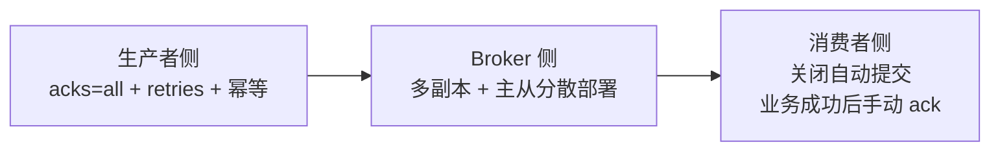

# 8-8 如何保证Kafka消息不丢失

## 【学习目标】

- 建立「生产者-Broker-消费者」三端保障的完整心智模型，回答面试高频题「如何保证 Kafka 消息不丢失」。
- 掌握生产者侧 `acks`、`retries`、幂等发送的配置与取舍。
- 理解消费者侧「关闭自动提交 + 手动 ack」的实现，并通过重复消费事故理解 ack 时机的重要性。

## 【正文】

### 一、面试高频题：消息不丢失的三端保障

先抛一个面试官常问的问题：既然用 Kafka 作为消息中间件应对高并发，**如何保证消息不丢失？**

标准答案不是单点配置，而是三端一起落地：**生产者侧、消费者侧、Broker 侧**都做了对应实现，才能构成完整保障。任何一端缺失，都会留下丢消息的口子。



- 生产者侧：保证消息**发出去了**且被 Broker 可靠接收；
- Broker 侧：保证消息**存住了**，机器故障不丢数据；
- 消费者侧：保证消息**处理完了**再移交位点，避免「没处理就当成已消费」。

代码层面主要落地的是生产者与消费者两端；Broker 侧通常由运维保障。

### 二、生产者侧：acks、retries 与幂等

**1. `acks`：确认深度的三档选择**

`acks` 控制「生产者发送消息后，等待哪些副本确认才认为发送成功」。针对集群场景（一个 topic 有主分区 Leader 与从分区 Follower），原稿给出三档语义，配置时对应如下：

| acks 取值 | 语义 | 丢消息风险 |
|---|---|---|
| 0 | 生产者只管发送，完全不关心是否被接收 | 最高，发送即「成功」， Broker 未收到也无感知 |
| 1 | Leader 分区成功接收并持久化即认为成功，不关心 Follower | Leader 若在 Follower 同步前故障，新 Leader 数据不全 |
| all（口播中的「2」） | Leader 与 Follower 都成功接收并持久化才算成功 | 最低，避免主分区故障、从分区选举出新 Leader 时数据不一致 |

口播中说的「设置为 2」，对应配置里的 `all`，即等待所有参与副本都完成持久化。生产要保证不丢失，`acks` 必须设为 `all`。代价是性能下降：需要等待持久化的机器变多，耗时变长、吞吐降低，这是用延迟换可靠性，属于必须做的取舍。

**2. `retries`：失败重试**

通过 `retries` 配置发送失败后的重试次数，也可用 Spring Retry 实现更细粒度的重试策略。重试解决的是「瞬时故障」（网络抖动、Leader 选举中），对「消息本身有问题」的永久故障无意义，所以要配合错误日志与死信处理。

**3. 幂等发送**

Kafka 生产者本身支持幂等：每个生产者会从 Broker 申请一个唯一 ID（PID），发送时对消息做递增序列号，Broker 依据「PID + 序列号」去重。开启幂等后，重试不会导致消息重复写入，是重试机制的安全垫。

### 三、消费者侧：关闭自动提交，改手动 ack

消费者侧的保障只有一句话：**业务处理确认成功后，再手动提交 offset**。

默认的自动提交是「定时到就把位点交上去」，不管业务是否处理完，一旦业务抛异常或进程被杀，位点已提交，消息就丢了。正确做法：

1. `enable-auto-commit` 设为 `false`，关闭定时自动提交；
2. 指定 ack 模式 `ack-mode: MANUAL_IMMEDIATE`，手动调用 `acknowledge()` 后，offset 立即改变（对比 `MANUAL_COUNT` 等批量语义，立即提交最保守，适合本项目的单条触发场景）。

### 四、Broker 侧：运维的主场

Broker 侧的保障主要是：**不要单节点部署，使用多副本机制，并把不同的主从分区分散到不同 Broker**。这一层一般不是开发配的，属于运维的基础设施职责，集群 + 多副本，是前面 `acks=all` 能生效的前提（只有一个 Leader 时，all 与 1 无异）。

### 五、配置落地

进入配置文件，把上述策略写成配置：

```yaml
kafka:
  bootstrap-servers: localhost:9092
  producer:
    key-serializer: org.apache.kafka.common.serialization.StringSerializer
    value-serializer: org.apache.kafka.common.serialization.StringSerializer
    acks: all
    retries: 3
  consumer:
    key-deserializer: org.apache.kafka.common.serialization.StringDeserializer
    value-deserializer: org.apache.kafka.common.serialization.StringDeserializer
    auto-create: true
    mail: smtp.qq.com
    host: smtp.qq.com
```

相比 8-5 的基础配置，生产者新增 `acks: all` 与 `retries: 3`；消费者侧新增的 `enable-auto-commit: false` 与 `ack-mode: MANUAL_IMMEDIATE` 属于 `spring.kafka.listener` 命名空间下的配置（`spring.kafka.consumer.enable-auto-commit` 与 `spring.kafka.listener.ack-mode`）。

**关于代码块的如实说明**：原稿此配置块末尾混入了 `mail: smtp.qq.com` 与 `host: smtp.qq.com` 两行，它们与 Kafka 配置无关，属于邮件服务（SMTP）的配置内容错位混入，疑为录屏时从其他配置段粘贴串位。按代码守恒原则原样保留、不做删改；实际项目中这两行应放在邮件服务的配置段（如 `spring.mail.host`），放在 kafka 节点下不会生效。

至此，业务代码里生产者与消费者两侧的「不丢失」配置完成，Broker 侧交由运维保证。

### 六、消费者改造：从「打印消息」到「触发 Agent」

配置只是声明了意图，消费者代码还要把职责坐实。当前消费者只打日志，没有业务处理，正确职责是**触发 Agent 工作流执行**。

把 controller 里触发图的逻辑迁移到 consumer：先用 `IdUtil` 生成随机 threadId 装入 `RunnableConfig`（会话隔离，呼应 6-3），消息本身就是商品 ID，直接以 `message` 入参触发 `graph.call(...)`，最后补一条 `consumer end` 日志。整个消费过程用 try-catch 包裹：异常时打印 `consumer error msg = ...` 并把异常继续抛出去，抛出的意义在于让监听容器感知消费失败，配合 ack 策略决定是否重投。

这一版 controller 的激活方法尚未改造完，暂时保留原样：

```java
@RestController
@RequestMapping("/api")
public class SaleProductController {
    @Resource
    private ProductSaleService productSaleService;
    @PostMapping("/saleProduct")
    public R approval(@RequestParam(value = "approval") Boolean approval) {
        try {
            Map<String, Object> data = overAllState.data();
            return R.success(data);
        } catch (Exception e) {
            log.error("error msg={}", e.getMessage());
        }
        return R.success();
    }
}
```

### 七、事故复盘：没有 ack 的消费者会重复消费

启动后先记录初始位点：offset = 3，end = 3。触发一次销售，观察变化：

- end 变成 4、size 变成 4，第 4 条消息已进 topic；
- 日志显示 `html email send success`，第 4 条消息**确实被消费处理了**（工作流跑完、邮件已发）；
- 但 consumer 的 offset 依然停在 **3**，位点没有提交。

后果立即可见：重启服务且不再发起销售，consumer 又把第 4 条消息拉出来重新消费了一遍，日志再次走到查询库存调拨、调用大模型预测那一步。**用户会收到第二封邮件**，这就是「消费了却没 ack」的典型事故：

```
groupId=group-1] Notifying assignor about the new Assignment(partitions=[product_sale_topic-0])
2025-11-30 20:05:46.554 [org.springframework.kafka.KafkaListenerEndpointContainer#0-C-1] INFO com.ai.transfer.nodes.ExtractNode result={...}
```

根因：只配了 `ack-mode: MANUAL_IMMEDIATE`，但监听方法没有 `Acknowledgment` 参数、也没调用 `acknowledge()`，框架想手动 ack 也无从谈起。修正：方法签名加 `Acknowledgment acknowledgment` 参数，业务成功、打日志之前调用 `acknowledge()`：

```java
@Service
public class AgentConsumerService {
    @KafkaListener(topics = "product_sale_topic", groupId = "group-1")
    public void agentConsumer(String message, Acknowledgment acknowledgment) {
        OverallState overAllState = graph.call(
            Map.of(
                "productId", message,
                "threadId", Thread.currentThread().getId(),
                "runnableConfig", runnableConfig.get()
            )
        );
        try {
            acknowledgment.acknowledge();
        } catch (Exception e) {
            log.error("error msg={}", e.getMessage());
            throw e;
        }
    }
}
```

修正后重启验证：消费完成、邮件发送成功、offset 正常提交；再次重启，流程直接结束、不再重复调用大模型，**ack 提交成功，重复消费消除**。

需要说明的是，此代码块中 `graph` 与 `runnableConfig` 的注入定义未在块内展示（原稿上文已说明把图的注入迁移到 consumer 中），实际工程中需在类内补齐这两个字段的声明；`@KafkaListener` 注解按原稿写法保留在方法上。

### 八、与上下游的衔接

至此，8-7 打通的「生产-消费」链路具备了不丢失能力：生产者 `acks=all` + `retries` 保证发出，消费者手动 ack 保证处理完才交位点。剩下的工程问题是「消费太慢导致积压怎么办」，由 8-9 的批量消费与多消费组方案承接。

## 【易错点 / 面试题】

1. **面试官问：`acks=all` 不是会影响性能吗，生产环境怎么权衡？**
   答：可靠性优先的场景（订单、资金、库存触发）用 `all`，并接受吞吐损失；可容忍少量丢失的日志类场景用 1 甚至 0。没有免费的午餐，acks 是在「丢消息概率」与「延迟/吞吐」之间做交换，选型看业务对丢失的容忍度。
2. **手动 ack 的调用时机放在业务前还是业务后？**
   必须业务成功后。放在业务前等于自动提交的翻版，业务还没执行就交出兵牌，异常时消息已丢。正确顺序：执行业务 → 打日志 → `acknowledge()`；ack 本身异常时记录并抛出，让容器决定重试策略。
3. **重复消费和消息丢失是一对矛盾吗？**
   是两种失败模式的权衡：ack 太早→丢消息；ack 太晚或不提交→重复消费。工程上的标准解是「至少一次投递 + 业务幂等」：Kafka 保证 at-least-once，重复由消费端幂等（去重表、状态机、唯一键）兜底，这正是 8-11「消费端重复消费的幂等处理」的主题。

## 【小结】

本节把「消息不丢失」拆成三端落地：生产者 `acks=all` + `retries: 3` + 幂等发送，消费者关闭自动提交、`MANUAL_IMMEDIATE` 手动 ack，Broker 多副本交由运维。关键事故复盘表明：ack-mode 只是开关，`Acknowledgment.acknowledge()` 的显式调用才是闭环，漏掉它，重复消费立刻现形。消费端触发工作流后的 Agent 主链路（大模型生成 → 结构化提取 → 转换入库），可对照工程模块 `980-demo/src/main/java/com/carl/ai/transfer/agent/TransferAgent.java` 与 `980-demo/src/main/java/com/carl/ai/transfer/service/TransferOrderServiceImpl.java`。下一节转入消费速率话题：批量消费、多消费组与 `auto-offset-reset` 策略，解决消息积压。
