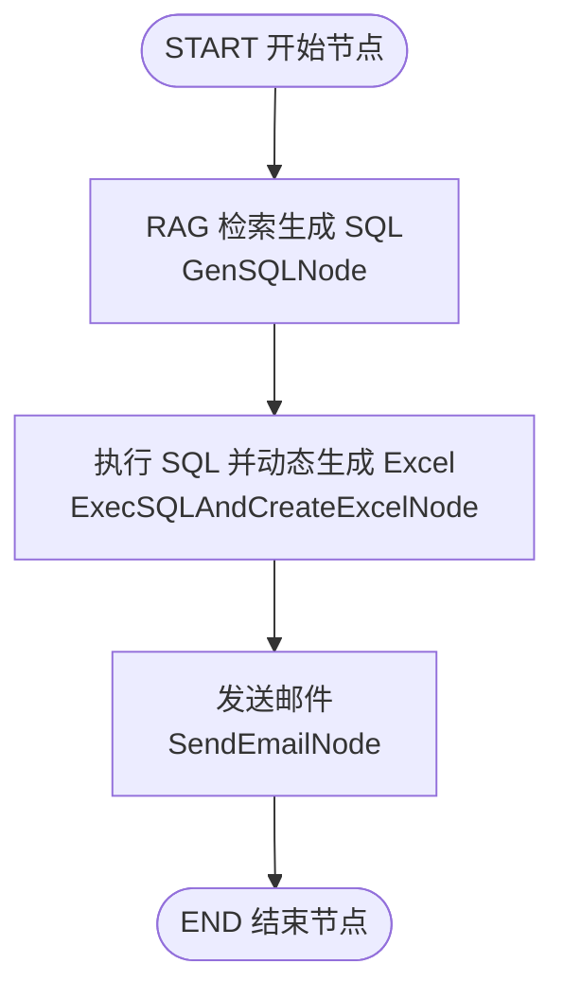

# 9-11 智能BI报表问答系统Graph工作流设计

## 【学习目标】

学完本节，应当能够：

- 说清「先设计工作流、再写节点代码」的顺序及原因，独立画出一张智能 BI 报表问答系统的工作流全图；
- 讲透初级版三个核心节点各自的输入、输出与职责边界：RAG 检索生成 SQL、执行 SQL 并生成 Excel、发送邮件；
- 解释两个关键设计决策：为什么企业表结构要放进向量库而不是塞进提示词；为什么第一版只做主链路；
- 向面试官描述「从初级版到进阶版」的演进路线图。

## 【正文】

### 一、先画图纸，再动代码

从本节开始进入智能 BI 报表问答系统的 Agent 开发。动手之前，首先要明确 Agent 的设计思路，也就是工作流的全链路设计。只有先把工作流设计清楚，后面的代码编写才知道要写哪些节点、有哪些边，以及每个节点具体要处理什么事情。

先设计后编码的顺序不是仪式感，而是工程必然。工作流引擎（课程采用的 Spring AI Alibaba Graph）里，一张图由三样东西构成：节点（干什么）、边（怎么走）、状态 key（节点之间传什么）。三者没想清楚就写代码，典型症状是：写到一半发现上一个节点少产出了一个 key，回头补；边连错了，返工；状态策略选错了，数据被覆盖或意外合并。设计阶段一张图的成本，和编码阶段返工的成本，完全不在一个量级。

本节先给出初级版本的设计，具备基本功能即可；更高级的扩展内容放到后面的小节讲解。之所以不直接把优化之后的 Agent 工作流贴出来，是因为优化点（评估、回环、持久化）都依附在主链路上，主链路不存在，优化无处附着。先用初级版本把「一条 SQL 从生成到送达邮箱」的全过程走通，是性价比最高的路径。

### 二、初级版工作流全图

初级版本的工作流链路如下：

四个环节的语义：

1. **开始节点**：触发整个工作流的执行，也就是触发 Agent。用户输入一段自然语言（例如「查询 25 年 11 月某商品的销售金额」），链路启动；
2. **RAG 检索生成 SQL**：从私有知识库召回表结构，交由大模型生成可执行 SQL；
3. **执行 SQL 并动态生成 Excel**：真正到数据库里执行这条 SQL，除了拿到查询结果，还动态生成一个 Excel 文件；
4. **发送邮件**：把动态生成的 Excel 文件发送到提问人的邮箱。

走到这里，整个流程结束。以上就是一个初级版本的实现，覆盖了智能 BI 问答系统的基本功能。

### 三、逐节点拆解

三个核心节点的职责、输入输出可以归纳成一张表：

| 节点 | 输入 | 处理 | 输出 |
|---|---|---|---|
| RAG 检索生成 SQL | 用户自然语言（`userInput`） | RAG 召回表结构 → 组装上下文 → 大模型生成 | 待执行 SQL（`genSQL`） |
| 执行 SQL 并动态生成 Excel | `genSQL` | 数据库执行 → 结果集 → 动态生成 Excel | Excel 文件、查询结果 |
| 发送邮件 | Excel 文件、提问人信息 | 组装邮件 → 发送 | 发送结果 |

#### 节点一：RAG 检索生成 SQL

该节点要回答一个核心问题：大模型凭什么知道我们公司的表长什么样？

公司自己内部的表结构，以及表与表之间的关联关系，在前置准备阶段已经放进了本地知识库，存到了对应的向量数据库里（9-12 节准备库表数据，9-10 节把向量存储落到 Milvus）。所以这一步通过 RAG 检索，把本次问题需要用到的那些表结构查询出来，放进上下文告诉大模型，让大模型根据这些表结构以及它们之间的对应关系，生成对应的 SQL。该节点既要执行 RAG 操作，又要和大模型进行交互，是整条链路里 AI 含量最高的部分。

为什么表结构不直接写进系统提示词？三个理由：

- **上下文经济性**：一个企业的库表动辄几十上百张，全塞进提示词，每次调用都要消耗大量 token，且大部分表结构与当前问题无关；
- **可维护性**：表结构变更（加字段、加表、改关联）时，改提示词意味着改代码、重新发布；向量库里的知识更新是数据层的操作；
- **检索精度**：RAG 按语义相似度召回，只会带回与当前问题相关的少数几张表，噪声更小，模型注意力更集中。

这套设计就是标准的 RAG（检索增强生成）模式：把「模型不知道的私有知识」外置到向量库，用时按需检索，拼装进上下文。课程后续对生成准确率做的全部优化（评估节点、循环重试、提示词打磨），都发生在这一节点及其下游。

#### 节点二：执行 SQL 并动态生成 Excel

拿到大模型生成的 SQL 之后，真正到数据库里去执行。执行完之后不仅仅是拿到查询结果，它还会动态生成一个 Excel 文件，用户问的是业务问题，交付物不应该是一张结果集的截图，而是一份可以下载、可以转发、可以继续加工的报表文件。

这一节点是纯工程节点，不涉及 AI，但有两个隐含要求：SQL 执行层要安全（课程在 10-3 节引入 `jdbcTemplate` 作为 SQL 执行层，并持续加固，防止大模型生成的 SQL 带来注入风险）；Excel 生成要动态适配结果集结构（列数、列名由查询结果决定，不能写死模板）。

#### 节点三：发送邮件

把动态生成的 Excel 文件发送到提问人的邮箱里。交付链路在此闭环：用户用自然语言提问，最终在邮箱收到一份报表文件。邮件发送服务在课程 10-6、10-7 节落地，包括依赖集成、服务配置与接口业务完善。

### 四、从初级版到进阶版：演进路线

初级版只保证「主链路能通」。可优化的点其实比较多，课程后续章节逐一落地，可以先建立一张路线图：

| 优化方向 | 对应章节 | 解决的问题 |
|---|---|---|
| 提高 SQL 准确性 | 11-1 至 11-5 | 生成节点产出不稳定，引入评估节点 |
| 进阶版工作流设计 | 11-6、11-7 | 评估失败后断链，引入条件边与回环 |
| 评估-循环-微调三件套 | 11-8、11-9 | 系统性拉满准确率 |
| SQL 执行安全加固 | 10-3、10-4 | 大模型生成 SQL 的注入风险 |
| 报表生成引擎 | 10-5 | 报表样式与交付体验 |
| 邮件发送服务 | 10-6、10-7 | 交付通道落地 |

这里体现的是 Agent 系统建设的通用节奏：**主链路先行，优化随后**。初级版把所有节点用最简方式串起来，先证明「这件事能成」；再针对每个节点度量问题、逐个加固。反过来做（一上来就把评估、循环、持久化全设计上）的风险是：主链路还没跑通，优化层已无从验证。

### 五、设计原则归纳

这套工作流设计背后有三条可迁移的原则：

1. **单一职责节点**：每个节点只做一件事（生成 SQL / 执行并导出 / 发邮件）。节点边界清晰，才能被单独测试、单独替换、单独加固；
2. **数据经状态机流转**：节点之间不直接调用，而是通过状态 key（`userInput`、`genSQL` 等）传数据。这是 Graph 引擎「数据驱动控制流」的基础；
3. **AI 节点与工程节点分离**：RAG 与大模型交互集中在节点一，其余是确定性工程逻辑。AI 的不确定性被收敛在最小范围内，系统的可预测性最大化。

## 【易错点 / 面试题】

1. **面试题：「为什么把表结构放进向量库，而不是直接写在系统提示词里？」**
   答：三个层面。成本上，全量表结构进提示词会带来大量无关 token 消耗，RAG 按需召回更经济；维护上，表结构变更是数据操作而非代码发布；效果上，检索只带回相关表，减少上下文噪声，模型生成更聚焦。可以再补一层：提示词适合放「稳定不变的规则」（角色、输出格式），适合放「频繁变化的私有知识」（表结构、文档）的地方是向量库。

2. **易错点：跳过设计直接写节点。** 工作流开发中，节点、边、状态 key 是一体三面。不先画图就写代码，常见后果是节点返工（补 key）、边返工（改连线）、状态策略返工（该用替换却用了合并）。正确做法是先有全链路图，再逐个节点开发，每开发一个节点补齐它产出与消费的 key。

3. **面试题：「初级版为什么故意不做优化？」**
   答：这是主链路优先的工程策略。所有优化（评估、回环、持久化）都依附于主链路存在，主链路不通，优化层无法验证、无法度量。初级版用最低成本证明链路可行，同时给出基线，后续每一层优化都有对照。Agent 系统和所有软件系统一样：先跑通，再跑好。

## 【小结】

本节给出了智能 BI 报表问答系统初级版的执行图纸：开始节点 → RAG 检索生成 SQL → 执行 SQL 并动态生成 Excel → 发送邮件 → 结束。三个节点各司其职，AI 的不确定性被收敛在第一个节点，主链路用最简形态先保证可通。后续章节在这张图纸上逐层加固：评估节点与条件边（11-6、11-7）、SQL 执行安全（10-3）、报表引擎与邮件交付（10-5 至 10-7）。下一节先做数据准备：把演示库表与初始化数据落到数据库。「图 + 节点 + 状态流转」的思想在配套工程 `980-demo` 中有同构落地：`980-demo/src/main/java/com/carl/ai/transfer/agent/TransferAgent.java` 把一个完整节点动作（自然语言 → 抽取 → 入库）封装为可复用组件，`980-demo/src/main/java/com/carl/ai/transfer/service/TransferOrderServiceImpl.java` 承接确定性工程逻辑，与本节「AI 节点与工程节点分离」的分层完全一致。
