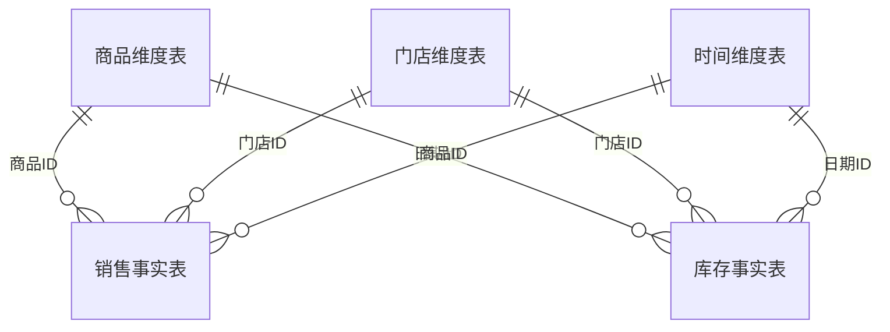

# 9-12 数据准备：前置数据库脚本执行

## 【学习目标】

学完本节，应当能够：

- 说清智能 BI 报表问答系统演示库的星型模型结构：三张维度字典表加两张事实业务表，以及它们之间的外键关联；
- 独立完成数据准备全流程：建库（含字符集选择）、执行建表 SQL、执行各表初始化数据、执行验证查询；
- 解释两个关键问题：为什么先备数据再写工作流代码；为什么演示库规模刻意保持小；
- 向面试官讲清维度表与事实表的职责差异，以及 utf8mb4 字符集的选择理由。

## 【正文】

### 一、为什么数据准备是前置必选项

真正编写工作流代码之前，还有一项准备工作：根据私有知识库的数据表结构设计文档，到数据库里创建一个新的数据库，创建这些表，并往表里插入一些初始数据。

这项准备不是可选的装饰。后面所有开发都依赖它：大模型生成 SQL 之后，要拿到数据库里执行、验证能否查出结果；生成的 SQL 是否正确，要和库里的真实数据核对。没有数据，整条 BI 问答链路就失去了验证基准，无法回答「模型生成的 SQL 是否正确」这一核心问题。所以这一步必须先执行起来。

表结构设计文档的来源也值得一提：这套表结构由 AI 辅助生成。课程不便直接拿真实公司的表结构（可能涉及保密协议），AI 生成的设计简洁、直观，且每一处关联都可人工核对，正适合教学与验证场景。

### 二、星型模型：三张字典表 + 两张业务表

先看都有哪些表。整套结构是一个典型的星型模型（Star Schema），中心是事实表，周围是维度表：



#### 维度表（字典表）

- **商品维度表**：商品 ID、商品名称、分类 ID、分类名称、品牌、成本价、建议零售价；
- **门店维度表**：门店 ID、门店名称、所在省份、城市、地址、开业日期；
- **时间维度表**：日期 ID、实际日期、年份、季度、月份、日、周、星期，日期维度拆得比较细，这是为了支持「按年/季度/月/周」各种粒度的 BI 提问。

#### 事实表（业务单据表）

- **销售事实表**：销售唯一 ID、销售日期 ID、销售门店 ID、商品 ID、销售数量、销售金额、应收金额、折扣金额；
- **库存事实表**：库存唯一 ID、日期 ID、门店 ID、商品 ID（这三个字段都标了外键，关联三张字典表）、库存数量、库存金额、最后一次入库时间、最后一次出库时间。

两类表的分工要讲透：维度表是字典，回答「某条 ID 对应谁」；事实表是业务单据，回答「发生了什么、量是多少」。销售数据不把商品名称、门店名称直接存在事实表里，只存 ID，通过 ID 关联字典表，这就是外键关联：销售事实表关联商品字典、门店字典、日期字典这三张表；库存事实表同样关联这三张字典表。

这套设计刻意保持简单：总共三张字典表加两张业务表，测试时直观，也方便人工核对大模型生成的 SQL 到底是否正确。教学演示的价值就在于此，对错可验证。

### 三、建库：字符集的选择

文档里提供了对应的建表 SQL。把它复制出来，回到本地数据库，先新建一个数据库，命名为 `bi-helper`：

```sql
CREATE DATABASE bi-helper CHARACTER SET utf8mb4 COLLATE utf8mb4_unicode_ci;
```

两点说明。其一，正文提到排序规则可用 `utf8mb4_general_ci`，脚本中使用的是 `utf8mb4_unicode_ci`，两者都是合法的 MySQL 排序规则（后者按 Unicode 通用排序规则比对，多语言场景更精确），以脚本为准即可。其二，字符集选 utf8mb4 而不是 utf8：MySQL 的 `utf8` 实际只占 3 字节，存不下 4 字节字符（如部分 emoji 与生僻汉字），`utf8mb4` 才是完整的 UTF-8 实现。这是 MySQL 使用中的经典陷阱，建库时一旦选错，后期改字符集涉及数据转换，成本很高。

库建好之后，进去执行建表 SQL，点运行，没有报错信息。关掉窗口刷新一下，几张表都有了。这里多出来一张顾客表，也就是顾客维度表，文档里其实没有这张表，没有就没有，想加进来的话可以自己加上，不加也无所谓（下一节会把文档补齐）。

### 四、初始化数据：分批执行

文档里还准备了一批初始化数据的 SQL，也就是一批 INSERT 脚本，到数据库里执行。这批插入的数据量还挺多，按表分批执行：

```sql
INSERT INTO dim_product (product_id, product_name, category_id, category_name, brand, cost_price, retail_price) VALUES
(6, 'iPad Air', 102, '平板电脑', 'Apple', 3500.00, 4599.00),
(7, '小米平板 75', 103, '电视', 'Sony', 5200.00, 6999.00),
...
(20, '科沃斯扫地机器人 T10', 104, '家电', 'Ecovacs', 2400.00, 3299.00);
```

说明：片段中的省略号表示中间若干行被折叠；样本里「小米平板 75」一行的品牌与分类字段仅作演示填充，与真实商品属性无关，理解结构即可。

执行顺序与规模：先插入一批商品维度数据，执行，没有报错；接着插入一批门店维度数据，也就是门店字典，执行，同样没有报错；再往下是插入日期维度的数据；然后又插入了 30 条顾客信息，也就是顾客维度。

```sql
INSERT INTO dim_store (store_id, store_name, province, city, address, open_date) VALUES
(1, '北京旗舰店', '北京', '北京', '北京市朝阳区', '2025-12-28 12:00:00'),
...
```

下面是两个业务表：销售事实表和库存事实表，两张表各插了 300 条。执行销售事实表的脚本，没有报错；再执行库存事实表的脚本，也没有报错。

300 条的规模是刻意的。数据量大到人工核对不过来，就失去了「可验证」的意义；小到一眼看穿，模型生成 SQL 的对错才能快速定位。BI 问答系统开发初期，验证效率优先于数据规模。

### 五、验证

数据落库后做一次抽查验证：

```sql
SELECT * FROM bi-helper.fact_sales LIMIT 1000;
```

打开销售事实表看一下，一共是 300 条数据；库存事实表同样也是 300 条，都初始化好了。至此，前置数据准备完成，可以进入工作流开发。

## 【易错点 / 面试题】

1. **面试题：「维度表和事实表有什么区别？为什么 BI 场景常用星型模型？」**
   答：维度表是字典，描述业务实体（商品、门店、时间），字段少而稳定；事实表是业务单据，记录度量（数量、金额），行数大、持续增长。星型模型让事实表只存维度 ID，通过外键关联字典，避免了宽表里的信息重复存储，聚合查询（按门店汇总、按月汇总）也因关联路径清晰而好写、好优化。大模型生成 SQL 时，这种「字典 + 单据」的结构也更容易被理解和正确 JOIN。

2. **易错点：跳过数据准备直接写工作流。** 没有库表和数据，大模型生成的 SQL 无法执行、无法验证对错，节点测试全部失去基准。正确顺序是：建库 → 建表 → 灌初始化数据 → 验证条数 → 再进节点开发。

3. **易错点：建库字符集选 `utf8`。** MySQL 的 `utf8` 是 3 字节实现，无法存储 4 字节字符。建库应选 `utf8mb4`，排序规则 `utf8mb4_general_ci` 与 `utf8mb4_unicode_ci` 均可，以团队规范统一即可。

4. **面试题：「演示数据为什么要人工控制规模（各 300 条），不直接上生产数据？」**
   答：三个原因。合规上，生产数据可能涉及商业敏感信息，不宜带进课程演示；验证上，小规模数据可人工逐条核对模型生成 SQL 的对错，大规模数据则失去对照基准；性能上，演示环境无需压力测试数据。这与「AI 辅助生成表结构」是同一思路：构造可控、可验证的教学数据集。

## 【小结】

本节完成了智能 BI 报表问答系统的前置数据准备：`bi-helper` 库（utf8mb4 字符集）下建好三张维度字典表（商品、门店、时间）与两张事实业务表（销售、库存），灌入各表初始化数据（含 30 条顾客信息、销售与库存事实表各 300 条），并用 SELECT 验证条数。星型模型让「模型生成 SQL 的对错」可被人工核对，这是后续所有节点测试的基准。下一节正式进入工作流开发，先梳理核心节点逻辑。数据层的同构实践可参考配套工程 `980-demo`：`980-demo/src/main/java/com/carl/ai/transfer/repository/BbTransferOrderRepository.java` 与 `BbTransferOrderItemRepository.java` 用 Spring Data JPA 把 AI 抽取结果落入 H2 库，`980-demo/src/main/java/com/carl/ai/transfer/service/TransferOrderServiceImpl.java` 编排主单与明细的保存，与本节「事实表 + 字典表关联落库」的数据组织思想一致。
