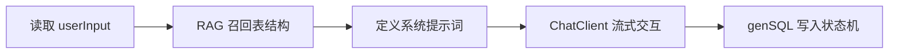

# 9-13 明确目标：核心节点开发逻辑梳理

## 【学习目标】

学完本节，应当能够：

- 说清智能 BI 报表问答 Agent 的目录结构规划：图放 config 包、节点放 nodes 包，边按需再建；
- 独立完成 `GraphConfig` 的初始化：`KeyStrategyFactory` 声明状态 key 策略、`StateGraph` 建图、`@Bean` 返回 `CompiledGraph`；
- 讲透 `NodeAction.apply` 的契约：输入 `OverAllState`、输出 `Map<String, Object>` 增量，以及构造注入 `ChatClient` 的原因；
- 梳理第一个节点「RAG 检索生成 SQL」的三步业务逻辑，并建立「增量式开发」的节奏感。

## 【正文】

### 一、先补齐一处文档

上一节执行数据准备时发现：实际表结构比文档多了一张顾客维度表，而当时的文档没有同步更新。课下已把文档补齐并放到笔记里：增加了一节 2.4 顾客维度，字段都维护好了；另外第三部分事实表结构有一处改动，销售事实表里增加了一个顾客 ID 字段。

到时候直接拿笔记里的这份模板，放进自己的 Word 文档，再保存到向量数据库里即可。私有知识库的源文档保持最新，是 RAG 效果的基础，召回的内容过时，生成的结果必然过时。

### 二、目录结构：图与节点分开放

从本节开始进入智能 BI 报表问答 Agent 工作流的开发。开发之前，按照智能库存调拨优化系统那套同样的顺序，先定义项目目录结构：

- **config 包**：放图的定义，即 `GraphConfig`，负责建图、装配节点边、编译；
- **nodes 包**：放节点，以及边（如果后续用到）。

边暂时不建目录。这是有意为之：当前只开发第一个节点，边是否单独成类、放哪里，等真正用到再定义；用不到，就不必事先建这一层目录结构。工程上这叫不为假设的需求提前买单，目录结构应该跟着真实代码走，而不是跟着想象走。

### 三、图的定义：`GraphConfig` 三步初始化

首先做图的定义。新建一个类，依然叫 `GraphConfig`，加上配置类注解 `@Configuration`，里面定义一个 `@Bean`：

```java
@Configuration
public class GraphConfig {
    @Bean
    public CompiledGraph graph() {
        KeyStrategyFactory keyStrategyFactory = new KeyStrategyFactory();
        // ... 其他配置代码 ...
        return new StateGraph(...);
    }
}
```

片段是骨架，省略了内部细节，重点在三处结构：

**其一，返回值是 `CompiledGraph`。** 编译后的图才是可执行的图，`StateGraph` 是「图纸」，`CompiledGraph` 是「装配好的机器」，controller 里注入并调用的必须是后者。编译动作在 9-15 节补全，这里先把返回类型定下来。

**其二，先建 `KeyStrategyFactory`，再 `new StateGraph`。** 顺序不能反：建图时必须确定放进状态机里的那些 key 用什么策略，所以要先定义 key 的策略工厂。这里使用 key 的策略工厂来创建 key，写法是匿名内部类。如果这一块写得很熟，可以改成 lambda 表达式；但对于刚接触 Agent 开发的新手，推荐写匿名内部类，见名知意，后期回头看代码时容易梳理思路。可读性与简洁性的取舍，团队里通常以可读性优先。

**其三，图要有名字。** `new StateGraph(...)` 时给图起个名字叫 `biHelperGraph`，把策略工厂传进去，拿到图对象。名字会在日志与错误栈里标识这张图，多图并存时靠它区分。

#### 状态 key 与替换策略

第一个节点是 RAG 检索生成 SQL，它会让大模型帮我们生成一条待执行的 SQL。给该 key 起个名字，就叫 `genSql`，策略使用 `Replace`（替换策略）。

替换策略的含义：同一个 key 再次被写入时，新值覆盖旧值。这一选择与后续的「评估不过 → 回环重生成」直接相关，循环里第二轮生成的 SQL 必须覆盖第一轮的，而不是两条并存。选策略时问自己一句：该 key 会被写几次？多次写入时想要旧值还是新值？

先定义这一个 key 就够了。等后面开发到哪个节点，它会产出什么样的 key、需要什么 key，再回到这里补上。增量式补 key，和增量式建目录是同一个节奏。

### 四、第一个节点：`GenSqlNode` 骨架

拿到图之后就进入第一个节点的开发。按之前的开发套路，在 nodes 包里创建该节点：实现 `NodeAction`，实现里面的 `apply` 方法。节点命名为 `GenSqlNode`，注释写「借助大模型生成 SQL 节点」：

```java
public class GenSQLNode implements NodeAction {
    private final ChatClient chatClient;
    
    public GenSQLNode(ChatClient chatClient) {
        this.chatClient = chatClient;
    }
    
    @Override
    public Map<String, Object> apply(OverAllState state) throws Exception {
        return Map.of();
    }
}
```

三点契约要讲透：

**第一，`apply` 的入参是 `OverAllState`。** 这是整个工作流的共享状态，前面所有节点产出的数据都在里面，通过 `state.value(key, 默认值)` 读取。节点之间不直接互相调用，全部经状态机传数据，这是 Graph 引擎数据驱动控制流的基础。

**第二，`apply` 的返回值是 `Map<String, Object>`。** 节点不直接修改 state，而是返回一份增量，由引擎合并进状态机。这一设计带来两个好处：节点本身无副作用、可重复执行；合并策略（如 `Replace`）由引擎按 key 统一执行，行为可预期。初学常见误区是试图在节点里改 state，正确做法永远是「返回增量」。

**第三，节点里持有 `ChatClient`，构造方法注入。** 该节点要和大模型交互，所以依赖 `ChatClient`；用构造器注入而非字段注入，依赖显式、便于测试（可以传 mock）。这一节先只注入 `ChatClient`，下一节做 RAG 召回时，还会把 `VectorStore` 一并加入构造参数。

### 五、节点业务逻辑三步走

正式写业务逻辑之前，先梳理该节点有哪些步骤。业务逻辑大致分三步：



1. **RAG 召回**：前面已把公司内部的数据表结构、表与表之间的关系放到了私有知识库里，也就是向量数据库。与大模型对话之前，首先要通过 RAG 的召回把这部分内容查出来。具体实现放到下一节；
2. **定义提示词**：定义系统提示词，约束模型的角色与输出；
3. **与大模型交互**：发起对话，流式接收生成结果。

基本上这就是第一个节点要完成的业务逻辑。先梳理步骤再写代码，和先画工作流再写节点，是同一种工程习惯，顺序想清楚，代码只是誊写。

至于 Spring AI 的 RAG 全貌，前面已通过一张图辅助理解过召回的全过程，该流程是比较复杂的；但具体到本项目要实现哪些步骤、哪些环节，取决于实际业务需求，不是每一步都必须在自己的项目里落地。下一节正式进入代码编写。

## 【易错点 / 面试题】

1. **面试题：「节点为什么返回 `Map<String, Object>` 增量，而不是直接修改 `OverAllState`？」**
   答：这是不可变数据流的设计。节点只声明「我产出了什么」，合并动作交还引擎，好处有三：节点无副作用，可重复执行、可并行推演；合并策略按 key 统一执行（`Replace` 就是后写覆盖），行为可预期；状态变更集中在一处，便于观测与排查。直接改 state 会让数据流隐式化，出问题难定位。

2. **面试题：「`Replace` 策略在这里为什么是必须的？」**
   答：因为 `genSQL` 这一 key 会被多次写入。后续评估节点判 `fail` 后会回环到本节点重新生成，第二轮 SQL 必须覆盖第一轮。若用「保留旧值」类策略，状态机里会同时存在两条 SQL，下游执行节点无法确定该执行哪条。选策略的本质是回答：该 key 多次写入时，我要新值还是旧值。

3. **易错点：目录结构过度前置。** 边还没用到就先把边包、边类建好，是「为想象编码」。正确节奏与课程一致：config 与 nodes 先建，边等 `addEdge` 真的写出来再组织。反过来也要警惕另一种过度，目录完全不规划，节点散落各处。判断标准是：当前这一版工作流用不到的结构，一律不建。

4. **易错点：试图在节点内直接改状态机。** `apply` 的返回值才是节点产出的正规通道。直接修改入参 `state`，既破坏引擎的合并策略，也让节点的输入输出不再可推理。

## 【小结】

本节完成了核心节点开发的前置梳理：文档补齐顾客维度后，项目按 config（图）与 nodes（节点）分包；`GraphConfig` 用 `KeyStrategyFactory` 声明 `genSql` 的替换策略，`StateGraph` 建图，`@Bean` 返回待编译的图；`GenSqlNode` 实现 `NodeAction`，以构造注入持有 `ChatClient`，业务逻辑收敛为「RAG 召回 → 定义提示词 → 流式交互」三步，通过返回 Map 增量把 `genSQL` 写入状态机。下一节正式实现 RAG 召回：引入 `RetrievalAugmentationAdvisor` 与 `VectorStoreDocumentRetriever`，并打磨系统提示词。同款「节点动作 + 依赖注入 + 增量返回」的封装可参考配套工程 `980-demo`：`980-demo/src/main/java/com/carl/ai/transfer/agent/TransferAgent.java` 把一个完整节点动作（自然语言 → 抽取 → 入库）封装为组件，构造注入 `TransferOrderExtractor` 与 `TransferOrderService`，与本节「节点只依赖明确协作者」的写法一致。
