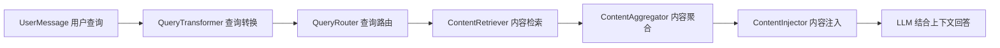

# 9-2 RAG技术深度解析

## 【学习目标】

- 能向面试官完整讲清 RAG 的定义、两个核心阶段（向量存储与召回）以及每个阶段的输入输出。
- 能说清「BI/报表系统为什么必须上 RAG」，第一性原因是数据安全，效果提升是附带收益。
- 能在 Spring AI 技术栈里指认链路各环节对应的真实类型，为后续集成 Milvus、落地召回链路打好地基。

## 【正文】

### 一、RAG 是什么

RAG 是 Retrieval-Augmented Generation（检索增强生成）的缩写。做法可以概括成三句话：把公司内部的文档沉淀成私有知识库；用户提问时，先从知识库里检索出与问题相关的内容；再把这些内容作为上下文交给大语言模型，模型基于这段上下文回答用户提出的问题。

拆开看，三个关键词各自对应一个工程动作：

- 私有知识库：文档的统一入口，解决「模型没见过公司数据」的问题。
- 检索：按语义而非关键词定位内容，解决「哪几段文档与当前问题有关」的问题。
- 上下文注入：把检索结果拼进提示词，解决「模型回答时看不到这些知识」的问题。

大语言模型的权重里沉淀的是公开语料上的通用知识，对公司内部的表结构、表关系、业务口径一无所知。RAG 的思路不是把这些知识训进模型，而是在推理时动态补进上下文，相当于把闭卷考试改成开卷考试，资料摊在桌上，模型负责查阅之后作答。

先破一个常见误区：RAG 不等于向量数据库。向量库只是写入链路的存储层，一条完整的 RAG 还包括文档读取、切分、向量化、查询转换、检索、聚合、上下文注入等多个环节。面试里把 RAG 讲成「用了 Milvus」，等于把系统讲成了一半。

### 二、为什么 BI/报表系统必须用 RAG

最核心的原因是数据安全。公司的业务表结构以及表里的业务数据都有安全性要求，不可能直接调用网络上的第三方大模型，否则表结构设计乃至表数据都存在泄露风险。换成 RAG 之后，所有表结构和数据都留在公司内部，不与外部网络的数据发生交互，也就不存在泄露问题。

| 维度 | 直接调用第三方大模型 | RAG 私有知识库 |
|---|---|---|
| 数据流向 | 表结构、样本数据随请求发送到外部 API | 知识留存内网，外发的只有用户查询文本 |
| 泄露面 | 库表设计、字段命名、业务口径全部暴露 | 取决于查询内容本身 |
| 合规审计 | 难以过内审与等保类检查 | 全链路可审计、可网络隔离 |
| 知识更新 | 只能靠重新训练或等待模型迭代 | 改文档即生效，分钟级 |
| 回答溯源 | 无法说明结论出自哪里 | 可引用命中文档，可人工核对 |

RAG 的附带收益同样值钱：知识更新只需维护文档，不用动模型；回答可以附带引用来源，出问题能定位到具体文档。这也是面试题「为什么不用微调」的标准答案素材，微调改变的是模型的风格与领域语感，并不注入可频繁更新的知识，且每次知识变动都要重新训练。

还要说清部署形态与本章路线的关系：数据不出内网有两条路，检索侧用 RAG 把知识拦在内网，模型侧把大模型私有化部署到本地（第 12 章展开 Ollama 与 vLLM 方案）。两条路可以单独用，也可以叠加；本课程先走「RAG + 第三方模型演示」练链路，再补私有化，最后两层都落地。

### 三、阶段一：向量存储（写入链路）

向量存储是把文档变成向量数据的预处理过程。通俗地说：把上传进来的各种格式文档（Word、TXT、Markdown 等）先切分成不同的块，再把这些块转换成向量，最后存进向量数据库。

从流程图来看，这是一条单向的预处理链路：

步骤看着不多，但每一步都有坑：

1. 切分（TextSplitter）：块切得太大，一段里混着多张表的结构，语义被稀释，检索时难以精准命中；切得太小，表关系被拦腰截断，召回半句话也没有信息量。块与块之间通常要留重叠区，避免关键定义正好落在切口上，重叠不是浪费，是用少量存储换召回完整性，9-7 会专门拆默认分割方案的问题。
2. 向量化（EmbeddingModel）：把文本块转成向量。后续所有查询也必须用同一个向量模型，不同模型产出的向量不在同一个语义空间里，混用等于存进去的是法语、查出来用的是英语。写入模型与查询模型要作为固定配置管理，见 9-4。
3. 回写入库：向量要写回文档对象再统一保存，元数据（来源文件名、文档标题等）要一起落库，否则召回成功也无法溯源。

生产上还要考虑幂等：同一份文档重复上传，不能无限堆积重复向量，常见做法是按文档维度先清理再写入。9-16 的清库重传就是这条原则的演示级操作。

### 四、阶段二：召回（读取链路）

只存不用没有意义。完整的召回链路是：用户发起一条 User Message，也就是用户提出的查询；这条查询先经过 Query Transformer（查询转换器），可能被转换成多条查询；多条查询再经过 Query Router（查询路由器）分发到不同的检索分支；随后由 Content Retriever 执行内容检索。由于查询路由可能触发多个内容检索，因此会检索到多个 Content，这时需要通过 Content Aggregator（内容聚合器）把多个内容聚合起来；聚合之后还有一步 Content Injector，把这些内容整合并注入到与大模型对话的上下文当中。

换句话说，检索到的内容最终变成了提示词的一部分发送给大模型，大模型就能借助私有知识文档中的内容来回答用户的问题。这是一套比较完整的召回流程，实际编写召回逻辑时不一定会用到其中所有环节，可以根据业务需要选择其中的一部分来实现。本课程的 BI 项目用到了查询转换（9-17、9-18 展开）与内容检索、注入，多知识库场景才需要 Router 与 Aggregator。

Router 与 Aggregator 的存在提示了一个边界：当知识库按业务域拆成多个集合（销售库、库存库、客服库）时，「问的问题该去哪个库找」本身就是一个路由决策，聚合则负责把多库结果去重、排序、截断后再注入，这两个环节本课程不展开，但要知道它们的位置，面试聊到「多知识库 RAG」时才不会接不上话。

### 五、落到 Spring AI 栈上

链路名词最终都要落到代码。对应关系如下：

| 链路环节 | Spring AI 中的对应物 | 落地章节 |
|---|---|---|
| Document / TextSplitter | `Document` 与 `TextSplitter` | 9-4 读取、后续切分 |
| EmbeddingModel | `EmbeddingModel` 接口（OpenAI 兼容端点） | 9-5 之后 |
| EmbeddingStore | `VectorStore` 接口（Milvus 实现） | 9-10 集成 Milvus |
| 召回链路 | `RetrievalAugmentationAdvisor`（`queryTransformers` / `documentRetriever` / `queryAugmenter`） | 9-15 至 9-18 |
| 简版问答 | `QuestionAnswerAdvisor` | 备选方案 |

Spring AI 2.0 起 Advisor 链是一等公民，RAG 这类横切能力以 Advisor 形式挂在 `ChatClient` 上，模型调用前后自动完成「转换查询 → 检索 → 注入上下文」。本课程使用的 Spring AI Alibaba Graph 与这套 Advisor 机制可以在同一个 `ChatClient` 上组合，9-18 的节点代码即为实例。

两层能力别混淆：`QuestionAnswerAdvisor` 是「零配置简版问答」，适合快速验证；`RetrievalAugmentationAdvisor` 把转换、检索、增强全部暴露成可配置部件，才是生产可用的形态。选型时先问自己「要不要查询改写、要不要控空上下文行为」，答案是要，就直接上后者。

### 六、生产落地的两个提前量

第一，检索策略别默认「纯向量」。向量检索擅长语义泛化，弱在精确匹配（型号、编码、枚举值），生产常用向量加关键词的混合检索，再加重排收敛。第二，召回质量要可度量。建一个小评测集：收集真实提问，标注每条提问应当命中哪些文档，用改写前后的查询分别计算召回率，用数字决定要不要上优化。这两个习惯在 9-16 至 9-18 的排查与优化里都会用到。

## 【易错点 / 面试题】

1. **面试官问：RAG 和微调怎么选？** 知识频繁更新、要求回答可溯源、数据不能出内网，三者占任意一条就应优先 RAG；微调适合改输出风格、格式与领域语感。两者不互斥，生产系统里常先微调格式、再用 RAG 补知识。
2. **面试官问：召回效果差，从哪查？** 按链路分层定位，别一上来就换模型：查询侧（是否需要改写、多查询）、切分侧（块大小与重叠）、检索侧（topK 与混合检索）、注入侧（上下文裁剪与排序）。能讲出这条分层排查路径，比背十篇原理都管用。
3. **易错点：整篇文档不切分直接向量化。** 超出向量模型输入窗口是小事，语义被大面积稀释才是大事，一张表的结构和十张表的结构混在一起，哪段都「有点像」，检索排序会失效。
4. **易错点：把 RAG 等同于向量数据库。** 向量库只承担存储与相似度检索，RAG 的价值在链路：读取、切分、向量化、转换、聚合、注入，缺一环效果就断一层。面试时按两阶段六环节讲，才显得真做过。

## 【小结】

RAG 由写入与读取两半拼成：写入是把文档切块、向量化、入库；读取是把用户查询转换、检索、聚合、注入上下文。数据安全是 BI 系统选择 RAG 的第一性原因，知识可更新与回答可溯源是附带收益。下一篇进入工程初始化，把这套链路落到 `ai-bi-helper` 子工程里。

同一套「ChatClient 驱动、结构化输出落地」的写法，在本课程配套工程 `980-demo/src/main/java/com/carl/ai/transfer/extract/TransferOrderExtractor.java` 中有完整可部署的实现，可对照阅读。
