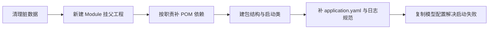

# 9-3 工程初始化与环境搭建

## 【学习目标】

- 独立完成 `ai-bi-helper` 子工程的初始化：清脏数据、建 Module、配 POM、建包结构、补配置文件。
- 说清每个依赖的职责，以及「暂连第三方大模型、后续换私有化」这一路线的权衡。
- 避开初始化阶段的高频坑：端口冲突、应用名与日志 appName 不一致、引了模型依赖却不配 key 导致启动失败。

## 【正文】

### 一、清理脏数据，新建子模块

进入编码阶段的第一步是初始化 BI 系统子工程。代码生成器生成的 `src` 文件夹属于脏数据，可以直接删除，因为父工程本身就会包含 `src` 下的业务代码。保留它反而危险：模块自带一套源码目录，后续业务代码不知道该往父工程写还是往子模块写，结构会越走越歪。

在父工程上新建一个 Maven Module，依旧选择 Quick Start 模板，命名为 `ai-bi-helper`，Parent 必须选择当前父工程。创建完成后等 IDEA 把 POM 文件刷新完毕即可。

挂父工程不是形式主义：依赖版本、插件配置、仓库地址统一由父 POM 仲裁，子模块才能做到「只声明坐标，不声明版本」。这也是 9-4 里引用 `ai-common` 的统一响应体 `R` 的前提，公共模块的收敛管理挂在父工程上。

### 二、POM 依赖与职责

接着修改子工程的 POM。`<url>` 节点可以直接删掉，然后按需要补充依赖。BI 助手 Agent 首先要引入 `spring-boot-starter-web` 与 `spring-boot-starter-test` 这两个基础依赖。因为整个 Agent 使用 Spring AI Alibaba 开发，所以还需要引入 Spring AI Alibaba 的核心依赖 `spring-ai-alibaba-graph-core`。

```xml
<dependency>
    <groupId>org.springframework.boot</groupId>
    <artifactId>spring-boot-starter-web</artifactId>
    <version>3.1.0</version>
</dependency>

<dependency>
    <groupId>org.springframework.boot</groupId>
    <artifactId>spring-boot-starter-test</artifactId>
    <version>3.1.0</version>
    <scope>test</scope>
</dependency>

<dependency>
    <groupId>com.alibaba.cloud</groupId>
    <artifactId>alibaba-graph-core</artifactId>
    <version>1.0.0</version>
</dependency>
```

各依赖的职责与缺失后果：

| 依赖 | 职责 | 缺失后果 |
|---|---|---|
| `spring-boot-starter-web` | 提供 Spring MVC 与内嵌容器，承载 `/document/upload` 等 HTTP 入口 | Agent 没有对外的触发入口 |
| `spring-boot-starter-test` | 单元测试与集成测试基建 | 节点级测试无从写起 |
| `spring-ai-alibaba-graph-core` | Spring AI Alibaba 的 Graph 工作流引擎，Agent 的节点、边、状态机都由它驱动 | 无法定义工作流 |

两点如实说明。其一，片段中第三个依赖的 artifactId 写作 `alibaba-graph-core`，与正文所述 `spring-ai-alibaba-graph-core` 不一致，以 Spring AI Alibaba 官方坐标为准，复制后务必刷新 Maven 并编译验证。其二，片段把版本号写死在子模块里，工程惯例是版本交给父 POM 或 Spring Boot 的 BOM 统一管理，子模块只保留 groupId 与 artifactId，避免多模块之间版本漂移。

### 三、大模型选型：先第三方，后私有化

大模型方面延续智能库存调拨优化系统的做法，使用 OpenAI 协议的大模型，具体由阿里通义千问提供对话能力。这里需要说清一个权衡：前面讲过为了保证企业数据安全不应使用第三方大模型，但课程还没讲到企业内部的私有化大模型部署。为了保证演示效果，暂时先连接阿里的千问；等后面章节讲完企业内部如何私有化部署大模型之后，会把连接目标改成自己部署的大模型。现阶段只是用它来演示整个工作流程的执行效果。

按此思路再补两个依赖：`spring-ai-autoconfigure-model-openai` 与 `spring-ai-autoconfigure-model-chatclient`。前者负责 OpenAI 兼容协议的模型装配，后者提供 `ChatClient` 的自动配置。其余依赖留到后面编码过程中用到时再添加。刷新之后 POM 没有报错，说明依赖配置没问题。

「先第三方、后私有化」是一条被刻意设计的演进路线：先用托管模型把链路跑通、把效果验准，再在 12 章把模型侧换成 Ollama 或 vLLM 上的私有化部署。两步分离的好处是，链路问题与模型部署问题不会互相纠缠，排查时边界清晰。

### 四、包结构与启动类

目录结构方面，在 `src/main/java` 下依次建 `ai`、`bi`、`helper` 三层包，包结构通常与项目命名保持一致，即 `com.carl.ai.bi.helper`，然后把启动类移到 `helper` 包下，用 `Shift + F6` 重命名为 `BiApp`（勾选 select all），并改造成 Spring Boot 启动类：加上 `@SpringBootApplication` 注解，`main` 方法里调用 `SpringApplication.run(BiApp.class, args)`，再用 `Ctrl + Alt + L` 格式化。

```java
package com.carl.ai.bi.helper;

@SpringBootApplication
public class BikeApp {
    public static void main(String[] args) {
        SpringApplication.run(BikeApp.class, args);
    }
}
```

两点如实说明：片段省略了 import 语句，实际以 IDE 自动补全为准；片段里类名仍显示旧名 `BikeApp`，这是重命名步骤之前的录制片段，与正文「重命名为 `BiApp`」没有同步，以 `BiApp` 为准。包名、类名、文件名三者必须一致，否则启动类定位会出问题。

### 五、配置文件与日志规范

此时 `src` 下缺少 `resources` 目录，需要手动补上，然后在其中新建 `application.yaml`，先写入基础配置：`spring.application.name` 与项目名保持一致，设为 `ai-bi-helper`；启动端口参考 `ai-transfer` 的 8876，把 BI 助手定为 8877。

```yaml
spring:
  application:
    name: ai-bi-helper
  server:
    port: 8877
```

端口错开一位，是为了本地同时跑多个子项目时不抢端口；应用名保持一致，是为了日志按服务名聚合时不出错。

日志规范同样照搬 `ai-transfer`：把 `logback-spring.xml` 复制到本项目的 `resources` 下，把 `appName` 由 `ai-transfer` 改成 `ai-bi-helper`，与项目名保持一致，其余内容无需改动。

```xml
<configuration>
    <appender name="STDOUT" class="ch.qos.logback.core.ConsoleAppender">
        <encoder>
            <pattern>%d{yyyy-MM-dd HH:mm:ss} - %msg%n</pattern>
        </encoder>
    </appender>

    <root level="info">
        <appender-ref ref="STDOUT" />
    </root>
</configuration>
```

`application.yaml` 中再声明日志相关配置：`logging.file.path` 指定日志生成位置，设为当前目录下的 `logs`；`logging.level` 中 `root` 开启 `info` 级别，`com.carl` 同样开启 `info` 级别。统一的日志规范不是洁癖：RAG 链路里排查问题，靠的就是按时间线还原各节点的输入输出，格式不一致会把排查成本放大数倍。

### 六、第一个坑：引了模型依赖却不配 key

启动项目验证，果然报错，引入大模型依赖之后没有做任何配置，启动就失败了。解决办法是把 AI 相关配置从 `ai-transfer` 原样复制过来，对话模型依旧使用阿里的 `qwen3-max`。再次启动，8877 端口启动成功，子工程初始化完成，接下来就可以进入 Agent 的实际开发。

该坑值得记住：模型自动配置在缺少 API Key 等必要属性时会 fail-fast，启动即失败。看起来吓人，其实是好事，把配置问题暴露在启动阶段，而不是等到第一次调用模型时才在运行期报错。

工程上再进一步：密钥不应写死在配置文件里，正确做法是走环境变量或配置中心。本课程配套工程 `980-demo` 即采用 default / prod 双 profile：`980-demo/src/main/resources/application.yml` 使用离线 mock 模型，`application-prod.yml` 接真实端点，密钥经环境变量注入，装配逻辑见 `980-demo/src/main/java/com/carl/ai/transfer/config/ChatModelConfig.java`。



## 【易错点 / 面试题】

1. **面试官问：多模块项目里子工程为什么要挂父工程？** 统一依赖版本管理、统一插件与仓库配置，避免每个模块各自为政导致版本漂移；父工程还能收敛 `ai-common` 这类公共模块的引用。
2. **易错点：端口与应用名「复制了配置却忘了改」。** 两个项目同时启动会抢端口；应用名与日志 appName 不一致会让日志归属错乱。复制配置时，这两项是必改项。
3. **易错点：密钥进代码库。** key 一旦提交进 Git，泄露面就不可控，正确做法是环境变量注入，仓库里只保留占位符。

## 【小结】

子工程初始化的主线是：删脏数据、建 Module 挂父工程、按职责补依赖、建与项目名一致的包结构、补 `application.yaml` 与日志规范，最后用「从 `ai-transfer` 复制模型配置」解决启动失败。到这里，BI 助手的架子搭好了；下一篇开始建私有知识库的数据源头，文档上传与读取。
