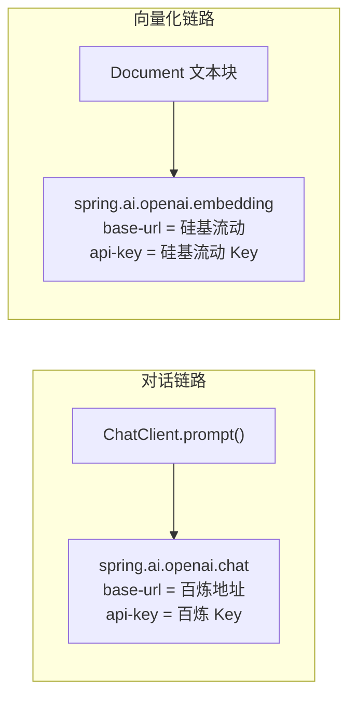

# 9-5 文本向量大模型介绍以及整合智源向量大模型

## 【学习目标】

- 说清向量模型与对话模型的契约差异，记住「写入与查询必须使用同一个向量模型」这条选型红线；
- 能在阿里云百炼、硅基流动两个平台上独立完成向量模型选型，会读模型卡上的维度与上下文长度两项指标；
- 独立完成「对话走百炼、向量走硅基流动」的双端点配置，讲清每一项配置写在哪里、为什么写在那里；
- 避开两个高频坑：把 Rerank 当 Embedding 用、漏掉外层必填的 `api-key`。

## 【正文】

### 一、四步链路走到哪一步了

知识库建设链路共四步：上传文档 → 读取 → 拆分 → 向量化 → 入库。9-4 已用 `TikaDocumentReader` 完成读取，`get()` 方法直接返回 `List<Document>`。这里有一个容易被忽略的事实：Tika 读取器在读取时已按文档格式把内容拆成了不同块，第一步「读取」与第二步「拆分」在代码层面已经落地，`handleDocument` 里拿到的就是文档集合。

```java
@Service
public class DocumentServiceImpl implements DocumentService {
    @Resource
    private VectorStore vectorStore;

    // 业务逻辑
    // 1. 法律文档
    // 2. 进行文档的拆分，形成不同的块
    // 3. 调用向量大模型，将文本块转换成向量
    // 4. 人脑

    @Override
    public void handleDocument(MultipartFile file) {
        TikaDocumentReader documentReader = new TikaDocumentReader(file.getResource());
        List<Document> documents = documentReader.get();
    }
}
```

课程片段原样保留。`documents` 已通过 `documentReader.get()` 取得；注释里列出的四步业务逻辑（读取、拆分、向量化、入库）正是后续几节的施工图。本节专攻第三步：把文本块转成向量。

### 二、向量模型与对话模型：两类完全不同的大模型

向量模型是一种特殊类型的大模型。平时使用的通义千问、DeepSeek 这类属于支持深度思考或文本对话的大模型；文本向量大模型不做语言交互，只负责把文本数据转成向量。两者的输入输出契约完全不同：

| 对比项 | 对话模型 | 向量模型 |
|---|---|---|
| 输入 | 提示词（系统消息 + 用户消息） | 一段文本 |
| 输出 | 自然语言回复 | 固定维度的浮点数组 |
| 用途 | 生成、改写、决策 | 相似度计算、语义检索 |
| 状态 | 支持多轮对话 | 单段进出、无状态 |
| 计费场景 | 每轮对话按 token | 写入与查询各按 token 计一次 |

选型红线：写入与查询必须使用同一个向量模型。不同模型产出的向量不在同一语义空间，混用的后果是「存得进、查不出」，这类故障不抛异常，只是召回结果近似随机，排查成本极高。

### 三、Spring AI 的支持面与两个可选平台

Spring AI 已把向量化能力集成好：只要在配置文件里把要用的向量大模型配置好，RAG 流程就会自动把文本节档转成对应的向量。课程当前使用 1.0.3 版本，官方文档 reference 中 models 目录下有专门的向量模型章节，已支持的向量大模型包括亚马逊的、MiniMax、Ollama、支持 OpenAI 协议的各类向量大模型、千帆、智谱等等，集成面相当广。

课程给出两种选择。

第一种是阿里云百炼平台。前面已经用百炼的千问作为语言交互大模型，现在同样可以选用阿里的向量大模型。登录阿里云后进入大模型服务平台百炼控制台，在「模型服务 - 模型广场」中选择全部模型，左侧按模态类型筛选「文本向量」，即可看到阿里自己的向量模型。这里要特别区分两个名字：

| 模型类型 | 作用 | 能否用于向量化入库 |
|---|---|---|
| `Rerank` | 对候选文本做重排序 | 不能，它不产出向量坐标 |
| `Embedding` | 把文本块转成向量坐标 | 能，RAG 入库需要的正是它 |

需要留意的是，阿里的向量模型有免费额度限制，额度用完之后继续调用就需要付费。对写入频次高的知识库场景，额度消耗主要发生在首次灌库阶段。

第二种是硅基流动平台。注册、登录并完成实名认证之后，平台会赠送一定余额。它的模型广场聚合了各家厂商的大模型，不像阿里百炼那样以自研模型为主；展开筛选器可以看到不少标记为免费的大模型，可直接免费用于测试，适合想控制成本的场合。使用时在「API 密钥」页面新建一个 API 密钥，写好描述后生成，把生成的 key 复制出来，回到项目中配置即可。

两个平台的定位差异可以概括为：

| 维度 | 阿里云百炼 | 硅基流动 |
|---|---|---|
| 模型来源 | 阿里自研为主 | 聚合各家厂商 |
| 免费额度 | 向量模型有额度限制 | 新用户赠余额，广场有免费标记模型 |
| 接入协议 | OpenAI 兼容 | OpenAI 兼容 |
| 课程用途 | 对话模型（千问） | 向量模型（智源 BGE 系列） |

### 四、模型参数怎么读：维度与上下文长度

在硅基流动的嵌入模型里，智源研究所（北京的一家公司）出品的向量模型表现相当不错。模型列表里 `bge-large-zh-v1.5` 是专门把中文转成对应向量的模型，另外还有对应的英文版本，以及 `M3` 这一多语言版本。

模型名后面的指标值得关注，例如「4096 维 32K」「1024 维 8K」：前者是向量维度，后者是上下文长度。

- 维度越高，语义空间的表达精度越高，查询时检索的区分度越好，对后续召回非常有帮助；代价是存储与计算成本同步上升；
- 上下文越大，单次可转换的文本越长，转换以及与大模型交互的效果也越好。

性能越强的档位通常越贵，4096 维 32K 那一档的定价是 0.28 元人民币。一般场景下用 1024 维的 `M3`，或者中文场景直接用 `bge-large-zh-v1.5`，就已经能够满足需求。选型时按「业务语言 + 文档长度 + 预算」三要素取平衡，不必盲目追高。

### 五、双端点配置：为什么要下沉到子节点

确定模型之后回到项目做配置。不管用阿里的向量模型还是智源的向量模型，两者都支持 OpenAI 协议，对应到 Spring AI 文档里就是 OpenAI 这一支。官方文档说明需要引入 OpenAI model 相关依赖，而该依赖项目里此前已经引入过了，不需要重复添加，只要补上配置即可。

配置上有一个关键变化：原先 OpenAI 的 `api-key` 与 `base-url` 是写在 `spring.ai.openai` 顶层的，但现在同时对接了两个平台，对话走阿里云百炼，向量走硅基流动，就不能再把 `base-url` 和 `api-key` 写死在顶层了，需要把它们下沉到各自的子节点里：



具体做法：在 `spring.ai.openai.chat` 下配置 `base-url` 与 `api-key`，填入阿里百炼的地址和密钥；再在 `spring.ai.openai.embedding` 下配置 `base-url`（写到 `https://api.siliconflow.cn` 即可，不要把后面的路径带上）与 `api-key`（填硅基流动生成的密钥）；`embedding` 下还有 `options`，在其中指定具体使用的模型名。

有一个反直觉的点：`spring.ai.openai` 外层的 `base-url` 可以删掉，但外层的 `api-key` 必须保留，使用 OpenAI 协议时该字段是必填项，填哪一个都无所谓，真正的地址与密钥已经在各自的节点里指定好了。

### 六、配置块逐行解读

```yaml
spring:
  application:
    name: ai-bi-helper
  ai:
    openai:
      api-key: sk-xxxxx
      base-url: https://dashscope.aliyuncs.com/compatible-mode
      chat:
        model: qwen3-max
      embedding:
        api-key: sk-xxxxx
        base-url: https://api.siliconflow.cn
        model: bai-embedding-v1
        options:
          model: bai-embedding-v1
          dimensions: 768
          encoding-format: float32
          user: user
          organization-id: org-xxxxx
```

三点说明，帮助读懂这份配置：

其一，外层 `base-url` 仍指向阿里云百炼，而正文说过「可以删掉」。删与不删都不影响运行，因为 `chat` 与 `embedding` 子节点已各自指定地址；但外层 `api-key` 必须保留，它是 OpenAI 协议的必填项。

其二，`embedding` 下的模型名写作 `bai-embedding-v1`、`dimensions: 768`，与正文讨论的 `bge-large-zh-v1.5`（1024 维）并不是同一个，属于课程演示中的占位值；9-6 的配置里换成了 `BAAI/bge-large-zh-v1.5`。落到自己的项目时，按实际选用的模型与维度填写。

其三，`model` 与 `options.model` 重复指定了同一个模型，`user` 与 `organization-id` 属于 OpenAI 协议的透传参数，演示中占位填写，不影响主流程。

配置完成后，Spring AI 就能自动把向量模型集成进来。下一步是第四节：把文档转换成向量并存进向量数据库。

## 【易错点 / 面试题】

1. **易错点：把 Rerank 当 Embedding。** 模型广场里两者都出现在「文本向量」筛选下，但 Rerank 是文本排序模型，负责对候选结果重排，不产出向量坐标，不能用来做向量化入库。点进模型详情页看输出定义，是最快的区分方法。

2. **易错点：删掉外层 `api-key` 导致启动失败。** 下沉配置时只盯着子节点，把外层 `api-key` 一并删掉，OpenAI 协议的必填校验会直接报错。正确做法：外层 `base-url` 可删，外层 `api-key` 保留占位。

3. **面试题：「向量模型的维度和上下文长度分别决定什么？你怎么选？」**
   答：维度决定语义空间的表达精度与检索区分度，也决定存储与计算成本；上下文长度决定单次可转换的文本长度，直接影响上游能容忍多大的分块。中文场景优先 `bge-large-zh-v1.5`，多语言或长文本场景考虑 `M3`；不是越高越好，按业务语言、文档长度与预算取平衡。

4. **面试题：「对话模型和向量模型为什么不能用同一个？」**
   答：契约不同，对话模型自然语言进、自然语言出，向量模型文本进、固定维度浮点数组出；向量还需要跨调用保持维度一致才能做相似度计算。生产上还有一个附加约束：知识库写入与查询必须锁定同一个向量模型，否则向量不在同一语义空间，检索结果近似随机。

## 【小结】

本节走完 RAG 四步链路的第三步：认清向量模型与对话模型的契约差异，在百炼与硅基流动之间完成选型（维度、上下文长度、额度三个视角），并用「子节点下沉」的手法实现了对话与向量双端点配置。两个平台都走 OpenAI 协议，这也是 Spring AI 能用同一套 `spring.ai.openai` 配置接管两类调用的原因。下一篇把向量存进向量数据库，先拿最熟悉的 Redis 上手，并在那里埋下一个关于文档拆分的伏笔。

这种「端点与密钥外置、实现可切换」的配置纪律，在配套工程 `980-demo/src/main/java/com/carl/ai/transfer/config/ChatModelConfig.java` 中同样成立：该配置类用 `@ConditionalOnProperty` 在离线与真实两套 `ChatModel` 实现之间切换，base-url、model、api-key 全部从配置读取（prod profile 走 `${OPENAI_API_KEY}` 环境变量注入），与本节「chat 与 embedding 各自指定地址与密钥」是同一种思路。
