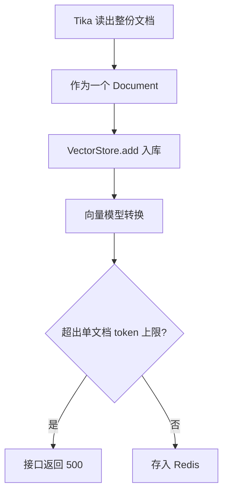

# 9-6 使用Redis作为向量数据库以及问题引出

## 【学习目标】

- 说清 Spring AI 已集成的向量数据库清单，以及课程「Redis + Milvus 双线演示」的选型逻辑；
- 分清普通 Redis 与 Redis Stack 的边界，独立完成 `spring.ai.vectorstore.redis` 与 `spring.data.redis` 两块配置；
- 用 `VectorStore.add()` 完成向量入库，说清抽象层带来的替换自由；
- 完整复盘「上传返回 500 → token 超限」的排障路径，理解问题如何引向文档拆分。

## 【正文】

### 一、向量数据库选型面

向量转换完成之后要存进数据库，先要弄清有哪些向量数据库可选，以及 Spring AI 目前已经支持哪些。回到 Spring AI 官网文档的 reference，`Vector Databases` 一节列出了它已集成的向量数据库：Elasticsearch、Milvus、MongoDB、Oracle、OpenSearch、PgVector、Redis 等，这些都是比较常用的选择。本课程既会用 Redis 作为向量库，也会演示用 Milvus 作为向量数据库。

对传统 Java 开发者来说，Redis 的学习成本最低，此前基本都用过 Redis，拿它当向量数据库上手非常快。之所以额外引入 Milvus，是因为 Milvus 是专门的向量数据库，存储数据量比 Redis 更大，检索性能也比 Redis 更好，希望通过这门课程让大家多接触一些技术选型。

| 维度 | Redis（向量检索） | Milvus |
|---|---|---|
| 定位 | 缓存/内存数据库顺带支持向量 | 专为向量检索设计的数据库 |
| 数据规模 | 中小规模，受内存约束 | 更大规模，可扩展 |
| 检索性能 | 满足常规场景 | 专用索引体系，性能更好 |
| 团队成本 | 已有 Redis 基建时近乎零成本 | 需引入新组件运维 |
| 课程安排 | 本节主用 | 9-9、9-10 扩展演示 |

### 二、前提：必须启动 Redis Stack

先用 Redis 演示。引入依赖之前有一个硬前提：必须启动的是 Redis Stack 而不是普通的 Redis。7-2 讲智能库存调拨系统持久化时，用 Docker 启动的就是 Redis Stack，也介绍过 Redis 与 Redis Stack 的区别；普通 Redis 本身并不具备向量查询能力，向量索引的创建与相似度查询依赖 Redis Stack 内置的检索模块，必须使用 Redis Stack 才行。启动好之后端口是 6379。

### 三、引入依赖与自检

点开文档中的 Redis 条目，按说明复制对应的 Starter 依赖，粘贴到项目 POM 末尾引入，刷新之后没有报错，并且能够点进类里，说明依赖引入成功。

```xml
<dependency>
    <groupId>org.springframework.ai</groupId>
    <artifactId>spring-ai-starter-model-openai</artifactId>
</dependency>
```

```groovy
dependencies {
    implementation 'org.springframework.ai:spring-ai-starter-model-openai'
}
```

两段分别是 Maven 与 Gradle 两种构建工具下的坐标写法，内容等价，按项目实际形态二选一。如实说明：课程此处贴出的 artifactId 是 `spring-ai-starter-model-openai`，而 Redis 向量存储对应的 starter 应为 `spring-ai-starter-vector-store-redis`（9-10 切换到 Milvus 时使用的 `spring-ai-starter-vector-store-milvus` 命名可佐证这一规律）。复制依赖时以官方文档 Vector Stores → Redis 条目给出的坐标为准；自检标准上，「Ctrl + 左键能点进 `RedisVectorStore` 类」比「刷新不报错」更硬，后者只说明坐标能解析，前者才说明依赖真的到位。

### 四、两块配置分别管什么

引入依赖之后还要在配置文件里做 Redis 向量存储的相关配置。配置分两块，管的事情完全不同：

| 配置节点 | 管什么 | 缺少后果 |
|---|---|---|
| `spring.ai.vectorstore.redis` | 向量索引定义：索引名、前缀、是否自动初始化 schema | 索引创建不了，入库即失败 |
| `spring.data.redis` | Redis 连接信息：host、port、超时 | 找不到 Redis 地址，启动即报错 |

第一块在 `spring.ai.vectorstore.redis` 下：`index-name` 指定索引名称，这里叫 `bi-helper`；`prefix` 指定前缀，设为 `bi-helper-prefix`；`initialize-schema` 设为 `true`，让它在启动时自动帮我们完成 schema 初始化。自动建索引省去了手写索引创建命令的麻烦，开发阶段很合适；生产环境对结构变更有管控流程的团队，会更倾向于把这项关掉、走脚本初始化。

第二块是 Redis 本身的连接信息，它不在 `spring.ai` 下面，而是与 `ai` 平级的 `spring.data.redis`：配置 `host` 为 `localhost`，`port` 为 6379，读取超时时间与连接超时时间都设为 5 秒。只配 `vectorstore.redis` 而缺少连接信息的话，Redis 是找不到地址的。这条「谁的数据源谁配置」的分界在 Spring 生态里是通用纪律：`spring.ai.*` 管 AI 能力语义，`spring.data.*` 管中间件连接。

```yaml
spring:
  application:
    name: ai-bi-helper
  ai:
    openai:
      api-key: sk-xxxxxxxxxxxxxxxxxxxxxxxxxxxxxxxx
      chat:
        options:
          model: qwen3-max
          base-url: https://dashscope.aliyuncs.com/compatible-mode
          api-key: sk-xxxxxxxxxxxxxxxxxxxxxxxxxxxxxxxx
    embedding:
      base-url: https://api.siliconflow.cn
      api-key: sk-xxxxxxxxxxxxxxxxxxxxxxxxxxxxxxxx
      options:
        model: BAAI/bge-large-zh-v1.5
    vectorstore:
      redis:
        index-name: bi-helper
        prefix: bi-helper-prefix
        initialize-schema: true
  server:
    port: 8877
  logging:
    file: ./logs
    level:
      com.carl: info
```

配置里对话与向量两路各自携带 base-url 与 api-key（对话指向百炼、向量指向硅基流动），与 9-5 的双端点思路一致；`server.port` 设为 8877，`logging.level.com.carl` 设为 info，方便本地调试时观察框架日志。

### 五、入库：一行 add()

配置就绪后回到业务逻辑实现第四节，入库，也就是把向量存进向量数据库。实现很简单：通过 `@Resource` 注入一个 `VectorStore`，直接调用它的 `add()` 方法，该方法需要的正是 `Document` 集合，前面 `documentReader.get()` 拿到的 `documents` 直接传进去即可完成保存。

值得停下来看一眼这一设计：业务代码持有的是 `VectorStore` 接口，不是任何具体实现；存入时的向量化由框架依据配置的 EmbeddingModel 自动完成，开发者连「调哪个向量模型」都不需要写代码。9-9 把存储换成 Milvus 时，这段代码一行不用改，这就是抽象层的收益。

### 六、端到端验证：从端口占用说起

启动项目准备测试。测试前需要一份文档，这里从百度百科复制了《刑法》的第一章，总共一万多字，只截取了一部分作为测试素材。

启动时提示 8877 端口被占用。用 `Ctrl + R` 打开 CMD，执行 `netstat -ano | findstr 8877` 查占用情况，却查不到任何进程；改端口为 8878、8879 仍然报被占用，命令又始终搜不到占用者。最后重启了一次电脑，端口才恢复，项目成功启动。

这段经历值得记入排障手册：`netstat` 查不到占用者却绑定失败，常见原因是端口被系统层的动态端口保留段或容器映射占住，普通用户态工具看不到；重启后恢复也符合这一特征。日常遇到「端口莫名被占」，除了换端口，还可以查系统保留段，别在 `netstat` 的空结果上反复打转。

启动成功后验证文档上传接口。先打开 Redis 可视化工具连上本地 Redis，可以看到当前里面只有一些 group 相关的内容，还没有向量数据。然后在 Apifox 里调用接口上传文件，发送之后返回了 500 错误。

### 七、500 错误全景还原

接口层有一个兜底异常处理器：

```java
@ControllerAdvice
public class GlobalExceptionHandler {
    @ExceptionHandler(Exception.class)
    public ResponseEntity<String> handleException(Exception ex) {
        return ResponseEntity.status(HttpStatus.INTERNAL_SERVER_ERROR).body("status: 500");
    }
}
```

`@ControllerAdvice` 把一切异常收敛成 500，好处是前端拿到的是统一响应，坏处是真实错误被藏了起来，排障时要么打断点，要么去看日志，不能只看接口返回。

回到代码里打断点重新发送，可以看到异常信息是「Tokens 在一个单文档中的最大数量」：换言之，输入的 token 太长了，导致它无法解析、无法存入一个上下文当中。回想一下，在硅基流动平台上查看过，所使用的向量大模型上下文最大为 1k，而这份文档内容远超该长度，所以它无法把文档转成向量再存进向量数据库。

把根因翻译成链路语言：Tika 读出的整份文档作为一个 `Document` 交给 `VectorStore.add()`，框架把整块文本送给向量模型，而向量模型的单次上下文上限是 1k，超限是必然，与代码有没有写错无关。这就是这里埋下的问题点：接下来需要对第二个环节，也就是文档拆分环节，做针对性的优化。



## 【易错点 / 面试题】

1. **易错点：用普通 Redis 替代 Redis Stack。** 两者端口都是 6379，普通 Redis 却没有向量检索能力，启动时创建索引会直接失败。7-2 的 Docker 启动命令启动的就是 Redis Stack，别自己起一个普通 Redis 图省事。

2. **易错点：只配 `spring.ai.vectorstore.redis`，漏掉 `spring.data.redis`。** 前者定义索引语义，后者才是连接信息；缺了后者，应用根本找不到 Redis 地址。两块配置各管一层，缺一不可。

3. **面试题：「上传文档返回 500，报 Tokens 超过单文档最大数量，怎么定位、怎么根治？」**
   答：先看异常文本与模型卡，确认是向量模型单次上下文超限；根治不在无限调大上下文，而在文档拆分环节，把整篇文档切成大小合适、带重叠的块，让每个块都落在模型上下文之内。这正是 9-7、9-8 的主题。

4. **面试题：「Redis 做向量库的边界在哪里？什么时候换 Milvus？」**
   答：Redis 的优势是团队已有基建、学习成本低，适合中小规模与演示场景；一旦本地私有知识库的文档变多、内容变大，内存约束与检索性能都会成为瓶颈，此时换专门的向量数据库（如 Milvus）。选型看规模与性能要求，不看个人熟悉度。

## 【小结】

本节把向量存进了 Redis：依赖引入（注意 Redis starter 坐标）、两块配置（索引定义 + 连接信息）、`VectorStore.add()` 一行入库，走完整条链路，并在端到端验证时撞上「单文档 token 超限」的 500。这次撞坑是有价值的，它证明「整篇文档作为一个块」这条默认路径走不通，也正式引出下一个主题：文档拆分。Redis 与 Milvus 的双线演示、以及「换存储不改业务代码」的抽象层收益，会在 9-9、9-10 完全展开。

密钥与端点外置的配置纪律同样贯穿配套工程：`980-demo/src/main/resources/application.yml` 中模型 base-url、api-key 全部走 `${OPENAI_API_KEY}` 形式的环境变量注入，default profile 不填 Key 也能离线启动，与本节「连接信息与密钥集中在配置层」的写法一致。
