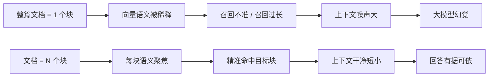

# 9-7 踩坑预警！默认文本分割方案的核心问题

## 【学习目标】

- 复现「token 太长」报错，并验证两种直觉解法（换大上下文模型、删减文档）各自的效果与局限；
- 看懂 Redis 里一条向量记录的结构，说出「整篇文档只有一个 content」为什么是错的；
- 向面试官讲清 RAG 召回不准时，文档分割为什么是第一排查现场；
- 带着两个问题（上下文获取、长文本入库）进入自定义分割器的实现。

## 【正文】

### 一、两种最直觉的解法，先验证再下结论

面对 9-6 留下的「token 太长」报错，最容易拍脑袋想到的两种解法是：换一个上下文支持更大的向量大模型（比如原来上下文只支持 1k，换成支持 8k 的），以及缩短文档本身的内容，把一个大文档拆成多个小文档。先用这种最直觉的方案验证一下。

回到配置文件，把向量大模型换成上下文更大的；再改文档，原来有一万两千多字，删掉第七节、第四章等部分，只留大约 4000 字，保存后重启项目。重新上传这份《刑法》文档，接口返回 200，说明这次成功了。

```yaml
spring:
  ai:
    openai:
      base-url: https://api.siliconflow.cn
      api-key: sk-rrnmcx... # 省略部分密钥
      options:
        model: BAAI/bge-m3 # 指定使用的嵌入模型
    vectorstore:
      index-name: bi # 向量索引名称
      prefix: bi # 前缀
      initialize: true # 初始化标志
    redis:
      host: localhost
      port: 6379
      timeout: 5s
      connect-timeout: 5s # Redis 连接超时设置
```

配置解读：`spring.ai.openai` 下 `options.model` 指定为 `BAAI/bge-m3`，即 9-5 提到过的多语言、大块上下文档位；`vectorstore` 下 `index-name` 与 `prefix` 都设为 `bi`，`initialize` 为初始化开关；Redis 连接信息紧随其后。与 9-6 的配置相比，这份示例有几处写法差异，如实说明：初始化键这里写作 `initialize`（9-6 为 `initialize-schema`）、索引与前缀从 `bi-helper` 简化为 `bi`、Redis 连接信息放在 `vectorstore.redis` 节点下（9-6 放在 `spring.data.redis` 下）。课程两份示例的写法并不一致，落地时以自己使用的 Spring AI 版本官方文档为准，关键是「索引定义」与「连接信息」两块都要齐备。

### 二、200 背后：一条记录装下整篇文档

接口返回 200 只说明向量存进去了，存成什么样还要打开 Redis 可视化工具刷新查看：可以看到里面已经出现了向量坐标。key 的命名是依据配置的 `prefix` 前缀生成的（9-6 演示值为 `bi-helper-prefix`，本节示例为 `bi`），上半部分是向量坐标，往下就是存储的文本内容。翻到最后可以看到结尾内容是「第50条……没有故意犯罪」，换言之 Word 文档里的整个内容都被保存到了这同一条记录里。

问题就在这里：整个文档只变成了一个 `content`。文档一长，超过了向量大模型的上下文长度，就直接报错了；靠删文档把长度压到模型上限以内，只是一个块硬塞了进去，结构问题一个都没解决。

### 三、为什么「整块存储」是 RAG 的万恶之源

先看面试视角。只要简历上写了 RAG，面试官百分之百会问「你是如何提高 RAG 召回的准确率和效率的」，本节就是这一问题的最佳引子。整块存储的代价有三个层次：

1. **检索粒度失控。** 一个 `content` 对应一个向量，该向量是全文语义的「平均值」。查询「库存实时表有哪些字段」时，相关段落的信号被全文无关内容稀释，命中率自然低。
2. **上下文质量失控。** 即便召回成功，喂给大模型的是整篇文档，token 消耗巨大，噪声占比高，大模型很难从中准确取用，提供给大模型的上下文不够清晰、不够准确，大模型就无法合理利用本地知识库，于是产生幻觉、生成一些胡编乱造的数据，对整个工作流的执行准确性影响很大。
3. **写入侧失控。** 文档一长就超过模型上下文直接报错，知识库永远建不起来。

用传统技术类比最直观：把一段长文本整个塞进数据库或者 Elasticsearch 的一个字段，还希望通过该字段来做检索召回，效率必然非常低。RAG 的向量检索是同一回事，检索的基本单元是块，不是文件。

再从检索机制上补一刀：向量检索每次召回，是拿查询向量与库里的块向量逐一计算相似度、取 top-k。整篇文档只贡献一个候选向量，无论库里堆了多少文件，这次查询都只有「一票」；相关章节的信号在全文平均化之后被稀释得所剩无几。分块之后，同一份文档贡献多个候选向量，相关段落才第一次有机会进入候选集。



### 四、两个值得先自己想的问题

由此还牵出两个问题，值得先自己想一遍：

其一，大模型无法准确、合理地获取到 RAG 的上下文怎么办？

其二，如果文本太长，又不想把它拆成多个文档，那要怎么存进向量数据库？

这里直接给出思路：使用自定义的定制化分割器来提高召回准确度。所谓优化，就是在第二步，文档拆分，这一环节动手。通过 reader 把整个文档加载进来之后，把文档切分成一个个块，让它变成多个 `content`，而不是像现在这样把所有内容都放进同一个 `content` 里存储。文档有上万字甚至两三万字时，整块存储不仅是存不进去的问题，整块存储的召回效率本身也非常低。

注意两个问题指向同一个动作，但约束不同：问题一关心「召回来的上下文准不准」，问题二关心「写进去的时候放不放得下」。分块同时回答两者，块小了，写得进去；块语义聚焦了，召得准确。

### 五、分割为什么必须是「定制化」的

文档分割在 RAG 基础里是非常非常重要的一环。分割做得不好，会直接拖累召回效率，进而影响后续整个 Agent 的开发。

所谓「定制化」，是指不同的业务场景、不同类型的文档，切分时所遵循的规则是不一样的，该规则需要由你自己来定义。按固定长度硬切是最省事的默认方案，但它不尊重文档结构：一句话被拦腰切断、一个表格被拆成两半，语义完整性全靠运气。

| 切分方式 | 粒度 | 边界完整性 | 召回表现 |
|---|---|---|---|
| 按固定长度硬切 | 长度可控，但与内容单元不对齐 | 句子、表格常被拦腰切断 | 块内语义混杂，命中看运气 |
| 按文档结构定制切分 | 与标题、章节等内容单元对齐 | 标题归入所属块，前言独立成块 | 每块语义聚焦，可精准命中 |

后续 Agent 开发需要执行 SQL，就必须拿到数据库表结构设计：表里有哪些字段，以及表与表之间的关系。课程笔记里已经提供了这样一份文档模板，「企业智能体数据库表结构设计文档」，可以直接下载参考，看这一类要放进本地知识库的文档该怎么写。

这份文档的结构是：一个文档标题，下面是一级标题「一、二……」，二级标题「二点一、二点二……」，其中 2.1、2.2、2.3 各自是一张表的结构定义；「三」下面又分 3.1、3.2，同样各是一张表结构；再往下还有「四」「五」。用数字标题来组织文档是非常常见的写法，文本切分完全可以按数字标题的维度来做：2.1 作为一个块存进向量数据库，2.2 作为一个块，依次类推。

按文档自身的编写格式来做定制化切分，是本节要立起来的核心原则。下一节落地两个适用面很广的定制化分割器。

## 【易错点 / 面试题】

1. **易错点：把「换更大上下文模型」当根本解。** 这一招只是提高了单块上限，检索粒度与上下文噪声两个问题原封不动；更大上下文的档位通常还更贵、转换更慢。它能救急，不能治本。

2. **易错点：把「拆成多个文档上传」等同于「分块」。** 多个大块仍是差召回，分块要做在块粒度（chunk），不是文件粒度。判断标准很简单：Redis 里一条记录对应一个语义聚焦的小块，才对。

3. **面试题：「RAG 召回不准，你的排查与优化顺序是什么？」**
   答：先看分块，粒度、边界、重叠是否符合文档结构；再核对写入与查询是否同一个向量模型；然后才考虑重排序、混合检索等手段；最后才是提示词优化。分割是第一现场，因为它同时决定写入能否成功与召回的粒度。

4. **面试题：「分块是越细越好吗？」**
   答：不是。切得过细会丢上下文、断语义，一个完整的表结构定义被切成几块后，哪一块都不足以回答「这张表有哪些字段」；块间还需要重叠来补偿边界断裂。正确的做法是按文档结构定制切分规则，并用召回效果验证。

## 【小结】

本节复盘了默认路径的失败：换大上下文模型加删减文档能让接口返回 200，但 Redis 里那条记录仍然装着整篇文档，一个被稀释的向量、一段超长的上下文，召回效率与生成质量双输。由此立起本节的核心原则：文档分割必须按文档自身的格式定制化。下一节实现两个定制化分割器：按数字编号标题切分的 `HeadingTextSplitter` 与按中文标点切句的 `ChineseTextSplitter`，并在 Redis 里验证「一个向量变成多个向量」的效果。

上下文质量直接决定下游结构化输出的质量，这条传导链在配套工程 `980-demo/src/main/java/com/carl/ai/transfer/extract/TransferOrderExtractor.java` 中同样成立：该抽取器把字段清单写死在提示词里、只要求输出 JSON，正是在用「干净的上下文」换「稳定的结构化输出」，可对照阅读。
