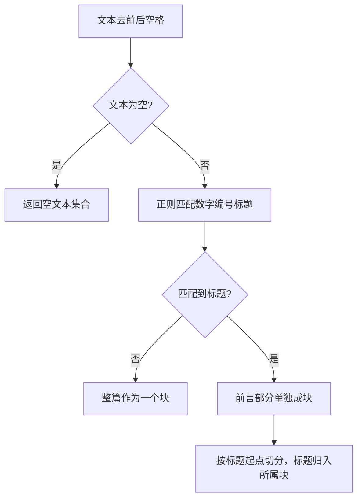

# 9-8 面试加分项：使用自定义的定制化分割器来提高召回准确度

## 【学习目标】

- 说清「定制化分割」的设计原则：切分规则由文档自身的编写格式决定；
- 掌握 `HeadingTextSplitter` 的完整流程：空值兜底、正则匹配标题、前言单独成块、按标题边界切分；
- 掌握通用中文分割器的两参数设计（分块大小、重叠大小）与重叠的补偿作用；
- 按文档类型选择分割器，并能把「自定义分割器」讲成面试加分项；
- 在 Redis 里验证切分效果：一个向量变成多个向量，查询精准命中。

## 【正文】

### 一、定制化的含义：按文档格式定规则

之所以叫「定制化」，是因为文档的编写格式各不相同，那就按照文档自身的编写格式来做定制化的切分。这里采用的切分规则是数字编号标题：`1`、`1.1`、`2`、`2.2`、`3`、`3.1`、`3.2`、`4`、`4.1`、`4.2` 等等，实现上用一个正则表达式去匹配这些数字编号标题，再按匹配结果做文本切割。

### 二、HeadingTextSplitter 处理流程

`HeadingTextSplitter` 的处理流程是：先去掉文本前后的空格并判断是否为空，为空就直接返回空的文本集合；不为空则用正则去匹配文档中的数字编号标题，并记录每个标题的起始索引。如果一个标题都没匹配到，就把整篇文本作为一个块返回；而按课程提供的模板编写文档时一定存在数字标题，所以不会退化成整篇一个块。接下来还有一个边界处理：如果第一条标题不在文本开头，就把开头到第一条标题之间的前言部分也单独作为一个块。最后按各个标题的起点切分，标题本身包含在各自的块当中。核心就是靠正则匹配出所有数字编号标题，再以它们为边界切块。

```java
public class HeadingTextSplitter extends TextSplitter {
    private static final Pattern HEADING_PATTERN = Pattern.compile("\\d+\\.|\\d+\\.\\d+\\.|\\d+\\.\\d+\\.\\d+\\.|\\d+\\.\\d+\\.\\d+\\.\\d+\\.|\\d+\\.\\d+\\.\\d+\\.\\d+\\.\\d+\\.|\\d+\\.\\d+\\.\\d+\\.\\d+\\.\\d+\\.\\d+\\.|\\d+\\.\\d+\\.\\d+\\.\\d+\\.\\d+\\.\\d+\\.\\d+\\.|\\d+\\.\\d+\\.\\d+\\.\\d+\\.\\d+\\.\\d+\\.\\d+\\.\\d+\\.|\\d+\\.\\d+\\.\\d+\\.\\d+\\.\\d+\\.\\d+\\.\\d+\\.\\d+\\.\\d+\\.|\\d+\\.\\d+\\.\\d+\\.\\d+\\.\\d+\\.\\d+\\.\\d+\\.\\d+\\.\\d+\\.\\d+\\.|\\d+\\.\\d+\\.\\d+\\.\\d+\\.\\d+\\.\\d+\\.\\d+\\.\\d+\\.\\d+\\.\\d+\\.\\d+\\.|\\d+\\.\\d+\\.\\d+\\.\\d+\\.\\d+\\.\\d+\\.\\d+\\.\\d+\\.\\d+\\.\\d+\\.\\d+\\.\\d+\\.|\\d+\\.\\d+\\.\\d+\\.\\d+\\.\\d+\\.\\d+\\.\\d+\\.\\d+\\.\\d+\\.\\d+\\.\\d+\\.\\d+\\.\\d+\\.|\\d+\\.\\d+\\.\\d+\\.\\d+\\.\\d+\\.\\d+\\.\\d+\\.\\d+\\.\\d+\\.\\d+\\.\\d+\\.\\d+\\.\\d+\\.\\d+\\.|\\d+\\.\\d+\\.\\d+\\.\\d+\\.\\d+\\.\\d+\\.\\d+\\.\\d+\\.\\d+\\.\\d+\\.\\d+\\.\\d+\\.\\d+\\.\\d+\\.\\d+\\.|\\d+\\.\\d+\\.\\d+\\.\\d+\\.\\d+\\.\\d+\\.\\d+\\.\\d+\\.\\d+\\.\\d+\\.\\d+\\.\\d+\\.\\d+\\.\\d+\\.\\d+\\.\\d+\\.|\\d+\\.\\d+\\.\\d+\\.\\d+\\.\\d+\\.\\d+\\.\\d+\\.\\d+\\.\\d+\\.\\d+\\.\\d+\\.\\d+\\.\\d+\\.\\d+\\.\\d+\\.\\d+\\.\\d+\\.|\\d+\\.\\d+\\.\\d+\\.\\d+\\.\\d+\\.\\d+\\.\\d+\\.\\d+\\.\\d+\\.\\d+\\.\\d+\\.\\d+\\.\\d+\\.\\d+\\.\\d+\\.\\d+\\.\\d+\\.\\d+\\.|\\d+\\.\\d+\\.\\d+\\.\\d+\\.\\d+\\.\\d+\\.\\d+\\.\\d+\\.\\d+\\.\\d+\\.\\d+\\.\\d+\\.\\d+\\.\\d+\\.\\d+\\.\\d+\\.\\d+\\.\\d+\\.\\d+\\.|\\d+\\.\\d+\\.\\d+\\.\\d+\\.\\d+\\.\\d+\\.\\d+\\.\\d+\\.\\d+\\.\\d+\\.\\d+\\.\\d+\\.\\d+\\.\\d+\\.\\d+\\.\\d+\\.\\d+\\.\\d+\\.\\d+\\.\\d+\\.|\\d+\\.\\d+\\.\\d+\\.\\d+\\.\\d+\\.\\d+\\.\\d+\\.\\d+\\.\\d+\\.\\d+\\.\\d+\\.\\d+\\.\\d+\\.\\d+\\.\\d+\\.\\d+\\.\\d+\\.\\d+\\.\\d+\\.\\d+\\.\\d+\\.|\\d+\\.\\d+\\.\\d+\\.\\d+\\.\\d+\\.\\d+\\.\\d+\\.\\d+\\.\\d+\\.\\d+\\.\\d+\\.\\d+\\.\\d+\\.\\d+\\.\\d+\\.\\d+\\.\\d+\\.\\d+\\.\\d+\\.\\d+\\.\\d+\\.\\d+\\.|\\d+\\.\\d+\\.\\d+\\.\\d+\\.\\d+\\.\\d+\\.\\d+\\.\\d+\\.\\d+\\.\\d+\\.\\d+\\.\\d+\\.\\d+\\.\\d+\\.\\d+\\.\\d+\\.\\d+\\.\\d+\\.\\d+\\.\\d+\\.\\d+\\.\\d+\\.\\d+\\.|\\d+\\.\\d+\\.\\d+\\.\\d+\\.\\d+\\.\\d+\\.\\d+\\.\\d+\\.\\d+\\.\\d+\\.\\d+\\.\\d+\\.\\d+\\.\\d+\\.\\d+\\.\\d+\\.\\d+\\.\\d+\\.\\d+\\.\\d+\\.\\d+\\.\\d+\\.\\d+\\.\\d+\\.|\\d+\\.\\d+\\.\\d+\\.\\d+\\.\\d+\\.\\d+\\.\\d+\\.\\d+\\.\\d+\\.\\d+\\.\\d+\\.\\d+\\.\\d+\\.\\d+\\.\\d+\\.\\d+\\.\\d+\\.\\d+\\.\\d+\\.\\d+\\.\\d+\\.\\d+\\.\\d+\\.\\d+\\.\\d+\\.|\\d+\\.\\d+\\.\\d+\\.\\d+\\.\\d+\\.\\d+\\.\\d+\\.\\d+\\.\\d+\\.\\d+\\.\\d+\\.\\d+\\.\\d+\\.\\d+\\.\\d+\\.\\d+\\.\\
```

如实说明：课程片段只给出类声明与 `HEADING_PATTERN` 常量，方法体以文字描述实现思路，未贴出完整代码。这一正则的写法特点是按标题层级逐级展开：从一级编号到「编号.编号.编号……」逐级书写 alternation，用 `|` 串成一个超长模式，任意深度的数字编号标题都能命中。落到工程里还有两点值得注意：其一，模式没有锚定行首，正文中出现的数字加点（如版本号、小数）也会被当成标题命中，存在误切风险，课程模板文档以编号标题为主，影响有限，生产上可以给模式加行首与编号格式约束；其二，正则只匹配编号本身，标题文字跟在编号之后，因此按匹配起点切块时，标题会落在所属块的开头，与课程描述的「标题本身包含在各自的块当中」一致。



### 三、通用中文分割器：按句切，管大小也管重叠

为了多覆盖一些场景，这里再给出一个通用的中文文档文本分割器 `ChineseTextSplitter`，同样继承 `TextSplitter`，注释标注「可作为通用的中文文档分割器」。它的核心依然是一个正则表达式，匹配的是中文常见的分句符号：句号、冒号、问号、分号这些中文标点，以及中文括号。切分原理一句话概括：按句子分割，判断一句话的依据就是这些中文句子结束符，比如遇到一个中文句号就认为这是一句话。

它接收两个参数：第一个是分块大小，即每个块有多大；第二个是块与块之间的重叠大小。举例来说，上一个块长度是 500，下一个块也是 500，通过重叠参数可以指定允许相邻两个块之间重叠多少文本。实现时同样是实现文本切分方法：先用中文标点把文本匹配成一个个句子，再遍历这些句子，处理重叠部分，最后组装进各个块里。

重叠参数的存在是为了补偿边界断裂：一句跨块的话被切成两半后，任何一块都不完整；让相邻块共享一小段文本，查询命中任一块都能拿到完整语义。重叠过大则浪费存储、召回重复；过小则起不到补偿作用，按文档句长权衡。

### 四、两类文档，两把剪刀

| 文档类型 | 课程示例 | 切分依据 | 适用分割器 |
|---|---|---|---|
| 结构化模板文档 | 表结构设计文档 | 数字编号标题 | `HeadingTextSplitter` |
| 长篇中文文档 | 《刑法》节选 | 中文句子边界 + 块大小 + 重叠 | `ChineseTextSplitter` |

当然还可以继续扩展：《刑法》本身是分章节的，第一章下面有很多条，第二章下面又有很多条，那完全可以按章、按节这样的维度来切分。具体怎么切，比较考验个人的设计能力，这里提供的两个分割器只是作为引子。

### 五、面试怎么讲这一段

面试时的说法可以这样组织：文档是由开发人员提供的，里面是数据库表结构设计以及表与表之间的对应关系，因此团队可以规定统一的模板格式来上传，用数字标题做层级区分，比如「2」说明是哪块业务的表，「2.1」「2.2」分别是具体哪张表，大家都按该规范编写。于是你自己自定义实现了按数字编号标题切分的文档分割器，另外还针对某种格式的文档实现了另一种切分方式。面对面试官时一定要突出「自定义」「定制化实现了文本切割」这一点；如果追问设计思路，就回答是按照公司内部文档格式做的定制化。实在没思路时，也可以让 AI 解释这些代码，甚至让 AI 生成一个更好的文本切割方法。

### 六、落地验证：一个向量变成多个向量

回到代码，要用数字编号标题切分，就 `new` 一个 `HeadingTextSplitter`，再调用文本分割器的 `split()` 方法，它可以接收文档集合，调用之后即完成切分。切分后的内容再存进向量数据库。

重启项目，先把之前生成的向量删掉，再来观察按自定义方式切分之后生成的向量是什么样。项目启动成功后上传 BI 文档，返回 200。回到 Redis 可视化工具刷新：在实现自定义文档切割之前只有一个向量，而切分之后出现了多个向量，逐个查看 `content` 可以看到 2.2、2.3、3.1、2.1、3.2 这样的数字编号标题，某一段没有数字编号的内容则被单独放进了一个块，确实已经按数字编号完成了切分。

切得越细，召回时效率越高、效果也越好。比如只想查库存实时表，就可以直接命中对应的向量，把这一块内容作为上下文交给大模型。而在没有切分之前，整篇文档作为一个整体存储，后续召回的效率就慢得多。可以类比传统数据库：把一段长文本整个塞进一个字段，还希望通过该字段来做检索，效率自然非常低。

## 【易错点 / 面试题】

1. **易错点：标题正则未锚定行首。** 课程这一版 `HEADING_PATTERN` 匹配任何位置的「数字 + 点」，正文里的版本号、小数也会被误判为标题，切出碎块。修复方向是给模式加行首与格式约束（编号单独成行、后跟标题文字），而不是推倒重来。

2. **易错点：重叠参数设成 0 或设得过大。** 0 等于放弃边界补偿，跨块句子两半都查不完整；过大则存储膨胀、召回结果重复。按文档句长取一个「能盖住一句完整话」的量级即可。

3. **面试题：「你的 RAG 分割方案怎么设计的？」**
   答：按文档格式定制，而不是无脑按固定长度切。团队上传的文档有统一模板，用数字编号标题组织，所以实现了按编号标题切分的分割器，前言单独成块、标题归入所属块；对《刑法》这类长篇中文文档，则用中文标点切句，再按分块大小与重叠组装。效果在 Redis 里可验证：切分前一个向量，切分后按 2.1、2.2、3.1 等标题生成多个向量，查询能精准命中目标块。

4. **面试题：「分块之后一定比整篇好吗？」**
   答：分块解决了写入上限与召回粒度，但引入了边界断裂，所以要用重叠、标题归入等手段补偿；没有放之四海皆准的切分规则，按文档类型定制、用召回效果验证，才是可迁移的方法论。

## 【小结】

本节落地了两个定制化分割器：按数字编号标题切分的 `HeadingTextSplitter`（空值兜底、无标题退化、前言单独成块、按标题边界切分）与按中文标点切句的 `ChineseTextSplitter`（分块大小 + 重叠两参数），并在 Redis 里完成了效果验证，一个向量变成多个语义聚焦的向量，查询库存实时表时能直接命中对应块。「按文档格式定制切分规则」这一原则，比任何具体实现都更值得带走。下一篇转向工程扩展：用 Docker Compose 启动 Milvus 与可视化界面，为更大规模的知识库做准备。

需要说明的是，分割器属于与业务解耦的通用能力：本节的两个分割器针对课程知识库的文档形态设计；配套工程 `980-demo` 聚焦调拨单的结构化抽取主链路（`980-demo/src/main/java/com/carl/ai/transfer/extract/TransferOrderExtractor.java`），未重复实现 RAG 链路，阅读时把本节当独立能力模块即可。
