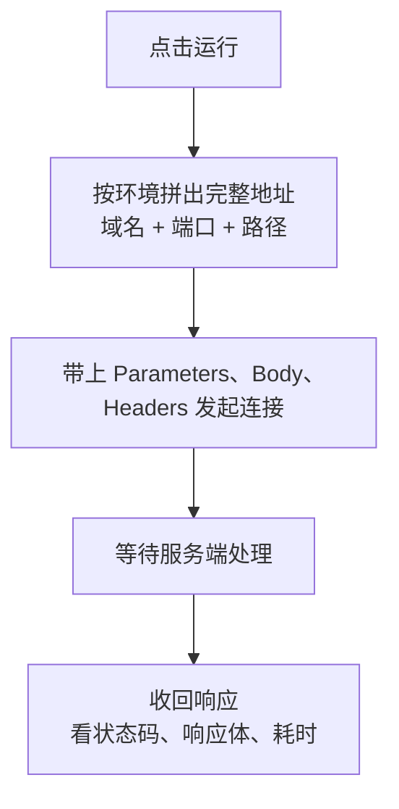

# 1-2 准备工作：安装ApiFox

## 【学习目标】

- 独立完成 ApiFox 的下载安装，并创建团队、项目与接口；
- 理解 ApiFox 的环境管理机制，会配置开发环境的域名与端口；
- 掌握 GET / POST 请求的参数位置差异，为课程后续的接口调试做好准备。

## 【正文】

### 1. 为什么选 ApiFox

ApiFox 是一款接口测试软件。做接口开发的过程中，多数团队会在 Postman 与 ApiFox 之间做选择，也有人还在使用 Postman。两者的基础能力重叠，都能构造并发送 HTTP 请求、查看响应；差异在于 ApiFox 把更多环节整合到了一起：它不只是能实现 Postman 那样的接口测试功能，还能够对接 Swagger 这类接口文档，也能够进行 Mock 测试数据的生成。

为什么这些能力值得整合到一处？回顾接口开发的日常链路：后端写接口 → 出文档 → 前端/测试对照文档构造请求 → 联调 → 回归。链路里的每个环节换一个工具，上下文就断一次。ApiFox 的思路是把「文档 - 请求 - Mock - 联调」收进同一个工具：能直接读 Swagger 文档生成接口，能在后端未就绪时用 Mock 顶上空窗期，还能把调试好的请求保存成用例反复跑。「前端等后端、后端等联调」的常见协作阻塞，Mock 能力可以直接解开。综合之下，现在 ApiFox 在接口测试这块比较流行，本课程统一使用它调试后续的接口。

两类工具的能力对照如下：

| 能力 | Postman | ApiFox |
|---|---|---|
| 接口测试（构造请求、看响应） | 支持 | 支持 |
| 接口文档对接（Swagger / OpenAPI） | 有限支持 | 支持 |
| Mock 数据生成 | 支持 | 支持 |
| 用例与目录组织 | 支持 | 支持 |
| 中文文档与本土化 | - | 更贴近国内团队习惯 |

对国内团队而言，中文界面与文档对接是 ApiFox 流行的重要原因；功能层面两者都能覆盖课程的全部使用场景，选哪个都不影响后续章节的学习，统一用一种即可。

还要说清接口测试在课程里的位置：本课的主角是 Agent 与多 Agent 系统，接口工具不是学习重点，但它是「验证 Agent 系统是否按预期工作」的入口，主管 Agent 暴露给前端的接口、A2A 通信的端点、观测埋点的输出，最终都要以 HTTP 请求响应的形式被检验。工具十分钟能上手，值得投入的是理解每个接口背后的链路。

下载地址在课程笔记里给出，自行下载并根据自己的操作系统安装即可。安装过程不复杂，这款软件的使用比较简单，此处不做演示。

### 2. 团队、项目与接口的层级

打开 ApiFox 界面，左侧有一个「团队」入口。先在这里新建一个团队，再在团队下新建项目，就创建一个课程项目，命名为行程规划智能体。项目类型选择 HTTP 即可，因为我们所创建的接口一般都是 HTTP 接口。点击创建，项目就建出来了。

这套「团队 → 项目 → 接口」的层级不是摆设：团队是权限与资源共享的单位，项目把同一业务的接口收敛在一起，接口之下的用例则保存具体的请求组合。课程项目虽小，仍然按层级组织，方便后续章节不断往里加接口，第 11 章起要调试的 A2A 通信接口、第 13 章起要调试的主管 Agent 交互接口，都会陆续并入同一项目。

再往下一层，「接口」与「用例」的分工也值得分清：接口描述「请求长什么样」，路径、方法、参数、响应结构；用例保存「某次具体调试」，填好的参数值、当时的环境、备注。一个接口可以对应多个用例：正常参数一条、边界参数一条、错误参数一条。调试时在用例间切换，比每次手改参数高效，也天然形成一份回归资产。

项目创建完成后，可以看到里面有「接口」菜单，点击新建就可以把接口创建出来。

### 3. 环境管理：ApiFox 的核心机制

环境是 ApiFox 最值得先理解的机制。ApiFox 提供了环境选择，可以选测试环境、开发环境、正式环境，以及本地的 Mock 环境。测试环境和开发环境主要的不同，就在于所请求的服务器的端口不同，做过开发的同学应该都很清楚：同一套服务在不同阶段跑在不同地址上，如果每个接口都把域名和端口写死，切换环境就得逐条手改，既低效又容易漏，漏改一个接口，故障就藏在线上。

正确做法是把域名与端口收进环境配置，接口只保留路径。操作步骤：点击「管理环境」，选择开发环境，主要设置两项，服务器域名与端口。本地开发场景下域名填 `127.0.0.1`，端口填本课程项目的 `8888`。点击保存，开发环境即创建完成。

之后创建一个接口：接口的环境选择处选中刚才创建的开发环境。这样一来，接口名称处就不需要再写前面设置的域名以及端口号了，只需要填写接口的请求地址即可。假设接口请求地址是 `test`，填好之后点击保存，一个接口就创建出来了。点击运行，可以看到该接口的完整地址，正是「开发环境的域名 + 端口号 + 接口所请求的地址」。这就是用 ApiFox 新建接口的完整流程，比较简单，但环境机制是这套流程的灵魂：域名与端口属于环境配置，接口只描述路径；环境一切换，挂在它下面的所有接口全部跟着切，不会漏。

再往后做真实联调时，还会用到环境里定义变量的能力：把域名、端口、鉴权 Token 这类值提成变量，接口里引用变量而非字面量，多套环境的差异就只剩一份配置表。课程项目只用到「域名 + 端口」两级，但机制是相通的，等到第 13 章接触观测接口、需要带鉴权头时，变量的价值会更明显。

### 4. 请求方法与参数位置

接口创建后，还需要约定请求方法与参数。至于接口的请求方法，可以选择 GET 还是 POST：点击「修改接口」，在里面更改它是 GET 请求、POST 请求还是其他类型的请求，修改完成之后点击保存，就把接口的修改保存下来了。

再次点击运行会来到请求页面，参数位置随方法不同而变化：

| 请求方法 | 参数位置 | 课程中的典型用途 |
|---|---|---|
| GET | Parameters 标签页，以查询字符串拼接在 URL 之后 | 查询类操作，例如按 id 查详情、查看团队成员列表 |
| POST | Body 请求体，可以是 JSON，也可以是表单的形式 | 提交类操作，例如提交旅行需求 |

如果是 GET 请求，可以在 Parameters 标签页里添加参数，比如 id 之类的；如果是 POST 请求，它携带的参数就放在 Body 请求体里面。此外还可以设置 Headers，两种方法都支持，例如内容类型、鉴权信息等。

以课程工程的 `POST /api/travel/plan` 为例，Body 选 JSON 格式时，内容形如一个包含需求文本的 JSON 对象，字段名与服务端约定一致（如 `requirement`）；字段名拼错、层级多套一层，都是「参数明明填了却报错」的高发原因。GET 请求则把参数摆在 Parameters 标签页，键值对一一对应，填错的键在最终 URL 里一眼能看出来，这也是 GET 排障更直观的原因。

这里有一个容易混淆的点：Body 的格式（JSON 还是表单）必须与 Headers 里的内容类型对应，Body 选 JSON 时内容类型应为 JSON，选表单时则对应表单类型，两者混用会导致服务端解析不出参数。保存的请求会留在用例里，下次调试直接从历史里取，不必每次重填。

### 5. 点击运行之后发生了什么

理解「运行」背后发生的事，排障时才能按层定位。点击运行后，ApiFox 依次做这几件事：按接口所在环境拼出完整地址（域名 + 端口 + 路径）→ 带上 Parameters、Body、Headers 发起连接 → 等待服务端处理 → 收回响应。响应回来时，重点看三样东西：状态码、响应体、耗时。

| 状态码段 | 含义 | 常见原因 |
|---|---|---|
| 2xx | 成功 | 请求被正常处理 |
| 4xx | 客户端错误 | 路径写错（404）、方法不允许（405）、参数问题（400） |
| 5xx | 服务端错误 | 服务没起（连接拒绝）、服务内部异常（500） |

一个实用的排障顺序：先看耗时与状态码确认「是否可达」，再看响应体确认「结果是否正确」。「连不上」查环境与服务端状态，「连上了但结果不对」查参数与 Body 格式。这套顺序在后续联调 A2A 接口时同样适用。

### 6. 课程联调实战：走一遍完整流程

把前面的机制串起来，对照课程配套工程走一遍完整流程，印象会深很多：

1. **起服务**：按课程说明启动 981-demo（default profile 离线模式即可，服务端口为 8888）。启动前确认端口没被占用，启动后看到就绪日志再进入下一步；
2. **建环境**：在「行程规划智能体」项目里确认开发环境已配好 `127.0.0.1:8888`；
3. **建接口**：新建两个接口，`GET /api/travel/members` 与 `POST /api/travel/plan`，环境都选开发环境，保存；
4. **发请求**：运行 GET 接口，响应里应能看到当前发现的团队成员列表；再运行 POST 接口，Body 传 JSON（如需求文本），响应里应能看到主管 Agent 汇总出的行程规划；
5. **读响应**：按第 5 节的状态码与响应体两层看法，确认「通了」且「对了」。GET 接口的响应里，成员列表应为 JSON 数组，每个成员带名称与描述；POST 接口的响应里，应包含主管 Agent 汇总出的规划文本。若响应为空或字段缺失，先核对请求体字段名与服务端约定是否一致，再怀疑服务端逻辑。

这套流程与第 11 章之后的 A2A 接口调试、第 13 章的观测接口调试是同一套方法，区别只在接口路径与参数。工具层面的功夫到此为止，剩下的都是接口背后的 Agent 逻辑。

日常使用中还有两个提效习惯：一是把调试好的请求及时保存成用例，命名带上场景（如「成员列表-正常」「规划-含路线需求」），回归时一键全跑；二是接口按章节或模块建目录归组，课程项目接口会越来越多，没有目录支撑后期找人比找接口快。两者都不难，难在养成习惯。

### 7. 常见坑

常见坑按「配置类」与「认知类」分两拨记：配置类改完即生效，认知类要靠理解机制来避。下面九条基本覆盖课程阶段会遇到的全部问题。

1. **忘记保存**：接口的修改（方法、参数、路径）必须保存后才生效，直接运行拿到的是旧配置；
2. **环境没选对**：接口如果挂在默认环境上，运行时会请求默认域名，表现为「接口 404 或连不上」，先检查接口的环境选择，再查服务端；
3. **Content-Type 不匹配**：如第 4 节所述，Body 格式与内容类型不对应时，服务端取不到参数；
4. **把调试地址当正式地址**：开发环境填的 `127.0.0.1:8888` 只在本机有效，演示给同事或部署到服务器时，需要换成对应环境的域名与端口，这正是要建多套环境的原因；
5. **Mock 环境不会自己变**：Mock 返回的是事先定义的结构，后端上线后要记得把接口切回真实环境，否则会一直对着假数据自测；
6. **服务端没起就调**：联调前先确认课程项目对应的 Spring Boot 服务已经启动、端口确实是 8888，客户端连不上的第一嫌疑永远是服务端没起来；
7. **路径开头漏了斜杠或多了斜杠**：环境里配的是 `http://127.0.0.1:8888`，接口路径按 `/api/travel/plan` 的写法与不带斜杠的写法在不同工具里拼接结果不同，拼出来的地址先肉眼核对一遍再发送；
8. **浏览器缓存与 Cookie 干扰**：ApiFox 里看到的结果与浏览器不一致时，优先以接口工具为准，它不带会话状态，更能反映接口本身的行为。

## 【易错点 / 面试题】

1. **面试题：GET 和 POST 的本质区别是什么？**
   答：不要只答「GET 传参在 URL、POST 传参在 Body」。本质区别在语义与特性：GET 被定义为安全、幂等的读取操作，参数随 URL 传递、有长度限制、可被缓存和收藏；POST 用于提交与变更，参数在请求体中，无长度限制、默认不缓存。选型判据是操作语义，读取用 GET，提交用 POST。面试中能补一句「幂等性」的差异，基本就到位了。

2. **面试题：接口 Mock 解决什么问题？**
   答：Mock 让调用方在后端未就绪时，基于约定好的返回结构并行开发与自测，解掉「前后端互相等待」的协作阻塞。往深一层说，Mock 依赖的是接口契约（文档 + 返回结构），契约先行也是微服务协作的常见实践，先把接口文档与 Mock 定下来，前后端才能真并行。

3. **面试题：Swagger / OpenAPI 文档和接口测试工具是什么关系？**
   答：Swagger 是接口契约的描述格式，OpenAPI 是它的规范；ApiFox 这类工具能直接读取契约生成接口与请求骨架，省去手抄字段的功夫，也让「文档即工具里的接口」保持同步，避免文档与实现两张皮。课程后续如果接触 Springdoc 之类的文档组件，生成的正是这种契约。

4. **易错点：把域名端口写进每个接口。**
   违背环境机制的设计会让环境切换变成体力活，且极易遗漏。域名与端口属于环境配置，接口只描述路径，这是接口工具使用的基本纪律。

## 【小结】

本节完成了第一项准备工作：安装 ApiFox，创建「行程规划智能体」项目，并理解了环境管理、请求方法、参数位置三个核心机制。后续章节调试主管 Agent 暴露的接口时，用的正是本节创建的项目与环境，课程配套工程 981-demo 的 `src/main/java/com/travel/agent/web/TravelController.java` 暴露了 `POST /api/travel/plan`（提交旅行需求，Body 传 JSON）与 `GET /api/travel/members`（查看团队成员）两个接口，可以直接用本节的流程在 ApiFox 中构造请求：开发环境配好 `127.0.0.1:8888`，POST 请求的 Body 填 JSON 格式的需求文本即可。接口工具本身没有难点，难的是把「环境、方法、参数、响应」四件事养成按顺序检查的习惯，这套习惯在联调 A2A 通信、排查观测接口时会反复兑现价值。下一篇配置阿里大模型广场的 API Key。
