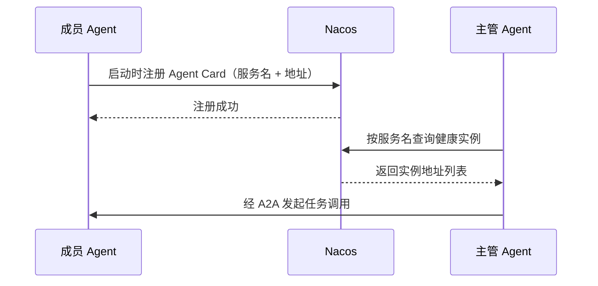

# 1-5 准备工作：安装Nacos 3

## 【学习目标】

- 理解 Nacos 在课程中的定位：服务注册与发现，服务 A2A 通信协议；
- 用 Docker 独立完成 Nacos 3 的安装、启动与登录；
- 记住 8848 / 9848 / 8080 三个端口的用途，理解为什么必须选 Nacos 3。

## 【正文】

### 1. Nacos 在课程里扮演什么角色

Nacos 在课程中承担服务发现的角色，主要服务于 A2A 通信协议，A2A 协议正是靠它完成不同节点上 Agent 的服务发现。

回顾一下课程第 11 章的架构：团队成员（路线制定专员、景点推荐等 Agent）启动后，需要把自己的「智能体卡片」（Agent Card）注册到某个地方；主管 Agent 要调用某个成员时，先从该处解析出成员的真实地址，再发起 A2A 调用。该「注册 - 发现」的中枢就是 Nacos。

没有它会怎样？主管 Agent 就只能把成员地址硬编码在配置里：成员一扩容、迁移或上下线，调用方就得跟着改配置、重新发布；多成员场景下，哪个实例还活着也无从判断。服务注册发现正是为解决这些问题而生：成员启动时主动报到（注册），主管按服务名解析可用实例（发现），成员变化对调用方透明。这也是微服务架构的标配组件，放到多 Agent 场景里，注册中心里存的对象从「服务实例」换成了「智能体卡片」。

拆开看，注册中心管理的数据模型只有三样：服务名（成员的逻辑标识，如课程工程里的 `a2a-<AgentName>`）、实例列表（服务名对应的真实地址集合，带健康状态）、元数据（附在实例上的键值对，课程里存的正是 Agent Card 这类结构化描述）。调用方的全部动作就是「按名字要实例」，注册中心的全部职责就是「把名单维护准确」，健康检查自动剔除死实例，新实例上线自动加入，调用方对此无感。

把注册与发现的时序画出来，职责边界会更清楚：



课程 11-2 与 11-3 两节做的，正是这张图的前三行；11-4 起补上最后一行。本节只需把 Nacos 这半边基础设施备好。

### 2. Docker 方式安装

先自行安装 Docker，然后从 Docker 拉取 Nacos 镜像，执行下面这条命令即可把 Nacos 3 的服务端拉取下来：

```bash
sudo docker pull nacos/nacos-server:v3.1.0
```

用 Docker 装中间件有三个直白的好处：不用管宿主机上有没有 Java 运行环境，镜像自带；不用执行安装脚本，拉下来就能跑；不用了删掉容器即可，不留残余。理解两条命令只需要三个概念，镜像是打包好的运行环境（`nacos/nacos-server:v3.1.0` 就是官方发布的 Nacos 3.1.0 镜像），容器是镜像跑起来的实例，端口映射则是把容器内部的端口接到宿主机上，外部才能访问。上面第一条命令拉镜像，第二条命令起容器，端口映射的事下一节细说。

再补两个 Docker 使用常识，后续课程还会用到：一是容器与进程一一对应，容器停了服务就停了，`docker ps` 看运行中的容器，`docker logs` 看容器日志，第 11 章排障时这两条命令使用频率极高；二是数据持久化，容器默认的文件系统随容器删除而消失，想留住 Nacos 里的注册数据，要么去掉 `--rm`，要么挂载数据卷。课程阶段数据丢了重启即可，不必急着上数据卷，但要知道有这回事。

镜像拉取完成之后，用启动命令把容器跑起来（课程示例命令直接复制运行即可）：

```bash
sudo docker run --rm -name nacos -e MODE=standalone -e NACOS_AUTH_ENABLE=false -e NACOS_AUTH_TOKEN=MjM1ZmU4NjAxMzU1N'
```

在 Linux 上执行后，控制台日志中会出现 `Nacos started successfully`，这表示 Nacos 已经正常启动。

需要如实说明：课程录屏中这条启动命令是不完整的，直接照抄会在自己的机器上失败。从命令本身可以识别出三处问题，第一，`--rm` 之后直接跟了 `-name`，参数名应为 `--name`，否则 Docker 无法解析；第二，命令里没有 `-p` 端口映射，容器内的端口不会暴露到宿主机，宿主机上访问不了控制台与 API；第三，命令末尾的鉴权 token 字符串被截断，且引号未闭合。

命令里出现的几个环境变量值得认识：`MODE=standalone` 表示单机模式运行，适合课程阶段的本地开发，不依赖外部数据库；`NACOS_AUTH_ENABLE=false` 关闭登录鉴权，本地图省事可以，暴露到公网则必须开启；`NACOS_AUTH_TOKEN` 是关闭鉴权后仍会参与生成的一个内部令牌，截断与否不影响单机启动。按 Docker 使用惯例，完整启动还需要把下一节所述的三个端口（8848、9848、8080）各自映射到宿主机。本节后续操作以上述端口理解为准，命令细节以 Docker 官方文档与 Nacos 官方文档为准。

### 3. 端口与登录

启动之前先了解一下 Nacos 的几个端口：

| 端口 | 协议 / 用途 | 课程用途 |
|---|---|---|
| 8848 | HTTP 端口，最主要的端口 | 课程使用（客户端连接、API 调用） |
| 9848 | RPC 端口 | Nacos 2.x 起新增的 gRPC 通信端口 |
| 8080 | 控制台页面端口 | 浏览器访问管理页面 |

启动 Nacos 之后，在浏览器输入 `127.0.0.1:8080` 就能进入 Nacos 的控制页面。页面会要求输入用户名和密码，默认的用户名是 `nacos`，密码同样是 `nacos`，提交之后即可登录到 Nacos 的管理页面。

登录环节的排障也顺带一说：页面打不开，先查容器是否真的在跑（`docker ps`）、端口映射是否配了；页面能开但登录不上，先确认没有改过密码、没有开启鉴权，课程示例命令里 `NACOS_AUTH_ENABLE=false` 就是为此；忘记自己改过的密码，最省事的办法是删掉容器重新按示例命令启动，本地阶段数据不重要。

登录后的页面结构可以先认个脸：左侧是导航菜单（服务管理、配置管理，以及 Nacos 3 新增的 Agent 管理与 MCP 管理），主区域是服务列表，按服务名分组展示实例，每个实例带 IP、端口、权重与健康状态。第 11 章成员注册成功后，就能在服务列表里看到以 `a2a-` 开头的服务项；看不到时，说明注册这半边出了问题，与主管侧的解析逻辑无关，排查范围立刻缩小。

「按现象缩小排查范围」是准备篇最该带走的技能：页面打不开查容器与端口，登录不上查鉴权开关，服务列表为空查成员端注册动作。三层各有各的解法，逐层排除比全局乱试快得多。课程第 11 章的两次测试（注册、获取）都会回到控制台验证，届时本节认的门就会用上。

顺带交代版本背景：Nacos 从 2.x 开始把节点间通信切到 gRPC，新增了 9848 作为 RPC 端口；HTTP 端口 8848 的定位保留至今，仍是客户端与开放 API 的主入口。控制台端口则在 2.x 调整为 8080。记住「客户端 8848、控制台 8080、节点间 9848」这组对应，读启动日志时就能对号入座。

### 4. 为什么必须用 Nacos 3

之所以必须用 Nacos 3 这一版本，是因为 Nacos 3 的管理界面中已经包含「Agent 管理」和「MCP 管理」，可以说 Nacos 3 已经对人工智能 Agent 做了兼容。

这两个新菜单也透露了 Nacos 的演进方向：注册中心正在从「管服务实例」扩展为「管 AI 资产」，Agent 卡片是智能体的身份与能力描述，MCP 服务端是工具能力的提供方，两者都需要被注册、被发现、被检索，这与传统微服务里「服务注册发现」是同一套思想，只是管理的对象换成了 AI 组件。理解了这条演进线，Nacos 3 相比 2.x 的变化就不再是「多了两个菜单」，而是「多了一类管理对象」。

背后的原因是数据结构：后面的课程里，A2A 通信协议需要把远程 Agent 的「智能体卡片」（Agent Card）存入 Nacos，而 Agent Card 是一种结构化的模型数据，按课程配套工程的定义，它至少包含 Agent 名称、能力描述、端点地址这几类信息（见 `981-demo/src/main/java/com/travel/agent/a2a/AgentCard.java`）。Nacos 3 正是针对智能体卡片这种结构做了存储支持，能够直接存放这种形式的模型数据，因此版本号必须选 Nacos 3。装 2.x 会缺 AI 相关的管理能力与存储形态，第 11 章的注册环节将无从落地。

为什么「结构化存储」对 Agent Card 是硬需求？因为主管 Agent 不是简单地拿一个地址去连，它要先读卡片里的能力描述，才能判断「该成员擅长什么、某类子任务该不该分给它」。卡片存得残缺或格式不对，主管的决策就少了依据，这也是 Nacos 3 把 Agent Card 当一等公民支持的价值：存得完整，才读得明白。

控制台多出的「Agent 管理」与「MCP 管理」两个菜单，也方便人工核对：注册进来的 Agent 卡片内容是否完整、描述是否写得能让主管 Agent 正确路由，都可以在页面上直接检查。

再把 A2A 与 Nacos 的关系串一遍：A2A 是 Agent 之间的通信协议，规定「怎么发现对方、怎么发起调用、消息长什么样」；Nacos 是承载「发现」的基础设施，负责存好每个成员的 Agent Card 并在被询问时给出健康实例的地址。协议与设施各司其职，课程第 11 章会看到，成员端把卡片注册进 Nacos，主管端从 Nacos 解析地址后通过 A2A 传输对象发起调用，两步合起来才是一次完整的跨 Agent 协作。

### 5. 与课程工程的对应

配套工程 981-demo 把「注册 - 发现」链路做了可运行复刻：

- `src/main/java/com/travel/agent/a2a/NacosAgentRegistry.java`：成员容器启动时以服务名 `a2a-<AgentName>` 把本机地址注册到 Nacos；主管侧从 Nacos 解析健康实例，封装为 A2A 传输对象调用，对应课程 11-2「团队成员基于 A2A 协议注册到 Nacos」与 11-3「主管 Agent 基于 A2A 协议获取团队成员」；
- `src/main/java/com/travel/agent/config/AgentProperties.java`：`app.agent.nacos-server-addr` 默认 `127.0.0.1:8848`，`app.agent.discovery` 支持 `in-process`（进程内注册表，default profile 离线跑通）与 `nacos`（真实注册中心）两种模式。

两种发现方式的差异，一张表对清：

| 维度 | in-process（进程内注册表） | nacos（Nacos 注册中心） |
|---|---|---|
| 成员注册 | 进程内登记 | 以服务名注册到 Nacos |
| 主管发现 | 进程内查询 | 从 Nacos 解析健康实例 |
| 依赖 | 无外部依赖 | 需要 Nacos 3 在线 |
| 对应场景 | 离线演示、单进程调试 | 分布式部署、课程 11-2/11-3 |

换言之：不启动 Nacos 也能跑通调度链路（进程内注册表）；要复刻课程的 A2A 分布式场景时，才需要本节装好的 Nacos 3。这也是课程工程的设计思路，先把链路形态跑通，再逐步替换为真实基础设施。

### 6. 常见坑

1. **版本装错**：Nacos 2.x 没有 Agent 管理与 MCP 管理，也无法按智能体卡片的结构存取数据，课程场景必须 3.x；
2. **端口映射遗漏**：如第 2 节所述，启动命令缺少 `-p` 映射时，宿主机访问 `127.0.0.1:8080` 会连不上，先查端口映射再查容器状态；
3. **8848 端口被占用**：本机已有服务占用 8848 时容器会启动失败，停掉占用进程或调整宿主机端口映射；
4. **鉴权开关**：课程示例命令通过环境变量关闭了登录鉴权，仅适合本地开发；暴露到局域网或公网的生产部署应开启鉴权并修改默认的 nacos/nacos 密码；
5. **`--rm` 的取舍**：`--rm` 表示容器停止后自动删除，调试期图干净可以用，但想把 Nacos 里注册的数据留在容器里反复观察时，应去掉该参数；
6. **数据不会自己出现**：注册行为发生在成员 Agent 启动的那一刻，Nacos 起好了但成员没启动，控制台里自然是空的，排查「发现不到成员」时，先确认成员端真的启动了；
7. **容器名与端口撞车**：本机如果已经有别的 Nacos 容器在跑，新容器会因容器名冲突启动失败；先用 `docker ps -a` 看一眼，停掉或删除旧容器再启动；
8. **把课程示例参数原样带上生产**：关闭鉴权、全放行这类设置只属于本地开发。生产部署至少要做三件事：开启鉴权、改掉默认的 nacos/nacos 密码、用独立数据源，准备篇的命令求的是「跑起来」，生产求的是「敢暴露」。

## 【易错点 / 面试题】

1. **面试题：A2A 场景下为什么需要注册中心，直接配地址不行吗？**
   答：硬编码地址只适用于成员固定的静态场景。多 Agent 系统里成员会扩容、迁移、上下线，主管 Agent 需要动态解析「哪个实例可用、地址是什么」；注册中心把「服务名 → 实例列表」的映射管起来，调用方按名字解析即可，成员变化对调用方透明。课程中 Nacos 存放的正是 Agent Card 这类元数据，比普通的 IP 列表多了一层能力描述。

2. **面试题：Nacos 3 相比 2.x，对 AI 场景的兼容点在哪？**
   答：管理面新增 Agent 管理与 MCP 管理；数据面对智能体卡片（Agent Card）这类结构化模型数据做了存储支持。课程第 11 章把 Agent Card 存入 Nacos，依赖的正是 3.x 的能力。

3. **易错点：把 8080 当成客户端端口用。**
   8080 是控制台页面端口，给人看的；客户端连接与 API 调用走 8848。课程代码里配置的 `127.0.0.1:8848` 才是客户端端口，配错会导致连不上注册中心。

4. **面试题：注册中心和配置中心有什么区别，Nacos 两者都做吗？**
   答：注册中心管「实例在哪」，服务名到地址列表的动态映射，读频繁、变化快；配置中心管「参数是什么」，键值对形式的静态配置，要求推送及时、版本可追溯。Nacos 同时提供这两类能力（服务发现 + 配置管理），课程里只用到服务发现这一半；知道另一半存在，读它的文档时才不会迷路。

## 【小结】

本节完成了第四项准备工作：用 Docker 安装并启动 Nacos 3，理清了 8848 / 9848 / 8080 三个端口的分工，并理解了「必须 3.x」的原因，Agent Card 的存储支持。需要提醒的是，课程录屏中的启动命令存在参数名错误、端口映射缺失与命令截断三处问题，实操时应以 Docker 与 Nacos 官方文档为准补齐。安装好的 Nacos 将在第 11 章 A2A 通信中投入使用；配套工程 981-demo 的 `a2a/NacosAgentRegistry.java` 复刻了注册与发现链路。准备篇到此结束，四样东西，接口工具、模型 Key、地图 AK、注册中心，分别对应「调试入口」「模型凭证」「工具凭证」「服务设施」，后面所有章节的开发都在这四样之上展开。下一篇进入框架篇：体验 JManus。
