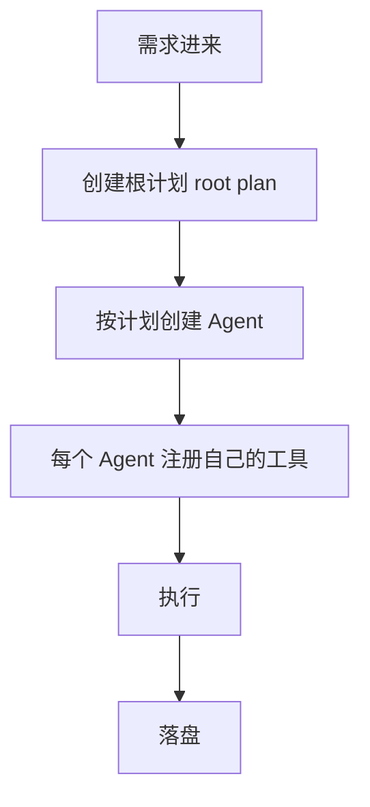

# 1-6 仿Manus能自主决策的框架：Jmanus

## 【学习目标】

- 说清 Manus → OpenManus → JManus 的谱系关系与各自定位；
- 独立完成 JManus 的下载、IDEA 导入与启动初始化；
- 通过一次完整的需求执行，读懂 JManus 的日志：计划如何创建、Agent 如何诞生、工具如何注册。

## 【正文】

### 1. 从 Manus 说起

年初的时候 Manus 引起过一次轰动，效果上等同于 DeepSeek 带来的冲击。平时我们使用大模型，只是跟它对话，让它查点资料或者画一张图，仅此而已；而 Manus 能做到的是：假设我想让大模型帮我购买一件商品，它会先从数据库里查询我以往的购物信息，得到我的购物偏好，然后据此列出一张购物清单并询问我是否需要购买这些物品，让我确认这张清单；确认之后，Manus 会拿着清单到淘宝、拼多多对物品进行比价，拿到最低价格后把物品买下来，并自动完成付款。它之所以引起轰动，正是因为通过它，大模型能够自动帮我们完成一整串工作，而不只是画一张画或提供一些信息。

Manus 的创新之处在于用多个智能体互相协作来完成用户需求。就拿购物需求来说，它用了三个智能体：第一个负责挖掘用户的购物偏好，第二个负责进行购物价格的对比，第三个负责下单付款操作。每个智能体只关注自己的职责，组合起来完成完整任务，这正是「多 Agent 协作」的思想雏形，也是本课程要深入的方向。注意其中还包含一次人工确认（核对购物清单）：自主不等于完全脱离人类，关键节点上保留人的决策权，是可靠性与自主性的平衡。

由于 Manus 是闭源的，有公司仿照它「多智能体互相协作」的理念开发了 OpenManus，之所以叫 OpenManus，是因为该框架是开源的，不过它的开发语言是 Python。而 Spring AI Alibaba 又在 OpenManus 的基础上开发了 JManus，面向 Java 语言。三者的谱系如下：

| 框架 | 开源情况 | 语言 | 定位 |
|---|---|---|---|
| Manus | 闭源 | - | 多智能体协作完成复杂任务的标杆产品 |
| OpenManus | 开源 | Python | 复刻 Manus 多智能体协作理念 |
| JManus | 开源 | Java | 基于 OpenManus 理念、Spring AI Alibaba 生态的 Java 版多智能体协作框架 |

总结一下：Spring AI Alibaba 提供的 JManus 基于 OpenManus 开发，是面向 Java 语言的多智能体协作开发框架，源码放在 Spring AI Alibaba 的 GitHub 仓库中。对 Java 开发者来说，这条谱系的意义在于：Manus 验证的理念，可以用自己熟悉的技术栈复刻，而不必切换到 Python 生态。

Manus 当初为何轰动，值得多想一层：在它之前，大模型给的是「信息」，一段回答、一张图；它给的是「交付」，一件被完整办妥的事。从信息到交付，中间隔着的就是工具调用、任务拆解、流程控制这些工程能力，而这些能力恰好都可以在 Java 栈上复现。这是本课程选择 JManus 作为第一个体验框架的深层原因。

### 2. 下载与导入

本节要导入的框架叫做 JManus，它是阿里巴巴基于 Spring AI Alibaba 开发的多智能体协作开发框架。把整个仓库下载下来（直接点击压缩包下载即可），解压后可以看到其中有一个 `spring-ai-alibaba-jmanus` 模块，把该模块单独取出来，其余文件全部删掉即可。之所以只取一个模块，是因为 Spring AI Alibaba 仓库包含众多子模块，JManus 只是其中之一，全部导入会让依赖解析变得杂乱。

接下来用 IDEA 把 JManus 项目导入进来。导入时注意选择 File → New → Project，项目名称随便填，Location 定位到刚才解压出来的 JManus 文件夹，另外 JDK 必须使用 JDK 17，这是硬性要求，版本不对，编译或运行会直接失败，排障时先确认这里，再查其他原因。

「JDK 17 是硬性要求」也解释了框架的一个侧面：JManus 构建在 SpringBoot 3.4.5 与 Spring AI Alibaba 之上，这条技术栈的基线就是 JDK 17。企业内网如果默认 JDK 8，需要单独准备 17 的运行环境；这一点在课程后续搭建成员 Agent、主管 Agent 时同样成立，建议一开始就把 IDEA 的项目 SDK 与语言级别统一设成 17，免得每个模块都踩一遍。

导入后打开项目可以看到很多文件夹，进入 `src` 源码文件夹，继续打开到 `java` 目录，最下面有一个 SpringBootApplication，这就是 JManus 框架的入口文件。点击运行该文件启动 JManus。

### 3. 启动过程

启动过程中会打印出一系列日志，从日志可以看到它基于 SpringBoot 开发，SpringBoot 版本是 3.4.5。同时可以看到内嵌数据库的连接池信息：

```text
.HikariDataSource : Spring-AI-Alibaba-Manus-h2-Pool - Start completed.
Database info:
Database JDBC URL [Connecting through datasource 'HikariDataSource' (Spring-AI-Alibaba-Manus-h2-Pool')]
Database driver: undefined/unknown
Database version: 2.3.232
```

日志里出现 Hikari 连接池与 H2 数据库，说明 JManus 内置了轻量持久化：框架运行所需的数据表随启动自动建好，无需额外准备数据库。课程第 8 章会看到，JManus 的计划协调器（PlanAct）正是围绕这些持久化状态运转的，此处只需建立初步印象。

启动完成后把日志拉到最下面，会看到它给出了一个地址，并提示应用已经启动、可以通过浏览器打开该地址。启动时它会自动打开浏览器，如果浏览器没有自动打开，就把该地址复制到浏览器中打开。

启动阶段值得留意的除了 SpringBoot 版本与数据库连接池，还有端口信息：JManus 会占用一个 HTTP 端口提供页面与接口服务，日志里会打印出来。它与后续课程里其他 Spring Boot 服务（成员 Agent、主管 Agent）各自独立进程、各自占端口，端口冲突是联调阶段的常见问题，看到「端口被占用」的报错时，先回想有哪些服务在跑。

### 4. 初始化：语言与模型

打开地址后需要进行两步初始化。

第一步选择语言，选择「简体中文」即可。

第二步选择模型，这里选择「阿里云百炼」，也就是前面 1-3 篇所说的阿里提供的模型广场，然后填入阿里云百炼的 API Key 并保存。阿里云百炼这一大模型平台收录了当前主流的大模型，包括 DeepSeek V3、Kimi K2 以及阿里自家的 Qwen；在平台上申请 API Key 的路径是：点击右上角的「设置」进入阿里云百炼控制台，左侧菜单栏中可以看到 API Key 入口，把 Key 申请下来。后面课程中凡是调用阿里大模型广场（也就是阿里云百炼）里的模型，无论是 Qwen、DeepSeek 还是 Kimi，都必须用到该 API Key。

保存之后跳转到主页面。至此，JManus 的初始化完成，可以开始提需求了。初始化只做一次，配置会持久化，重启后不必重复填写。

顺带把初始化两步的用意说透：选语言决定界面与框架内置提示词的语言，选「简体中文」与后续中文需求描述配套，减少语言切换带来的理解偏差；选模型 + 填 Key 则是把「思考能力」接进来，没有模型，JManus 的计划创建、Agent 拆分都无从谈起。两步各自负责「交互层」与「决策层」，缺一不可。

### 5. 一次完整执行：查股价并存 TXT

输入这样一个 Prompt：**通过百度去查询阿里巴巴的最新股价，并且将结果保存到本地的 TXT 后缀名的文件**，点击发送。

该 Prompt 的写法值得注意：前半句是目标（查阿里巴巴最新股价，且明确了信息渠道是百度），后半句是交付物（保存到本地 TXT 文件）。目标与落点都明确，Agent 才不缺信息、不跑偏，写需求时把「要什么」和「交到哪」说清，是后续章节反复会用到的技巧。

把需求表述拆成三个要素，可以当成给 Agent 写 Prompt 的检查单：**信息渠道**（从哪拿数据，如「通过百度」）、**处理目标**（拿数据之后做什么，如「查询最新股价」）、**交付形态**（结果落到哪，如「保存到本地 TXT 文件」）。三要素齐备，Agent 拆解角色时才有明确依据；缺了任何一样，要么它反复追问，要么按自己的猜测执行，结果不可控。这与传统软件「把需求写清楚」是同一回事，只是读者从人变成了 Agent。

执行完成后界面显示已经完成，即通过百度查询到阿里巴巴最新的股价，并把股价保存到了 TXT 文件中。重点看它的日志。把日志复制到 VS Code 中删掉不必要的部分后，先通过搜索 `Create New` 关键词来看它创建了哪几个 Agent 来完成需求。一共匹配到两条记录：第一个创建的 Agent 是 `BROWSER_AGENT`，也就是浏览器代理者，从名称可以判断它的主要任务就是操作浏览器、登录百度去查询阿里巴巴的股价；第二个创建的 Agent 是 `DEFAULT_AGENT`，它的主要工具是把浏览器抓取到的信息保存到文件里。该 Agent 注册了很多工具，例如 `BrowserUse`、`Terminal` 以及 `TestfileOperator`，从名称上就能判断后者主要用于文件操作。总的来看，JManus 一共创建了 2 个 Agent：

```text
-Creating root plan with ID: plan-1755415977389
-Create new BaseAgent: BROWSER_AGENT, planid: plan-1755415977389
-Registering tool: browser_use
-Registering tool: database_use
-Registering tool: terminate
-Registering tool: bash
```

日志往下拉，可以看到它把浏览器里的网页信息抓取过来的过程，随后把抓取到的信息保存到文件中。文件保存在 JManus 项目的 `extensions` 文件夹下，进入 `inner_storage` 文件夹，再进入 `plan` 目录，就能看到保存了阿里巴巴股价信息的文件，打开后里面就是阿里巴巴的最新股价。

产出文件的存放路径也值得留意：`extensions/inner_storage/plan` 这三级目录各有分工，`extensions` 放扩展能力，`inner_storage` 是框架的内部存储，`plan` 则按计划归档每次执行的产出。第 8 章深入 JManus 文件架构时还会回到这里，现在只需建立印象：Agent 的每一步产出都有落盘位置，不是跑完就散的黑箱，事后可查是可运维的前提。

读日志时抓住两条主线即可：`Create New` 一行的数量告诉你「框架拆出了几个角色、各自叫什么」；`Registering tool` 一行的数量告诉你「每个角色拿到了哪些工具」。角色与工具的对应关系，就是多 Agent 协作的最小全景。

日志这么碎，为什么还值得逐行读？因为它是理解框架决策的唯一直接证据：界面只告诉结果，日志才暴露过程。工程实践中排查多 Agent 问题，八成时间花在读日志与追踪上，把这一习惯在体验阶段就建立起来，比后面遇到问题再补课高效得多。复制到 VS Code 里删减、用关键词过滤，是课程演示的做法，也是日常可复用的手法。

### 6. 这次体验说明了什么

总结一下：针对「查询阿里巴巴最新股价并保存到 TXT 文件」该需求，JManus 创建了两个 Agent 来协作完成。第一个 Agent 负责浏览器操作，登录百度并把信息抓取下来；第二个 Agent 负责从抓取的信息中筛选出关于阿里巴巴股价的最新内容，再把这些内容保存到 TXT 文件里。

把过程抽象一下：需求进来 → 创建根计划（root plan）→ 按计划创建 Agent → 每个 Agent 注册自己的工具 → 执行 → 落盘。全程没有人类逐步干预，这正是「自主决策」的最小样本：角色怎么拆、每个角色用什么工具，都是框架自己决定的。课程第 8 章会深入 JManus 的计划协调器（PlanAct，8-10）：计划怎么向大模型请求创建（8-11）、怎么根据计划类型创建不同的执行者（8-12）、不同的执行者怎么调用不同的执行流程（8-13）。



这次体验也与 1-1 篇提到的两种设计思想直接对应：JManus 走的是「Agent 自主代理」路线，流程由框架临场规划；课程后面还会讲 Graph 工作流编排，流程由人事先画死。两条路线没有绝对优劣，判据在需求：路径不确定、需要临场判断的，用自主代理；步骤固定、要求可预测可审计的，用工作流。JManus 的日志之所以值得细读，正因为它把「临场规划」的过程完整暴露了出来。

与课程配套工程对照着看会更清晰：981-demo 用 AgentScope 复刻了同构的多 Agent 链路，`src/main/java/com/travel/agent/agent/SupervisorAgent.java` 扮演主管（对应 JManus 的计划协调角色），`agent/TeamMembers.java` 注册路线制定专员与景点推荐成员（对应 JManus 动态创建的 BaseAgent），`agent/SupervisorTools.java` 提供任务分发工具。区别在于 JManus 这里接的是真实的阿里云百炼模型，而 981-demo 的 default profile 用 `model/OfflineChatModel.java` 离线规则模型模拟同样的决策节奏，不联网、不填 Key 也能跑通「主管 → 成员 → 工具」全链路。两个工程对照着读，能把「框架黑箱」与「自己可控的代码」接上。

这是对 JManus 该多智能体协作开发框架的初步体验，后面的课程会对它做更深入的学习。

## 【易错点 / 面试题】

1. **面试题：Manus、OpenManus、JManus 三者是什么关系？**
   答：Manus 是闭源的标杆产品，核心理念是多智能体协作完成复杂任务；OpenManus 开源复刻该理念，语言是 Python；JManus 由 Spring AI Alibaba 基于 OpenManus 的理念开发，面向 Java 语言。Java 团队选 JManus 的理由正在于栈统一：能与 Spring Boot 以及 Spring AI Alibaba 的其他能力（MCP、A2A、Nacos）无缝配合，不用在 Python 生态里另起一套。

2. **面试题：从这次体验看，JManus 的「自主决策」体现在哪？**
   答：人类只给了一句自然语言需求，JManus 自主完成了：创建根计划、按计划创建两个 BaseAgent、为每个 Agent 注册相应工具、执行并落盘。角色怎么拆、工具怎么配，都是框架自己决定的，这就是自主决策与固定工作流的本质区别：流程不是人预先画死的，而是 Agent 临场规划出来的。

3. **易错点：JDK 版本随手用。**
   课程明确 JDK 17 是硬性要求。用其他版本导入可能编译或运行失败，排障时先确认 JDK 版本，再查其他原因。

4. **易错点：把初始化时的模型选择跳过。**
   第二步初始化必须选择「阿里云百炼」并填入 API Key，否则执行需求时无模型可用。若 1-3 篇的 Key 申请遗漏了，此处会卡住，准备篇的每一步都是后续章节的前置。

5. **易错点：执行完不看日志。**
   界面显示「已完成」只是结果，日志里的 `Create New` 与 `Registering tool` 才是过程。养成看日志的习惯，才能理解框架的决策，出问题也知道从哪查。

6. **面试题：JManus 和 Spring AI Alibaba 是什么关系？**
   答：JManus 是构建在 Spring AI Alibaba 之上的多智能体协作开发框架，源码就放在 Spring AI Alibaba 的仓库里（`spring-ai-alibaba-jmanus` 模块）。可以把 Spring AI Alibaba 理解为地基与生态（模型接入、MCP、A2A、Nacos 等能力），JManus 是盖在地基上的一栋具体建筑（Manus 理念的 Java 实现）。学 JManus 的过程中遇到底层能力不懂时，回头看 Spring AI Alibaba 的基础章节就能接上。

## 【小结】

本节完成框架篇的初体验：理清 Manus → OpenManus → JManus 的谱系，完成 JManus 的下载、导入（JDK 17）与初始化（简体中文 + 阿里云百炼 Key），并通过「查股价存 TXT」的需求读懂了执行日志，根计划创建、BaseAgent 动态创建、工具注册、结果落盘。建议把日志里的 `Create New` 与 `Registering tool` 两类关键词记住，它们是观察多 Agent 协作的显微镜。下一篇开始正式学习第一个核心框架 AgentScope，重点看它如何用 ReActAgent 搭建搭载工具的智能体；把 JManus 的「计划协调器拆角色」与 AgentScope 的「ReActAgent 循环调用工具」对照着看，多 Agent 的两种组织方式会逐渐清晰。
