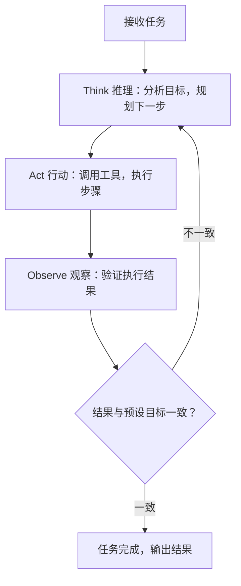

# 1-7 具备ReAct核心能力的框架：AgentScope

## 【学习目标】

- 说清课程为什么要同时引入 JManus 与 AgentScope 两个多智能体框架，以及二者的定位差异。
- 理解 ReAct（推理-行动）模式作为智能体思维链的工作机制，以及它为什么是「自主代理」思想的核心。
- 掌握 AgentScope 面向生产环境的四项关键能力：安全沙箱、响应式非阻塞执行、人机协同介入、可观测性。
- 能够独立在 Maven 工程中导入 AgentScope 与 Logback 依赖。

## 【正文】

### 一、课程为什么讲两个多智能体框架

本课程围绕「多 Agent + Skills + Spring AI 构建自主决策智能体」展开，会先后介绍两个多智能体框架：JManus 与 AgentScope。二者承担的使命不只是「把多个智能体协同起来」，更是体现同一套设计思想，**Agent 自主代理**：从步骤制定、任务分解与分发、工具使用，到结果认证，整个流程都不需要人为介入，全部由智能体自主思考并自主执行。

两个框架的出身不同：

- **JManus** 可以看作 Manus 的 Java 版本，出现时间更早。第 8 章已围绕它讲解了计划协调器（PlanAct）、执行者等核心组件，它的定位是「用 Java 复刻 Manus 的架构思路」。
- **AgentScope** 出现得比 JManus 晚一些，由阿里通义实验室开发。出现更晚意味着它吸收了更多生产环境的经验，在多智能体协同以及智能体自主代理的核心架构上都比 JManus 更成熟。它完全基于 Spring AI Alibaba 生态，所使用的函数方法都是在 Spring AI Alibaba 开发框架之上改进而来的。

AgentScope 框架分为 Python 版本和 Java 版本，课程统一使用 Java 版本，文档地址在官网上。选 Java 版本的原因与整个课程的技术栈一致：工程落地用 Java + Spring 生态，智能体框架不能成为栈中的孤岛。课程 3-11 篇「主流的多Agent开发框架」做过框架横评，AgentScope 与 JManus 正是其中的两个 Java 选手；6-1 篇「SpringAI 1.0，1.1 和 2.0」讲清了 Spring AI 的版本演进，为理解「AgentScope 基于 Spring AI Alibaba」打下地基。

### 二、ReAct：智能体的思维链

AgentScope 的第一个亮点是它完全采用了 **ReAct 模式**。ReAct 是后续课程重点讲解的内容，也是智能体拥有自主代理思想的核心，可以把它理解为智能体的思维链。

ReAct 是 Reasoning（推理）与 Acting（行动）的合成词，工作方式可以概括为「先思考、再执行、后验证」：

1. **Think（推理）**：智能体先思考当前任务应该怎么做，规划出执行步骤。
2. **Act（行动）**：按照思考出来的步骤尝试执行任务，执行过程通常体现为调用工具或自定义函数。
3. **Observe（观察）**：执行完成后对任务结果进行验证，判断结果是否与预设目标一致。

如果结果与预设目标不一致，说明这次行动是错误的，智能体会回过头重新思考、重新执行任务，再对结果重新验证，直到结果和预设目标一致为止。整条环路构成一个闭环：



为什么 ReAct 是「自主代理」的核心？因为「目标-行动-验证-修正」这条环路正是人类专家处理复杂任务的方式。只会一次调用工具的智能体，本质上仍是提线木偶：每一步走对走错都无法自知。具备 ReAct 思维链的智能体，才能在执行复杂任务时保持完全自主，步骤错了自己发现，路线偏了自己纠偏。

把「自主代理」拆开，是四件事的闭环：**步骤的制定、任务的分解与分发、工具的使用、结果的认证**。ReAct 环路同时覆盖这四件事，Think 阶段对应步骤制定与任务分解，Act 阶段对应工具使用，Observe 阶段对应结果认证；而分发之所以能「自主」，是因为每一层 Agent 都运行在同一条思维链上，上层只需给出目标，下层自行决定行动。在人工流程里，这四件事分别由项目经理、架构师、开发、测试承担；在 AgentScope 的框架里，它们被压缩进一条 ReAct 环路，由智能体自主完成。这正是「Agent 自主代理」设计思想的完整含义，也是课程从第 8 章到第 13 章所有篇章的总纲。

JManus 同样基于这种 ReAct 思维框架，区别在于：**AgentScope 是基于 Spring AI Alibaba 来实现这条思维链的，而 Spring AI Alibaba 1.1 版本对 ReAct 思维框架做了很好的封装**，创建一个带有 ReAct 思维框架的智能体非常简单。开发者不需要自己拼装「思考-行动-验证」的循环，框架层已经处理好了。借助这套框架，智能体能够执行复杂任务，并且在执行过程中保持完全自主。

课程后续 6-9、6-10 两篇会逐步演示如何用 AgentScope 构建搭载工具的 ReAct Agent，6-15 测试 AgentScope 的 Agent 运行，本节先把框架层面的设计思想立住。

### 三、生产级别：沙箱、响应式架构与全程可控

生产环境对智能体框架的追问通常有四个：单个智能体出错会不会拖垮全流程（隔离性）；高并发下线程会不会被打满（架构）；流程跑偏了能不能拉住（可控性）；出了问题能不能定位（可观测性）。AgentScope 的生产级特性正是按这四问逐一作答。

AgentScope 的第二个亮点是**生产级别**。

**安全沙箱隔离**：对于每一个单个智能体的执行，它都被安排在安全沙箱里面，哪怕某个智能体执行失败，也不会导致整个工作流程失败。这一点与 JManus 有异曲同工之妙，但在多智能体规模扩大后，沙箱隔离的价值会被进一步放大：N 个智能体并行执行时，任一节点的失败都不应产生连锁反应。这与微服务设计中「故障隔离在单元边界内」的思路完全一致，单体系统里一个异常可能拖垮全进程，微服务架构中一个实例宕机还有熔断与降级兜底。

**响应式架构**：由于是生产级别，性能也比较高，AgentScope 采用响应式架构，并且是非阻塞的执行方式。响应式编程的收益在多智能体场景下尤其明显：智能体之间的消息传递、工具调用的等待、大模型的流式返回，都不应该阻塞线程。线程一旦被大模型调用的网络 I/O 占满，整个团队的智能体都会排队。课程 7-8、7-9 两篇专门讲过 Flux 作为装载 SSE 流式数据的容器，非阻塞执行的收益在那里有完整体现。

**人机协同介入**：AgentScope 与 JManus 还有一个最大的不同，JManus 的整个流程人工无法介入，而 AgentScope 在执行过程中，人类可以介入进行修正、监督和指导，也就是「**智能体自主、全程可控**」，把人的力量传承进来。完全自主的智能体在生产环境是不可接受的：一次错误的工具调用可能造成不可逆后果。AgentScope 把人的能力保留在环路里，体现在三个机制上：

| 机制 | 作用 |
|------|------|
| 安全中断 | 执行过程中可安全切断当前流程，避免不可控动作继续发酵 |
| 优雅取消 | 取消任务时妥善处理已完成与未完成的中间状态，不留下脏数据 |
| 人机协作 | 人类可在关键节点修正计划、监督执行、提供指导 |

再配合 OpenTelemetry 提供的可观测性，AgentScope 构成了面向生产环境的能力闭环。课程 13-3 讲解 docker 搭建 Agent 跟踪和 Token 消费分析、13-4 讲解旅游规划 Agent 团队集成 Agent 追踪观测，正是建立在这套可观测性基础之上。

### 四、JManus 与 AgentScope 对照

| 维度 | JManus | AgentScope |
|------|--------|------------|
| 出身 | Manus 的 Java 版本 | 阿里通义实验室开发 |
| 技术生态 | 自建多智能体体系 | 完全基于 Spring AI Alibaba 生态 |
| ReAct 实现 | 自建思维框架 | 基于 Spring AI Alibaba 1.1 的成熟封装 |
| 人工介入 | 整个流程无法介入 | 支持安全中断、优雅取消、人机协作 |
| 执行隔离 | 沙箱隔离 | 沙箱隔离 |
| 架构风格 | 常规执行 | 响应式、非阻塞 |
| 可观测性 | 课程未涉及 | 集成 OpenTelemetry |

一句话记忆：JManus 回答「Manus 的架构怎么用 Java 复刻」，AgentScope 回答「生产环境里的多智能体协同应该怎么建」。

两个框架在课程中的分工也因此清晰：第 8 章借 JManus 理解「多 Agent 的规划-执行骨架怎么搭」；第 9 章借 AgentScope 理解「工程化的分布式 Agent 协同怎么落」；第 11 章之后进入 Spring AI Alibaba 1.1 的 A2A 与 MCP 实战。三条线共用同一套 ReAct 思想，读懂其一，其余只是工程形态的差异。

### 五、依赖导入

通过 Maven 就可以把 AgentScope 依赖下载下来：创建一个 AgentScope 项目，然后在项目中导入依赖，当前版本是 1.0.7。AgentScope 的日志采用的是 SLF4J 接口，而 JManus 的版本需要实现该接口，所以这里用 Logback 该日志实现去实现 SLF4J 接口，也就是一共导入两个依赖：AgentScope 的依赖和 Logback 的依赖。

```xml
<dependency>
    <groupId>io.agentscope</groupId>
    <artifactId>agentscope</artifactId>
    <version>${AgentScope.version}</version>
</dependency>
```

这段配置的选型理由值得展开：日志门面（SLF4J）与日志实现（Logback）分离是 Java 工程的标准做法。AgentScope 只面向 SLF4J 接口编程，具体落地到哪个日志实现由使用方决定，框架与工程之间不产生硬绑定，这与课程反复强调的「面向接口编程」是同一条工程纪律。版本号通过 `${AgentScope.version}` 属性占位，统一在 pom 的 properties 段或父 BOM 中管理，升级框架时只改一处。导入 Logback 之后，即可在配置文件中调整日志级别，第 13 章分析 Agent 追踪与 Token 消费日志时会直接受益于这一配置。

再补一条多模块工程的经验：`${AgentScope.version}` 这类属性占位符应与 Logback 的版本一并纳入统一版本治理，集中在父 POM 中声明。如果每个模块各自指定依赖版本，升级时漏改一个模块就会造成运行时类冲突，而这类问题往往到集成阶段才暴露，排查成本极高。依赖版本治理是「生产级别」四个字最不起眼却最基础的一部分。

### 六、ReAct 在课程中的落地路径

ReAct 不是孤立概念，课程后续篇章构成一条完整的落地路径：6-9、6-10 用 AgentScope 构建搭载工具的 ReAct Agent；6-15 测试 AgentScope 的 Agent 运行，观察「思考-行动-验证」的真实轨迹；9-4 创建不同节点的 ReAct Agent，把单智能体思维链扩展为多节点协同；9-5 至 9-8 讲解主管 Agent 自主分解任务、PlanNotebook、Hook 与任务分发；第 11 章接入 A2A 与百度地图 MCP，让 Act 阶段落到真实工具与远程 Agent 上；第 13 章补齐追踪与观测，让 Observe 阶段的结果可度量。整条路径都是本节立下的思想基础在工程侧的展开。

## 【易错点 / 面试题】

1. **面试题：ReAct 与普通 Function Calling 有什么区别？**
   普通 Function Calling 是「模型决定调用一次工具、拿回结果、再生成回答」的单轮或有限轮交互，工具调用是回答的附属品；ReAct 是一条闭环思维链，推理、行动、观察、再推理，行动结果会反过来修正下一步推理，直到目标达成。前者是一项能力，后者是一种范式。答题时点明：AgentScope 把 ReAct 做成了框架级封装，开发者创建智能体即获得整条思维链，这是「框架」与「裸调 API」的本质差距。

2. **面试题：为什么 AgentScope 强调「智能体自主、全程可控」？**
   完全自主的智能体在生产环境不可控，一次错误的工具调用可能造成不可逆后果。AgentScope 通过安全中断、优雅取消、人机协作三个机制，把人类的修正与监督能力保留在环路里，再叠加 OpenTelemetry 的可观测性，才能满足生产部署要求。答题时把「自主」与「可控」作为一对矛盾统一体来展开：自主是效率来源，可控是安全底线，二者缺一不可。

3. **易错点：不要混淆「Spring AI Alibaba 生态」与「Spring AI」。**
   AgentScope 构建在 Spring AI Alibaba 之上，后者的函数方法又是在 Spring AI 开发框架之上改进而来。课程配套的 981-demo 工程（`981-demo/src/main/java/com/travel/agent/agent/SupervisorAgent.java`、`agent/TeamMembers.java`、`a2a/AgentCard.java`、`config/AgentProperties.java` 等）基于 Spring AI Alibaba 1.1 的 A2A + Nacos 栈实现了主管调度远程成员的完整链路，与第 9 章 AgentScope 分布式协同属于同生态的不同实现路径，阅读时可相互参照，但不要把两个框架的 API 名词混用。

## 【小结】

本节确立了后续所有 AgentScope 篇章的思想基础：ReAct 思维链 + 生产级隔离与可控性。接下来 6-9、6-10 将动手构建搭载工具的 ReAct Agent，9-1 起进入工程化的分布式 Agent 协同。可对照 981-demo 工程中 `981-demo/src/main/java/com/travel/agent/agent/SupervisorAgent.java` 与 `agent/TeamMembers.java`，理解主管-成员架构在 Spring AI Alibaba 1.1 栈上的等价落地，为第 9 章的 AgentScope 版本做好准备。
