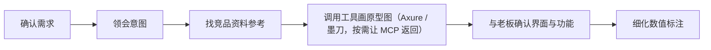

# 10-2 Agent Skills就是个专属工作流

## 【学习目标】

- 说清 MCP 全量返回工具的两个弊端：占满上下文空间、多次交互消耗 Token。
- 理解 Agent Skills 的第一层价值：智能体基于领域知识自己选择工具，让 MCP 按需返回。
- 理解 Agent Skills 的本质是一整套 SOP（标准作业流程），而非单点工具调用。
- 区分 Agent Skills 与 SubAgent 的生命周期差异：可移植复用 vs 执行完释放。

## 【正文】

### 一、承接 SubAgent：专业场景的执行者

上一篇讲过，SubAgent 专门负责单个专业场景的任务，比如 CRUD 这类任务、专门写 SQL 语句的任务、专门做数据分析中某个数据清洗步骤的任务，这些单个专业场景都交给专门的一个子代理（SubAgent）去负责。它有自己独立的上下文，在自己的容器里单独执行该场景，哪怕出错也不会影响到主任务支线的执行，而且能够让多个子代理并行执行这些单个专业场景，从而提高效率。

先明确 SubAgent 与 Skills 的关系铺垫：上一篇的 SubAgent 是「执行单个专业场景的临时工」，本节的 Skills 是「可移植复用的岗位知识」。两者都从主 Agent 身上拆压力，但拆走的东西性质不同，一个拆走执行，一个拆走知识。理解该区别，是读懂本节后半段 Skills 与 SubAgent 对照的前提。

在此基础上再来看 Cloud Code 提出的第三个前瞻性概念：Agent Skills。要理解它解决了什么问题，得先回到 MCP 的痛点。

### 二、MCP 的痛点：一股脑返回的全部工具

前面课程提到过 Agent Skills，当时把它解释为智能体的一项技能，它懂得如何使用工具、如何挑选正确的工具。在 Agent Skills 该概念提出来之前，Agent 要使用外部工具是通过 MCP 实现的。当时的工作方式是这样的：

1. MCP 服务端把一系列工具**一股脑儿地全部返回**给智能体；
2. 智能体并不知道执行当前任务需要用哪一个工具，只能去请求语言大模型，问它应该用哪个工具才能完成任务；
3. 由语言大模型帮它挑选出正确的工具，这样 Agent 才能正确使用该工具。

这种方式的弊端有两个：

- **弊端一：上下文被占满。** MCP 把所有工具全部返回给智能体会占满上下文空间。工具描述本身也是 token，一个 MCP 服务端挂几十个工具，每个工具的入参 schema、说明文本累加起来相当可观，真正与当前任务相关的可能只有一两个。
- **弊端二：Token 被反复消耗。** 智能体不知道用哪个工具，需要和语言大模型多次交互才能正确调用相应的工具，每一轮交互都是 token 成本。

用课程内的实例给这两个弊端定量：5-6 篇「百度地图MCP提供的工具体体系全景」展示了一个真实 MCP 服务端的工具规模，地理编码、路线规划、地点检索等各类工具一应俱全。对「制定驾车路线」这样一个任务，相关工具可能只有两三个，其余全部是上下文里的沉默成本。智能体每轮推理都要带着这些无关描述重新计算注意力，既挤占窗口，又拖慢响应；选中正确工具前的多轮试探，则把单次任务的 token 成本放大数倍。

换句话说，MCP 解决了「工具能不能被调用」的标准化问题，但没有解决「工具如何被高效选中」的问题。调用链路上的效率损耗，正是 Agent Skills 要补的位。

### 三、Agent Skills 的第一层价值：让智能体自己会选工具

Agent Skills 该概念就是针对该场景提出的：**给智能体赋予一项专业技能，它在解决相关领域的问题时，就能基于自身的专业领域知识，自己知道该用哪一个工具，并且知道让 MCP 只返回对应的工具，不需要把所有工具都返回，只要这一两个工具就够了。**

对照前面的痛点，收益是直接的：上下文里只出现相关工具，Token 消耗从「多轮试探」降为「一次定位」。MCP 的角色没有变，它仍然是工具的提供方；变的是工具的选择权，从「每次现问大模型」前移到了「技能包内置的领域知识」里。

值得强调的是，「让 MCP 只返回对应的工具」这句话改变了工具调用的控制流。在此之前，控制流是「服务端推什么，智能体接什么」；在此之后，变成「智能体按领域知识决定要什么，服务端只返回被要的」。工具选择权从服务端前移到智能体侧的技能包，这是 Agent Skills 相对 MCP 最本质的架构变化。

也要说明该机制的边界：Skills 并不取消 MCP 的工具发现机制，而是在其上加一层领域路由。当任务确实无法归入任何已装载技能时，智能体仍然回退到「全量工具 + 模型选择」的原始路径，技能覆盖不到的场景，不能假装覆盖。工程上这意味着技能库的覆盖面需要持续运营：新场景出现时，要么补一个新技能包，要么明确接受回退路径的 token 成本。

### 四、Agent Skills 的第二层价值：一整套 SOP 流程

有人会问：已经有了 MCP，还需要 Agent Skills 吗？二者是否重复，不都属于调用工具的范畴吗？

**并不是。Agent Skills 不只是调用工具，它包含的是一整套 SOP 流程，也就是标准流程。**

以产品经理做需求分析为例，他要经过几个固定的步骤：

1. 首先跟老板确认需求；
2. 确认之后要画出原型图，老板只说了一个概念，产品经理领会到该意图之后，要把概念落成原型图；
3. 画原型图之前，他要花一段时间上网找资料，找一些竞品的界面、竞品的信息做参考；
4. 然后再调用工具画原型图，调用工具时选择 Axure 还是墨刀，由产品经理自己决定；
5. 原型图画出来之后再跟老板确认，定下整个产品的界面以及功能；
6. 接着产品经理还要把这些界面和功能细化，也就是给出数值标注，该图标应该多大、该页面应该实现哪几个功能，都要标注清楚。

六步串起来是一条没有分支的单向流水线，这正是「固定流程」的直观形态：

这就是产品经理画原型图的一整套 SOP 流程，也就是一个专业领域的 Skills。回看该例子：产品经理画原型图的几个步骤是固定下来的；他要调用的工具无非就是 Axure 或者墨刀，在 SOP 流程里需要调用工具时，它知道让 MCP 只返回这两个工具，其他工具都不需要返回。

该例子点破了 MCP 与 Skills 的分工：**MCP 只是提供了工具，至于怎么用它并不知道；而具备产品领域专业知识的 Agent 知道 Axure 该怎么用、墨刀该怎么用，这些工具的用法正是包含在 SOP 流程里面的。** 整套制作原型图的标准流程，就是产品经理的一项技能，也就是 Agent Skills，它不只是懂得使用一个工具，而是一整套流程。

拆开这套 SOP 看，工具调用只占一步（调用 Axure 或墨刀），前后五个步骤，确认需求、领会意图、找竞品参考、再次确认、细化标注，没有一步是「调工具」，但每一步都依赖产品领域的专业知识。这就是「专属工作流」的含义：Skills 把专业知识固化成流程，工具只是流程走到某一步时的执行手段。只把 Skills 理解成工具选择器，就丢了前五个步骤，而那才是专业技能的主体。

### 五、Agent Skills 与 SubAgent 的区别

Agent Skills 与 SubAgent 的不同之处在于：**Agent Skills 是可以移植、可以重复使用的。** 例如某个岗位上的人员离职了，新进来的同样具备这套标准 SOP 流程的专业知识，依旧是可复用的能力；而 SubAgent 是一个流程的工具，它在执行完该单个专业场景的任务之后就会被释放掉。

| 维度 | Agent Skills | SubAgent |
|------|--------------|----------|
| 本质 | 一整套 SOP 流程（标准流程） | 单个专业场景的执行者 |
| 生命周期 | 可移植、可重复使用 | 执行完单个场景任务即释放 |
| 组织类比 | 岗位的职责说明与作业手册 | 临时抽调干活的实习生 |
| 与工具的关系 | 内含工具用法，按需让 MCP 返回工具 | 在独立上下文与容器中执行场景任务 |

用组织学类比收束：Skills 是「岗位知识」，人走了知识留下，换人直接复用；SubAgent 是「一次排班」，活干完人就撤。这就是 SubAgent 与 Agent Skills 的区别，也是下一篇要深挖的「Skills 装载的到底是什么」的入口。

最后把一次任务在两种模式下的上下文轨迹并排放在一起，差异一目了然：没有 Skills 时，任务进入上下文的首先是服务端全量工具描述，模型在多轮交互中试探筛选，无关工具全程占用窗口；装载 Skills 之后，任务进入上下文首先触发元数据索引匹配，模型凭索引直接点名所需工具，MCP 只返回被点名的两三个，上下文里从头到尾没有出现过无关工具。同一条「画原型图」的任务，前者是「搬进整个工具箱再挑」，后者是「拿着清单去取」。

课程内部对这两个概念有清晰的篇章分工：3-7 篇「具有专业知识的 Agent Skills」建立概念，3-8 篇「工具调用最强组合：Agent Skills+MCP」讲组合，本节之后 10-3 挖装载内容、10-4 讲加载机制、10-5 定文件标准，到 10-7 与 12-1 至 12-4 进入工程实现；SubAgent 的工程形态则在 12-5 篇景点推荐任务中落地。两条线在课程中始终并列推进，阅读时注意区分。

## 【易错点 / 面试题】

1. **面试题：已经有了 MCP，为什么还要 Agent Skills？二者是否重复？**
   这是本节最高频的面试问法。答题分两步：第一步承认重叠面，两者都服务于工具调用，MCP 是供给端标准，Skills 是消费端能力；第二步点破差异，MCP 只提供工具、不携带用法，全量返回还会占满上下文并迫使模型多轮试探；Skills 把「选哪个工具、怎么用、按什么流程用」打包成领域知识，让 MCP 按需返回。结论：MCP 解决「连得上」，Skills 解决「用得省、用得对」。

2. **面试题：为什么「一股脑返回全部工具」在大工具集下不可接受？**
   两个量化视角：上下文物候，工具描述随数量线性膨胀，挤占真正任务的推理空间；交互轮次，没有领域知识就要反复询问模型，token 成本随试探轮次上升。可补充 Spring AI 2.0.1 的对应实践：框架提供 `ToolSearchToolCallingAdvisor` 做渐进式工具披露，会话内先索引全工具、按需检索，正是同一思想在框架层的落地（课程 10-4 篇会讲 Skills 侧的渐进式加载，12-4 篇讲工程实现）。

3. **易错点：把 Agent Skills 理解成「更聪明的工具调用」。**
   Skills 的最小完整单元是 SOP 流程，工具调用只是流程中的一个环节。只答「让模型选对工具」只拿一半分，必须答出「固定步骤 + 输出形式」这层流程属性。

## 【小结】

本节回答了「Agent Skills 是什么」的第一层与第二层答案：它让智能体基于领域知识自主选择工具、让 MCP 按需返回，更是一整套可复用的 SOP 标准流程；它与 SubAgent 的分界在生命周期，Skills 可移植复用，SubAgent 执行完即释放。下一篇 10-3 继续往下挖底层逻辑：一个 Agent Skills 技能包里到底装载着哪三类东西。
