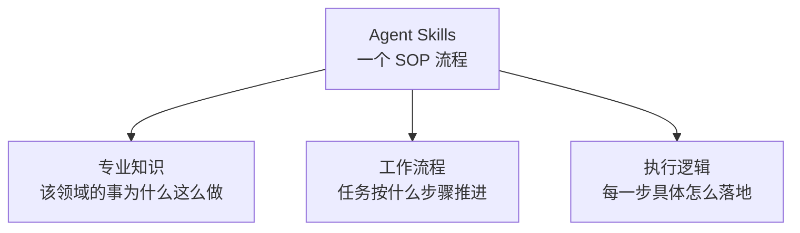

# 10-3 Skills装载的是专业知识和工作流程

## 【学习目标】

- 建立对 Agent Skills 递进的两层认识：先会选工具、再拥有完整技能流程。
- 掌握 Agent Skills 的三类装载内容：专业知识、工作流程、执行逻辑。
- 理解 Agent Skills 以文件夹形式赋予智能体的机制。
- 厘清 MCP 标准与 Agent Skills 标准的边界，说清「两个不同概念」。
- 区分 Agent Skills 内置的固定工作流程与人工封装的 Workflow，并对应到各自的应用场景。

## 【正文】

### 一、两层认识：从「会选工具」到「拥有流程」

Cloud Code 继 MCP 该协议标准之后，又提出了一个具有前瞻性的 AI 概念：Agent Skills。

**第一层认识**：MCP 使得 Agent 能够调用外部的工具，但该工具该如何使用、需要使用哪一个对应的工具，Agent 本身并不知道，它必须去请示语言大模型才能知道选择哪个工具以及如何使用该工具。Agent Skills 则让智能体自己知道完成该任务需要调用哪一个工具，并且知道如何正确地使用该工具，这是我们对 Agent Skills 的第一层认识，上一篇已完整展开。

**第二层认识**：Agent Skills 该技能包不只是让智能体懂得选择正确的工具、懂得如何使用该工具，它其实包含了一整套的技能流程。假设该技能包属于产品领域，是一套产品领域的相关知识，智能体拥有这套产品领域知识之后，并不只是会用墨刀或者 Axure 去画原型图，画原型图只是这套产品领域专业知识中的一环。除此之外还包括：该产品如何定型、如何跟老板沟通并理解老板的需求、如何把老板口头的需求画成原型图、如何到网上找到相关的竞品信息做参考，以及如何就原型图里的标注与前端、后端开发人员沟通，最终敲定整个版本里的尺寸和功能摆位。使用工具只是其中一环，所以进一步的认识是：**Agent Skills 是一整套标准的专业技能流程。**

两层认识的递进关系可以概括为：第一层解决「工具选型」，第二层解决「作业方法」。只有第一层，智能体是个熟练的工具操作员；加上第二层，智能体才是该领域的专业从业者。课程 12-2 篇「有限预算内规划精彩旅行的Skills」可以作为第二层认识的样本，它固化的不是「调哪个工具」，而是「预算约束下怎么排行程」的完整方法，工具调用只是其中一个环节。

### 二、底层逻辑：一个 SOP 包含的三类东西

继续往下挖掘它的底层逻辑。Agent Skills 是一个 SOP 流程，该流程里面包含三类东西。

| 类别 | 产品领域技能包示例 | 作用 |
|------|--------------------|------|
| 专业知识 | 产品知识本身、用户的心理学、用户的行为学以及消费习惯 | 回答「该领域的事为什么这么做」 |
| 工作流程 | 从跟老板讨论的阶段推进到定稿的原型图的一整套流程 | 回答「任务按什么步骤推进」 |
| 执行逻辑 | 墨刀怎么用、Axure 这些画原型图的工具怎么用 | 回答「每一步具体怎么落地」 |

第一类是专业知识。以产品领域的 Agent Skills 为例，它的专业知识除了产品知识本身，还包括用户的心理学、用户的行为学以及消费习惯，这些都属于该产品领域里必须具备的专业知识。

第二类是工作流程。要把一个产品从跟老板讨论的阶段推进到定稿的原型图，中间有一整套工作流程，而不是一上来就用墨刀或者 Axure 把原型图画出来。

第三类是执行逻辑，主要就是工具的调用：墨刀怎么用、Axure 这些画原型图的工具怎么用。

三类内容的分工值得记住：专业知识是判断依据，工作流程是推进骨架，执行逻辑是落地手段。缺了专业知识，流程走完也不知道每一步为什么；缺了工作流程，知识再多也是一盘散沙；缺了执行逻辑，前两者都停在纸面。这也解释了为什么 Agent Skills 不能简单地用「一份工具说明书」来实现，说明书只有第三类。

三类内容在文件层各有落点，10-5 篇的文件结构标准会逐一对应：工作流程主要写在元数据文件的正文里（目标、步骤、输出格式），执行逻辑主要落在指令结构与脚本文件上，专业知识则分散在资源文件（说明文档、参考材料、样例数据）之中。把该对应关系记住，「三类内容」就不再是抽象名词，而是写技能包时的目录规划。

### 三、赋予方式：一个文件夹

如何把 Agent Skills 赋予给智能体？**它是通过文件夹的形式去赋予的。** 该文件夹里面包含了工具的使用、脚本以及一些资源，当然还有一些文档。整个 Agent Skills 其实就是一个文件夹，正是通过文件夹的方式，规定了智能体在该专业领域里的专业知识、工作的流程以及工具如何使用，这些都是通过该文件夹赋予给智能体的。

用文件夹作为载体不是随意的工程选择，而是同时满足了三个需求：结构上天然分层（元数据、流程文档、脚本、资源各安其位）；版本上可以整体纳入 Git 管理；分发上可以整体拷贝，即插即用。文件结构的细节留到 10-5 篇展开，本节先建立「技能 = 文件夹」的心智模型。

与「把提示词写死在系统 Prompt 里」相比，文件夹载体的工程优势很明显：后者无法版本化，改一次提示词就覆盖一次历史，出错后难以回滚；也无法复用，换一个智能体就要把同一段提示词复制一遍，各处副本逐渐漂移。文件夹形态把技能变成可版本化、可复用的交付物，这是 Skills 能被称作「标准」的工程基础。

### 四、MCP 与 Agent Skills：两个不同的概念

由此也能看清 MCP 与 Agent Skills 是两个不同的概念。

**MCP 讲的是工具调用，它提供的是一个标准，即外部工具连接的标准**：第三方工具提供方，比如携程网、百度地图，只要按照 MCP 协议的标准去制定自己的 MCP 服务端，任何不同的语言大模型，无论你是 DeepSeek 还是 Qwen，都能够接入该 MCP 服务端去调取工具。这就是 MCP 标准的划时代意义，它使得智能体能够调用外部工具，所有语言大模型的智能体都能按照同一个标准去调用外部的工具。在此之前，不同的语言大模型去调用同一个工具，各家都有各自的调用方式。

**而 Agent Skills 并不只是工具调用**，它还包括工作流程以及整个专业领域的知识，就像前面说的产品经理，它包括了制作原型图、画出原型图的全部步骤，而工具调用，例如用墨刀或者 Axure 去画原型图，只是其中的一个环节。**所以 Agent Skills 是一个技能系统的标准。**

| 维度 | MCP | Agent Skills |
|------|-----|--------------|
| 标准类型 | 外部工具连接标准 | 技能系统标准 |
| 核心内容 | 工具的接入与调用协议 | 专业知识 + 工作流程 + 执行逻辑 |
| 服务方 | 第三方（携程、百度地图等）按协议实现服务端 | 技能包作者按技能体系组织文件夹 |
| 消费方 | 任何语言大模型的智能体 | 任何智能体，加载即获得该领域能力 |
| 划时代意义 | 统一工具调用方式，不重复造轮子 | 统一技能封装方式，能力可移植复用 |

课程 4-10 至 4-16 篇完整实现了 Spring AI 1.1 的 MCP 与 A2A，其中百度地图 MCP 就是「第三方按协议实现服务端」的实例；本节之后 10-7 篇开始讲 Spring AI 1.1.2 实现 Agent 装载 Skills，两侧的工程实现可以相互参照。

把这些篇章连起来看，课程的技术叙事分上下半场：第 4 章解决「工具怎么标准化地连进来」，第 10 章解决「连进来之后怎么被专业地使用」。MCP 与 Skills 在课程里从来不是二选一的竞品，而是一条流水线的上下游。

### 五、Skills 的工作流程 vs Workflow

再来看 Agent Skills 里的工作流程。前面提到它包含专业知识、工具调用逻辑以及工作流程，谈到工作流程，自然会联想到语言大模型领域提出的工作流（Workflow）。两者有什么不同？

**Agent Skills 所指的工作流程是一个固定的流程**：我要完成一个什么样的任务、要完成该任务需要经过什么步骤、以及最后的输出是什么。还是以产品经理为例：要完成的任务是制定原型图，并把原型图交给前端和后端，让他们按照原型图去写代码把功能实现出来。完成该任务的步骤是，不是一上来就使用墨刀或者 Axure 画原型图，而是先跟老板沟通、理解老板的意图；理解意图之后还要把意图细化并制作成文档，同时参考竞品的信息；做出一个完整的版本、画出图之后跟老板确认；确认之后才到墨刀或者 Axure 里进行原型图的制作；而在制作原型图的过程中，还需要跟前端、后端讨论能不能实现；最后才是把完整的原型图以及每个功能模块的步骤、先做什么再做什么、每个功能模块的尺寸是多少全部固定下来，然后交给前端和后端去写代码。至于最后要输出成什么形式，就是一张带有数据指标以及步骤的完整原型图。

无论是什么样的产品经理、在哪一家公司做产品经理，都是按照这样一个流程去制作的。所以无论是哪一个 Agent，只要拿到该技能包，就会按照该固定的流程去执行产品经理的相关任务。

**而前面讲的 Workflow 与之不同**：该工作流是由主管去制定的，并且是我们手动去封装流程节点的，第一步要做什么、第二步要做什么，有分支、有总结、还有并行，这些都是手工封装出来的，业务逻辑是写在流程里面的。而在 Agent Skills 这里，**工作流是写在 Agent 里面的**，它以文件的形式赋予给智能体，整个流程不需要我们手动去完成，而是由智能体自己按照该固定流程去完成，相当于把智能体的能力给拓展了。

| 维度 | Agent Skills 的工作流程 | Workflow（工作流） |
|------|--------------------------|---------------------|
| 流程归属 | 写在 Agent 里面 | 由主管制定、人工封装节点 |
| 节点来源 | 技能包文件内置 | 手工封装，有分支、总结点、并行 |
| 业务逻辑位置 | 随技能包赋予智能体 | 写在流程节点里面 |
| 执行方式 | 智能体自主按固定流程完成 | 按编排的拓扑执行 |
| 适用场景 | 有固定流程的专业领域场景 | 自定义的、个性化的工作流 |

应用场景也因此不同：**对于有固定流程的场景，可以使用 Agent Skills；对于一些自定义的、个性化的工作流，则可以采用 Workflow。** 课程第 7 章基于 Graph 搭建的旅游规划工作流就是后者的工程实例，两套范式在课程中形成完整对照。

实践中的判断口诀：流程的每一步都固定、且固定得下来，用 Skills；流程需要随输入动态分支、或需要人工编排调整，用 Workflow。前者赌「该领域的专家做法收敛」，后者赌「业务编排需要弹性」。把课程第 7 章的 Graph 工作流与第 12 章的 Skills 实战对照阅读，两种赌法的工程形态会非常直观。

## 【易错点 / 面试题】

1. **面试题：MCP 与 Agent Skills 是替代关系吗？**
   不是，二者处在不同层。MCP 是供给端标准，规定外部工具怎么接入、怎么被任何模型调用；Agent Skills 是消费端标准，规定某领域的知识、流程与工具用法怎么打包赋予智能体。一个技能包执行到「调用百度地图」这一步时，底层走的仍是 MCP。答出「技能包调用 MCP 工具」这条调用关系，是区分理解深浅的分水岭。

2. **面试题：Agent Skills 里的工作流程和 Workflow 有什么区别？**
   三个答题点：流程归属不同，Skills 的流程写在 Agent 里、以文件赋予，Workflow 的节点由人工封装、业务逻辑写在节点里；灵活性不同，Skills 是固定模板无分支，Workflow 有分支、总结、并行；场景不同，固定流程的专业场景用 Skills，个性化流程用 Workflow。可补充：把 Skills 理解成「给 Agent 的岗位手册」，Workflow 理解成「给团队的流程图」，性质立判。

3. **易错点：把三类装载内容简化为「工具 + 文档」。**
   专业知识（为什么这么做）、工作流程（按什么步骤推进）、执行逻辑（每步怎么落地）缺一不可。只给工具说明书的技能包，智能体拿到也不会用，它缺了判断依据和推进骨架。

## 【小结】

本节挖到了 Agent Skills 的底层逻辑：一个 SOP 装载三类东西，专业知识、工作流程、执行逻辑，并以文件夹形式赋予智能体；由此厘清了它与 MCP「两个不同概念」的边界，以及与 Workflow 在流程归属和适用场景上的分工。下一篇 10-4 回答一个自然的追问：整个文件夹都加载进去，上下文不会被占满吗？渐进式加载机制正是为此而生。
