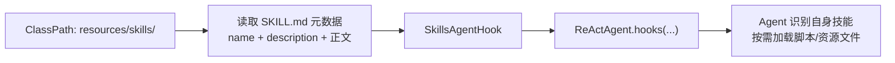

# 10-7 SpringAi 1.1.2实现Agent装载Skills

## 【学习目标】

- 独立搭出一个最小 Skills Demo 工程：两个 BOM（Spring AI Alibaba + 扩展）+ Agent Framework + DashScope + spring-boot-web 五个依赖各自的作用与导入方式。
- 掌握 Spring AI Alibaba 1.1.2 装载 Skills 的机制：经 Hook 挂载 SkillsAgentHook，从 ClassPath 读取 `SKILL.md`。
- 写对技能目录结构：`resources/skills/<技能文件夹>/SKILL.md`，文件夹名与技能名一致。
- 能说清 Skills 与 MCP 在工程实现上的分界，以及 DashScope API Key 走环境变量的配置方式。

## 【正文】

### 一、先立分界：Skills 不是工具，是内嵌工具的工作流

10-2 至 10-5 篇讲过 Cloud Code 提出的 Skills：专业领域的专用工作流。它与 MCP 的一个很大区别是，Skills 远不止一个工具，它是一整套固定的工作流程，该工作流程里面会包含使用 MCP 工具。用一句话概括分工：**MCP 提供「能被调用的能力」，Skills 规定「什么场景下按什么步骤调用哪些能力」**。

Spring AI Alibaba 已发布到 1.1.2 版本，该版本开始支持 Skills 能力。本节用 1.1.2.0 版本，看 Spring AI Alibaba 是如何把 Skills 装载到 ReActAgent 上的。

课程至此涉及的 Spring AI Alibaba 版本号共三个：最初的 1.0 版本；课程主要使用的 1.1.0 版本；以及本节为支持 Skills 而采用的最新 1.1.2 版本。版本选型的第一信息来源始终是官方文档，本节的所有依赖坐标均以文档推荐为准。

### 二、依赖管理：两个 BOM 各司其职

新建一个 Skills Demo 项目，版本号取 1.1.2.0。官方文档已推荐使用 BOM 方式导入 Spring AI Alibaba 的依赖，与课程一贯强调的导入方式一致。

第一个 BOM 是 Spring AI Alibaba 的主 BOM；第二个是 **Spring AI Alibaba 扩展的 BOM，版本号 1.1.2.1**。为什么要额外导入扩展 BOM？因为 Spring AI Alibaba 的模型管理平台 DashScope 属于 Spring AI Alibaba 的扩展，必须导入扩展的 BOM 版本管理，才能引入 DashScope 依赖。两个 BOM 叠加，构成完整的版本治理。

真正导入依赖时，主体是 **Agent Framework** 依赖（与 1.1 版本没什么不同，Agent 的构建能力都在该坐标里），加上 DashScope 依赖，二者均为必须。此外还需要 **SpringBoot 的 Web 依赖**，原因很具体：运行 Skills 项目时要用到 SpringBoot 的 JSON 注解，而该注解属于 spring-boot-web 依赖里的包。SpringBoot 依赖同样走 BOM 管理，版本取 3.5：文档的版本说明里注明，Spring AI Alibaba 1.1.2 对应的 SpringBoot 版本就是 3.5。

原稿给出的依赖管理代码如下：

```xml
<dependencyManagement>
    <dependencies>
        <dependency>
            <groupId>com.alibaba.cloud.ai</groupId>
            <artifactId>spring-ai-alibaba-bom</artifactId>
            <version>1.2.8</version>
            <type>pom</type>
            <scope>import</scope>
        </dependency>
        <dependency>
            <groupId>org.springframework.ai</groupId>
            <artifactId>spring-ai-alibaba-agent-framework</artifactId>
            <version>1.2.8</version>
            <type>pom</type>
            <scope>import</scope>
        </dependency>
        <dependency>
            <groupId>com.alibaba.cloud.ai</groupId>
            <artifactId>spring-ai-alibaba-starter-dashscope</artifactId>
            <version>1.2.8</version>
            <type>pom</type>
            <scope>import</scope>
        </dependency>
    </dependencies>
</dependencyManagement>
```

需要如实说明的一处原稿痕迹：该代码块中三个坐标的 `<version>` 均写作 `1.2.8`，而本节口述采用的版本号是 `1.1.2.0`（扩展 BOM 为 `1.1.2.1`）。按代码守恒原则，此处按原稿原样保留该代码块内容、不作改写；实际搭建时应以自己选定的 Spring AI Alibaba 版本统一替换三个版本号，保持主 BOM、Agent Framework、DashScope starter 三者同版本。五个依赖的职责归纳如下：

| 依赖 | 职责 | 版本管理方式 |
|------|------|--------------|
| spring-ai-alibaba-bom | Spring AI Alibaba 主版本治理 | BOM import |
| spring-ai-alibaba 扩展 BOM | DashScope 等扩展的版本治理 | BOM import |
| spring-ai-alibaba-agent-framework | Agent 构建（ReActAgent 等） | 受主 BOM 管理 |
| spring-ai-alibaba-starter-dashscope | DashScope 模型接入 | 受扩展 BOM 管理 |
| spring-boot-starter-web | 提供 JSON 注解等 Web 能力 | spring-boot-dependencies（3.5） |

BOM 分两层不是冗余：主 BOM 管框架与核心 starter，扩展 BOM 管厂商扩展。少了扩展 BOM，DashScope 依赖无法解析；这类「核心/扩展分离」的版本治理在 Spring 生态里是常见做法。

### 三、创建 ChatModel：DashScope 与 API Key 的环境变量管理

ReActAgent 的两个必须属性：一个是 Agent 的 `name`，另一个是 Agent 所挂载的模型，即 Agent 的大脑，它的逻辑推理能力来自哪个语言大模型。模型经 `model` 属性挂载，该方法接收一个 ChatModel 对象。

此处的 ChatModel 来自阿里大模型平台 DashScope，通过 `DashScopeChatModel` 对象生成 ChatModel 实例。DashScope 调用大模型需要 API Key，而 API Key 是非常敏感的资源，因此不硬编码在代码里，而是放到环境变量：运行配置（Modify Run Configuration）中的 Environment Variable 里设置存放 API Key 的变量，填入自己的 API Key，代码中再通过该变量读取。敏感凭证走环境变量、不落源码，这是所有接入第三方大模型服务的工程底线。

### 四、通过 Hook 装载 Skills

关键问题：1.1.2 版本如何把 Skills 挂载到 ReActAgent 上？答案是经 **Hook**。Hook 在 AgentScope 框架里相当于一个外挂，可以挂载第三方插件，日志、监控等都可以通过 Hook 挂载到 ReActAgent 上。Skills 同样走这条路：1.1.2 版本提供了 **SkillsAgentHook** 对象，通过它把 Skills 注册到 Hook 里，即完成挂载。

注册动作的核心是读取 Skills 的 Markdown 文件。Skills 优于 MCP 的一点正在于此：只需加载一个 Skills Markdown 文件，其余内容用到时才加载（渐进式加载，见 10-4 篇）。1.1.2 版本提供了专门读取该文件的对象，读取路径是 **ClassPath**，参数即存放这些 Skills Markdown 文件的文件夹；读取后生成相应对象，传入 SkillsAgentHook 的注册方法，挂载即告完成。

原稿代码块展示了从 ChatModel 创建到 Agent 运行的完整骨架：

```java
// 创建 ChatModel
ChatModel chatModel = DashScopeChatModel.builder()
    .dashScopeApi(dashScopeApi)
    .build();

// 创建 ReAct Agent
ReactAgent agent = ReactAgent.builder()
    .name("skills-agent")
    .model(chatModel)
    .hooks(List.of()) // 挂载技能的钩子
    .build();

// 运行 Agent
AssistantMessage response = agent.call("请介绍你有哪些技能");

// 打印出Agent的回答
System.out.println(response.getText());
```

需要如实说明的两处原稿痕迹：其一，代码块中 `hooks(List.of())` 传入的是空列表（占位写法），口述中实际挂载的是 SkillsAgentHook 对象，具体注册调用未在该代码块中展开；其二，`dashScopeApi` 变量在块内未展示声明过程，它对应口述中从环境变量读取 API Key 后构造的对象。按代码守恒原则，代码块按原稿原样保留；实际编写时应把 SkillsAgentHook 实例放入 `hooks(...)` 列表，并先完成 `dashScopeApi` 的构造。

整条装载链路可以归纳为：



### 五、技能目录结构：skills 文件夹与 SKILL.md

读取对象从 ClassPath 取文件，该 ClassPath 即 resources 文件夹。在 resources 下建立 `skills` 文件夹，它作为读取参数传入；所有技能的 Markdown 文件全部存放在 `skills` 文件夹下。

本节只建一个技能，百度 Map 技能：在 `skills` 下再建 `baiduMap` 文件夹，在其下创建 `SKILL.md`。由 10-5 篇的文件结构标准可知，Skills 的 Markdown 文件是整个技能必须的文件，其他文件均可选；注意写法，Skills 是大写的，即 `SKILL.md`。若还有其他技能（如 PDF），就在 `skills` 下另建一个文件夹（如 `pdf`），其中同样放置 `SKILL.md`。智能体读取所有技能，都在 `skills` 文件夹下进行：

| 路径 | 角色 | 是否必须 |
|------|------|----------|
| `resources/skills/` | 技能根目录（读取对象传入的 ClassPath 参数） | 必须 |
| `resources/skills/baiduMap/` | 单个技能的文件夹，名称即技能名 | 必须 |
| `resources/skills/baiduMap/SKILL.md` | 技能元数据与正文（name + description + 步骤） | 必须 |
| `resources/skills/pdf/SKILL.md` | 其他技能同理，一技能一文件夹 | 按需 |

`SKILL.md` 的写法要点：技能名称必须与文件夹名称一致；随后是技能描述，本节的描述即「基于百度地图 API 的执行」。描述承担场景路由的职责（10-5 篇的四要素：功能范围、触发条件、适用场景、边界声明），写得好不好直接决定智能体何时唤起该技能。

### 六、运行验证：让 Agent 自报技能

挂载完成后验证 Agent 是否识别该技能：运行 Agent，询问它当前拥有哪些技能，并打印回答。运行结果显示，智能体已能装载该技能，它自报「是一个基于百度地图的技能」，这正是 `SKILL.md` 里的描述，说明元数据已被成功读取并进入 Agent 的技能清单。

该验证手法值得记住：问「你有哪些技能」是在探针式地检查渐进式加载的第一层（元数据索引）是否就位；若要验证更深层（脚本、资源文件是否按需加载），需要发起一个真正触发该技能的任务，看它是否走到调用百度地图 API 的步骤。

### 七、与 981-demo 的对应

课程工程的离线复刻中，「把能力挂到 ReActAgent」这一动作由 Toolkit 完成：`981-demo/src/main/java/com/travel/agent/agent/TeamMembers.java` 里，每个团队成员先 `new Toolkit()` 再 `toolkit.registerTool(...)`，最后把 toolkit 传入 `ReActAgent.Builder`，这与课程中「经 Hook 把 SkillsAgentHook 挂到 ReActAgent」是同一思路的两种落地：课程用 Hook 挂「技能包」，demo 用 Toolkit 挂「工具对象」。而技能的目录化组织（`skills/<name>/SKILL.md`）对应 demo 中按领域拆分的工具类，如 `981-demo/src/main/java/com/travel/agent/tool/RouteMakingTools.java`（路线制定专员的百度地图风格工具）。

## 【易错点 / 面试题】

1. **面试题：Spring AI Alibaba 1.1.2 通过什么机制给 ReActAgent 装载 Skills？为什么走 Hook 而不是直接加个 skills 属性？**
   通过 Hook：SkillsAgentHook 对象把从 ClassPath 读到的 `SKILL.md` 注册进去，再把该 Hook 放入 `ReActAgent.builder().hooks(...)`。走 Hook 的理由是复用框架既有的插件扩展点，日志、监控本来就经 Hook 挂载，技能作为同一类「横切能力」接入，不需要为核心 Builder 增加专用 API，框架扩展性与稳定性都更好。答题时补上渐进式加载：Hook 注册的只是元数据索引，脚本与资源文件按需加载，这是 Skills 区别于「把工具全量挂上」的关键。

2. **面试题：该 Demo 为什么要导入两个 BOM？spring-boot-web 又是干什么用的？**
   两个 BOM：主 BOM（spring-ai-alibaba-bom）管框架与 Agent Framework 的版本；扩展 BOM 管 DashScope 等扩展的版本，DashScope 属于扩展，没有扩展 BOM 就无法引入。spring-boot-web 则是因为运行 Skills 项目要用 SpringBoot 的 JSON 注解，该注解在 web 依赖的包里。延伸一点：BOM 分层的设计意图是让「核心版本」与「厂商扩展版本」可以各自演进，这是 Spring 生态依赖治理的惯例。

3. **易错点：技能文件夹与 `SKILL.md` 的命名不规范。**
   两处硬约束：文件名必须是大写的 `SKILL.md`（Skills 首字母大写）；技能名称必须与所在文件夹名称一致（如 `baiduMap` 文件夹对应百度 Map 技能）。违反任一条，智能体在 `skills` 目录下扫描时就无法把文件夹与技能元数据对应起来，表现为「技能挂了但 Agent 不认」。

## 【小结】

本节完成了 Skills 的工程装载闭环：依赖层（主 BOM + 扩展 BOM + Agent Framework + DashScope + spring-boot-web，版本走 1.1.2.0 与 SpringBoot 3.5），模型层（DashScopeChatModel + API Key 环境变量），挂载层（SkillsAgentHook 经 Hook 注册，从 ClassPath 的 `skills` 文件夹读取 `SKILL.md`），目录层（`skills/<技能名>/SKILL.md`，名称与文件夹一致），验证层（询问 Agent 技能清单）。原稿代码块中的版本号不一致与 `hooks(List.of())` 占位两处痕迹已按代码守恒原则原样保留并在正文说明。11-1 篇回到旅游规划项目，看这套技能与工具能力如何落入四模块架构；12-1 至 12-4 篇将看到行程规划经理真正挂载 Skills 的实战。
