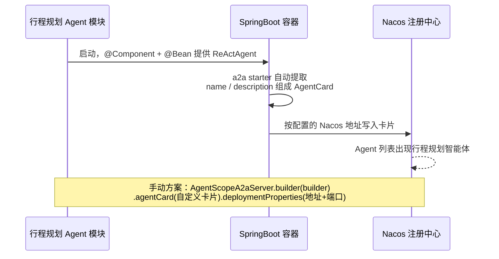

# 11-2 测试团队成员基于A2A协议注册到Nacos

## 【学习目标】

- 说清 AgentScope 注册智能体卡片到注册中心的两种方案（Bean 自动注入 / 手动写入）及其适用场景。
- 独立定位并修复「缺少 Bean」报错：理解 starter 依赖的作用域，会用 dependencyManagement 收敛依赖。
- 完成一次完整的注册验证：启动团队成员模块，在 Nacos 管理页确认 AgentCard 出现且字段正确。
- 理解 Bean 方案下 AgentCard 的信息来源（自动从 ReActAgent 提取），以及与手动方案的能力差距。

## 【正文】

### 一、测试目标

前面课程一共实现了三个功能：第一，主管智能体的自主规划、自主决策，即把复杂需求分割为一个一个的简单任务；第二，基于 Nacos 的 A2A 协议注册中心，远程智能体把自己的智能体卡片注册到 Nacos，主管从 Nacos 获取这些卡片，把任务分发给远程智能体执行；第三，主管智能体把获取到的远程智能体作为工具注册进自己的工具包，分发任务时调用该工具执行子任务。

第一个功能此前已演示过，本节测试第二个功能的注册侧：远程智能体能否把自己的卡片存进 Nacos，主管能否从 Nacos 读到这些卡片。读侧放到 11-3 篇验证。

### 二、两个依赖

A2A 与 Nacos 的支持各只需一个依赖：

```xml
<!-- 以 SpringBoot 方式添加 A2A 依赖 -->
<dependency>
    <groupId>io.agentscope</groupId>
    <artifactId>agentscope-a2a-spring-boot-starter</artifactId>
    <version>${AgentScope.version}</version>
</dependency>

<!-- 额外添加 Nacos Spring Boot starter 的依赖 -->
<dependency>
    <groupId>io.agentscope</groupId>
    <artifactId>agentscope-nacos-spring-boot-starter</artifactId>
    <version>${AgentScope.version}</version>
</dependency>
```

前者提供「以 SpringBoot 方式把智能体卡片注册到注册中心」的自动装配能力，后者提供 Nacos 客户端。课程以行程规划智能体模块为例，此前已简单写了一段注册代码，但从未执行过，本节先跑起来，看会出什么问题。

### 三、首次启动报错：缺的不是配置，是 Bean

启动行程规划智能体模块，直接报错：缺少某个 Bean。这段注册代码本身没有写错，问题出在机制层面。这里涉及 AgentScope 对 A2A 注册中心的一个重要知识点，先用一段占位说明把它摆出来：

```java
public class TripPlannerAgent {
    public void getTripPlannerAgent() {
        /*
         * 1. AgentScope框架自带了注册中心：AgentScopeA2aServer
         * 2. AgentScope框架将智能体卡片注册到注册中心,有2种方案：
         *    a. 通过SpringBoot，以Bean的形式自动注入
         *    b. 手动写入注册中心，主要针对于AgentScopeA2aServer
         */
    }
}
```

两个重要知识点：

**第一，AgentScope 框架自带注册中心**，即 `AgentScopeA2aServer` 对象，可以启动该注册中心，把智能体卡片写入其中。项目里的 Nacos 只是本项目选择的注册中心，并非非 Nacos 不可；报错信息里缺少的 Bean（AgentScope A2A server）对应的正是框架自带的注册中心。

**第二，把卡片注册进注册中心有两种方案。** 方案一是经 SpringBoot、以 Bean 的方式自动注入，注意是 Bean 方式，这就是报错说找不到 Bean 的原因：默认走自动注入，而容器里没有该 Bean，自然无从注入，所以要在方法里补上 Bean 声明。方案二是手动写入，主要针对框架自带的 `AgentScopeA2aServer`。

### 四、手动写入方案：先看懂，再放弃

手动写入的代码长这样：

```java
// 行程规划Agent Builder
ReActAgent.Builder builder = AgentUtils.getReActAgentBuilder()
    .name("TripPlannerAgent",
    description: "行程规划Agent"
);
```

同样经 Builder 生成要写入注册中心的智能体，然后经注册中心的 `agentCard` 方法传入自定义的智能体卡片，这样做的好处是能自定义卡片对象：

```java
ConfigurableAgentCard agentCard = new ConfigurableAgentCard()
    .name("TripPlannerAgent")
    .description("行程规划Agent")
    .build();

AgentScopeA2aServer.builder(builder)
    .agentCard(agentCard)
    .deploymentProperties(
        new DeploymentProperties()
    )
    .build();
```

这里有个疑问：代码里没写注册中心的地址，怎么写入？答案是通过 `deploymentProperties` 方法配置自带注册中心的地址，传入的对象直接 new 出来即可，其构造方法需要传入注册中心的地址与端口号，例如地址取 localhost、端口取 8080，卡片即可写入 `AgentScopeA2aServer`。写完之后还需把该注册中心启动，否则无处写入。

需要如实说明的一处原稿痕迹：上面第二个代码块中 `new DeploymentProperties()` 未展示构造参数，而口述明确其构造方法需要传入地址与端口号（localhost:8080）；另外第一个代码块中 `.name("TripPlannerAgent", description: "行程规划Agent")` 采用了命名参数写法，Java 中并不存在该语法，属原稿的示意性简写。按代码守恒原则，两处均按原稿原样保留，不修改代码块内部；实际编码时对应 `.name("TripPlannerAgent").description("行程规划Agent")` 与 `new DeploymentProperties("localhost", 8080)` 的形式。

手动方案最终没有采用：本项目是分布式部署，要在自己的节点上再启动一个注册中心，与分布式架构不太对应，因此把这段手动写入的代码注释掉，留作参考。若对自定义卡片有强需求（例如卡片上要挂课程之外的字段），仍可按这种方式实现。

### 五、Bean 自动注入方案：正式采用

改用自动方式，即经 Bean 注入 Nacos，更方便。既然是 Bean 方式，先给类标注 `@Component`，再声明一个 Bean 注入容器，SpringBoot 才能自动把该 Bean 写入注册中心，也就是 Nacos。

配置文件回答「注入哪个注册中心」的问题：此前已在配置文件中指明 Nacos 地址，SpringBoot 据此把 Bean 写入 Nacos，全程自动。

该 Bean 有两处硬性要求：

1. **返回类型不能是 void，必须返回智能体，即 ReActAgent 对象**，行程规划智能体的 ReActAgent 实例即该 Bean 的产物。
2. **不手写智能体卡片**。SpringBoot 把智能体注册到 Nacos 时存的是卡片，因此它会自动提取 ReActAgent 里的一些信息（描述、名称）组成卡片写入。这与手动方案能自定义卡片对象相比，是本方案较弱的地方，卡片字段完全由框架提取，定制空间有限。

### 六、第二个坑：依赖放错层级，主管模块被连坐

改完 Bean 就能跑吗？还不能。看项目配置文件：SpringBoot 能把 ReActAgent Bean 自动注入 Nacos，关键在于「以 SpringBoot 方式注册卡片」的 starter 依赖。但对于注册中心里 A2A 协议的客户端，主管 Agent 节点，它并不需要把自己注册进 Nacos，因此压根不需要该依赖。而该依赖此前放在根目录的配置文件里，主管模块也会导入；导入了就要提供该 Bean，可主管模块根本不需要提供（它只从 Nacos 读取，是纯客户端），于是报错。

修复动作分两步：把该依赖从各模块的直接依赖中注释掉，移入 `dependencyManagement`，这样无需所有模块都导入，只在需要的模块导入即可；然后在行程规划、路线制定这两个成员模块里导入它。`dependencyManagement` 的作用正是统一版本、按需引入：声明但不强制继承。

### 七、联调验证

重新运行。先打开 Nacos（启动命令见课程文档），进入管理页的 Agent 管理，此时没有任何智能体卡片。接着启动行程规划模块：日志显示 SpringBoot 已成功把该模块运行起来，其智能体卡片已写入并注册到 Nacos。刷新 Nacos 管理页的 Agent 列表，行程规划智能体的卡片出现；点进详情，描述信息为「行程规划Agent」，名称与设置值一致，这些信息正是从 ReActAgent 对象里自动提取出来的。至此，远程智能体成功写入 Nacos 注册中心。

注册链路可归纳为：



### 八、与 981-demo 的对应

离线工程用同样的两段式结构复刻了注册语义：生产 profile 下由 `981-demo/src/main/java/com/travel/agent/a2a/NacosAgentRegistry.java` 的 `registerSelf(agentName, ip, port)` 把成员以服务名 `a2a-<AgentName>` 注册进 Nacos；default 离线 profile 下由 `981-demo/src/main/java/com/travel/agent/a2a/InProcessAgentRegistry.java` 的 `register(transport)` 在进程内收拢各成员的 `AgentCard`（`981-demo/src/main/java/com/travel/agent/a2a/AgentCard.java` 定义 name / description / baseUrl 三字段）。课程里「卡片信息自动从 ReActAgent 提取」在 demo 中对应 `TeamMembers.routeCard(...)` / `attractionCard(...)` 的显式构造，离线模式下没有 SpringBoot 自动装配可依赖，显式声明卡片更直接，但字段语义与课程完全一致。

## 【易错点 / 面试题】

1. **面试题：AgentScope 把智能体卡片注册到注册中心有哪两种方案？怎么选？**
   方案一：经 SpringBoot 以 Bean 自动注入，类标 `@Component`，方法标 `@Bean` 且返回 ReActAgent，配置文件指明 Nacos 地址，框架自动提取名称与描述组成卡片写入。方案二：手动写入 `AgentScopeA2aServer`，Builder 生成智能体后，经 `agentCard(...)` 传入自定义的 `ConfigurableAgentCard`，用 `deploymentProperties(...)` 配好地址与端口并启动注册中心。选型标准就一条：需要自定义卡片字段、或运行环境没有 SpringBoot 容器时，用手动方案；标准分布式部署一律用 Bean 方案，本项目即如此。

2. **面试题：Bean 方案里，注册方法的返回类型为什么不能是 void？**
   因为容器的注入物就是智能体本身：返回 ReActAgent，SpringBoot 才既有一个可管理的智能体实例，又能从中提取名称、描述组成卡片写入 Nacos。返回 void 意味着「没有产物」，框架拿不到任何可提取信息，注入也就失去了对象。延伸一点：该方案下卡片字段由框架自动提取，定制能力弱于手动方案，这是面试官喜欢的追问点。

3. **易错点：把 a2a 注册 starter 依赖放在根 pom，让主管模块一起导入。**
   症状是主管模块启动报「缺少 Bean」，它被强行要求提供一个自己根本不需要的注册 Bean。正确做法是把该依赖收进 `dependencyManagement`，只在行程规划、路线制定这类需要注册的成员模块里导入。这道题背后的通用经验：starter 类依赖带自动装配副作用，放层级前先问「该模块是否真的需要这套自动装配」。

## 【小结】

本节打通了 A2A 注册侧：引入 a2a 与 nacos 两个 starter；首次启动的缺 Bean 报错引出两种注册方案，手动写入 `AgentScopeA2aServer`（可自定义卡片，但分布式项目不采用，代码注释保留）与 Bean 自动注入（`@Component` + `@Bean` 返回 ReActAgent，卡片信息由框架自动提取）；随后修复依赖层级问题，把注册专用 starter 收进 `dependencyManagement` 并按需导入成员模块；最终在 Nacos 管理页验证到行程规划智能体的卡片，字段与设置一致。原稿两处代码痕迹（命名参数简写、`new DeploymentProperties()` 缺构造参数）已按代码守恒原则原样保留并说明。11-3 篇验证读侧：主管 Agent 如何从 Nacos 发现并获取远程成员。
