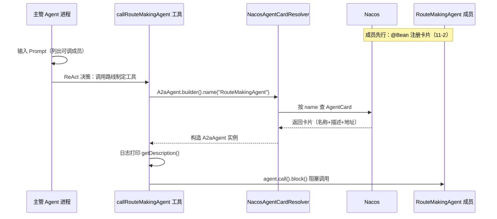

# 11-3 测试主管Agent基于A2A协议获取团队成员

## 【学习目标】

- 用 Bean 方式把路线制定 Agent 注册进 Nacos，复刻 11-2 的注册链路。
- 写对主管侧的发现工具：`A2aAgent.builder().name(...).agentCardResolver(new NacosAgentCardResolver(...))`，并理解 name 与 Nacos 中卡片 name 的对应关系。
- 掌握分步调试法：先用日志验证「工具被调用」，再解锁远程获取验证「成员被发现」。
- 独立完成多模块联调，能从日志确认主管成功获取远程成员的描述信息。

## 【正文】

### 一、路线制定成员注册：与 11-2 完全同构

行程规划智能体的卡片已写入 Nacos。路线制定智能体照此办理，注册方式与 11-2 篇行程规划智能体注册到 Nacos 的方法相同，只需把它设为一个 Bean：

```java
@Component
public class RouteMakingAgent {
    @Bean
    public ReActAgent getRouteMakingAgent() {
        return AgentUtils.getReActAgentBuilder(
            name: "RouteMakingAgent",
            description: "路线制定Agent"
        ).build();
    }
}
```

需要如实说明的一处原稿痕迹：该代码块中 `.name("RouteMakingAgent", description: "路线制定Agent")` 采用命名参数写法，Java 中并不存在该语法，属原稿的示意性简写；按代码守恒原则此处按原稿原样保留，实际编码时对应 `.name("RouteMakingAgent").description("路线制定Agent")` 的形式。至此，Nacos 的 Agent 列表下应同时存在行程规划与路线制定两张卡片。

本节的核心任务在主管侧：主管如何通过 Nacos 发现远程智能体并调用它们。

### 二、主管侧的两个发现工具

回到主管智能体模块。前面课程写了两个智能体工具，分别获取远程智能体：一个获取远程的路线制定智能体，另一个获取远程的行程规划智能体。智能体工具只需要用 `@Tool` 注解修饰即可被智能体采用。两个工具都通过 Nacos 注册中心把智能体卡片读取出来，从而获取到远程智能体。

以路线制定智能体为例：

```java
@Tool(description = "路线制定智能体,擅长路线规划")
public void callRouteMakingAgent() throws NacosException {
    A2aAgent agent = A2aAgent.builder()
        .name("RouteMakingAgent")
        .agentCardResolver(
            new NacosAgentCardResolver(NacosUtil.getNacos())
        )
        .build();
    agent.call().block();
}
```

三个要点：

**其一，`A2aAgent.builder().name("RouteMakingAgent")` 中的 name 必须与 Nacos 中所存放卡片的 name 完全一致。** 解析器是「按名字查卡片」的，名称对不上，就取不到对应卡片，远程成员无从发现。这是字符串契约，没有模糊匹配，写错一个字母即失败。

**其二，`agentCardResolver(new NacosAgentCardResolver(NacosUtil.getNacos()))` 指明卡片从哪来。** NacosUtil.getNacos() 产出 Nacos 客户端，NacosAgentCardResolver 持该客户端按 name 拉取卡片。这一层抽象的意义在于：换注册中心（例如换成 ZooKeeper、Consul）只需替换 resolver 的实现，工具代码不动。

**其三，`agent.call().block()` 是阻塞式调用。** 从 block 即可看出运行方式，同步等待远程成员执行完毕。工具方法声明 `throws NacosException`，因为解析过程涉及 Nacos 客户端 IO。

### 三、日志验证：getDescription() 作为发现成功的判据

运行之前先加日志：引入 SLF4J 注解，若成功获取到远程智能体（A2aAgent 对象不为空），则把它的描述属性打印到日志里。A2aAgent 对象上有 `getDescription()` 方法，能打印出描述，即证明远程智能体被成功获取；再核对描述内容，即可确认拿到的正是目标成员（「路线制定Agent」而非别的成员）。

该验证手法与 11-2 篇在 Nacos 页看卡片详情形成互补：管理页验证「卡片在册」，日志验证「主管按名取到了卡片并构造出可用实例」。

### 四、Prompt 设计：让主管自己决定调工具

第二处关键改动在主管的启动方式。此前测试主管智能体是通过 main 函数直接生成对象再 run，不启动 Spring 容器，因为用不到。但现在调用远程智能体的逻辑放在了智能体工具方法里，因此运行主管时要给一个 Prompt，促使它执行该工具方法，进而到 Nacos 获取卡片、调用远程智能体：

```java
String prompt = """
    帮我制定2026年元旦，
    深圳到惠州3日游自驾游计划，
    请包含吃住行，天气，酒店，餐饮美食。
    你可以调用以下Agent处理子任务：
    - routeMaking Agent: 擅长处理自驾路线制定
    - tripPlanner Agent: 擅长处理景点行程规划
    - 每个子任务要注明调用的Agent
    """;
```

这段 Prompt 的写法值得拆解：先给完整业务需求（2026 年元旦深圳到惠州 3 日游自驾，含吃住行、天气、酒店、餐饮），再显式列出可调用的成员及其擅长领域，最后约定「每个子任务要注明调用的 Agent」。三条信息各司其职，业务内容决定任务内容，成员清单与工具描述共同构成路由依据（工具 description 写「擅长路线规划」，Prompt 里写「擅长处理自驾路线制定」，两处语义对齐，模型才敢把路线子任务派过去），输出约定方便事后核对分发是否正确。

运行方式改为流式：

```java
Flux<Event> stream = AgentUtils.streamResponse(agent, prompt);
stream.doOnNext(msg -> System.out.println(msg.getMessage()));
```

流式输出让主管的思考、工具调用、成员返回逐条可见，调试时能看清「哪一步调了哪个工具」。

### 五、分步调试：先证「调得到」，再证「取得对」

联调分两步走，这是定位问题的最小闭环：

**第一步**，先把获取远程智能体的代码注释掉，只留一行日志，运行 main。若日志打印出来，即证明经该 Prompt 能够调用该方法、工具链路本身是通的。运行结果符合预期：Prompt 成功触发了工具方法，日志如期输出。

**第二步**，把获取远程智能体的代码解除注释，再运行。启动前有个前提：必须先把路线制定智能体模块启动起来，成员不在册，主管拿不到卡片；同时启动主管模块（IDEA 多模块同时启动的方法在课程文档中有介绍）。

### 六、结果解读

两个模块的启动类都是标准形态：

```java
@SpringBootApplication
public class RouteMakingAgentApplication {
    public static void main(String[] args) {
        SpringApplication.run(RouteMakingAgentApplication.class, args);
    }
}
```

运行后看主管智能体打印的信息：首先看到它调用了工具方法（正在调用中）；随后路线制定智能体的描述信息被打印出来，正是 11-2 篇注册时由框架自动提取进卡片的那段描述。描述能拿到，即证明主管已能通过 Nacos 注册中心、依据智能体卡片成功获取远程智能体。

完整发现链路：



### 七、与 981-demo 的对应

离线工程把这条发现链路落成了可测代码：主管侧工具在 `981-demo/src/main/java/com/travel/agent/agent/SupervisorTools.java`，`ask_route_making_agent` 即课程中「获取路线制定智能体」那枚工具，内部经 `registry.resolve(memberName)` 完成按名解析；注册表在 prod profile 下是 `981-demo/src/main/java/com/travel/agent/a2a/NacosAgentRegistry.java`（`resolve` 经 Nacos 选健康实例，拼出 `/a2a/<name>` 端点），default 离线 profile 下是 `981-demo/src/main/java/com/travel/agent/a2a/InProcessAgentRegistry.java`（进程内按名取通道）。demo 还为远程调用包了 resilience4j 熔断（`dispatch` 方法中 `CircuitBreaker.decorateSupplier`），成员不可用时返回降级提示而非让主管的 ReAct 循环崩掉，这是课程未展开、生产必须补的一层。

## 【易错点 / 面试题】

1. **面试题：`A2aAgent.builder().name(...)` 里的 name 和 Nacos 里的卡片是什么关系？解析不到会怎样？**
   name 就是查卡的键：NacosAgentCardResolver 按该 name 去注册中心取 AgentCard，取到才构造出 A2aAgent 实例。因此工具里的 name 必须与成员注册时的卡片 name 逐字一致（如 「RouteMakingAgent」）。解析不到时拿不到实例，后续 `agent.call()` 无从执行；工程上应把这种「成员未注册」显式报出来（demo 中即抛 `IllegalStateException("团队成员未注册: ...")`），而不是静默返回空，否则主管的 ReAct 循环会拿到一个无信息的工具结果，难以定位。

2. **面试题：为什么用 `call().block()`？什么时候不应该阻塞？**
   工具方法声明为 void、经 `@Tool` 修饰，主管的 ReAct 循环在「思考 → 调用工具 → 观察结果」里同步消费工具返回值，因此阻塞等待成员执行完毕，再把结果交回循环，语义最直白。不适合阻塞的场景：成员执行时间长、或主管需要并行调度多个成员，此时应改用响应式编排（`Flux` 组合），避免线程长时间挂住。课程此处为跑通链路选了阻塞式，面试中能主动指出这一边界即可加分。

3. **易错点：只启动主管、不启动成员模块。**
   症状是工具被调用但获取不到远程智能体，Nacos 里根本没有那张卡片。排查顺序：先看 Nacos 管理页 Agent 列表有没有该成员（在册？），再看工具里的 name 与卡片 name 是否逐字一致（键是否匹配），最后才怀疑网络与配置。课程采用的分步调试法（先注释远程获取代码验证工具被 Prompt 触发，再解锁验证获取）正是为了把「Prompt 路由问题」与「Nacos 解析问题」两类故障解耦开。

## 【小结】

本节验证了 A2A 的读侧：路线制定 Agent 以 Bean 方式注册进 Nacos 后，主管侧经 `@Tool` 工具内的 `A2aAgent.builder().name(...).agentCardResolver(new NacosAgentCardResolver(...))` 按名解析卡片，`getDescription()` 日志确认获取成功；Prompt 中显式列出可调成员与擅长领域，为模型的路由决策提供依据；分步调试法把「工具被调用」与「成员被发现」两类问题解耦。原稿代码块中的命名参数简写已按代码守恒原则原样保留并说明。11-4 篇继续推进：让获取到的远程成员真正执行任务，调用它自己的百度地图 MCP，并修复由此暴露的 `ReActAgent` 与 `A2aAgent` 类型不匹配问题。
