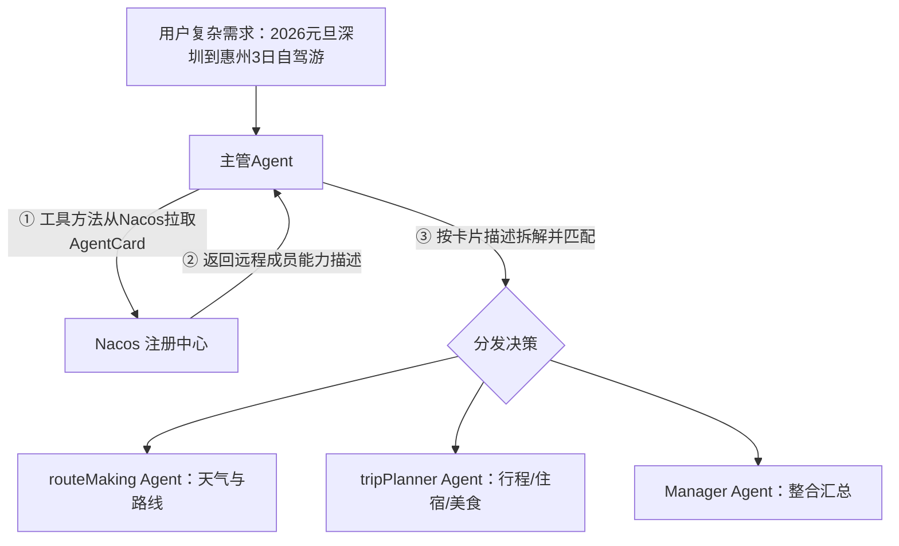

# 11-7 主管Agent自主分发任务给远程相应的成员

## 【学习目标】

- 理解「人工指定成员」与「主管自主发现并分发」的本质差别，以及 Agent Card 描述信息在其中的枢纽作用。
- 完成主管 Agent 的 Prompt 与 `@Tool` 方法描述改造，让分发决策依据来自 Nacos 上的能力名片。
- 复现「四个子任务自动分配到对应远程 Agent」的运行结果，并解释其决策依据。

## 【正文】

### 1. 从「告诉它有哪些人」到「它自己去找人」

前面课程（11-1 至 11-4）已搭好多 Agent 骨架：行程规划 Agent 与路线制定 Agent 先后启动，通过 A2A 协议把各自的 Agent Card 注册到 Nacos；主管 Agent 能把拆解出的子任务分配给远程成员执行。

但此前的分发依赖人工指定：Prompt 中写明了「有两个智能体，一个擅长自驾游路线制定，一个擅长景点行程规划」，成员名单与擅长领域都是人告诉它的。本节去掉这层人工指定，改由主管 Agent 自主完成全流程：

1. 自己到 Nacos 拉取远程 Agent 的 Agent Card；
2. 从卡片描述中判断每个远程 Agent 擅长什么；
3. 把拆解好的子任务分发给能力匹配的成员。

全程无需人工提供成员信息，这才是「自主性」的完整含义。

### 2. 改造一：把能力写进 Agent 描述

先改两个远程智能体的描述信息。如果描述只写「路线制定Agent」这类名称，主管 Agent 根本无从判断该 Agent 擅长什么。修改后的描述为：

- 路线制定 Agent：「擅长处理自驾游路线制定的」；
- 行程规划 Agent：「擅长处理景点行程规划」。

重新注册前，一定要先把 Nacos 上原有的旧卡片删除，再写入新卡片，否则旧描述残留会导致主管读到过期信息。注册完成后回到 Nacos 控制台，可以看到两张卡片的描述已更新，主管 Agent 据此判断两个远程智能体各自擅长什么。

### 3. 改造二：Prompt 中给出可调用的 Agent 与分发约束

```java
public void run() {
    String prompt = """
        帮我制定2026年元旦，
        深圳到惠州3日自驾游计划，
        请包含吃住行，天气，酒店，餐饮美食。
        你可以调用以下Agent处理子任务：
        - routeMaking Agent: 擅长处理自驾路线制定
        - tripPlanner Agent: 擅长处理景点行程规划
        - 每个子任务要注明调用的Agent
        """;
    Flux<Event> stream = AgentUtils.streamResponse(agent, prompt);
    // 把响应应打印出来
    stream
}
```

Prompt 的主体需求不变，变化集中在后半段：明确告知主管 Agent 可以调用哪些远程 Agent 处理子任务，并要求每个子任务注明由哪个 Agent 处理。`AgentUtils.streamResponse(agent, prompt)` 以流式（`Flux<Event>`）方式驱动主管 Agent 的 ReAct 循环，响应逐事件回传，便于观察「思考 → 选工具 → 执行」的每一步。

Prompt 写法本身也有讲究：任务描述要具体到可拆解的程度。「深圳到惠州 3 日自驾游，包含吃住行、天气、酒店、餐饮」这类需求信息完整，主管才能切出边界清晰的子任务；若只写「帮我规划旅行」，拆解结果会空洞失焦，后续分发再准也产出有限。

### 4. 改造三：工具方法描述指向 Nacos

在前面课程中，主管 Agent 调用远程智能体的逻辑写在 `@Tool` 注解修饰的工具方法里，主管要调动远程成员，必须通过调用这些自家方法完成：

```java
@Tool(description = "从Nacos注册中心获取路线制定Agent")
public void callRouteMakingAgent() throws NacosException {
    log.info("工具方法：路线制定智能体...正在调用中");
    A2Agent agent = A2Agent.builder()
        .name("RouteMakingAgent")
        .agentCardResolver(
            new ConfigurableAgentCardResolver(
                "http://192.168.98.72:8082",
                "RouteMakingAgent",
                "text",
                "text",
                "JSONRPC"
            )
        )
        .build();
    // 调用Agent的逻辑
}
```

关键改动是 `@Tool` 的 description：改为「从 Nacos 注册中心获取路线制定 Agent」，另一个方法同理改为「从 Nacos 注册中心获取行程规划 Agent」。在 ReAct 循环中，模型选择工具的唯一信号就是 description，描述写什么，模型就认为该方法能干什么。至于两个远程智能体各自擅长什么，工具描述中不作展开，由主管智能体自行查看从 Nacos 获取到的 Agent Card，从卡片描述信息中自行选择擅长处理相关任务的智能体，这才叫自主性。

代码内部按 A2A 规范构建 `A2Agent`：指定目标 Agent 名称，通过 `ConfigurableAgentCardResolver` 配置远程服务基址（`http://192.168.98.72:8082`）与 JSONRPC 通信方式，完成远程调用的寻址。

### 5. 运行结果：自主分发



执行后主管 Agent 列出完整计划，共四个步骤，每个步骤都交给擅长处理该子任务的智能体：

```
**子任务分解如下：**
1. **获取元旦惠州天气与路线规划** (由路线制定Agent处理)
2. **规划详细行程与住宿** (由行程规划Agent处理)
3. **规划特色餐饮美食** (由行程规划Agent处理)
4. **整合并生成最终计划** (由Manager Agent处理)
```

注意这些分配结果并非人工指定，而是主管 Agent 根据从 Nacos 获取到的 Agent Card 中远程智能体的能力描述，自主地把相关任务分发给擅长处理这些任务的子智能体。

### 6. 人工指定 vs 自主分发

| 维度 | 人工指定（11-4 及以前） | 自主分发（本节） |
|---|---|---|
| 成员信息来源 | Prompt 中人工写明 | Nacos 上的 Agent Card |
| 擅长领域依据 | 人工描述 | 卡片 description 字段 |
| 新增远程成员 | 需改 Prompt 重新部署 | 注册即被发现，无需改动主管 |
| 人工介入程度 | 高 | 低，仅维护卡片描述 |

自主分发的代价是对卡片描述质量的要求显著提高：描述写歪了，分发就会错配。这也是 11-2 强调卡片注册规范的原因。

还有一点值得注意：主管 Agent 的「自主」是有限自主，它只在已注册成员的集合内做选择，不会凭空创造不存在的成员。成员集合由 Nacos 控制，这天然形成一道安全边界：新成员上线注册后才能被发现，下架后不再参与分发。

从链路视角复盘完整数据流：用户 Prompt 进入主管 Agent 后，ReAct 循环第一步并不是拆任务，而是判断「要不要先了解有哪些成员」，工具描述「从 Nacos 注册中心获取某某 Agent」此时成为触发信号；工具返回的卡片信息进入上下文后，第二轮推理才依据卡片描述拆解并分发。换言之，「先发现、后分发」是两轮推理协作的结果，工具方法的 description 写得清不清楚，直接决定第一轮能不能正确触发。

这也解释了一个常见疑惑：为什么有时候主管「忘了」发现成员就直接拆任务？原因是首轮推理未触发获取工具，上下文里没有卡片信息，后续分发只能凭 Prompt 中残留的线索猜测。修正手段有二：把工具描述写得更具触发感，或在 sysPrompt 中明确「先获取成员再规划」的步骤要求。

## 【易错点 / 面试题】

1. **为什么改 `@Tool` 的 description 而不是改方法名？** ReAct 循环里模型按 description 理解工具语义，方法名只是代码标识，对模型不可见。描述与能力不符，选工具就会偏。
2. **为什么重新注册前要删旧卡片？** Nacos 上同名卡片不删会导致旧描述残留，主管读到过期能力信息，把任务分给并不擅长该领域的成员。
3. **面试题：Agent Card 里放什么才能支撑自主分发？** 最小集是三样：名称（name）、能力描述（description）、服务基址（baseUrl）。`981-demo` 的 `com/travel/agent/a2a/AgentCard.java` 正是按该最小集实现的 record，并通过 `A2aEndpointController` 暴露 `/.well-known/agent.json` 能力发现端点。

## 【小结】

本节把主管 Agent 的分发依据从「人工写死的成员名单」切换为「Nacos 上的 Agent Card 描述」，实现了任务分发的自主化。下一节（11-8）在此之上引入人工介入：计划生成后允许用户逐条讨论修改。在 `981-demo` 工程中，`com/travel/agent/agent/SupervisorTools.java` 把每枚团队成员封装为一工具（`ask_route_making_agent` / `ask_attraction_agent`），`com/travel/agent/agent/SupervisorAgent.java` 用 sysPrompt 固化路由规则，`com/travel/agent/config/AgentProperties.java` 的 `app.agent.discovery` 可在进程内注册表与 Nacos 注册中心之间切换，完整复刻「发现成员 → 读能力 → 分发任务」的链路。
