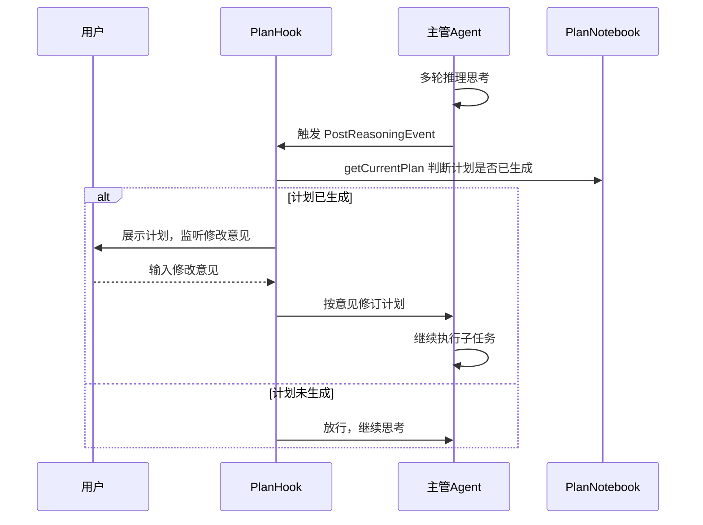

# 11-8 人工介入修改主管Agent制定的计划

## 【学习目标】

- 理解 `needUserConfirm` 的能力边界：只提供 yes/no 确认，不支撑「逐条讨论修改」。
- 用框架自带 `UserAgent` 承接用户输入，并通过 Hook 事件在计划生成后打断主管 Agent。
- 跑通「计划评审 → 人工意见 → 计划修订 → 继续执行」的人工介入闭环。

## 【正文】

### 1. 为什么需要人工介入

11-7 中主管 Agent 全自主地拆解任务、分发、执行。但自主不等于正确：主管列出的子任务未必符合用户真实目标。理想形态是人机协同，计划出炉后先经人工评审，可以逐条讨论增删改，而不是只能整体 yes/no。本节实现这条人工介入通道。

人工介入的时机有两种设计：任务开始前介入（需求还没说清，先澄清再规划）与计划生成后介入（规划已完成，评审修订）。本节实现的是后者，前者更轻，直接在入口拦截用户输入即可；后者要解决「何时打断、如何对话、如何续跑」三个问题，复杂度更高，也更接近真实生产中「人审」环节的位置。

### 2. 第一层：`needUserConfirm` 计划确认

前面课程讲过，智能体之所以能自主分解任务、制定计划步骤，核心在 `PlanNotebook` 对象。课程对该对象做了自定义扩展，新增一个属性：计划生成后需经用户确认才能执行。开启方式：

```java
PlanNotebook.getPlan()
    .needUserConfirm(true)
    .maxSubtasks(5)
    .build();
```

`needUserConfirm(true)` 让计划执行前必须经用户确认；`maxSubtasks(5)` 限制子任务数量上限，防止计划无限膨胀。

但仅靠该属性并不够：它提供的是「是 / 否」式确认，无法讨论「哪些步骤保留、哪些步骤要改」。要支持对话式修订，需要另建机制。

### 3. 第二层：`UserAgent` 接管用户输入

框架自带一个 `UserAgent` 智能体，专职与用户打交道、监听用户输入。创建极简，不需要语言模型：

```java
UserAgent user = UserAgent.builder()
    .name("User")
    .build();
Msg userInput = user.call().block();
System.out.println("用户说：" + userInput.getTextContent());
```

运行后输入 `hello`，控制台随即回显该输入，证明 `UserAgent` 能稳定拿到用户消息。由此形成分工思路：由 `UserAgent` 专门对接用户，用户输入经它转发给主管 Agent、路线制定 Agent 或行程规划 Agent，而不是让主管直接面对用户终端。

这一分工与 11-7 的自主分发叠加后，团队里的消息流向变成「用户 ↔ UserAgent ↔ 主管 Agent ↔ 远程成员」的四段链路，每一段职责单一：UserAgent 管接入，主管管调度，成员管执行。链路长了，排错时按段隔离即可，输入没进来查 UserAgent，分发没发生查主管 Prompt 与工具描述，执行没结果查成员自身。

### 4. 第三层：Hook 事件里打断

前面课程介绍过 Hook（钩子）机制：实现 Hook 接口即可针对不同事件做处理。整体思路是，主管 Agent 把执行计划列出来后，本会继续执行这些计划步骤；现在要在计划列出的时点打断它，转交 `UserAgent` 收集人工意见，再让主管按意见修订计划。

挂载 Hook：

```java
.planNotebook(plan.getPlan())
.hook(new planHook())
.toolkit(toolkit)
.build();
```

事件处理骨架：

```java
case PostReasoningEvent e -> {
    String reason = e.getReasoningMessage().getTextContent();
    log.info("#### 思考过程: " + reason);
}

case PostActingEvent e -> {
    // Agent执行工具后，可以在这里处理结果
}
```

`PostReasoningEvent` 在推理思考结束后触发，`PostActingEvent` 在工具执行后触发。打断点选在 `PostReasoningEvent`：思考完成意味着计划已产出。

Hook 接口面向多事件开放，不同事件可按需处理，本节只用到「推理结束」这一个切面，其余事件留空即可。这种事件级编程的好处是「不改框架、不改 Agent 主流程」，横切逻辑全部外置到 Hook 类中，需要时挂上、不需要时摘掉。

### 5. 如何判断「计划已生成」

不能在思考过程中就打断，主管可能经过多轮思考，中途的计划并不完整，基于半成品提意见没有意义。判据是计划是否已存在。

计划的数据全部集中在 `PlanNotebook` 对象中（计划状态、子任务列表等）。思路是把 `PlanNotebook` 作为参数传入 Hook：`PlanHook` 需要持有两个成员变量，`UserAgent`（构造方法中创建）与 `PlanNotebook`（构造方法接收）；在事件处理中调用 `getCurrentPlan()` 获取计划列表并判断其是否已存在，存在即代表思考完成、整个计划已出炉，此时才打断主管，征询人工意见。



### 6. 运行验证

```java
ManagerAgent managerAgent = new ManagerAgent();
managerAgent.run();
```

执行后可以看到：主管 Agent 先把整个计划列出来，随后流程被切断，转入人工输入监听，提示用户输入修改意见。计划、人工意见、修订动作三者形成闭环，人工介入完成。

观察运行日志时有个实用技巧：把「思考过程」日志（`#### 思考过程: `）与计划输出对照着看。思考过程反映的是主管的推理路径，计划是推理的结论；两者对照能快速判断计划偏差出在哪一步，是任务理解歪了，还是成员能力判断错了，为后续调 Prompt 或调卡片描述提供依据。

### 7. 设计取舍：为什么这样分层

三层机制各自解决一个问题，叠起来才完整：`needUserConfirm` 用框架内置能力解决「要不要执行」；`UserAgent` 解决「用户输入从哪进来」；Hook 事件解决「什么时候打断、打断后做什么」。任何单独一层都不够用，只有确认位，人是被动的是/否应答；只有 UserAgent，没有触发时机；只有 Hook，用户输入仍混在主管的对话流里。

把 `UserAgent` 作为用户唯一入口还有一层工程收益：前端接入点与智能体执行流解耦。后续课程（13-2）把主管 Agent 暴露为用户交互接口时，用户 Prompt 的统一入口依然可以走这条链路，更换前端形态不需要改动 Agent 内部的计划逻辑。

从控制流角度看，打断的本质是「在事件回调里同步等待人工输入」。`UserAgent.call().block()` 在 Hook 回调线程中阻塞，直到用户提交意见，主管 Agent 的主流程随之暂停。这里有一个实践边界：阻塞等待期间，主管 Agent 的会话状态一直挂在内存里，长时间不响应会占用资源，生产环境通常会给人工评审加超时与提醒，超时则按默认方案放行或终止，避免流程无限挂起。

## 【易错点 / 面试题】

1. **为什么不在思考过程中打断？** 多轮思考中途计划不完整，基于半成品提意见没有意义；判据是 `getCurrentPlan()` 非空，代表计划已完整产出。
2. **为什么把 `PlanNotebook` 传进 Hook？** 计划的所有状态与内容都集中在 `PlanNotebook`，Hook 不持有该对象就无从判断计划是否生成，也无法读取计划细节向用户展示。
3. **面试题：`needUserConfirm` 与 Hook 打断有什么区别？** 前者是框架内置的 yes/no 关卡，开箱即用但粒度粗；后者是事件级编程，可在任意事件点插入人工交互逻辑，粒度细、可控性强，代价是要自己管理计划状态与用户会话。
4. **面试题：为什么人工意见要走「UserAgent 转发」而不是直接读控制台？** 直接读控制台会把智能体耦合到本地终端，无法服务于 Web 场景。UserAgent 作为统一入口，后端可以是控制台、HTTP 接口或消息队列，Agent 内部的计划评审逻辑不用随之改动，这是「用户接入点与执行流解耦」的常见做法。

## 【小结】

本节用「`needUserConfirm` + `UserAgent` + Hook 事件」三层机制实现了主管 Agent 计划的人工介入与对话式修订，多 Agent 系统从「全自主」走向「人机协同」。至此第 11 章的远程调度闭环（A2A 注册 → 能力发现 → 任务分发 → 人工介入）已完整。在 `981-demo` 工程中，`com/travel/agent/agent/SupervisorAgent.java` 以「第一轮按关键词选工具、第二轮汇总」的离线规则复刻了「先计划、后执行」的同构流程；`com/travel/agent/agent/SupervisorTools.java` 的远程调用还包了 resilience4j 熔断降级，生产环境中人工介入之外，成员不可用时也需有兜底路径。
