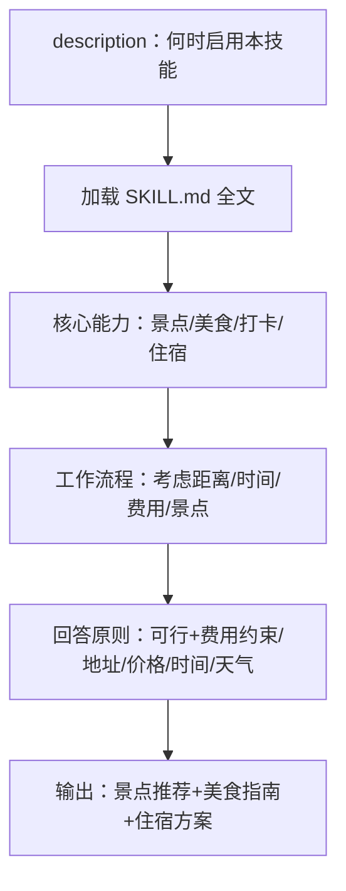

# 12-2 有限预算内规划精彩旅行的Skills

## 【学习目标】

- 掌握景点推荐技能的目录结构标准：`SKILL.md` + `Scripts` + `references` 三件套。
- 学会编写一份约束清晰的 `SKILL.md`：name、description、核心能力、工作流程、回答原则五要素。
- 理解 Skills 作为「固定工作流」而非「提示词片段」的本质差别。

## 【正文】

### 1. 从挂载到编写：技能的目录结构

上一节把 Skills 封装为 `AgentSkill` 对象，经 `SkillBox` 挂载到行程规划智能体，创建了两个技能：景点推荐技能与表格制作技能，均放在 `resources` 下的 `skills` 文件夹中，一个技能一个文件夹：

```java
AgentSkill SuggestSightsSkill = repo.getSkill(name: "Suggest-Sights");
AgentSkill MakeATableSkill = repo.getSkill(name: "Make_A_Tab");
skillBox.registerSkill(SuggestSightsSkill);
skillBox.registerSkill(MakeATableSkill);
```

按原稿如实说明：此处的技能名（`Suggest-Sights` / `Make_A_Tab`）与 12-1 文档示例中的 `Suggest_Sights` / `Make_A_Table` 不一致，按原稿保留；实际项目中技能名应以 `SKILL.md` 的 `name` 标签为准，并保持全文统一。

这条「不一致」本身就是一个提醒：技能名在「文件夹名、`SKILL.md` 的 name、`getSkill(name)` 参数」三处出现，任何一处漂移都会导致加载失败。可靠做法是只维护一个源头（`SKILL.md` 的 name），其余两处从它派生，避免手工抄写出偏差。

本节聚焦景点推荐技能，看它的 `SKILL.md` 该如何编写。

### 2. 景点推荐技能的三件套

景点推荐技能文件夹下有三个组成部分：

| 组成 | 是否必须 | 职责 |
|---|---|---|
| `SKILL.md` | 必须 | 技能的主文件，含 `name` 与 `description` 两个必须标签；`name` 必须与文件夹名相同 |
| `Scripts/` | 可选 | 存放脚本文件，如调用高德地图、墨迹天气 API 查询天气的 Python 脚本 |
| `references/` | 可选 | 存放知识类参考文件，如酒店信息；技能执行时可从中读取资料 |

三者的分工可以概括为：`SKILL.md` 定义「怎么做」，`Scripts` 提供「能做什么」，`references` 补充「知道什么」。

目录命名上遵循同一套约定：技能文件夹名 = `SKILL.md` 的 `name` 值，子目录用固定的 `Scripts` / `references` 名称。约定统一后，`FileSystemSkillRepository` 才能按同一套规则扫描与寻址，新增技能只需往 `skills` 文件夹里加一个目录，不需要改任何加载代码。

课程中用一个注释块回顾了注册相关的背景：

```java
/*
 * 1. AgentScope框架自带了注册中心：AgentScopeA2aServer
 * 2. AgentScope框架智能体卡片注册到注册中心，有2种方案：
 *    a. 通过SpringBoot，以Bean的形式自动注册。
 */
```

按原稿如实说明：该块为注释摘录，对应 11-2「Bean 形式自动注册」的注册方案回顾，原稿以注释形式保留，此处按原样呈现。

### 3. SKILL.md 的五要素

`SKILL.md` 的编写围绕五个要素展开：

**（1）name**：必须，且必须与技能文件夹名称相同。这是按名加载的寻址依据。

**（2）description**：必须，描述技能的用途。景点推荐技能的 description 写的是：在有限的预算内规划出一个精彩的旅行体验。description 同时是模型判断「何时启用该技能」的判据，第 10 章讲过渐进式加载：先读 description 决定是否加载，再读全文，因此 description 必须写清适用场景，而不是一句「景点推荐」。

**（3）核心能力**：课程给出四项，

| 序号 | 核心能力 | 要点 |
|---|---|---|
| 1 | 免费景点推荐 | 自然风光、历史古迹；提供最佳游览时间与避开人群的时间 |
| 2 | 美食推荐 | 当地特色小吃餐厅；性价比优先；分享本地人常去的隐秘餐厅 |
| 3 | 打卡点推荐 | 网红打卡点、拍照胜地；小众但出片的秘密景点 |
| 4 | 住宿建议 | 经济型、舒适型两种住宿方案 |

**（4）工作流程**：Skills 不是单纯的提示词，而是一整套固定流程（10-2、10-3）。景点推荐技能的流程分两步：先充分考虑距离、时间、费用、景点等因素，再输出方案，方案包含景点推荐、美食指南与住宿方案。原稿同时指出：更精细的流程还应了解用户的爱好偏好（需要查数据库或由用户提供信息），本课为控制复杂度暂不展开。

**（5）回答原则**：约束模型输出边界，避免漫无边际，第一，回答必须考虑可行性与费用约束；第二，提供具体地址、价格区间、开放时间，列得清清楚楚；第三，结合当时天气预报（下雨或晴天）给出适当建议。

四条核心能力与回答原则之间是互为约束的关系：能力定义「可以推荐什么」，原则限定「必须写到什么程度」。例如美食推荐若只给店名不给价格区间，就违反了原则中的可验收项；住宿建议若只给一档方案，则没有完整覆盖「经济型 + 舒适型」的能力约定。编写时把两边的词表对齐，输出质量才稳定。



### 4. Skills 与 MCP 的分工

3-8 讲过「Agent Skills + MCP」是工具调用的最强组合，两者的分工在本技能的文件结构上体现得很直观：

| 维度 | Agent Skills | MCP |
|---|---|---|
| 载体 | 本地文件（SKILL.md / Scripts / references） | 远程服务端（百度地图 MCP 等） |
| 提供什么 | 专业知识、固定流程、回答约束 | 可执行的远程工具 |
| 加载方式 | 渐进式：先 description，后全文 | 一次性拉取工具列表 |
| 典型问题 | 「这件事该按什么步骤做」 | 「该类数据从哪里实时获取」 |

景点推荐技能中，Scripts 里的天气脚本与 MCP 工具（如 `map_weather`）存在功能重叠，差异在于归属：技能脚本随技能分发、自包含；MCP 工具由服务端统一维护、跨技能复用。实际项目按「是否跨技能复用」来选择放哪边。

### 5. 五要素之间的依赖关系

五个要素不是简单并列，存在一条递进链：`name` 解决「找得到」，`description` 解决「选得中」，核心能力解决「做什么」，工作流程解决「按什么顺序做」，回答原则解决「做到什么程度算合格」。任何一环缺失，下游都会失控，没有回答原则，输出会漫无边际；没有工作流程，四项能力会被随意堆砌而非组织成方案。

这种结构化的另一层价值是可测试：回答原则中的「具体地址、价格区间、开放时间」都是可验收项，技能上线后可以逐条核对输出是否达标，而不是靠人工通读判断好坏。技能迭代时 likewise 有了回归基线，改一版 `SKILL.md`，用同一组需求跑一遍，对照原则逐项检查，就能判断改动是提升还是倒退。

## 【易错点 / 面试题】

1. **`name` 与文件夹不同名会怎样？** 按名加载直接失败或返回空，与 12-1 同一处坑：改文件夹名或改 `name` 标签，两边必须一致。
2. **description 写多长合适？** 没有硬性长度要求，但必须写清适用场景。渐进式加载下，description 是模型决定「要不要启用该技能」的唯一信号，写得太泛会导致技能被误触发或不被触发。
3. **面试题：`references` 与 `Scripts` 如何分工？** `references` 是被检索的知识（酒店信息等静态资料），`Scripts` 是可执行动作（调天气 API）；一个补「知道什么」，一个补「能做什么」。Skills 通过这种「文档 + 资源 + 脚本」的结构，把专业知识固化成可复用的工作流。
4. **面试题：一份合格的 `SKILL.md` 编写清单是什么？** 五要素逐项核对：name 与文件夹同名；description 写清适用场景；核心能力逐条列全（景点、美食、打卡、住宿四项）；工作流程明确步骤与输出物；回答原则给出可验收的约束（费用、地址、价格区间、开放时间、天气）。缺任何一项，模型的执行边界就会漂移。

## 【小结】

本节拆解了景点推荐技能的目录结构与 `SKILL.md` 五要素，Skills 从「挂载机制」落实到「内容编写」。核心结论有三：技能是文件夹而非单文件，`SKILL.md` 是唯一必须的主文件；`name` 与文件夹同名是加载的硬约束；description、核心能力、工作流程、回答原则四者把「何时用、做什么、按什么顺序做、做到什么程度」全部固化。第 12 章后续将把技能真正接入行程规划智能体的执行链路。在 `981-demo` 工程中，`com/travel/agent/agent/TeamMembers.java` 的 `attractionAgent` 与 `com/travel/agent/tool/AttractionTools.java` 是同类能力的最小落地：`sysPrompt` 承载「怎么做」的知识，`search_attractions` 工具承载「用什么」的能力，与课程中 `SKILL.md` + 工具的双轨结构一一对应。
