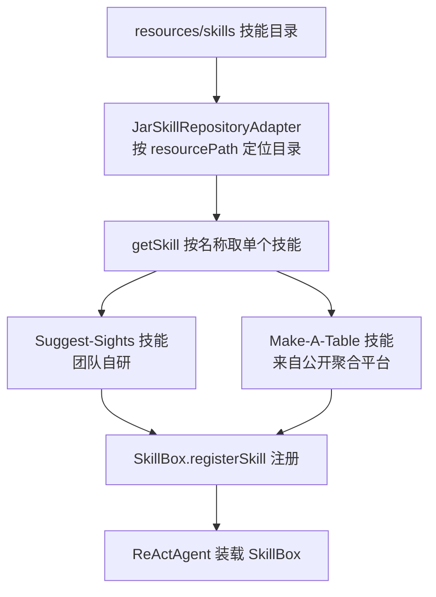

# 12-3 表格制作Skills

## 【学习目标】

- 讲清 SkillBox 从 resources 资源目录装载技能的完整流程，以及 ClasspathSkillRepository 与 JarSkillRepositoryAdapter 两个装载器的版本差异。
- 掌握从公开技能聚合平台获取现成技能的方法，理解 skill.markdown 中 name、description、核心能力为什么不能为空。
- 能够独立把一个第三方表格制作技能接进旅游规划智能体，并判断哪些技能自研、哪些直接复用。

## 【正文】

### 1. 本节要解决的问题

12-1 节创建了挂载 Skills 的行程规划经理 Agent，12-2 节为它装上「有限预算内规划精彩旅行」技能。到这里，行程规划智能体手里只有一个自研技能，它懂得怎么省钱，却不知道如何把结果交付成一份像样的表格。用户要的不是一段零散建议，而是能看、能存、能转发的结构化产出。本节补上第二块技能：表格制作。

技能装载的入口统一收敛在 SkillBox。前面课程演示过以文件形式读取 Skill.md；本节的变化在于，skills 文件夹位于 resources 资源目录之下，需要换一个专门从类路径资源仓库加载的装载器。

### 2. 两个装载器的版本差异

课程文档给出的推荐写法，是从资源仓库加载全部技能：

```java
ClasspathSkillRepository repository = new ClasspathSkillRepository("skills") {
    AgentSkill> allSkills = repository.getAllSkills();
};
```

需要如实说明：原稿该代码块存在转写残缺，`AgentSkill>` 缺少泛型左尖括号与类型参数，外层花括号的配对也不符合正常 Java 语法，判断为字幕转写丢字所致。此处按原稿照录，不对代码块内部做任何改动。按文档语义，这段代码想表达的是：用仓库对象扫描 skills 目录下的全部技能，返回技能集合。

版本差异才是本节真正的坑：

| 装载器 | 版本归属 | 加载来源 | 在 1.0.8 工程中的可用性 |
|---|---|---|---|
| ClasspathSkillRepository | 1.0.9 新增 | 类路径资源仓库 | 不可用，尚无此类 |
| JarSkillRepositoryAdapter | 1.0.8 已有 | 资源仓库（当前项目所用） | 可用，但已标记废弃，1.0.9 起移除 |

当前工程锁定 1.0.8，只能使用 JarSkillRepositoryAdapter；代价是它已处于废弃状态，未来升级 1.0.9 必须同步换类并回归验证。这类「文档超前于锁定版本」的情况在多 Agent 工程里反复出现：文档永远只写最新版，工程却被依赖树锁死。稳妥解法是锁定版本、记录迁移点、升级时单独验证，而不是照文档硬写导致编译失败。

### 3. 装配两个技能

```java
// 构建Skill
SkillBox skillBox = new SkillBox();

// 以文件形式读取Skill.md
JarSkillRepositoryAdapter repo = new JarSkillRepositoryAdapter(
    resourcePath: "skills"
);

// 景点推荐技能
AgentSkill SuggestSightsSkill = repo.getSkill(skillName: "Suggest-Sights");

// 表格制作技能
AgentSkill MakeATableSkill = repo.getSkill(skillName: "Make-A-Table");

skillBox.registerSkill(SuggestSightsSkill);
skillBox.registerSkill(MakeATableSkill);
```

同样如实说明：代码块中的 `resourcePath: "skills"` 与 `skillName: "Suggest-Sights"` 是字幕转写把 IDE 的具名参数提示一并录进来的结果，真实代码里它们是构造参数与位置参数，不会以这种语法出现。代码块按原稿保留。

装配逻辑可以拆成三步：建仓库，告诉装载器技能目录在哪；按名取技能，getSkill 以技能名为索引，名称必须与 skill.markdown 中声明的 name 严格一致；注册进 SkillBox，由 SkillBox 统一托管。两个技能一个自研（景点推荐）、一个外取（表格制作），来源不同，装配方式却完全相同，这正是 Skill 机制的价值：技能的生产方式对装载层透明，自研与复用走同一条路。



### 4. 表格制作技能从哪来：不重复造轮子

表格制作、PDF 处理、浏览器操作这类技能属于通用办公能力，业界已有成熟实现，课程明确建议直接复用。获取渠道是各类 Skills 聚合平台，原稿演示的站点内可以按关键词搜索，找到合适的技能直接下载。

以表格制作为例，下载下来的技能只有两个文件：

- skill.markdown：技能的身份证，描述名称、能力与用法，必须存在；
- xlsx 操作脚本：课程演示的版本是一段 Python 脚本，负责真正干活。

把这两个文件复制进项目的表格制作技能文件夹，装配即告完成。第三方技能之所以「拿来即可用」，是因为 Skill 标准只约束元信息格式，不约束实现语言，Python 脚本、Shell 脚本、Java 代码都可以作为技能资源存在，运行期按需加载执行。

复用第三方技能也并非零成本。脚本来自外部仓库，接入前应人工评审其文件读写范围与网络行为，确认不会越权访问宿主机资源；技能版本也要纳入管理，上游更新后需要回归验证。把外部技能当供应链组件对待，是团队协作的基本纪律。

从 10-5 节的技能文件结构标准回头看，skills 文件夹下每个技能对应一个子目录：skill.markdown 承载元数据，脚本与资源按需同目录存放。装载器只认该结构，不关心技能来自谁，自研技能与平台下载的技能在目录层面完全同构，把一个子目录拷到另一个项目的 skills 下即可复用。这种「文件夹即交付物」的形态，是技能得以流通的前提：它不依赖编译产物，也不限定实现语言，拷贝加改路径就能运行。

### 5. skill.markdown 为什么必须写全元信息

表格制作技能的 Python 脚本如下，从聚合平台原样复制：

```python
import pandas as pd

# Read Excel
df = pd.read_excel('file.xlsx')  # Default: first sheet
all_sheets = pd.read_excel('file.xlsx', sheet_name=None)  # All sheets as dict

# Analyze
df.head()      # Preview data
df.info()      # Column info
df.describe()  # Statistics

# Write Excel
df.to_excel('output.xlsx', index=False)
```

脚本能力分三组：读 Excel（默认第一个工作表，sheet_name=None 时以字典返回全部工作表）、预览与统计分析（head、info、describe）、写回 Excel（index=False 去掉行索引）。课程特别强调：skill.markdown 必须写全 name、description 与核心能力，内容为空会直接报错。

原因要从渐进式加载机制倒推。智能体启动时并不会加载技能里的脚本，只加载元信息；description 与核心能力描述是智能体判断「什么任务该派给哪个技能」的唯一依据，相当于技能的黄页条目。黄页为空，智能体既检索不到也无法决策，机制上就不允许这种技能存在。该技能的核心能力描述为：创建表格、编辑表格、数据分析、格式设计，面向 xlsx 格式文件与 CSV 表格。描述写得宽，触发条件就宽，行程规划链路上任何「把结果整理成表」的诉求都可能命中它。

放到整章里看，12-1 节让行程规划经理拥有了「装载技能」的能力，12-2 节验证了第一个自研技能，本节补齐第二个技能并打通「外部获取」这条来源。至此技能的两个来源，自研与复用，都跑通了，12-4 节才能在其上讨论更共性的问题：技能数量增长之后，工具如何按需加载。

### 6. 与 981-demo 的对应关系

981-demo 未引入 AgentScope 的 SkillBox 机制，而是把技能拆成不可再分的两个成分落地：

- 工具资源对应 `981-demo/src/main/java/com/travel/agent/tool/AttractionTools.java`：search_attractions 工具用 @Tool 注解声明名称与描述，等价于技能里那段真正干活的脚本；
- 专业知识与工作流程对应 `981-demo/src/main/java/com/travel/agent/agent/TeamMembers.java` 中景点推荐成员的系统提示词：「你是景点推荐专员，调用工具检索景点并给出推荐。」

该映射印证了 10-3 节的结论：Skill 装载的三样东西，专业知识、工作流程、工具资源，在工程上可以有不同封装形式，SkillBox 只是其中一种标准化封装。读博客与跑工程相互对照，才能看清机制与实现之间的距离。

## 【易错点 / 面试题】

1. **版本错配坑**：文档推荐 ClasspathSkillRepository，工程锁定的 1.0.8 里还没有该类，照文档硬写会直接编译失败。正确顺序是先确认依赖树里的实际版本，再选装载器，并记录升级迁移点。
   - 面试题：「Skill 的元信息缺失会怎样？」，渐进式加载下智能体只凭元信息检索与决策，元信息缺失等于技能不可发现、不可触发，加载阶段即报错。
2. **技能名不一致坑**：getSkill 按名称索引，代码传入字符串与 skill.markdown 声明的 name 差一个连字符都会取不到技能。建议全工程统一命名，自研技能用 Suggest-Sights，外取技能保持平台原始名 Make-A-Table，避免改名引入偏差。
3. **面试题：「技能里为什么能放 Python 脚本？」**，Skill 标准对实现语言不做约束，脚本是运行期按需加载的资源，而非编译期依赖；这与上下文窗口的取舍是同一套机制的两面：不命中就不加载，不加载就不占窗口。

## 【小结】

本节把第二个技能表格制作装进 SkillBox：技能目录位于 resources 下，1.0.8 版本用 JarSkillRepositoryAdapter 装载；表格制作技能来自公开聚合平台，由 skill.markdown 加一段 pandas 脚本构成，无需自研。至此行程规划智能体持有景点推荐与表格制作两个技能，一自研一复用。下一节 12-4 转向更根本的问题：如何让智能体持有的工具按需加载，避免全部塞进有限的上下文窗口。工程侧的对应实现见 `981-demo/src/main/java/com/travel/agent/tool/AttractionTools.java` 与 `981-demo/src/main/java/com/travel/agent/agent/TeamMembers.java`。
