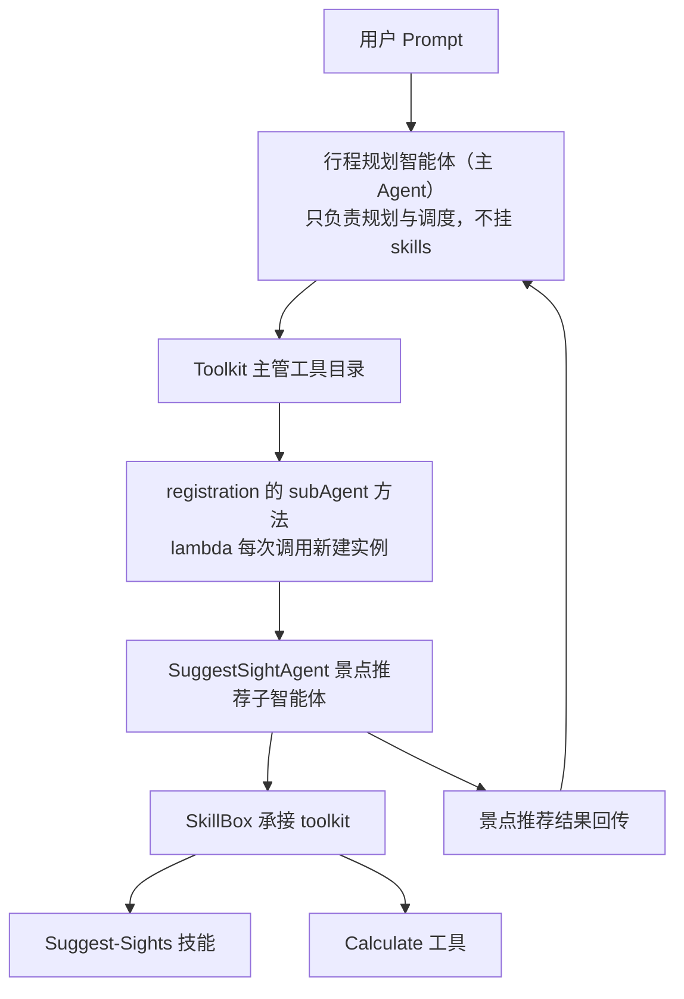

# 12-5 景点推荐SubAgent执行景点推荐任务

## 【学习目标】

- 理解把子智能体当作工具注册的机制：registerAgentTool、AgentTool 接口与 SubAgentTool 实现。
- 掌握 lambda 形式 toolkit.registration().subAgent(() -> new SuggestSightAgent()) 的必要性：每次调用创建新实例，避免状态污染。
- 完成景点推荐技能从主智能体到子智能体的迁移，理解职责边界与技能归属对齐的原则。

## 【正文】

### 1. 架构定位：主智能体与子智能体

在整体架构中，行程规划智能体处于主智能体的位置，它下面挂载若干子智能体，每个子智能体只负责执行一个单一任务：生成表格由一个子智能体完成，旅游景点推荐由另一个子智能体完成。本节实现最后一块拼图，把景点推荐任务下沉到一个独立的 SubAgent。

下沉的理由有三。其一，上下文卫生：技能挂在哪里，智能体的决策就要背着哪部分元信息；景点推荐技能留在主智能体上，主管每次规划都要额外背负不属于自己的领域描述。其二，提示词边界：主智能体的系统提示词只应关注规划与调度，混入景点领域知识会让角色漂移。其三，独立演化：子智能体可以单独更换模型、技能与提示词，不影响主链路。

### 2. Agent as Tool：注册机制

在 Toolkit（工具包）对象上，普通工具的注册走 register 系列方法；如果注册的是 MCP 工具，则使用另外一个专门注册 MCP 工具的方法，这是前面课程已经讲过的内容。除此之外，Toolkit 上还有一组以 register 开头的方法，其中 registerAgentTool 从命名就能看出用途：把智能体（agent）当作工具注册进工具包。这里被当作工具的智能体，正是子智能体，也就是 SubAgent。

```java
        public void registerAgentTool(AgentTool tool) {
            this.registerAgentTool(tool, (String)null, (ExtendedModel)null);
        }
```

registerAgentTool 接收的参数类型是一个接口 AgentTool。查看该接口的实现类可以看到 SubAgentTool 实现了它，因此构造子工具时直接 new SubAgentTool(...) 即可，构造时需要传入两个参数。

不过官方文档并不推荐这种直接 new 的写法，而是建议使用 lambda 形式，即 toolkit.registration().subAgent(() -> new SuggestSightAgent())。原稿以 Coordinator 与 Expert 的组合说明注册方式：

```java
        Toolkit toolkit = new Toolkit();
        ReActAgent mainAgent = ReActAgent.builder()
            .name("Coordinator")
            .build();
        ReActAgent expertAgent = ReActAgent.builder()
            .name("Expert")
            .sysPrompt("你是一个领域专家，负责回答专业问题。")
            .model(model)
            .build();
```

### 3. 为什么必须是 lambda

核心原因在于：lambda 能保证每一次调用都创建一个新的子智能体实例。若多个任务共享同一个 agent 实例，ReAct 循环内的消息历史与中间状态会互相污染，任务 A 留下的工具调用记录可能被任务 B 读到，轻则答非所问，重则状态错乱且难以复现。

子智能体在这里的定位是「一次性消耗品」：接受一个子任务，跑完一轮 ReAct 循环，返回结果，生命终结。lambda 的延迟实例化恰好匹配该生命周期，每次分发任务时才创建，用完即弃，实例间零共享。

这与 Web 开发里的经验同构：带会话状态的对象绝不能跨请求共享，全局单例只适合无状态服务。面试里聊到「子 Agent 要不要池化」，答案就在这里：不要，创建成本远低于状态污染的调试成本。

### 4. 技能迁移：归属与职责对齐

作为景点推荐子智能体，它理应拥有景点推荐的技能，因此原先挂在行程规划智能体上的景点推荐技能要整体剪切迁移到该子智能体里，技能的归属应当与职责边界保持一致。MakeATableSkill（表格制作）暂时注释掉，本轮只处理景点推荐这一条链路，多链路并行留待后续。迁移过去之后，景点推荐技能的方法签名上需要补一个 throws Exception，因为装载过程涉及资源读取。

技能迁移完成后，把它挂载到景点推荐智能体上；同时在子智能体内部创建一个 Toolkit，让工具包与技能组合起来一并挂载到该智能体上：

```java
        SkillBox skillBox = new SkillBox(toolkit);
        JarSkillRepositoryAdapter repo = new JarSkillRepositoryAdapter();
        repo.resourcePath = "skills";
        AgentSkill SuggestSightsSkill = repo.getSkill(skillName: "Suggest-Sights");
        skillBox.registerSkill(SuggestSightsSkill);
        skillBox.registration().tool(new Calculate());
    ```

如实说明：第三行 repo.resourcePath = 「skills」 与 12-3 节的构造参数写法不同，属同一转写来源的不同呈现；getSkill 实参的 skillName: 前缀同为 IDE 具名参数提示的转写残留；末行右花括号单独缩进，判断为代码块截取时的边界残留。代码块按原稿保留。注意 SkillBox 构造直接承接 toolkit，工具包与技能在子智能体内部组合，再整体挂载到该智能体上。行程规划智能体作为主智能体，本身不需要再挂载任何 skills，它只负责规划与调度。

### 5. 把子智能体挂回主智能体

最后回到行程规划智能体的装配方法，把创建出来的景点推荐子智能体引出来。由于创建过程会抛异常，这里用 try...catch 的形式包住，在 catch 中处理异常，并加上 @Bean 注解，把行程规划智能体交给 Spring 容器管理：

```java
        toolkit.registration().subAgent(
            () -> new SuggestSightAgent()
        );
```

至此整条链路成型：子智能体作为 agent tool 注册进工具包，工具包挂载到行程规划智能体；行程规划智能体是主智能体，其下有一个子智能体，景点推荐智能体，而景点推荐智能体上挂载着景点推荐技能。这就是本节要实现的完整流程。

关于 try...catch 的处理策略：catch 中至少要做两件事，记录完整异常栈，便于区分是技能目录缺失还是脚本加载失败；以及让启动快速失败，而不是带着一个半成品子智能体继续跑。子智能体创建失败而主智能体照常启动，会把问题推迟到用户请求时才爆，排查成本高出一个量级。

子智能体内部同样是一个 SkillBox 承接 toolkit 的结构，因此 12-4 节讲的渐进式加载在子智能体层面原样生效：景点推荐技能的脚本资源只在命中时才加载。技能下沉并没有削弱加载机制，只是把加载的单位从「主智能体」细化到「子智能体」，粒度更细，上下文更干净。



### 6. 与 981-demo 的对应关系

981-demo 把这条链路落成了四个文件：

- `981-demo/src/main/java/com/travel/agent/agent/TeamMembers.java` 的 attractionAgent：景点推荐 SubAgent 的 Bean 化落地，name 为 AttractionAgent，系统提示词为景点推荐专员，Toolkit 挂 AttractionTools；
- `981-demo/src/main/java/com/travel/agent/tool/AttractionTools.java`：search_attractions 工具按城市与偏好返回景点，对应景点推荐技能的「工具资源」部分；
- `981-demo/src/main/java/com/travel/agent/agent/SupervisorTools.java` 的 askAttraction：@Tool(name = 「ask_attraction_agent」)，即 Agent as Tool 在 Spring 侧的等价形态，主管把「问景点专员」当作一枚工具来调用；
- `981-demo/src/main/java/com/travel/agent/agent/SupervisorAgent.java` 的系统提示词内置路由规则：涉及景点、游玩交给 ask_attraction_agent。

离线模式下 OfflineChatModel.singleToolThenAnswer 让成员第一轮调用 search_attractions、第二轮汇总，行为与真实 ReAct 循环同构，子智能体作为工具被调用、用完即弃的生命周期，与课程 lambda 写法完全一致。

## 【易错点 / 面试题】

1. **共享实例污染**：直接 new 一个 SubAgentTool 后复用的写法，会让多个子任务共享同一实例的消息历史；必须用 lambda 保证每次调用新建实例。
2. **技能迁移不彻底**：景点推荐技能仍留在主智能体上，主智能体决策时背着不属于自己的领域元信息，提示词边界模糊，职责迅速腐化。
3. **面试题：「Agent as Tool 与 A2A 远程调用有什么区别？」**，前者是进程内把子 Agent 封装成工具，走本地方法调用，延迟低、共享内存，适合单体部署；后者是跨进程、跨服务的协议调用，经 AgentCard 发现加 JSON-RPC 提交，适合分布式部署。981-demo 中 `981-demo/src/main/java/com/travel/agent/a2a/A2aEndpointController.java` 暴露 /a2a/{agent} 端点，即把本地成员升级为可被远程主管调用的服务；进程内则走 SupervisorTools 直接 dispatch，两条路径在同一套代码里共存。

## 【小结】

本节把景点推荐任务下沉为独立 SubAgent：经 toolkit.registration().subAgent 以 lambda 形式注册，每次调用创建新实例避免状态污染；景点推荐技能随之从主智能体剪切到子智能体，职责边界与技能归属对齐；主智能体回归纯规划与调度。多 Agent 分工的拼图至此完整。后续 13 章进入工程化阶段：敏感资源外置、用户接口暴露、观测与 token 分析。工程侧的对应实现见 `981-demo/src/main/java/com/travel/agent/agent/TeamMembers.java`、`981-demo/src/main/java/com/travel/agent/agent/SupervisorTools.java` 与 `981-demo/src/main/java/com/travel/agent/tool/AttractionTools.java`。
