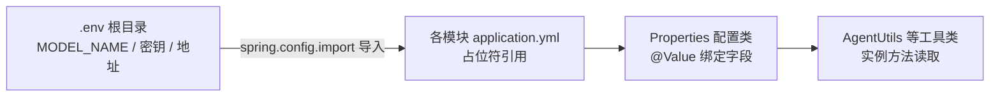

# 13-1 敏感资源处理方案

## 【学习目标】

- 把硬编码的敏感信息（DashScope API Key、百度地图 MCP 地址与 Key、模型名）抽离到根目录 .env，经 spring.config.import 接入各模块。
- 掌握 @Configuration 加 @Value 的配置承接方式，理解工具方法从 static 改回实例方法的必然性。
- 建立「密钥不进包、不进库」的工程纪律，并能在课程方案与 981-demo 方案之间做选型对比。

## 【正文】

### 1. 为什么要外置敏感资源

敏感资源的外置是项目功能全部跑通之后的第一项优化工作。当前代码中直接硬编码的敏感信息有三类：阿里千问大模型平台（DashScope）的 API Key、百度地图 MCP 的地址、百度地图的 API Key。这些信息随代码一起提交，风险显而易见：git 历史一旦写入便难以彻底清除，协作范围不可控，镜像分层里也能被提取。处理方式是把它们抽离到一个独立文件，让它不进入程序包，既不打进 jar 的 resources，也不出现在镜像层中。

### 2. .env 与变量清单

在项目根目录下建立 .env 文件，把敏感信息以变量的形式写进去：

| 变量 | 内容 | 消费方 |
|---|---|---|
| MODEL_NAME | 当前所使用的大模型名称 | 各智能体模块 |
| ALIBABA_DASHSCOPE_KEY | 阿里云 DashScope 密钥 | 主管 Agent 及各成员 |
| BAIDU_MAP_ADDR | 百度地图 MCP 服务端地址 | 路线制定模块 |
| BAIDU_MAP_KEY | 百度地图 API Key | 路线制定模块 |

变量命名遵循「归属加用途」的前缀约定：ALIBABA_ 开头归阿里云，BAIDU_ 开头归百度地图，MODEL_NAME 这类全局项不加前缀。命名一致的目的是让消费方一眼看出该找谁要值，多模块协作时减少反复确认的沟通成本。

### 3. application.yml 如何引用这些变量

配置文件如何引用这些变量？以主管 Agent 模块为例，在它的 application.yml 里以占位符的形式引用即可，比如 agent.model_name 写 ${MODEL_NAME}：

```yaml
    server:
      port: 8182

    spring:
      config:
        import: optional:file:.env.properties

    agent:
      model_name: ${MODEL_NAME}
      alibaba_dashscope_key: ${ALIBABA_DASHSCOPE_KEY}

    mcp:
      baidu_map_addr: ${BAIDU_MAP_ADDR}
```

agent.alibaba_dashscope_key 写 ${ALIBABA_DASHSCOPE_KEY}，mcp.baidu_map_addr 写 ${BAIDU_MAP_ADDR}。application.yml 之所以能感知到 .env 的存在，靠的是 spring.config.import 把外部文件导入进来（形如 optional:file:.env.properties）。这一行不能漏，漏掉之后 application.yml 就找不到 .env，占位符自然解析不出来。

含 a2a 与 nacos 的完整配置如下，端口 8182 为原稿所示；多节点部署时的端口分配以 13-2 节为准（主管 8081、路线制定 8082、行程规划 8085、Nacos 8848）：

```yaml
    a2a:
      server:
        enabled: true
      nacos:
        server-addr: localhost:8848

    agent:
      model_name: ${MODEL_NAME}
      alibaba_dashscope_key: ${ALIBABA_DASHSCOPE_KEY}

    mcp:
      baidu_map_addr: ${BAIDU_MAP_ADDR}
      baidu_map_key: ${BAIDU_MAP_KEY}
```

对 optional: 前缀的语义需要准确理解：它只保证「文件缺失时导入这一步本身不报错」，并不代表占位符能解析到值。一旦 .env 缺失而配置项又被消费，启动阶段会在属性绑定处才失败，错误被推迟且更隐蔽。生产环境应把「.env 缺失」视为故障，而非静默降级。

其余模块的配置方式完全相同：行程规划模块、路线制定模块，都要在各自的 application.yml 里配上这些占位符，并且同样补上导入配置，否则该模块就不知道 .env 文件的存在。



### 4. common 模块的特殊性

程序内部如何读取这些配置？以 common 模块为例。common 模块承载的是工具类，智能体的创建就在该模块里完成。需要注意的是，common 模块本身不需要配置文件，它连 resources 文件夹都没有，因为它会被嵌入到主管智能体模块、行程规划模块、路线制定模块中，运行时读取的是这些宿主模块的配置文件，所以 common 不必维护自己的 application.yml。给 common 建配置文件属于无效劳动：它从不作为独立应用启动，写了也不会被读取。

### 5. 配置类承接：@Configuration 加 @Value

在 common 模块下建立配置文件夹并新建配置类，类上加 @Configuration 注解，以便后续注入到各业务模块。类内部通过 @Value 注解把配置项绑定到私有字段上：

```java
    @Getter
    public class Properties {
        @Value("${agent.model_name}")
        private String modelName;

        @Value("${agent.alibaba_dashscope_key}")
        private String alibabaDashscopeKey;

        @Value("${mcp.baidu_map_addr}")
        private String baiduMapAddr;
    }
```

三个字段分别对应 modelName、alibabaDashscopeKey、baiduMapAddr，字段绑定完成后补上 getter 方法。如实说明：原稿代码块以 @Getter 起始，未包含类头的 @Configuration 注解、包名与 import 行，按正文描述该类应为 @Configuration 类；代码块按原稿保留。

### 6. static 改实例：本节最隐蔽的改动

调用侧以智能体创建工具类为例：把 Properties 注入进来，通过注入的对象调用 getter 拿到这些敏感配置，一次调用链就完整了。

```java
    public class AgentUtils {
        @Resource
        private Properties properties;

        // 从配置中读取敏感资源，不能使用static
        // 创建ReAct Agent Builder
        @param name: description
        @return io.agentscope.core.ReActAgent.Builder
    }
```

如实说明：代码块末尾两行 @param 与 @return 是 Javadoc 注释的转写残留，照原稿保留。

这里有一个必须注意的改动：前面课程中的工具方法一律是 static 静态方法，而现在因为要通过 @Value 注解从配置中读取敏感信息，这些方法就不能再声明为 static。Spring 的依赖注入只对容器管理的实例生效，静态方法不参与注入，配置就读不进来。因此要把此前写成静态的工具方法逐一改回实例方法，否则运行时取到的一律是空值，而且这类故障在编译期毫无迹象，只在运行期以空配置或 NPE 的形式爆发，是典型的「静态与依赖注入不兼容」案例，面试中被问到的频率极高。

### 7. 与 981-demo 的对照

`981-demo/src/main/java/com/travel/agent/config/AgentProperties.java` 用 @ConfigurationProperties(prefix = 「app.agent」) 批量绑定同类配置：model-mode、model-name、discovery、nacos-server-addr。application.yml 中默认 offline 模式不触网、不填 Key 即可跑通全链路；切换到真实模型时，Key 走环境变量而不落配置文件。相比 @Value 逐字段绑定，@ConfigurationProperties 在配置项成组时更集中，还能获得 relaxed binding 与 IDE 元数据提示；课程采用 @Value，是用最小改动把沿用多讲的 static 工具方法迁移到注入世界。两种方式解决同一个问题，选型看配置规模。

## 【易错点 / 面试题】

1. **static 陷阱**：把注入读取配置的方法保留为 static，Spring 不会报错，但运行期注入静默失效，取到的全是空值。判断标准很简单：凡是要用注入 Bean 的地方，方法就不能是 static。
2. **给 common 模块建配置文件**：common 没有 resources 文件夹，也不独立启动，配置写了不读；配置文件只属于宿主模块。
3. **面试题：「@Value 与 @ConfigurationProperties 怎么选？」**，零散单项用 @Value；成组配置、需要 relaxed binding 与类型安全用 @ConfigurationProperties。再追一层：「.env 为什么不能打进包、不能提交仓库？」，密钥随制品分发即视为泄漏，.gitignore 必须排除 .env，CI 用环境变量注入，本地用不提交的 .env，三处齐了才算闭环。
4. **文件名不一致坑**：原稿把外部文件创建在根目录的 .env，spring.config.import 里导入的却是 .env.properties，两者并非同一个文件名；此处按原稿照录。工程上必须保持创建文件与导入路径一致，否则 optional 前缀会让「文件缺失」被静默跳过，占位符拖到属性绑定处才报错，排查时极易被文件名这一环带偏。

## 【小结】

本节完成敏感资源外置：根目录 .env 存放真实密钥，各模块 application.yml 经 spring.config.import 导入并以占位符引用，common 模块用 @Configuration 加 @Value 的配置类承接，业务工具类从 static 改回实例方法完成注入读取。密钥从此不进包、不进库。下一节 13-2 在这套干净配置之上，为主管 Agent 暴露与用户交互的 Web 接口。工程侧的对应实现见 `981-demo/src/main/java/com/travel/agent/config/AgentProperties.java`。
