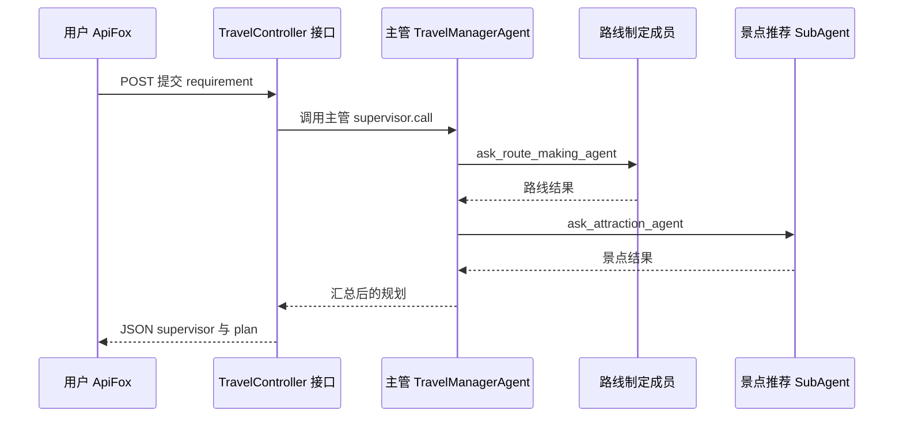

# 13-2 主管Agent暴露和用户交互的接口

## 【学习目标】

- 为多 Agent 系统建立唯一用户入口：主管 Agent 的 Web API，理解入口收敛的架构意义。
- 掌握 @RestController 加 @Bean 装配的最小实现，避开承载智能体的类漏加 @Component 的坑。
- 记住多节点端口分配，并能用 ApiFox 完成「接口通、配置读到」的联调验证。

## 【正文】

### 1. 为什么入口收敛到主管 Agent

用户与整套智能体系统的交互入口是主管 Agent 节点，因此主管 Agent 需要对外暴露一个 Web API 接口，让用户以 HTTP 请求的方式提交旅游规划的 Prompt。

背后的路线制定、行程规划、景点推荐有哪些成员、各自暴露什么能力，那是主管的发现与分发职责，用户无感。接口的职责边界因此非常窄：接收 Prompt、触发主管运行、返回结果。之后的整个旅游规划过程，任务分解、分发给远程成员、汇总结果，全部由智能体自主推进，用户不再参与其中。单一入口的收益在后续章节会持续兑现：成员增减不改变用户侧契约，鉴权、限流、审计只需在一个横切点布防。

### 2. 最小实现

在主管 Agent 模块下新建 controller，类上标注 @RestController，然后在其中定义接口方法并声明请求地址。接口方法的实现只有两步：创建主管智能体实例，然后让它开始运行。

```java
        @RestController
        public class ManagerAgentController {
            @Resource
            private ManagerAgent managerAgent;

            @RequestMapping(value = "/trip", method = RequestMethod.POST)
            public void tripPlan() {
                ReActAgent manager = managerAgent.getManagerAgent();
                managerAgent.run();
            }
        }
```

如实说明：tripPlan() 未声明请求参数（原稿如此，照录）；实例化那行取出 manager 变量后，下一行调用的却是 managerAgent.run()，变量未被使用，判断为讲演现场的示意写法。代码块按原稿保留，不做改动。

### 2.5 接口契约的三个待填坑

课程版接口刻意留了三处空白，读的时候应把它们当作待办而非终点：

其一，请求体。tripPlan() 没有参数，用户提交的 Prompt 从哪来？13-5 节会建立 PromptSchema 约束 JSON 提交格式，并显式指定 UTF-8，用户 Prompt 是中文，编码不写明就会乱码。

其二，响应体。void 意味着调用方拿不到任何结构化结果，只能去控制台看日志；生产接口必须返回可消费的数据。13-5 节的 ResponseSchema 与 981-demo 的 Map 返回，都是对这一项的补齐。

其三，执行语义。run() 之后接口立即返回，规划结果在服务端推进。旅游规划涉及多轮模型调用，同步阻塞的代价是连接长占用，异步化或流式化是生产演进的方向。

三处空白在后续章节逐一填上，本节先立骨架，这正是增量式工程推进的常见节奏：先让链路端点存在，再逐段补厚。

### 3. @Component 坑

还有一个容易踩的坑：承载智能体的类需要加上 @Component 注解，把它注册成 Spring 容器中的 Bean，controller 里才能正常注入进来。少了该注解，运行期会直接报注入失败。症状通常是启动时或首次请求时抛出 NoSuchBeanDefinitionException，根因是容器外 new 出来的对象没有依赖注入生命周期，@Resource 无处可取。

根因值得多说一句：智能体对象交给容器管理，除了能被注入，还有一层收益，它自身的依赖（配置、工具、模型参数）同样可以注入，装配逻辑集中在一处，而不是散落在各个 new 的位置。单例共享在这里是安全的：ReActAgent 本身不持有会话状态，状态在每次调用的消息里。这与 12-5 节子智能体「每次新建」的取舍恰好互补，无状态的才配做单例，有状态的必须每次新建。

### 4. 多节点端口分配

多节点部署时端口分配必须区分开：

| 节点 | 端口 | 职责 |
|---|---|---|
| 主管智能体 | 8081 | Prompt 入口，用户请求的唯一地址 |
| 路线制定智能体 | 8082 | 路线规划 |
| 行程规划智能体 | 8085 | 行程规划 |
| Nacos | 8848 | 注册中心（1-5 节安装时确定） |

每个节点各占一个端口，避免启动冲突。端口规划应在项目初期就定稿并文档化，多 Agent 项目的节点数量只增不减，临时分配必然撞车。

### 5. 联调验证

配置就绪后启动主管 Agent 应用。原稿在此处给出启动类，其中 main 方法签名上的 throws NacosException 按原稿保留，此处未展开其来源：

```java
        @SpringBootApplication(scanBasePackages = {"com.imoooc"})
        public class ManagerAgentApplication {
            public static void main(String[] args) throws NacosException {
                SpringApplication.run(ManagerAgentApplication.class, args);
            }
        }
```

scanBasePackages 显式指定扫描路径。多模块项目里，这一项常与「Bean 扫不到」的故障相伴，模块拆分后基础包名不一致时，它是第一排查点。

回到 ApiFox 的旅游规划接口，通过该端口发起请求并点击发送。请求返回没有报错，控制台中已经打印出 API Key 以及主管 Agent 所使用的大模型（原稿转写为 qwen3-max，断句跨段所致），说明上一节做的敏感信息外置方案生效了，.env 中的配置被成功读取。

请求到这里就停住了，没有继续往下执行。原因在于接口方法里调用智能体运行的那行代码当前并未继续执行。本节的验证目标，接口能通、配置能读到，已经达成，主管 Agent 与用户交互的接口就算打通了。后续章节会继续把执行链补厚：13-5 节补齐请求体与结构化输出，13-7 节验证主管自动生成 Prompt 驱动远程成员。这种「先验证链路端点、再逐段推进执行」的节奏，是多节点联调的常规打法：每一层只确认自己这一层的契约，故障域就被切成一段一段。

### 6. 与 981-demo 的对应关系

`981-demo/src/main/java/com/travel/agent/web/TravelController.java` 是同一职责的生产化落地：@RestController 加 @RequestMapping(「/api/travel」)，POST /plan 接收 @RequestBody 中的 requirement 字段，调 supervisor.call(...).block() 同步等待主管完成，返回包含 supervisor、requirement、plan 的结构化 JSON；GET /members 则列出当前发现的团队成员，把 11-3 节的「获取团队成员」也做成了可观测端点。

与课程的 ManagerAgentController 相比，TravelController 有三处刻意差异：入参显式化（requirement 字段而非空方法）、返回结构化数据（Map 而非 void）、同步阻塞等待（block()），生产接口必须能被调用方消费，void 加无参只够讲台演示。

`981-demo/src/main/java/com/travel/agent/agent/SupervisorAgent.java` 提供注入的 travelManagerAgent Bean，系统提示词内置分发规则；`981-demo/src/main/java/com/travel/agent/a2a/A2aEndpointController.java` 则把成员暴露为 A2A 端点：GET /a2a/{agent}/.well-known/agent.json 做能力发现，POST /a2a/{agent} 以 JSON-RPC message/send 提交任务，远程主管（含其他容器）据此调用本地成员。课程的多节点端口分配，在 981-demo 中收敛为单机 8080 加 docker-compose 编排（agent-app 映射 8080，nacos 映射 8848）。



## 【易错点 / 面试题】

1. **@Component 遗漏**：承载智能体的类未注册为 Bean，controller 注入即失败，报错发生在运行期而非编译期。
2. **端口冲突**：多节点同端口必挂；Nacos 的 8848 不能与任何智能体节点重复。端口表应在项目初期定稿。
3. **面试题：「为什么把用户入口收敛到主管 Agent，而不是每个成员都暴露接口？」**，单一入口让用户无感知内部拓扑；成员增删不改用户侧契约；鉴权、限流、审计只需一个横切点。补充一点：成员端点并非不能暴露，而是暴露给系统内部的远程主管消费，与面向用户的入口分层不冲突，981-demo 的 A2aEndpointController 正是对该分层的落地。

## 【小结】

本节为多 Agent 系统建立了唯一用户入口：主管 Agent 以 @RestController 暴露 POST 接口，接收 Prompt 后触发主管自主完成分解、分发与汇总；承载智能体的类须加 @Component 才能被注入；多节点端口分配为 8081、8082、8085 与 8848；联调确认接口通、.env 配置读到。请求体、响应体与执行语义三处空白留给 13-5、13-7 节补齐。下一节 13-3 引入观测能力，回答「贵不贵、慢不慢、链路是否正确」的问题。工程侧的对应实现见 `981-demo/src/main/java/com/travel/agent/web/TravelController.java` 与 `981-demo/src/main/java/com/travel/agent/a2a/A2aEndpointController.java`。
