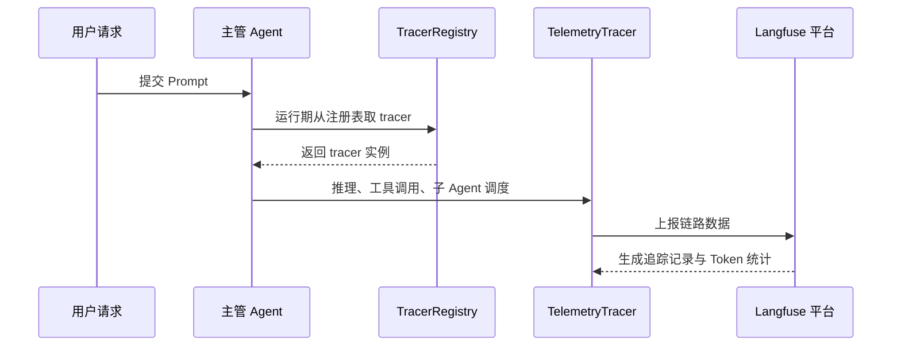

# 13-4 旅游规划Agent团队集成Agent追踪观测

## 【学习目标】

- 说清多 Agent 项目为什么必须接观测平台：执行链路可视化与 Token 成本归因是两个核心诉求
- 独立完成 Langfuse 与 Spring AI Alibaba 项目的集成：依赖引入、密钥外部化、初始化工具类、全局注册
- 理解采样率的生产取值策略，以及密钥为什么必须走环境变量注入

## 【正文】

### 为什么多 Agent 系统必须接观测平台

旅游规划项目跑起来之后，一次用户请求会在系统内部引发一串动作：主管 Agent 接收 Prompt，拆解任务，通过 A2A 协议调动远程的路线制定专员与景点推荐 SubAgent，子 Agent 再挂载百度地图 MCP 工具获取路线与天气数据。链路上任何一环出问题，子 Agent 没有注册上、MCP 调用超时、模型多轮对话烧掉超额 Token，仅凭控制台日志都难以定位。

Langfuse 正是为解决这类问题而生的开源 LLM 观测平台，通过 Docker 即可部署（对应 13-3 的搭建过程）。它给项目补上了两块能力：

| 能力 | 说明 | 本项目场景 |
|---|---|---|
| 执行追踪 | 记录每次 Agent 运行的完整链路：推理、工具调用、子 Agent 调度 | 主管分发任务后，远程成员是否真的收到调用 |
| Token 统计 | 按会话、按 Agent 归因模型输入输出的 Token 花费 | 哪次行程规划烧的 Token 最多、成本能否优化 |

一次「深圳到惠州驾车路线」请求，实际会发生多次模型调用：主管推理一次、路线制定专员推理若干次。没有观测平台，这些调用混在一堆日志里，既分不清归属，也算不清成本。接上 Langfuse 之后，每条请求是一条完整追踪，每次模型调用是追踪下的一个节点，Token 花费按节点自动汇总。

从求职角度看，「Agent 上线之后你怎么知道它有没有好好干活」是面试高频追问。能讲清「链路可追踪、成本可归因、采样可配置」这三点，就拿到了观测领域的标准答案。

### Langfuse 控制台与项目准备

启动 Docker 之后，登录到 Langfuse 的控制台，在里面创建一个项目即可。项目创建完成后，可以看到它提供了很多统计指标，其中包括智能体执行的追踪以及 Token 的花费。

对集成来说最关键的一步在 Settings 里：点击 API Key，平台会自动分配两个密钥，分别是 Public Key 和 Secret Key。如果还没有这组 API Key，需要先在这里创建好。

Public Key 与 Secret Key 的分工值得留意：公钥用于标识「是谁在上报」，私钥用于「证明身份」，两者拼成认证头之后随每次上报请求发送。后续初始化工具类里的 Base64 组装，处理的正是这一对密钥。

### 引入观测依赖

本项目集成 Langfuse 的主要改动在根目录的 Maven 配置里，导入如下依赖即可：

```xml
        <!-- Observation API : 能调用LangFuse进行Agent数据观测 -->
        <dependency>
            <groupId>com.alibaba.cloud.ai</groupId>
            <artifactId>spring-ai-alibaba-observation-extension</artifactId>
            <version>${observation-extension.version}</version>
        </dependency>
```

该依赖属于 Spring AI Alibaba 的监控 API，通过它能够调用 Langfuse，进行智能体数据的观测。课程使用的版本号是 `1.1.2.2`，通过 `${observation-extension.version}` 属性统一管理，后续升级只改属性值一处。

为什么选 Spring AI Alibaba 的观测扩展，而不是自己对接 Langfuse 的 HTTP 接口？因为模型调用发生在框架内部，`DashScopeChatModel` 的发包、ReAct 循环的多轮推理，业务代码完全看不见。只有框架侧的观测扩展才能无侵入地拿到「一次 Agent 运行」的完整生命周期；自行埋点只能覆盖业务代码够得着的那一小段， Agent 内部的思考与工具调用会全部漏掉。

### 配置敏感信息与采样率

密钥类信息一律不写死在代码里。在 `.env` 文件里放入 Langfuse 的地址、私钥和公钥，配置文件只保留占位符。

以主管 Agent 模块为例，`application.yml` 中的配置分为两部分：`langfuse` 段负责观测平台接入，`agent` 段是原有的模型配置，两组值都通过 `${...}` 从环境变量注入：

```yaml
        langfuse:
          # LangFuse 服务地址
          endpoint: ${LANGFUSE_ADDR}
          # 私钥
          secret-key: ${LANGFUSE_SECRET_KEY}
          # 公钥
          public-key: ${LANGFUSE_PUBLIC_KEY}
          # 采样率（生产环境建议 0.1-0.5）
          sampling-rate: 1.0

        agent:
          model_name: ${MODEL_NAME}
          alibaba_dashscope_key: ${ALIBABA_DASHSCOPE_KEY}
```

这套写法遵循配置外部化原则：仓库里只有占位符，真实密钥随部署环境注入。开发机、测试机、生产机各持各的 Key，泄露一台机器不会波及全部环境；镜像打包上传也不需要先做「脱敏清洗」。

采样率（sampling-rate）控制上报比例：1.0 表示全量采样，开发环境便于完整调试，因此课程直接设为 1.0；生产环境建议 0.1 到 0.5。原因在于每次上报都是一次额外网络请求，高并发下全量采样会带来可观开销，且绝大多数正常链路并没有分析价值，按比例抽样即可在成本与可观测性之间取得平衡。

### 编写 Langfuse 初始化工具类

配置项的读取沿用课程前面用过的 `@Value` 注解方案：先把配置绑定到一个配置对象，再把配置对象注入工具类。在公共模块中创建 `LangFuseUtils`，专门负责 Langfuse 观测的初始化：

```java
        @Service
        public class LangFuseUtils {
            @Resource
            private Properties properties;

            public TelemetryTracer initLangfuseTracing() {
                String endpoint = properties.getEndpoint();
                String authHeader = getAuthHeader();

                // 创建TelemetryTracer并配置Langfuse
                TelemetryTracer langfuseTracer = TelemetryTracer.builder()
                    .endpoint(endpoint)
                    .addHeader("Authorization", authHeader)
                    .build();

                return langfuseTracer;
            }
        }
```

初始化逻辑只有两步：第一步通过 `TelemetryTracer` 的 Builder 工厂方法生成实例，传入访问地址与认证头；第二步在认证头的构建方法里，把公钥和私钥做一次 Base64 组装后返回。地址直接从配置对象取，认证头由独立方法构建，职责切分清楚。

把认证头单独抽成一个方法，而不是在 `initLangfuseTracing()` 里拼接，好处是主流程保持一条直线：取地址、取认证头、构建实例。Basic 认证的拼接格式属于协议细节，一旦调整只影响那一个方法，初始化主流程不受干扰。

### 嵌入智能体执行链路

初始化完成的 tracer 需要注册到全局跟踪对象里才能生效。主管 Agent 的执行入口在 `Manager Agent` 类中，该类负责主管智能体的创建与运行：

```java
        public ReActAgent getManagerAgent() {
            TelemetryTracer tracer = langFuseUtils.initLangfuseTracing();
            // 注册到全局 TracerRegistry
            TracerRegistry.register(tracer);

            log.info("LangFuse Agent数据观测 已经初始化");
            log.info("================================");

            // 后续业务逻辑...
            TripPlan plan = new TripPlan();
            Toolkit toolkits = new Toolkits();
            // ... 其他代码
        }
```

把 `LangFuseUtils` 注入进来，调用初始化方法拿到 tracer 实例，注册进 `TracerRegistry`。此后不需要任何额外动作，全局跟踪对象会在智能体运行期间自动完成追踪。

「注册一次，全局生效」是这段代码的关键设计：`TracerRegistry` 是进程级的全局注册表，Agent 运行时从注册表取 tracer，业务代码因此与观测逻辑完全解耦。反过来说，如果漏掉注册这一步，系统不会报错，只是静默地不上报数据，这类「沉默的失败」正是观测集成的典型陷阱，排查时先确认注册代码真的执行过，再去看网络与密钥。



### 集成四步的分工

回看整个集成过程，四步各有分工，缺一不可：

| 步骤 | 产物 | 回答的问题 |
|---|---|---|
| 引入依赖 | `spring-ai-alibaba-observation-extension` | 谁来采集框架内部的调用数据 |
| 配置外部化 | `.env` + `application.yml` | 密钥怎么管、采样多激进 |
| 初始化工具类 | `LangFuseUtils` | 地址与认证头怎么变成可用实例 |
| 全局注册 | `TracerRegistry.register(tracer)` | 采集到的数据怎么进执行链路 |

四步合起来，才构成「请求进来 → 链路可见 → 成本可算」的闭环。

## 【易错点 / 面试题】

1. **密钥能不能直接写进 `application.yml`？** 不能。课程特意把 Langfuse 地址与两把密钥放进 `.env`，配置文件中只保留 `${...}` 占位符。面试官问「API Key 怎么管理」，标准答法是：环境变量注入、代码仓库零密钥、不同环境各持各的 Key。
2. **采样率为什么生产环境要降到 0.1–0.5？** 全量采样下每条链路都要发一次上报请求，高并发时观测本身会成为系统负担；正常链路占绝大多数，按比例抽样已足够支撑问题排查与成本分析。
3. **注册了 tracer 却看不到数据，先查什么？** 先确认 `TracerRegistry.register(tracer)` 是否真的执行过，全局注册漏掉时系统不报错、只是没有数据；再检查 Langfuse 服务地址与密钥是否匹配当前项目。

## 【小结】

本节把 Langfuse 观测平台接入了旅游规划项目：依赖、配置、初始化、注册四步走完，主管 Agent 的每次运行都会自动生成追踪记录与 Token 统计。观测是 13-3「Docker 搭建 Agent 跟踪和 Token 消费分析」的消费侧，平台搭好之后，必须完成本节的项目侧集成，Token 花费分析才真正有数据可用。

生产级落地可参考 `981-demo/src/main/java/com/travel/agent/config/AgentProperties.java`：课程中的 `${MODEL_NAME}`、`${ALIBABA_DASHSCOPE_KEY}` 等占位符，在该工程中固化为 `app.agent.*` 配置族，配合多 profile（offline 默认离线跑通链路、dashscope 切真实模型）实现同款「配置外部化、密钥不落库」思路；观测侧则由 Actuator 暴露健康与指标端点，与 Langfuse 的链路追踪形成互补。
