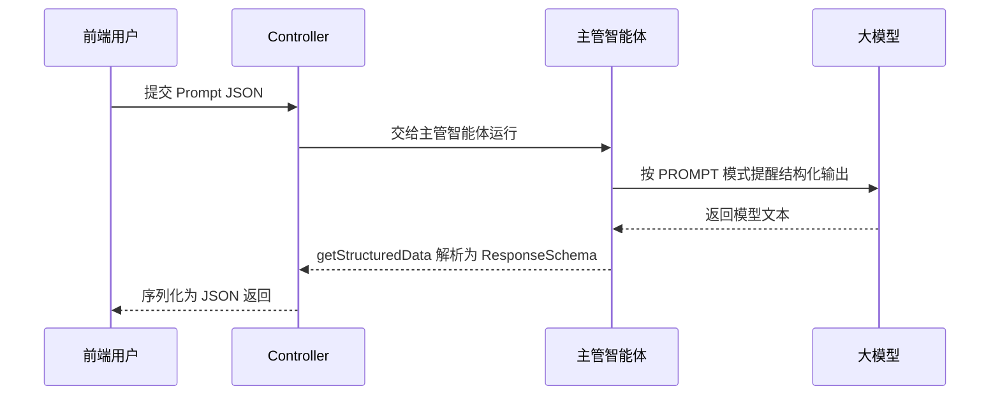

# 13-5 测试主管Agent接收Prompt及结构化输出

## 【学习目标】

- 理解接口层为什么必须定义输入/输出 Schema：它是 LLM 自由文本与前端消费之间的契约
- 掌握 PromptSchema / ResponseSchema 的设计要点：字段约束、无参构造函数
- 掌握 `structuredOutputReminder(PROMPT)` 与 `getStructuredData` 的构建期/运行期配合，以及两种结构化输出模式的选型依据

## 【正文】

### 用户交互接口的改造

前文已经写好了一个「用户提交旅游规划 Prompt」的接口，本节课重点看它的返回，要以 JSON 的形式返回给前端。

先回顾接口形态：POST 形式，并且有两处声明不能省。一是 `produces = "application/json;charset=UTF-8"`，二是请求体按 JSON 提交。之所以必须显式指定 UTF-8，是因为用户提交的 Prompt 是中文，编码不指明时，服务端可能按默认编码解析请求体，中文就会出现乱码；响应头里没有 charset 声明，前端同样可能按错误编码解读返回内容。

```java
    @RequestMapping(
        value = "/trip",
        produces = "application/json;charset=UTF-8",
        method = RequestMethod.POST
    )
    public ResponseSchema tripPlan(@RequestBody PromptSchema input) {
        ReActAgent manager = managerAgent.getManagerAgent();
        ResponseSchema response = managerAgent.run(input.getPrompt());
        return response;
    }
```

接口内部只做三件事：从 Spring 容器拿到主管智能体，把用户提交的 Prompt 交给它运行，把结果包进 `ResponseSchema` 返回。方法签名直接以 `ResponseSchema` 作为返回类型，Spring MVC 会将其序列化为 JSON，结构化输出改造完之后，接口层几乎不需要写额外的序列化代码。

### 用 Schema 约束提交内容

既然要求以 JSON 形式提交，就需要对用户提交的 Prompt 做一个限制，也就是为其定义一个对象。课程在公共模块里建立 `Data` 包，在该包下创建 `PromptSchema`。该 Schema 就是用户提交 Prompt 的 JSON 格式，用户提交的内容必须放在该字段下面。

不要小看这一层封装。没有 Schema 时，接口只能收到一坨自由文本：参数校验做不了、接口文档写不准、前后端联调全靠口头约定，字段名改一次对面就崩一次。有了 Schema，「用户想说什么」被收窄成一份明确契约，文档、校验、反序列化全部围绕它展开。这属于 Spring Boot 的基础功，但恰恰是工程化与玩具代码的分水岭。

### 定义结构化响应格式

接下来是本节课的核心：大模型反馈的内容，如何按照设定的 JSON 格式反馈？

课程在公共模块的 `Data` 包里定义 `ResponseSchema`，也就是响应格式。大模型反馈给项目、项目再反馈给前端的内容，都要按该结构输出，并且严格遵循所设定的格式，反馈内容必须放在 `response` 字段下：

```java
    public class ResponseSchema {
        // LLM响应
        public String response;

        // 必须有无参构造函数
        public ResponseSchema() {}
    }
```

代码里特意保留了一个显式的无参构造函数，这是反序列化的通行要求：框架把 JSON 文本转成对象时，先 `new` 出一个空实例，再逐字段填充。缺少无参构造，转换在第一步就会失败，接口等不到模型返回就先报错。凡是打算被「文本转对象」的类，无参构造都是硬性前置条件。

### 告诉智能体按结构化输出

定义好格式只是画好了靶子，还要告诉智能体：你的反馈必须遵循该格式。用户是与主管智能体交互的，因此该配置加在主管智能体的构建代码里，构建时挂上结构化输出声明：

```java
    AgentUtils.getReActAgentBuilder()
        .name("ManagerAgent")
        .description("负责用户需求的解决方案制定，以及任务分发")
        .toolkit(toolkit)
        .structuredOutputReminder(StructuredOutputReminder.PROMPT)
        .build();
```

其中 `structuredOutputReminder` 方法接收一个固定值，用来告诉智能体按结构化方式输出。该值有两种可选模式，课程采用的是 `PROMPT`：

| 模式 | 机制 | 兼容性 | 课程选型 |
|---|---|---|---|
| `PROMPT` | 把格式要求写进提示词，提醒模型按 Schema 输出 | 兼容较老的模型 | 采用 |
| `TOOL_CHOICE` | 借工具调用的参数机制强制走 Schema | 只支持特定的两种模型 | 未采用 |

采用 `PROMPT` 的原因是它兼容一些老的模型，而 `TOOL_CHOICE` 只支持特定的两种模型。从工程视角看，两种模式的本质差异是约束强度：`PROMPT` 是提示词软约束，靠模型自觉遵循，胜在兼容面广；`TOOL_CHOICE` 是机制硬约束，借函数调用的强类型参数保证结构，更可靠但挑模型。选型前先确认目标模型的能力清单，再决定押注哪一边。

### 运行时解析结构化数据

最后一步是让智能体的输出真正落进设定的格式。在主管智能体的运行代码中，前文只是把回应打印出来，现在改为按 `ResponseSchema` 直接处理：

```java
    .blockLast() // 阻塞直到结束
    .getMessage() // 获取消息
    .getStructuredData(ResponseSchema.class); // 解析为结构化数据
```

三个调用各司其职：`blockLast()` 阻塞直到流式响应结束，拿到完整结果；`getMessage()` 从响应中取出消息；`getStructuredData(ResponseSchema.class)` 把消息内容按设定的 Schema 解析为结构化数据，传入哪个类就解析成哪个类的实例。

至此，运行时的数据流变成：模型产出文本 → 按 Schema 解析为对象 → Controller 直接返回对象 → 框架序列化为 JSON。开发者在业务代码里从头到尾面对的都是对象，不再手工拼 JSON 字符串。



与 Spring AI 做一个名词对照：Spring AI 2.0.1 中同一诉求由 `chatClient.prompt().user(...).call().entity(MyPojo.class)` 完成，或使用 `BeanOutputConverter` + `@Schema` 组合。框架名词不同，思路一致，构建期声明格式、运行期把输出收进结构。课程使用 AgentScope 的 `getStructuredData`，面试中两种框架的说法都应该能讲清楚。

### 运行验证

把提示组装为 JSON 提交，注意 Prompt 必须放在 `prompt` 字段下：

```json
    {
        "prompt": "给我推荐一个适合家庭出游的景点"
    }
```

点击发送之后，接口反馈的是 JSON 格式，并且响应结果自动放到了 `response` 字段下：

```json
    {
        "response": "深圳是中国经济特区，科技创新中心，毗邻香港，发展迅速，人口年轻。"
    }
```

这里有一个重要的兼容性提醒：有些比较旧的模型可能不支持结构化输出。课程使用的模型是 Qwen3，如果换用另外一些模型，比如 DeepSeek 这些，可能就不支持结构化输出，会直接报错。结构化输出不是纯客户端特性，它依赖模型侧的配合，选型时必须核实。

## 【易错点 / 面试题】

1. **响应类忘了写无参构造函数会怎样？** 反序列化在 `new` 实例的阶段就失败，接口等不到模型返回先报错。凡是会被「文本转对象」的类，无参构造是硬性要求，`ResponseSchema` 里那行显式构造不是摆设。
2. **为什么选 `PROMPT` 而不是 `TOOL_CHOICE`？** `PROMPT` 兼容老模型，`TOOL_CHOICE` 只支持特定的两种模型。面试延伸提问「两种模式怎么选」，要能答出：软约束胜在兼容面，硬约束胜在确定性，先看模型能力清单再押注。
3. **面试题：如何保证 LLM 的输出前端一定能解析？** 三层防线：Schema 类定义契约；结构化输出模式约束生成过程；反序列化后做字段级校验。只靠提示词里写一句「请返回 JSON」而不做机制约束，生产环境迟早遇到格式漂移。

## 【小结】

本节给主管 Agent 的交互接口补上了结构化契约：入口用 `PromptSchema` 收窄用户输入，出口用 `ResponseSchema` 约束模型输出，构建期声明格式、运行期解析数据，一次请求走完「用户 JSON 进、模型结构化出、JSON 回」。

对应工程实现见 `981-demo/src/main/java/com/travel/agent/web/TravelController.java`：`POST /api/travel/plan` 接收需求字段，以 `LinkedHashMap` 组装 supervisor/requirement/plan 三个字段的结构化响应，字段顺序稳定，前端契约不随序列化细节漂移；主管智能体的构建与约束声明见 `981-demo/src/main/java/com/travel/agent/agent/SupervisorAgent.java`，其中系统提示词按「路线/景点」分流子的写法，与本节「告诉智能体按格式输出」是同一种思路，结构要前置声明，不能等输出之后再补救。
