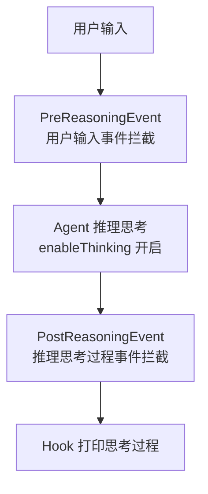

# 13-6 旅游规划打印出Agent的深度思考

## 【学习目标】

- 理解打印 Agent 思考过程的两大前提：Hook 拦截推理事件 + 模型支持思考模式
- 能定位「思考过程为空」的根因：模型侧不产出思考内容，而不是 Hook 写错
- 掌握 `enableThinking` 开关与模型选型的匹配方法，理解深度思考对成本与延迟的影响

## 【正文】

### 思考过程为什么打印不出来

前文稍微涉及过这部分：主管智能体模块中有一个自定义 Hook，Hook 内部会把推理思考的过程打印出来。但实际执行时，有时会发现思考过程是空的、并没有被打印出来，这是为什么？

先看 Hook 的形态。AgentScope 用 Hook 对 `HookEvent` 事件做拦截，常见事件有两类：`PreReasoningEvent` 对应用户输入事件，`PostReasoningEvent` 对应 Agent 推理思考过程事件。打印思考过程的 Hook，挂的正是 `PostReasoningEvent`：

```java
        @Override
        public <T extends HookEvent> Mono<T> onEvent(T event) {
            // Hook 是对 HookEvent 事件的拦截
            // PreReasoningEvent: 用户的输入事件
            // PostReasoningEvent: Agent 推理思考过程事件
            // ... (省略部分代码)
            return ReActAgent.builder()
                .name(name)
                .description(description)
                .model(DashScopeChatModel.builder()
                    .apiKey(aliApiKey)
                    .modelName(modelName)
                    .mode("stream")
                    .enableThinking(true) // 启用深度思考模式
                    .build()
                )
                .build();
        }
```

Hook 机制本身并没有问题，事件确实被拦截到了，只是拦截到的思考内容是空的。答案不在 Hook 里，而在模型侧。



### 根因在模型侧的能力清单

AgentScope 所使用的语言大模型都是从阿里大模型平台获取的，平台侧不提供某个模型，AgentScope 也就用不了。打开阿里大模型平台的官方文档，在「模型推理 - 文本生成」下有一个「深度思考」的说明，关键信息有三条：

1. 平台提供的模型分为思考模式和非思考模式两种；
2. 有些模型默认开启思考模式，有些则不支持；
3. 文档中列出了支持思考模式的模型，例如千问 3.5 默认开启思考模式，但它是商业版；使用免费版（也就是开源模型）时，只能选择文档中列出的那些模型。

所以并不是随便调用一个模型就能看到思考过程。课程选用 DeepSeek R1，它提供思考模式；有一点小瑕疵是它有时会用英文而非中文输出思考内容，教学项目不影响演示效果。

换个角度看，这件事与 2-1「大模型咋就懂咱说啥」一脉相承：思考过程（思维链）是模型在给出最终答案之前生成的中间推理文本，能不能拿到这段文本，取决于模型是否显式产出它。非思考模式的模型把推理压缩进最终答案，`PostReasoningEvent` 里自然什么都没有。

### 开启深度思考的配置

开启思考模式的配置在公共模块的智能体工具类里，方法很简单：构建 `DashScopeChatModel` 时把 `enableThinking` 设为 `true`：

```java
        // 配置大模型并启用深度思考模式
        .model(DashScopeChatModel.builder()
            .apiKey(aliApiKey)
            .modelName(modelName)
            .mode("stream")
            .enableThinking(true) // 关键：启用深度思考模式
            .build()
        )
```

三个配置项是配套关系：`modelName` 决定用哪个模型，`enableThinking` 决定要不要思考输出，`mode("stream")` 指定流式返回。三者中任何一个与模型能力不匹配，都拿不到预期的思考过程。

`mode("stream")` 与思考过程还有一层配合关系值得点出：流式返回让模型边生成边吐字，思考内容因此可以跟着生成进度逐段打印出来，而不是等整轮推理结束后一次性亮相。这与 7-8、7-9 两节讲的 Flux 装载 SSE 数据、包装 SSE 返回给前端是同一套机制在 Agent 侧的应用，调试时看着思考过程一行行刷出来，比盯着一个转圈图标更能判断模型「走神」在哪一步。

### 运行验证

配置好之后通过接口运行一次。课程问了一个带歧义的句子：「在咖啡馆里想要杯星巴克，这里的星巴克指代的是什么」，重点观察思考过程能否被打印出来。

从日志可以看到，所使用的大模型是 DeepSeek R1，紧接着整个思考过程就被完整打印出来了。思考完成后，它给出了这样的反馈：

```text
        2026 [INFO] 这是一个简单的问题，不需要创建计划。让我直接回答你的问题：
        1. 星巴克品牌的咖啡饮品
        2. 特定类型的咖啡（如星巴克特色的焦糖玛奇朵、星乐等）
        3. 或者顾客可能误以为当前咖啡店是星巴克门店（但实际不是）
```

这段日志同时印证了 2-1 的观点：模型能结合语境消解「星巴克」的歧义，它没有把星巴克简单等同于品牌或门店，而是列举了饮品、特定咖啡类型、误认门店三种可能，再给出最合理的解释。深度思考模式把这一消解过程显式暴露了出来，这正是可观测性对 Agent 调试的价值：答案正确与否看得见，怎么想的也看得见。

### 工程视角的成本权衡

深度思考不是免费午餐，生产环境要算两笔账：

| 维度 | 关闭深度思考 | 开启深度思考 |
|---|---|---|
| 输出 Token | 只有最终答案 | 思考过程 + 最终答案，显著变多 |
| 首 Token 延迟 | 更快 | 更慢，思考完才吐答案 |
| 适用场景 | 简单问答、分类、信息抽取 | 多步推理、歧义消解、规划类任务 |

这与 13-3、13-4 的 Token 消费分析直接相关：思考内容同样计费。因此工程上的常见做法是按任务分级，简单任务关闭思考，规划与推理类任务开启，而不是全局一把打开。旅游规划属于典型的规划类任务，开启思考换来的是拆解质量；若是只做「提取起点终点」这类抽取动作，关掉思考更划算。

## 【易错点 / 面试题】

1. **思考过程为空，第一反应查什么？** 先查模型是否支持思考模式，而不是先改 Hook。课程给出的排查路径：阿里大模型平台文档 →「模型推理 - 文本生成」→「深度思考」→ 确认所用模型在支持清单里。免费版只能选文档列出的模型；千问 3.5 虽默认开启思考，但属商业版。
2. **`enableThinking(true)` 设置了还是没思考输出？** 检查模型与开关是否配套，不支持思考的模型，开关形同虚设。换成 DeepSeek R1 可用，代价是思考内容有时输出英文。
3. **面试题：Agent 的 Token 成本怎么控？** 三个抓手：按任务开关深度思考（本节）；控制上下文长度（2-1 的输入侧）；用观测平台做成本归因，找到烧 Token 的大头再针对性优化（13-3、13-4）。

## 【小结】

本节给出了打印 Agent 思考过程的完整做法，核心就两步：选用支持思考模式的模型，并在 `DashScopeChatModel` 构建时把 `enableThinking` 打开。空白思考过程的根因在模型能力，不在 Hook 代码，先查模型清单，再改配置。

生产落地可参考 `981-demo/src/main/java/com/travel/agent/config/AgentProperties.java`：模型通过 `app.agent.model-mode`（offline/dashscope）与 `app.agent.model-name` 外部化切换；`981-demo/src/main/java/com/travel/agent/model/OfflineChatModel.java` 提供离线规则模型，默认 profile 不填 Key 即可跑通链路，避免真实思考 Token 的消耗与费用，调试期想怎么看日志就怎么看。
