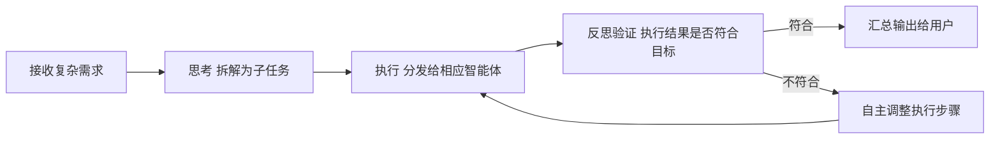

# 13-8 课程总结

## 【学习目标】

- 站在全课视角复述两大主线：多 Agent 协同、智能体自主思考与执行，以及二者如何通过「旅游规划」项目合流
- 说清多 Agent 协同的三种实现方式及其适用边界：Graph 引擎、FlowAgent 基类、AgentScope 框架
- 复述 AgentScope 工程化的五个要点与自主决策的两个层面，形成可迁移的知识框架
- 拿到一份全课知识地图：每章解决什么问题、产出什么，便于复习与查漏

## 【正文】

### 1. 两大主线：一个项目，两条脉络

整个课程围绕两个大的知识点展开：一个是多 Agent 协同，另一个是智能体的自主思考与执行，包括把复杂任务拆分成一个又一个简单任务的能力。两个知识点不是分开讲授的，而是通过「旅游规划」这一具体项目串起来演示：用户只提交一句「帮我规划一次旅行」，系统内部分解出路线制定、行程安排、景点推荐、费用统筹等子任务，由多个智能体协同完成。

这两条脉络恰好对应智能体系统的两个核心问题：多个角色如何分工协作（组织问题），单个任务如何被自主地拆解与推进（执行问题）。前者是架构，后者是引擎，合起来才是一个能用的自主决策系统。

### 2. 多 Agent 协同的三种实现方式

课程给出了三种实现方式。其中两种属于工作流编排的设计思想，另一种则基于 AgentScope 开发框架。

| 实现方式 | 核心对象 | 协作语义 | 课程篇章 |
|---|---|---|---|
| Graph 引擎 | `OverAllState`、`StateGraph` | 状态在节点间流转，连线定义顺序 | 第 7 章 |
| FlowAgent 基类 | `ParallelAgent`、`LlmRoutingAgent`、`SequentialAgent` | 继承基类即获得一种协作模式 | 6-8、7-13 |
| AgentScope 框架 | `ReActAgent`、Toolkit、A2A | 模型自主决策分发，无预编排连线 | 第 9~12 章 |

第一种是 Graph 引擎，关注两个对象：`OverAllState` 负责在工作流整个过程中承载智能体之间的数据与状态传输，所有传输的数据和智能体状态都放进该对象，它是 KeyValue 格式的状态对象，每个节点任务执行完成后把结果更新进去，下游节点再从里面取出上游的结果作为输入；`StateGraph` 则用于编排整个工作流，提供节点生成以及节点与节点之间连线生成的能力，`addNode`、`addEdge` 与条件边 `addConditionalEdges` 三个方法即可勾勒出并行、顺序、路由三种流程逻辑。执行路径在图构造时基本确定，适合流程稳定的业务。

第二种是 `FlowAgent` 基类（Spring AI Alibaba 1.1 提出），继承该基类的有三个智能体：`ParallelAgent`（内部的任务并行执行）、`LlmRoutingAgent`（由语言大模型动态地把任务分发给相应智能体）和 `SequentialAgent`（内部的工作流按顺序执行）。通过这三个智能体即可完成工作流编排，协作模式被封装成基类，按需继承。它与 Graph 引擎的关键差异在于：Graph 的节点里跑的是一段业务逻辑方法，而 FlowAgent 流程里真正执行任务的是能思考、能自己使用工具的智能体。

第三种是课程重点：通过 AgentScope 框架实现多 Agent 协同。它让整个项目完成了工程化搭建，也是旅游规划项目最终采用的形态。

三者的关系可以这样理解：前两种把「怎么协作」写在图与类里，第三种把「怎么协作」交给模型在运行时决定。课程同时讲透三类，是为了让学习者建立选型坐标，而非认定唯一答案。

### 3. AgentScope 工程化的五个要点

AgentScope 的工程化价值体现在五点：

| # | 要点 | 课程内容 | 对应篇章 |
|---|---|---|---|
| 1 | 基于 Docker 的分布式 Agent | 各智能体节点独立部署、独立进程 | 第 1、9 章 |
| 2 | MCP 工具标准化 | 课程使用远程的百度地图服务端；企业项目里 MCP 服务端通常由自己本地部署 | 11-5、11-6 |
| 3 | Skills 的工程化 | 把专业知识与工作流程封装成可渐进加载的技能包 | 第 10、12 章 |
| 4 | 单独子任务的执行 | SubAgent 由子 Agent 独立完成某一个子任务 | 10-1、12-5 |
| 5 | 分布式 Agent 之间的通信 | 基于 A2A 协议，智能体卡片通过 Nacos 注册中心完成注册 | 第 11 章 |

第二点值得单独展开：课程为了聚焦框架本身，直接使用了远程的百度地图 MCP 服务端；而企业项目里，MCP 服务端通常由自己本地部署。差异不在协议而在治理，自建服务端意味着密钥自管、可用性自保、数据不出内网，代价是要承担运维。选型时先问「工具能力是商品还是资产」，再决定用公共服务还是自建。

第五点是分布式协作的地基：A2A 协议解决「跨进程怎么说话」，Nacos 解决「说了之后谁在场」。成员启动即注册智能体卡片，主管运行时从注册中心获取成员列表，地址解析与能力发现全部动态化，节点增减不再需要改调用方代码。

### 4. 自主决策的两个层面

除了工程化的多 Agent 协同，AgentScope 还提供了智能体的自主决策能力，体现在两个层面：

其一，能够把整体复杂需求拆分成一个个简单任务，并自动分发给相应的智能体执行。用户的一句「规划一次深圳周边三日游」进入主管之后，拆解出的子任务带参数流向路线制定专员、景点推荐 SubAgent 与行程规划经理，拆解质量由 9-5 的自主分解与 9-6 的 `PlanNotebook` 保障，计划对用户可见、可人工介入修改（11-8）。

其二，执行任务时遵循「思考-执行-反思验证」的循环：先思考再执行，然后反思执行结果是否符合目标，不符合就自主调整执行步骤。这背后涉及一套智能体的思考框架。

第二个层面是第一个层面的质量保障：只会拆不会验，拆错了就一路错到底；加入反思验证之后，系统具备了闭环自纠的能力。13-6 打印出的深度思考文本，正是该循环里「思考」环节的显式暴露，调试 Agent 时看得见它怎么想，比只看结果有价值得多。

### 5. 全课知识地图

十三章的推进路线可以归纳为：概念打底（1~3 章）→ 框架装配（4、6 章）→ 任务剖析与编排实验（5、7、8 章）→ 工程化落地（9~12 章）→ 生产化收尾（13 章）。

| 章 | 主题 | 关键产出 |
|---|---|---|
| 1 | 课程导论与准备 | ApiFox、阿里大模型 Key、百度地图 AK、Nacos；Jmanus 与 AgentScope 两个参照框架 |
| 2 | 大模型原理基础 | Prompt 的分词与向量化、Transformer、自注意力；大模型与智能体的关系 |
| 3 | 多 Agent 与工具调用 | 数据获取困境、Function Calling、MCP、Agent Skills、A2A、核心执行流程 |
| 4 | Spring AI Alibaba 整合 | 依赖装配、MCP 注解、A2A 三组件、服务注册与发现、AgentCard |
| 5 | 旅游规划任务剖析 | 复合任务拆解；路线 / 行程 / 费用三类成员；百度地图 MCP 工具体系 |
| 6 | Spring AI 基础 | ChatModel、ChatClient、SSE 流式、MCP 客户端、FlowAgent 团队协同、AgentScope Agent 运行 |
| 7 | 工作流编排 | OverAllState、StateGraph、NodeAction、Edge、编译运行、Flux 包装 SSE、与 FlowAgent 的对比总结 |
| 8 | 多 Agent 设计思路 | 角色分工、冲突协商、SOP；Manus / OpenManus / JManus；PlanAct 与 ReAct |
| 9 | AgentScope 工程化 | 分布式架构、SpringBoot 4 整合、任务分解、PlanNotebook、Hook、远程 Agent 即工具 |
| 10 | SubAgent 与 Skills | SubAgent 定位、Skills 四要素、渐进式加载、文件结构标准 |
| 11 | 旅游规划团队联调 | A2A 注册 / 获取 / 调动、MCP 挂载、主管自主分发、人工介入改计划 |
| 12 | Skills 实战 | 预算约束、表格制作两个 Skills；渐进加载落地；景点推荐 SubAgent |
| 13 | 生产化收尾 | 密钥外置、用户接口、Langfuse 观测、结构化输出、深度思考、链路测试 |

这张地图的用法是反查：哪块概念模糊了就回到对应章复训，例如「Token 为什么烧得多」回 2-1 与 13-3/13-4，「主管为什么不分发」回 9-8 与 11-7。

### 6. 与 981-demo 的对应关系

课程代码以教学节奏演进，`981-demo` 则以生产形态复刻了同一条链路，便于把课程知识落到可部署工程：

- `981-demo/src/main/java/com/travel/agent/agent/SupervisorAgent.java` 与 `SupervisorTools.java`：主管的构建与「Agent 即工具」的任务分发（第 9、11 章）；
- `981-demo/src/main/java/com/travel/agent/agent/TeamMembers.java`：路线制定专员与景点推荐 SubAgent 两名成员，各挂 Toolkit（第 5、10、12 章）；
- `981-demo/src/main/java/com/travel/agent/tool/RouteMakingTools.java`：`map_geocode` / `map_directions` / `map_weather` 对应百度地图 MCP 工具体系（第 5、11 章）；
- `981-demo/src/main/java/com/travel/agent/a2a/A2aEndpointController.java` 与 `NacosAgentRegistry`：A2A 端点与 Nacos 注册发现（第 4、11 章）；
- `981-demo/src/main/java/com/travel/agent/config/AgentProperties.java`：模型、发现方式等配置外部化，默认离线模式不填 Key 即可跑通全链路（第 1、13 章）。

## 【易错点 / 面试题】

1. **面试题：「三种多 Agent 编排方式怎么选？」** 先问流程是否稳定：固定流程选 Graph 或 FlowAgent，路径确定、可测试、易回放；开放问题选 AgentScope 式自主决策，灵活但需要观测兜底（13-3/13-4 的 Langfuse 正是为此而生）。混合架构同样常见，主干用工作流保证可控，叶子节点用自主 Agent 处理开放输入。
2. **面试题：「自主决策循环与 ReAct 是什么关系？」** ReAct 是「思考 + 行动」的基层执行范式（8-8），本课的「思考-执行-反思验证」在其之上补了一层结果校验与自主调整：不止于行动，还要检验行动是否达成目标。答题时把两个层面分开说，别混成一个词。
3. **易错点：把 MCP 服务端当成只能调公共服务。** 课程用远程百度地图服务端是为了教学聚焦，企业里通常自建，密钥、可用性、数据边界都握在自己手里。面试追问「MCP 服务端谁提供」时，要能答出自建与公共两条路及取舍依据。

## 【小结】

本课以「旅游规划」为载体讲透了两条主线：多 Agent 协同的三种实现方式，Graph 引擎、FlowAgent 基类、AgentScope 框架，后者以 Docker 分布式部署、MCP 工具标准化、Skills 工程化、SubAgent 独立执行、A2A + Nacos 通信五个要点完成工程化；智能体自主决策的两个层面，复杂需求自主拆解分发，以及「思考-执行-反思验证」的执行循环。概念、框架、编排、工程化、生产化五段推进，最终在 13 章收拢为可观测、可结构化输出、可人工介入的完整系统。

工程侧的对应实现见 `981-demo/src/main/java/com/travel/agent/agent/TeamMembers.java`（成员与 SubAgent）、`981-demo/src/main/java/com/travel/agent/agent/SupervisorTools.java`（任务分发）、`981-demo/src/main/java/com/travel/agent/a2a/A2aEndpointController.java`（A2A 通信）与 `981-demo/src/main/java/com/travel/agent/config/AgentProperties.java`（配置外部化）。建议的收尾动作是：对照第 5 节知识地图逐章自查，再把 981-demo 在离线模式下跑通一遍，链路在自己机器上转起来，知识才算真正闭环。
