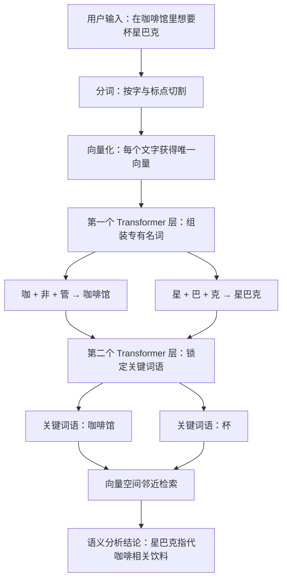

# 2-2 大模型的信息分析器：Transformer层

## 【学习目标】

- 说清 Transformer 层在「用户输入 - 推理计算 - 输出」三段式链路中的位置与职责。
- 完整复述「分词 → 向量化 → 逐层组装专有名词 → 锁定关键词语」的加工过程。
- 能用向量空间距离解释一词多义的消歧：为什么「星巴克」在咖啡馆语境中指饮料，而非门店或品牌。

## 【正文】

### 一、回顾：推理计算藏在大模型内部

一个语言大模型无论结构多么复杂，大体都能分为三部分：用户输入、推理计算、输出。用户输入即 prompt，但用户未必能把意图表达准确，而大模型的神奇之处，在于能推断出文字背后真实的意图。

以上一节的两个句子为例。第一句「在咖啡馆里想要杯星巴克」，大模型能推断出「星巴克」指代与咖啡相关的饮料；第二句「他拿着的星巴克很好看，我也想要个星巴克」，同一个词却被推断为星巴克店里出售的杯子。同一个词、两种含义，大模型靠的正是一步一步的推理。使用 DeepSeek 时看到的思维链展示，正是推理过程的外显。

本节聚焦三部分中的「推理计算」。它由很多层堆叠而成，这些层称为 Transformer 层：

| 模型 | Transformer 层数 |
|---|---|
| GPT-3 | 96 层 |
| GPT-4 | 120 层 |
| Qwen3 | 64 层 |
| Geekwalk（马斯克团队） | 64 层 |

Transformer 层的职责，正是把用户输入的文字逐层推理出真实意图。其中涉及大量数学公式，本节沿用课程风格：用大白话把过程讲透。为此，先把几十层简化为第一个、第二个、第三个 Transformer 层，观察文字如何逐层被加工，最终得到意图。示例句仍用「在咖啡馆里想要杯星巴克」。

这三段式在工程上有直接对应：用户输入即调用模型时传入的 prompt 或消息；推理计算是模型内部的前向运算，对调用方完全不可见；输出即模型返回的生成内容。981-demo 的 Web 入口（`981-demo/src/main/java/com/travel/agent/web/TravelController.java`）便是这套三段式的工程封装，接收用户请求、交给模型推理、把结果返回前端。本书后续所有工程章节，做的都是「把推理计算这一段用得更稳、更准」的文章。

### 二、起点：文字必须先变成向量

大模型处理文字的第一步是分词：把句子切成一个个单词，标点符号也在切割范围内。切割后的单词要做向量化。

课程按「一个字一个字地切割」来讲，是最易理解的简化说法；真实模型的分词粒度更细，可能切出词、子词甚至单字。粒度差异不影响本节要表达的核心：无论切出的单元大小，每个单元都必须获得向量表示，才能进入后续运算。

为什么要向量化？因为大模型并不认识文字，只认识数字，计算机的运算建立在数字之上。要用数字唯一表示一段文字，靠的是「用参数描述特征」。

以猫为例。猫区别于其他动物的突出特征有：有尾巴、体型娇小、会喵喵叫、吃老鼠、夜间活动、四脚着地、动作灵活。把这些特征写进一个向量，每个特征配一个数值作为向量参数，该向量即指代「猫」。大模型解析该向量时，依据这些突出参数即可判断「前面的东西是一只猫」。指向猫的向量参数越多、越细致，大模型越能把猫与狗等动物区分开，甚至能进一步区分猫的品种。参数规模上去之后，向量指代的对象会被刻画得足够细，细到不仅能区分物种，还能区分品种。

这就是大模型能够识别文字、图像、音乐的底层逻辑：用一个向量唯一指代某个对象，向量内的大量参数都是该对象的突出特征。分词并向量化之后，每个文字都在向量空间中拥有唯一向量。

值得展开的是「唯一」二字。向量空间可以理解成一个维度极高的坐标系，每个维度对应一种可描述的特征。一段文字落入该坐标系，占据一个点；点与点的距离反映了特征的接近程度。同一段文字在任何上下文里都先获得同一个初始向量，随后在 Transformer 层中被上下文逐步改造，这是后面几层事情的起点，也解释了为什么同一个「星巴克」在不同句子里最终会指向饮料或杯子。

### 三、第一个 Transformer 层：把字组装成词

文字完成向量化后进入第一个 Transformer 层。要注意的是，这里的第一个 Transformer 层是简化了的，在真正的大语言模型里面，可能要经过三四个乃至几十个 Transformer 层，才会得到具体的功能。

第一个 Transformer 层实现的功能是：把切割出的文字组装为熟悉的专有名词。

- 「咖」「非」「管」三个文字，经该层处理后组装为单词「咖啡馆」；
- 「在」和「里」不会被组装成一个单词，因为组合后并非一个单词；
- 「星」「巴」「克」三个文字，组装为单词「星巴克」。

组装遵循一条朴素规则：只把「组合后有意义」的文字并起来。「在」与「里」在古汉语里或许能成词，但在现代汉语的日常表达里只是介词加方位词的临时搭配，不构成一个独立单词，所以不被组装。判断「组合后有没有意义」，依据仍是向量空间，两个文字的向量特征能否拼出一个有对应点的新概念。

组装完成的专有名词，在向量空间里同样有唯一的向量指代。

这里引出一个自然的疑问：「咖啡馆」的向量与「星巴克」的向量，为什么在向量空间里挨得这么近？位置并非随机排列。咖啡馆主要卖咖啡，星巴克也是喝咖啡的地方，两个向量的特征存在重叠，咖啡、蛋糕、听音乐，这些特征两个向量都有，所以「咖啡馆」与「星巴克」在向量空间里距离很近。类似的，「巴黎」会让人想到法国而非中国，因此「巴黎」与「法国」的向量挨得近，「巴黎」与「中国」则相对远一些。这就是单词在向量空间中的位置关系。

### 四、第二个 Transformer 层：锁定关键词语

单词组装完成后，再经过第二个 Transformer 层。该层会从这一系列单词中找出关键词语，例如「咖啡馆」与「杯」，从而推断出「星巴克」指代的不是一家咖啡馆、不是一个 logo，而是一杯与咖啡相关的饮料，不是汽水，不是牛奶，而是咖啡类饮品。

深入向量空间看这一推断如何成立。与「咖啡馆」距离较近的有：慕斯蛋糕、轻音乐、咖啡，以及一些小资人群；与「杯」距离较近的是喝的东西，例如一杯咖啡、一杯白开水、一杯牛奶。大模型从「在咖啡馆里想要杯星巴克」中锁定了「咖啡馆」和「杯」两个关键词语，再在向量空间中找出与这两个关键词语距离都近的物体，咖啡这类饮品。两个条件同时满足，大模型由此推断：「星巴克」指代与咖啡相关的饮料。

排除法在其中发挥了作用：不是汽水，因为「杯」虽能盛汽水，但「咖啡馆」的场景不支持；不是牛奶，因为牛奶不与「星巴克」的向量相邻。答案被逐步夹到「咖啡类饮品」这一个区间里。

### 五、两层职责总览

大语言模型虽然有很多个 Transformer 层，底层也是一系列复杂的数学计算，但可以归纳为两个关键任务：

| Transformer 层（简化模型） | 核心任务 | 示例 |
|---|---|---|
| 第一个 Transformer 层 | 把切割的词语组装成专有名词 | 咖 + 非 + 管 → 咖啡馆 |
| 第二个 Transformer 层 | 找到关键词语，并在向量空间中定位与关键词语相关的对象 | 咖啡馆 + 杯 → 咖啡相关饮料 |

其中第二个任务也是最核心的：大模型据此对用户输入做语义分析。只有正确推断出用户意图，输出才有价值、才是正确的，这正是 Transformer 层要做的事。

最后补一个关于「简化」的说明。课程把几十层折叠成两层来讲，是为了让机制可见：第一层管局部组合，第二层管语义关联，两类职责分开观察最清楚。真实模型并不是只做两件事，而是把同类职责反复细化，浅层多做局部组合，深层多做全局关联，层数越多，刻画越精细。GPT-4 堆到 120 层，正是在这条路上做深。理解「两层最小模型」之后，再去看真实模型的层数，态度会是：层数决定精细程度，而非改变职责种类。

### 六、遗留的关键问题

语义分析的关键是找到关键词语。「星巴克」之所以被判定为咖啡类饮料，关键在于句中锁定了「咖啡馆」和「杯」。新问题随之而来：大模型是如何找到关键词语的？为什么关键词语是「咖啡馆」「杯」，而不是「想要」「在」？这涉及大模型核心中的核心，自注意力机制，下一节讲解。

把这一疑问再拆细一层：「想要」表达的是意愿，「在」表达的是位置，二者与「一杯什么饮料」这一待解问题关系较弱；「咖啡馆」限定场所，「杯」限定容器，合起来恰好把答案压到「咖啡类饮品」上。关键词语不是句子里最显眼的词，而是对推断目标约束力最强的词。如何让机器自动识别「约束力强弱」，正是自注意力机制要解决的事。

## 【易错点 / 面试题】

1. **Transformer 层是直接「读懂」文字吗？** 不是。大模型不认识文字，只认识数字。文字必须先分词、向量化，Transformer 层运算的对象是向量参数，而非文字本身。面试中常考「大模型为什么需要向量化」，答案就落在「计算机只基于数字运算」这一层。
2. **为什么「咖啡馆」和「星巴克」的向量在空间中离得近？** 两个向量的特征有重叠部分（咖啡、蛋糕、听音乐），特征越重叠，距离越近；「巴黎」与「法国」近、与「中国」远，同理。
3. **一个 Transformer 层就能完成全部功能吗？** 不能。课程中的「第一个层」「第二个层」是简化说法，真实模型往往要三四个乃至几十个 Transformer 层协同，才完成名词组装、关键词锁定这类功能；GPT-4 更是堆到 120 层。回答时务必带上这一句，避免被面试官追问层数时误以为一层封顶。

## 【小结】

本节把 Transformer 层拆成两个简化层来观察：第一层负责把切割的文字组装成专有名词，第二层负责锁定关键词语，并在向量空间中定位与关键词语相近的对象，完成语义分析。整个过程全部建立在向量化之上，文字的唯一向量、向量参数描述的突出特征、向量空间中的位置关系，是理解后续一切机制的地基。

遗留的问题是「关键词语如何被找到」，这正是下节自注意力机制的主题。这条链路在 981-demo 中有工程侧的对应：`981-demo/src/main/java/com/travel/agent/agent/SupervisorAgent.java` 作为主管 Agent，正是先把用户的自然语言需求做意图理解，再决定分发给哪个团队成员，语义分析的质量直接决定任务分发的准确率。语义分析越准，Agent 的「决策」才越可靠。
