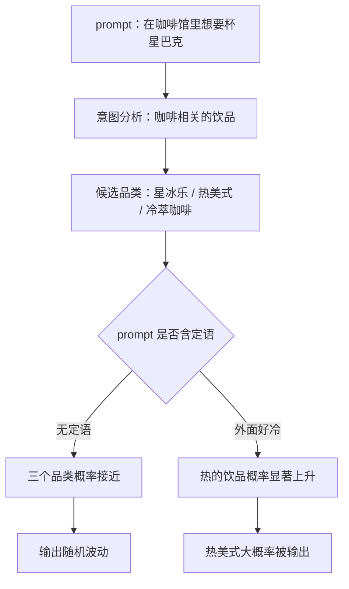

# 2-4 大模型的回应咋就这么体贴呢

## 【学习目标】

- 复述意图推断的收尾步骤：关键词语的突出特征求共同参数。
- 解释同一 prompt 两次输出不同的原因：候选答案概率接近时结果随机波动。
- 说明「体贴」的本质：概率分布决定输出，定语会重新分配概率。

## 【正文】

### 一、意图推断的最后一环：从特征到共同参数

回顾前面课程的内容：大模型把用户输入切割为一个个单词，经过第一个 Transformer 层，相关单词被组装成专有名词，「咖啡馆」即是如此；组装完成的单词再经过第二个 Transformer 层，句中关键词语被找到，在「在咖啡馆里想要杯星巴克」中，两个关键词语是「咖啡馆」与「杯」；「杯」还被判定为量词而非名词。

关键词语确定之后，如何推断出用户的真实意图？底层逻辑是向量空间。

「咖啡馆」在向量空间里有唯一的坐标，「杯」也有唯一的坐标。坐标不是空点，它包含单词的突出特征，即向量参数。「咖啡馆」坐标里的参数都与咖啡馆的突出特征相关：喝咖啡的地方、小资喜欢去的地方、有慕斯蛋糕。这些特征在其他场所，例如酒吧，并不具备。同理，「杯」的坐标里装着「指代喝的东西」这一突出特征。

「在其他场所并不具备」这句话点出了向量参数的价值：参数越独特，坐标越能把一个词同其他词分开。酒吧也有酒、有音乐，但没有「慕斯蛋糕配咖啡」这组参数组合，于是酒吧的坐标与咖啡馆的坐标必然分开。正是这种可分性，让后面的「取共同参数」有了立足点，如果所有场所的参数都差不多，交集也就无从谈起。

大模型从关键词语的突出特征中找出共同参数，完成意图推断：「杯」的突出特征是喝的东西，「咖啡馆」的突出特征与咖啡相关，二者交集即「与咖啡相关的喝的东西」，用户真正想要的就是一杯咖啡相关饮料。

为什么「取共同参数」这一步能成立？因为向量空间里的距离度量让「共同」变得可计算：「咖啡馆」的坐标与「杯」的坐标各自覆盖一片特征区域，两片区域的交叠处，就是同时被两个关键词语支持的候选含义。慕斯蛋糕在「咖啡馆」的区域内，但不在「杯」的区域内，交叠处没有它，于是被排除。整段推断没有任何玄学，全是坐标运算。

以上便是大模型推断用户真实意图的全过程，也是许多人好奇的问题的答案：大模型为什么知道我们想要什么，为什么很懂我们。只有真正了解了用户意图，大模型的输出才有意义。

### 二、输出环节：一场概率的游戏

意图明确之后，输出什么？与咖啡相关的饮料有很多品种：星冰乐、热美式、冷萃咖啡。大模型会输出哪一个？

候选集合从哪来？回到向量空间：与「咖啡相关的喝的东西」这一意图距离近的饮品，构成候选集合，星冰乐、热美式、冷萃咖啡都在其中，牛奶、汽水则被意图挡在门外。候选集合由意图决定，集合内部谁被选中由概率决定，这是两个独立的环节。这也解释了为什么用户换一个说法（比如「来杯摩卡」），候选集合会跟着变，意图的向量位置变了，邻近的饮品自然不同。

由于用户的 prompt 里没有任何定语，只是想要杯咖啡相关饮料，几个候选品类符合提示词的程度相当，输出概率都差不多，于是结果带有随机性：第一次问，可能输出星冰乐；第二次用同样的 prompt 再问，可能输出热美式，也可能继续输出星冰乐。同一个问题两次答案不同，不是模型出了故障，而是候选答案概率接近时，抽取结果自然飘忽。

### 三、一个定语如何改变概率

假设用户在 prompt 里加一个定语：「外面好冷，在咖啡馆里，我想要杯星巴克」。

加上「外面好冷」之后，概率分布被重新分配：大模型判断出用户可能想要杯热的咖啡相关饮料，热美式的概率上升，明显高于星冰乐、冷萃咖啡这两个偏冰的品类。此时再问，第一次大概率输出热美式；第二次以同样的 prompt 再问，很大概率仍是热美式，而不再是星冰乐或冷萃咖啡。

两种情形的对比如下：

| 情形 | prompt 特征 | 候选品类概率 | 输出表现 |
|---|---|---|---|
| 无定语 | 在咖啡馆里想要杯星巴克 | 星冰乐 / 热美式 / 冷萃咖啡概率接近 | 结果随机，两次可能不同 |
| 有定语 | 外面好冷，在咖啡馆里，我想要杯星巴克 | 热美式概率显著高于两个冰饮品类 | 大概率稳定输出热美式 |

结论很清晰：大模型的输出不是一成不变的，它依据概率来输出。定语不改变候选集合，改变的是候选集合上的概率分布，越贴合语境的候选，概率越高，被选中的机会越大。

还要澄清一点：概率「差不多」不等于「五五开」。三个品类概率接近，是相对而言；它们各自的确切数值由训练数据中的分布与当前 prompt 共同决定，模型倾向于输出概率略高的候选，只是差距小到不足以稳定压倒另外两个。一旦定语把差距拉开，「外面好冷」让「热」这一维度获得支持，略高的概率变成明显高的概率，输出随即稳定。概率思维的关键，就是把「输出什么」翻译成「哪个候选概率更高、高出多少」。

### 四、「体贴」从哪来

概率机制也解释了「体贴」的观感。例如让大模型做一份行程规划，它不只给出行程，还会顺手做成一个 Excel 表格。这背后是概率判断：用户拿到行程规划后，有较大概率希望它变成表格，课程中给出的估计是 80%，于是输出就以表格形式呈现。

换句话说，「体贴」不是模型有情绪、有眼力，而是概率分布恰好与用户的期望吻合：模型在每个备选回答形式中，选中了概率最高的那一种。当概率判断与用户心思一致，体验上就是「懂我」。

反过来也解释了一种常见体验：连续多轮追问后，模型的回答开始跑偏。每一轮追问都是新的上下文，候选集合随上下文漂移，概率分布随之重建；当新集合里各候选概率再次接近时，输出便不再稳定。这不是模型「累了」，而是概率机制在长上下文里的正常表现，上下文在变，概率也在变。

### 五、对 Agent 工程的两点启示

第一，输出不稳定是概率机制的必然结果，不是缺陷。同一个 prompt 两次结果不同，说明候选概率接近；要获得稳定输出，要么给 prompt 加约束（定语、格式要求、示例），要么在工程侧做结构化处理，把概率性的文本收敛为确定的数据结构。

第二，概率输出让测试变难。测试需要可复现的输入输出，而真实模型每次采样都可能不同，因此离线测试要用可控的替身。981-demo 正是这样设计的：`981-demo/src/main/java/com/travel/agent/model/OfflineChatModel.java` 提供一个返回固定响应的离线模型，让不依赖真实 API 的测试拿到确定性结果；切到真实模型时，概率行为由模型自身承担，工程只负责把输出接入后续流程。生产环境里，同一诉求还有更多落点：给 prompt 加示例、给输出加格式约束、给接口加重试与校验，目标只有一个，让概率性的输出变得可预期。

除此之外，课程第 13 章还会讲到结构化输出：与其接受一段概率性文本再解析，不如让模型按约定格式返回，把概率性的自然语言收敛为确定性结构。三招合起来，构成工程侧应对概率性的完整手段，prompt 约束缩小波动、结构化输出锁定格式、离线 mock 兜底测试。

| 手段 | 作用层面 | 具体做法 |
|---|---|---|
| prompt 约束 | 输入侧 | 加定语、给示例、写明格式要求，拉开候选概率差距 |
| 结构化输出 | 输出侧 | 按约定格式返回，把概率性文本收敛为确定性结构 |
| 离线 mock | 测试侧 | 用固定响应的替身模型（`OfflineChatModel`）保证测试可复现 |

## 【易错点 / 面试题】

1. **同样的问题问两次，答案不同，是模型坏了吗？** 不是。候选答案概率接近时，抽取结果自然随机。想获得稳定答案，需要给 prompt 加定语或格式约束，把概率差距拉开。
2. **「外面好冷」为什么能让输出偏向热美式？** 它没有改变候选集合（仍是那几个咖啡品类），但改变了概率分布：模型判断用户想要热的饮品，热美式的概率被抬高，冰饮品类概率被压低。
3. **大模型的「体贴」是主观故意吗？** 不是。输出是概率游戏，模型只是选中了概率最高的回答形式。行程规划输出成 Excel 表格，是因为模型判断用户有约 80% 的概率想要表格形态。
4. **面试延伸：如何让模型的输出可预期？** 三个方向：给 prompt 加定语、示例、格式要求，把概率差距拉开；用结构化输出把结果收敛为确定的数据结构；测试环境用离线 mock 模型固定输出。三者分别对应「输入侧约束」「输出侧约束」「测试侧兜底」。

## 【小结】

本节走完了「输入 → 推理 → 输出」的完整链路：关键词语的突出特征在向量空间中求共同参数，得到用户意图；意图明确后，输出由概率决定，候选概率接近时结果随机，定语重新分配概率后结果趋于稳定；「贴心」的观感，本质是概率分布与用户期望的吻合。

概率性是理解大模型行为的钥匙，也是工程设计的出发点：需要稳定就用约束收敛概率，需要测试可复现就用离线替身（`981-demo/src/main/java/com/travel/agent/model/OfflineChatModel.java` 即此角色）。至此，第 2 章关于「大模型如何听懂、如何回应」的原理部分告一段落，下一章将转向工程视角：大模型的能力边界在哪里，智能体为何必要。
