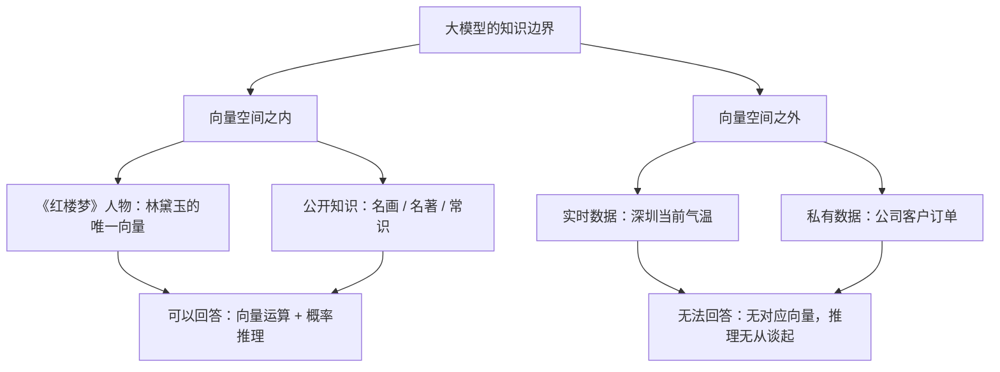

# 3-1 大模型困境：数据获取与整合上的「抓瞎」

## 【学习目标】

- 复述大模型的三大「神奇」能力，并指出它们共同的向量空间根基。
- 解释两个致命缺陷：无法获取实时数据、无法拥有用户私有数据。
- 说清缺陷的根因：向量空间中没有对应知识的唯一向量，概率推理无从谈起。

## 【正文】

### 一、大模型的三个「神奇」之处

上一章用通俗的语言解释了大语言模型的核心架构，Transformer 架构。理解它的职责之后，不难发现大语言模型有几个神奇的地方。

第一个神奇之处：它精通了人类的所有知识，古今中外、天文地理、历史文化，仿佛无所不晓。问《红楼梦》的某个角色，它能娓娓道来该角色的性格特征、结局，以及该人物在书中哪一章出现；问法国的某幅名画，它能答出作者、现藏于哪座博物馆、这幅画造成了哪些影响。

第二个神奇之处：它能像人类一样推理出用户的意图。仍用上一章的例子，「在咖啡馆里想要杯星巴克」，「星巴克」指代咖啡馆、品牌，还是咖啡相关饮料？大模型能准确推断出：在该句子的语境里，它指一杯咖啡相关饮料。

第三个神奇之处：它能根据用户的习惯调整结果的返回方式。例如用户要求以广东人的方式返回结果，它真的会像广东人一样说话，带上几句地道的广东俚语。

三个神奇之处看似各不相同，根基却是同一个：向量空间中的数学运算。知识以向量形式存着，意图推断靠向量距离，语气习惯同样来自训练数据中的分布，全部运算都发生在向量空间里。记住这一点，后面的缺陷分析就有了统一的解释框架。

### 二、一个它答不上来的问题

说到这里，问题来了：问大模型「今天深圳的天气是多少度」，它能答上来吗？

直觉上这很简单，但答案是：答不上来。

要理解为什么，先回顾它为什么能答对《红楼梦》。大模型之所以知道林黛玉的性格特征，是因为整本《红楼梦》被转换为向量喂给了它。在它的向量空间里，林黛玉这一人物有唯一的点，该点是一个向量，向量里有上百上千上万个参数，每个参数都是林黛玉的突出特征。《红楼梦》里的所有人物都在向量空间里有唯一的点，这些向量完整勾画出人物之间的关系。大模型通过在向量空间中做数学运算，才能把人物性格、人物关系娓娓道来。

反过来推：一个问题能被回答，前提是它的答案在向量空间里「有迹可循」，要么有一个向量直接指代答案（林黛玉的性格），要么有一组向量能通过距离运算拼出答案（星巴克指咖啡）。两个条件都不满足时，模型只能基于概率「猜」，而猜实时数值恰好猜对，概率低到没有工程意义。

同理，它能推断用户意图，是因为它能在输入中找到关键词语，再依据这些关键词语在向量空间中的位置，找出与它们距离近的物品、事件，通过概率运算推断意图。大模型所有的运算都发生在向量空间里，如果向量空间中没有唯一的点指代某个事件或物品，它根本推理不出来。

而「深圳当前的气温」该数值，在大模型的向量空间里没有任何一个唯一向量指代它。所以它答不上来。这揭示了大模型一个致命的缺陷：**无法获取时效性数据**。

这里要区分「训练时见过」与「此刻为真」。《红楼梦》写完了，人物关系不再变化，训练时灌入的向量长期有效；气温每时每刻都在变，训练时见过的旧气温，不构成对当前气温的指代，向量空间里根本没有「此刻几度」这一个点。时效性数据的共性是：公开、可查，但随时间流动，训练快照追不上它。

### 三、第二个缺陷：私有数据同样够不着

再进一步。有人想让大模型帮忙把公司的客户订单数据整理成季度销售报告，它能完成吗？

同样完成不了。因为大模型的向量空间里，没有任何一个向量指向该用户私人的客户订单数据。问它公开数据，巴黎的某幅名画、四大名著里某个人物的台词，它答得上来；但问某个公司自己的数据，它无能为力。这是第二个致命缺陷：**无法拥有用户的个人数据**。

私有数据的问题比时效性更根本：它不是「追不上」，而是「从未进去过」。公司的客户订单、个人的聊天记录、内部的财务报表，这些数据从未进入训练，向量空间里连一个点都不存在。让大模型整理季度销售报告，等于要求它依据不存在的数据做推理，结果只能是编造或拒绝。顺带一提，私有数据往往还敏感，客户订单涉及商业机密，个人记录涉及隐私，课程第 13 章「敏感资源处理方案」讲的正是如何在Agent 协作中守住这条线。

两个缺陷并列：

| 缺陷 | 表现 | 根因 |
|---|---|---|
| 无法获取实时数据 | 问「深圳现在几度」答不上来 | 向量空间中没有指代当前气温值的唯一向量 |
| 无法拥有私有数据 | 整理不了自己公司的订单数据 | 向量空间中没有任何向量指向用户的私人数据 |

注意二者的区别：实时数据是「公开但会变化」，模型训练时见过的旧值不构成对当前值的指代；私有数据是「从未进入训练」，向量空间里连点都没有。表现不同，根因相同，向量空间中缺少对应知识的唯一向量。

这两个缺陷直接决定了智能体的工程形态。既然模型自己看不到实时数据，就需要工具在调用时把数据取回来；既然模型接触不到私有数据，就需要在调用时把数据送进上下文。第 11 章主管 Agent 调度路线制定专员查询实时路况、第 12 章 Skills 装载专业知识，做的都是同一件事：补上「数据获取与整合」这一环。

### 四、出路：把数据搬进模型的上下文

既然运算必须发生在向量空间，解法就不是「把数据训练进模型」，而是在调用时把外部数据送进上下文。这正是智能体路线相对纯对话路线的核心增量：用工具把向量空间之外的数据取回来，交给模型参与推理。

「送进上下文」有三种典型形态，课程后续逐一展开：其一，工具调用，模型按 API 文档生成调用参数，取回实时数据；其二，MCP 服务，把外部能力封装成标准工具，模型按需取用；其三，Skills，把专业知识与工作流程以文件形式装配给 Agent。三者的共性是：数据在调用时抵达模型眼前，而不是在训练时进入模型权重。

本课程后续章节即是这一思路的完整落地：第 11 章中，路线制定专员 Agent 挂载百度地图 MCP 服务，实时查询路况、制定路线，天气、路况这类时效性数据，由 MCP 工具在调用时取回；景点信息等垂直数据，由景点工具直接提供。981-demo 中可以看到对应的离线实现：`981-demo/src/main/java/com/travel/agent/tool/RouteMakingTools.java` 与 `AttractionTools.java` 用固定数据模拟外部数据源，验证「外部数据进上下文 → 模型据此推理」这条链路。

沿着课程的编排，这条线索后面会分几步走实：先用函数调用让模型学会「按 API 文档调外部接口」取实时数据，再用 MCP 把工具调用标准化，最后用 Agent Skills 管理专业知识与工作流程。每一招解决的都是本章的两个缺陷，把向量空间之外的数据，在调用时搬到模型眼前。

可以说，第 2 章讲的是模型如何「想」，本章开始讲模型如何「看到」，数据获取与整合，是智能体区别于聊天机器人的第一道分水岭。判断一个系统是「聊天机器人」还是「智能体」，就看它能否在调用时把向量空间之外的数据取回来：取不回来，答案只能来自训练快照；取得回来，答案才能来自当下的事实。

## 【易错点 / 面试题】

1. **大模型为什么答不上「现在几度」？** 它的全部运算在向量空间中进行，而当前气温值在向量空间中没有唯一向量指代，概率推理无从谈起。这不是模型不够聪明，是知识边界之外无从推理。
2. **两个致命缺陷可以合并成一句话吗？** 不宜合并。「无法获取实时数据」指公开但随时间变化的数据；「无法拥有私有数据」指从未进入训练的用户自有数据。场景不同，根因相同，向量空间缺向量。
3. **面试延伸：怎么让大模型用上公司订单数据？** 不要在对话里指望它知道，也不要把整库数据塞进训练；正确路线是调用时把数据送进上下文，工具调用、MCP 服务都是这一思路的工程形态，后续章节会逐一展开。
4. **追问：把旧数据训练进去，能解决时效性问题吗？** 不能。训练解决的是「有没有对应向量」，时效性问题问的是「该向量此刻还准不准」。气温在变，训练快照里的旧向量指代不了当前值；只有调用时实时取数才对得上「此刻」。

## 【小结】

本章从大模型的三个「神奇」之处出发，反推出它的两个致命缺陷：无法获取实时数据、无法拥有用户私有数据。根因都指向同一处，向量空间中没有对应知识的唯一向量，运算与推理便无从谈起。对应的解法也由此确定：把向量空间之外的数据，在调用时搬进模型的上下文。

下一节将沿着这条线索继续：数据有了，如何组织与整合，智能体还需要哪些外部能力。想看「外部数据进上下文」的代码级实现，可对照 981-demo 的 `tool` 包（`RouteMakingTools.java`、`AttractionTools.java`），它们用离线固定数据复刻了这条链路；更完整的「多 Agent + 工具 + 注册发现」体系，可继续对照 981-demo 的 `agent` 与 `a2a` 两个包。
