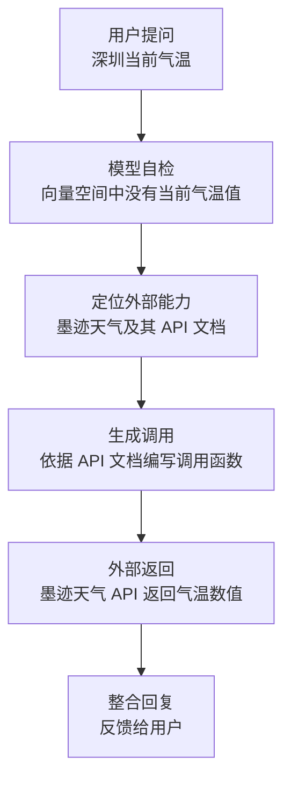

# 3-2 困境解决方案：函数调用( Function Calling )

## 【学习目标】

- 回顾大模型的两个致命缺陷：无法获取实时数据、无法拥有用户私有数据。
- 看清旧做法（人工调用外部 API、人工喂文档）的三个死结：重复开发、接口易变、维护成本全压在人身上。
- 建立 Function Calling 的核心思路：由模型自主判断是否需要外部数据，并依据 API 文档自行生成调用。
- 理解 Function Calling 的初步定位，模型内部一段能调用外部 API 的程序，为后续两篇的机制拆解铺路。

## 【正文】

### 一、问题回顾：一个「无所不能」的模型，一个答不上来的问题

看上去无所不能的大模型，遇到一个很基础的问题却会卡壳：当前时刻深圳的气温是多少度？

答案不在模型手里。当前气温是一个随时间流动的数值，在向量空间中没有任何向量指代它，上一篇已经论证过，凡是向量空间里没有唯一对应向量的知识，概率推理便无从谈起。这就是第一个致命缺陷：**无法获取实时数据**。

旧做法有两条路。要么让模型直接回答「我没有当前时刻的数据」，把用户拒之门外；要么由人工调用外部 API 取回实时数据，再反馈给模型或用户。第二条路看似可行，细看全是死结。

先看气温：人工调用一次墨迹天气的 API，取回当前气温，眼前的问题解决了。但用户不会只问气温。他还想问实时湿度、实时股票行情、实时交通状况。每一种数据，是否都要人工专门编写一个调用程序？更棘手的是，API 文档会变，接口地址调整、参数增减、返回结构改动，每次变更都要人工重新对接。把模型与外部数据之间的每一趟搬运都压在人身上，有三个绕不开的死结：

| 死结 | 表现 | 后果 |
|---|---|---|
| 重复开发 | 每类外部数据都要单独写调用程序 | 工作量随需求种类线性增长 |
| 接口易变 | 第三方 API 文档随时可能调整 | 人工跟进改动，维护成本持续累积 |
| 角色错位 | 数据搬运由人完成，模型只出结论 | 模型沦为问答机，整套流程称不上人工智能 |

最后一问最尖锐：如果实时数据始终靠人工搬进模型眼前，这套系统还叫人工智能吗？模型的核心价值是推理，让推理引擎去干体力活，是对资源的错配。

把视野拉开一点，「模型与外部数据的关系」其实经历了三个阶段：第一阶段是纯人工，用户自己查数据、自己拼答案；第二阶段是半自动，人工写好调用程序，模型或用户触发执行；第三阶段才是本节的主题，模型自主判断需求、自主生成调用。三阶段的分水岭在同一个问题上：**判断需求的人是谁**。前两个阶段是人，第三阶段换成模型。Function Calling 的全部意义，就是把这一判断权交还给模型。

| 阶段 | 谁判断需求 | 谁执行调用 | 人的角色 |
|---|---|---|---|
| 纯人工 | 人 | 人 | 全程参与 |
| 半自动 | 人 | 程序 | 写程序、触发执行 |
| Function Calling | 模型 | 模型生成并驱动调用 | 定义工具、维护文档 |

### 二、新思路：让模型自己判断、自己生成调用

正确的思路是把方向倒过来：由模型自主分析用户需求，判断是否需要获取外部实时数据；若需要，模型依据外部 API 文档自行编写调用函数，取回数据后整合进回复。

以「当前时刻深圳的气温是多少度」为例，完整链路分六步：

1. **用户提问**：询问深圳当前气温。
2. **模型自检**：向量空间中没有当前气温值，无法直接作答，但能判断出需要借助外部数据。
3. **定位外部能力**：模型的知识中有一个向量指向能提供实时数据的第三方应用，墨迹天气，且模型持有墨迹天气最新的 API 文档。
4. **生成调用**：依据 API 文档编写调用函数，把「深圳」作为参数传入，向墨迹天气发起调用。
5. **外部返回**：墨迹天气 API 返回深圳当前的气温数值。
6. **整合回复**：模型把实时气温整合进回复，反馈给用户。

关键一跃在第四步：模型能依据 API 文档自行编写 API 调用函数。该过程称为 **Function Calling**，中文译作函数调用。初学阶段，先把它理解为「一段能够调用外部 API 的程序」，一个寄居在模型内部、替模型跑腿的执行体。

这层思路的分量在于：它把「判断需求」与「执行调用」都收进了模型一侧。用户只提需求，中间的数据获取由模型自主完成，人从搬运工的位置上退下来。

这里有一个容易被忽略的前提：模型凭什么能「依据 API 文档编写调用函数」？答案在于 API 文档的契约属性。一份规范的 API 文档写明了接口地址、请求方法、参数名称与含义、返回结构，这些信息对模型而言是结构化程度很高的文本，足以支撑它生成一次正确的调用。反过来说，如果一份 API 文档写得含糊，参数含义模棱两可，模型生成的调用就会频频出错。课程第 4 章会把这层前提落到代码：工具方法通过 `@Tool` 注解的 `description` 说明自身用途，通过 `@ToolParam` 说明每个参数的含义，描述写得越准，模型填参越稳，工具描述的质量直接决定调用成功率。

### 三、第二个缺陷，同一个解法

第二个致命缺陷是**无法拥有用户私有数据**。典型场景：用户想让模型根据自己公司的客户订单生成季度销售报告，而模型手里没有任何一份订单数据，公司的订单存在用户自己的文件与数据库里，从未进入训练，向量空间中连一个对应点都不存在。

旧做法是人工投喂：把 Excel 文件、Word 文档、PDF 文档整理好喂给模型，模型才能依据这些材料生成报告。三个老问题原样复发：哪些文件相关，人来判断；文件格式变化，人来适配；数据更新，人来重喂。

同一思路照搬即可：模型判断出用户需求涉及私有数据，且这些数据存放在用户本地的文档、本地数据库或云端数据库中，便通过 Function Calling 直接调用相应资源，自主完成数据读取与操作。私有数据的获取，同样由模型自主完成。

私有数据的来源可以细分为三类，Function Calling 对三类一视同仁：本地文件（Excel、Word、PDF、Markdown）、本地数据库（MySQL、Access、HubDub）、云端数据库（阿里云、腾讯云等）。三类的接入方式不同，文件按路径读取，数据库按连接信息执行 CRUD，但模型侧的动作完全一致：判断需求、定位资源、生成调用、整合结果。差异被收拢到工具一侧，模型不必关心数据究竟躺在文件里还是数据库里。

### 四、定位：Function Calling 是什么

到此可以给 Function Calling 下一个初步定义：它是模型内部的一段程序，能够帮助模型自主调用外部 API，也能调用本地文件（Excel、PDF、Word、Markdown 等），还能查询数据库，本地的 MySQL、Access、HubDub，以及部署在阿里云、腾讯云等云端的数据库。两个致命缺陷，由同一段程序兜底。

这套机制要跑起来，有三个前提条件，初学时值得逐一核对：其一，模型要知道外部存在可用工具，不知道便无从调用；其二，模型要持有工具的「说明书」，API 文档或等价描述；其三，调用参数可从用户需求中推断，用户说了「深圳」，地点参数才有值。三个前提缺一个，调用链就断一环。后续课程讲的工具注册、`description` 编写、参数注解，做的都是把这三个前提夯实。

这里要主动说明一层工程现实，避免初学者误解。课程为了建立直觉，用「模型依据 API 文档自行编写调用函数」来描述该过程；在真实工程中，调用函数由开发者预先定义并注册到框架中，模型负责的是判断是否需要调用、选择哪个工具、填充哪些参数。后续章节会看到这套机制在 Spring AI 中的落地形态：`@Tool` 注解标注的工具方法、`ToolCallbackProvider` 的注册方式，以及 2.0 起由 `ToolCallingAdvisor` 在 Advisor 链中驱动的工具循环。概念先行，机制随后，下一篇先拆解「谁调用、谁执行」，第 4 章再见 Spring AI 的代码落地。

## 【易错点 / 面试题】

1. **Function Calling 等于「模型自己会调 API」吗？** 分两层回答。概念层：它是模型获得自主调用外部能力的手段，解决「谁去取数」的问题；机制层：工程实现中调用函数由开发者定义，模型负责选工具、填参数，执行由框架完成。面试只答概念层会显得没写过代码，只答机制层则暴露不懂设计意图，两层都要有。
2. **为什么把 Function Calling 放在模型「内部」，而不是做成一个外部服务？** 因为它承担的是模型自主决策链条上的一环，判断需求、生成调用参数，与模型的语义理解、逻辑推理能力同源。它看似是模型自带的能力，这正是下一篇要拆解的话题：真正发起调用的到底是谁。
3. **追问：把公司订单数据训练进模型，能否替代 Function Calling？** 不能。训练解决「有没有对应向量」，私有数据的问题在于数据根本进不了训练，未授权、易变动、体量失控。调用时取数（Function Calling / MCP）才是正解。
4. **追问：Function Calling 能调用哪些外部资源？** 三类：外部 API（天气、股票、交通）、本地文件（Excel / PDF / Word / Markdown）、数据库（本地 MySQL / Access / HubDub，云端数据库如阿里云、腾讯云）。

## 【小结】

本节承接上文留下的两个缺陷，给出第一套解决方案。旧做法靠人工在模型与外部数据之间搬运，重复开发、接口易变、维护成本全压在人身上，方向就是错的。Function Calling 把方向倒转过来：由模型自主判断是否需要外部数据，并依据 API 文档生成调用，实时数据与私有数据由此都有了自主获取的通道。它被定位为模型内部一段能调用外部 API 的程序，两个缺陷，一个程序兜底。

这只是方案的第一版。下一篇继续追问：第三方应用的 API，究竟是谁调用的？为什么不是大模型直接调，而要经过 Function Calling 中转？看清这一层，才能理解 MCP 出现的必然性。想提前看到工程侧的对应物，可对照 981-demo 的 `tool` 包，`981-demo/src/main/java/com/travel/agent/tool/RouteMakingTools.java` 与 `AttractionTools.java` 用 `@Tool` 注解定义了地图与景点工具，正是「预先定义、供模型选用」这一机制的最小落地。
