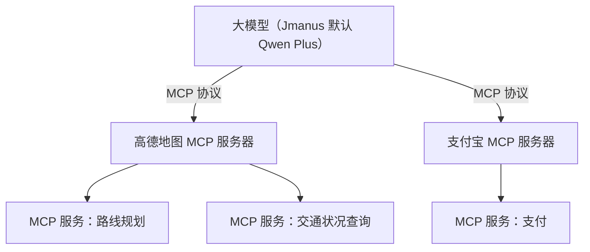
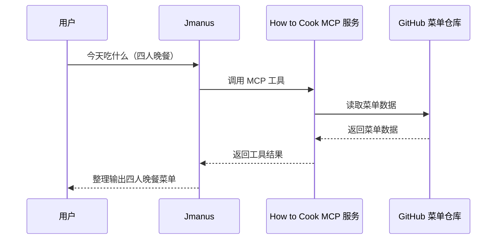

# 3-6 体验MCP：Jmanus配置MCP服务

【学习目标】

- 说清 MCP 服务器与 MCP 服务的层级关系，理解 MCP 协议要解决的核心问题。
- 独立在魔搭社区（ModelScope）MCP 广场挑选一个现成的 MCP 服务，生成连接地址。
- 在 Jmanus 工作台完成 MCP 配置（名称、连接类型、URL），并用提示词触发一次真实工具调用。

【正文】

## 1. MCP 协议要解决什么问题

经过前面课程的学习，已经建立了一个基本认知：MCP 通过它提供的工具，让大模型能够调用外部能力。例如调用百度地图 MCP 服务器提供的工具，可以进行路线规划查询、交通状况查询；调用支付宝 MCP 服务器提供的工具，则能完成付款操作。

先回顾 MCP 出现的动机。早期要让 Qwen 调用支付宝的能力，开发者必须根据支付宝的 API 文档，自己编写调用函数；换成 DeepSeek，又要根据同一份 API 文档再写一套。同一个第三方能力，每接入一个大模型就要重写一轮适配代码，重复且难维护。接入的模型与能力继续增加时，适配代码会呈「模型数 × 能力数」的组合式增长，维护成本随之失控。

MCP 协议把「如何调用」这一层标准化。从架构上看，MCP 包含三个节点：

- MCP Host：大模型端，工具调用的需求发起方；
- MCP 客户端：内嵌在 Host 中的协议客户端，负责与服务端通信；
- MCP 服务端：工具的提供方，对外暴露工具清单并执行调用。

工具统一由 MCP 服务端提供，任何接入 MCP 客户端的大模型都能直接复用同一批工具。开发者的接入成本因此从「N 个模型 × M 个能力」降为「M 个 MCP 服务端」。

| 对接方式 | 适配工作量 | 复用性 |
|---|---|---|
| 传统 API 直连 | 每个模型各写一套调用代码 | 差，接口一改全线返工 |
| MCP 协议 | 一次接入，所有支持 MCP 的模型通用 | 好，工具定义集中在服务端 |

## 2. MCP 服务器与 MCP 服务的关系

初学者最容易混淆的两个概念：

- MCP 服务器：独立运行的服务进程，是工具的承载本体。
- MCP 服务：MCP 服务器内部运行的一个个工具单元，负责具体的外部操作。

两者是容器与内容的关系。以高德地图为例：高德地图公司运行着高德地图 MCP 服务器，服务器里运行着一系列 MCP 服务工具（路线规划、交通状况查询等），大模型调用这批工具，就能使用高德地图的功能。支付宝同理：支付宝 MCP 服务器里运行着支付类的 MCP 服务工具，大模型获取并调用这批工具，就能调动支付宝完成付款。

连接建立后，MCP 客户端首先会向服务端索取工具清单，每个工具携带名称、功能描述、入参定义。这份清单进入大模型的上下文后，模型才知道有哪些工具可调、各自做什么。后续课程会将该过程拆解为「初始化 → 工具发现 → 调用 → 结果回传」四个环节细讲。



一句话记忆：MCP 服务器是承载工具的「店」，MCP 服务是店里的「工具」，大模型是「顾客」，MCP 协议是「购物规则」。关于 MCP 更深入的学习，后面课程会逐步展开。

## 3. Jmanus 工作台一览

第一章导入的 Jmanus 是一个基于 Java 的多智能体开发框架，源码目录下的启动类为 `OpenManusSpringBootApplication`，从命名即可看出它基于 Spring Boot 构建。忘记如何导入和启动的读者，可以回看第一章的内容。

直接运行该启动类，浏览器打开的是 Jmanus 的默认页面。点击进入工作台，顶部两条横杠处是工作台设置入口。设置页面包含以下几类配置：

| 设置项 | 内容 |
|---|---|
| 基础设置 | 工作台基础参数 |
| 智能体设置 | 智能体相关配置 |
| 大模型设置 | 当前默认为 Qwen Plus |
| MCP 设置 | 本节重点 |
| Prompt 提示词设置 | 提示词模板 |

其中大模型设置与第一章的阿里大模型广场 ApiKey 配置相衔接：Jmanus 默认使用 Qwen Plus，密钥来自阿里云百炼（DashScope）平台。模型负责决策「要不要调工具、调哪个」，MCP 服务负责「工具是什么、结果是什么」，两边通过工具清单在上下文里汇合。

本节聚焦 MCP 设置。进入 MCP 设置页，可以看到 MCP 服务器列表当前为空，需要手动导入一个 MCP 服务器。

## 4. 到魔搭社区挑一个现成的 MCP 服务

并不一定非要自己编写 MCP 服务器才能体验。魔搭社区（ModelScope）的 MCP 广场收录了大量现成的 MCP 服务器，按类别检索即可找到覆盖地图、支付、搜索、烹饪等场景的服务，可以直接拿来使用。后面课程会带大家手写 MCP 服务器，本节只做体验，因此挑一个门槛最低的例子：**How to Cook MCP**。

How to Cook MCP 由个人开发者提供，功能是根据其数据生成一日三餐菜单，数据来源是 GitHub 上的一个菜单仓库。相比高德地图、支付宝这类需要申请 API Key 的服务，它无需任何密钥，适合入门体验。也可以自行搜索或换成其他 MCP 服务。

配置一个外部 MCP 服务只需要两样信息：

1. **传输协议**：选择 SSE。三个选项里，STDIO 用于本机进程间通信；SSE 可以先简单理解为基于 HTTP 的流式传输，类似 WebSocket 的推送方式；第三个选项在后续课程细讲。
2. **服务地址**：有效期选 24 小时，点击「连接」生成地址，复制备用。

两样信息的分工值得记一下：传输协议决定「怎么连」，服务地址决定「连哪里」。协议选错，连接直接失败；地址失效，连接随即断开。

## 5. 在 Jmanus 控制台新建 MCP 配置

回到 Jmanus 控制台的 MCP 配置页，在 MCP 服务器列表下点击「新建 MCP 配置」，只需填写三项：

| 配置项 | 取值 | 说明 |
|---|---|---|
| MCP 服务器名称 | How to Cook | 自行命名即可，大小写只影响可读性 |
| 连接类型 | SSE | 与魔搭社区所选的传输协议保持一致；另有 Streaming HTTP、STDIO 可选 |
| URL | 粘贴刚生成的地址 | 地址 24 小时内有效 |

保存后，How to Cook 便出现在 MCP 服务器列表中，挂载完成。此时 Jmanus 已经与远端 MCP 服务器建立连接，工具清单进入上下文，具备了被大模型调用的条件。

## 6. 用提示词触发一次调用

回到魔搭社区的 How to Cook 页面，复制官方示例 Prompt「今天吃什么」，粘贴到 Jmanus 对话框并发送，实际意图是让大模型借助该 MCP 服务制作一份四人晚餐菜单。大模型最终输出如下：

```
            # 4人晚餐推荐菜单
            ## 前菜
            - 凉拌黄瓜
            - 蒜香面包
            ## 主菜
            - 红烧牛肉
            - 清蒸鲈鱼
            - 青椒肉丁
            - 地三鲜
            ## 粮菜
            - 米饭
            - 红糖馒头
            ## 汤品
            - 紫菜蛋花汤
            ## 甜点
            - 杨枝甘露
```

这份菜单并非大模型凭空生成。How to Cook 的数据来源于其背后的 GitHub 菜单仓库：大模型通过 MCP 工具读取仓库中的菜单数据，整理后输出为结构清晰的一日三餐清单。调用链如下：



从工程视角看，这次体验完整走通了 MCP 的四个环节：客户端连接（Jmanus 连接 MCP 服务器）→ 工具发现（工具定义进入上下文）→ 模型决策（模型决定调用哪个工具）→ 结果回传（工具数据进入回答）。其中「模型决策」一步常被误解为黑箱：模型并非随机选择，而是依据工具清单中每个工具的名称与描述做匹配，描述写得是否准确，直接决定工具被选中的概率。这也是后续课程编写 `@Tool` 注解时反复强调 description 的原因。

一条生产经验：MCP 服务地址带有 24 小时时效，相当于一枚临时凭证，不要提交进代码仓库；工程里应通过环境变量或配置中心注入。Jmanus 这类客户端在连接成功后会缓存工具列表，后续对话无需重复配置。

【易错点 / 面试题】

1. **MCP 服务器和 MCP 服务的区别是什么？** 服务器是承载工具的运行进程，服务是进程中一个个具体的工具单元。面试中常借此考察对 MCP 分层模型的理解，答混了会直接暴露只停留在 Demo 层面。可以进一步展开三节点模型：Host 发起需求、客户端负责通信、服务端提供工具，服务器与服务都处在服务端一侧。
2. **三种传输协议如何选？** STDIO 适合服务端与客户端同机的进程间通信；SSE 是基于 HTTP 的流式传输，适合远程 MCP 服务器；选错协议会直接导致连接失败。本节统一选 SSE，与魔搭社区保持一致。追问「SSE 与 WebSocket 的区别」时，要点是 SSE 只支持服务端向客户端的单向推送。
3. **如何验证输出确实来自工具而非模型编造？** 菜单内容来自 GitHub 仓库数据，而非模型臆造。工程上可通过 MCP 调用日志、工具返回值比对确认；这也是面试中「怎么降低模型幻觉」的常见追问方向，让模型基于工具返回的真实数据作答，而非放开联想。更系统的做法是给工具返回值附加结构化字段与调用链路标识，便于事后审计。

【小结】

本节走通了「选服务 → 生成地址 → 控制台配置 → 提示词触发」的 MCP 体验全链路，并厘清了 MCP 服务器与 MCP 服务的层级关系：服务器是进程级容器，服务是容器内的工具单元，两者通过工具清单向大模型暴露能力。体验之余值得建立两个工程意识：工具描述（description）的质量决定模型选工具的准确率；带时效的服务地址属于敏感凭证，必须走配置注入而非硬编码。下一篇会进一步讨论 MCP 工具调用模式的缺陷，以及 Agent Skills 如何补上「会用工具」的能力。想对照工程实现的读者，可参阅 `981-demo/src/main/java/com/travel/agent/tool/RouteMakingTools.java`：该文件以 `@Tool` 形式挂载 `map_geocode` / `map_directions` / `map_weather` 三个工具，离线桩返回与百度地图 MCP 同构的数据，保证「工具挂载 → 工具调用 → 结果回传」的链路形态与生产一致；端点与模型配置则集中在 `981-demo/src/main/java/com/travel/agent/config/AgentProperties.java` 中外部化管理。
